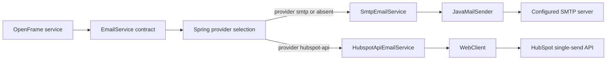
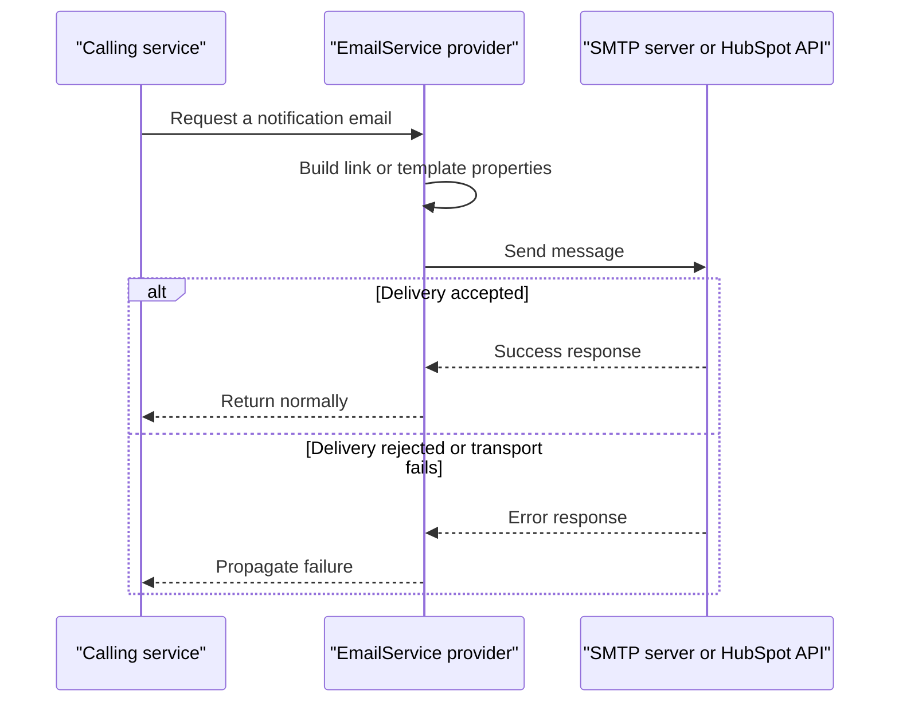

# Notification Mail

Notification Mail is the email-delivery integration supplied by the `com.openframe.oss:openframe-notification-mail` library, consumed by this OpenFrame OSS Tenant repository at version `7.0.11`. It provides two Spring services that implement the library's `EmailService` contract: an SMTP-backed default and a HubSpot single-send API provider. Provider selection is configuration-driven, so applications use the active implementation without needing transport-specific logic.

The implementation source is maintained in the [OpenFrame OSS Library](https://github.com/flamingo-stack/openframe-oss-lib/tree/7a766f00e4f58b5d89db007b878ac8d6e0c344f4/openframe-notification-mail).

## Responsibilities

- Deliver invitation and password-reset messages with links derived from configured templates.
- Deliver ownership-transfer and account-deletion notifications.
- Use HubSpot templates for email verification, download links, and custom template sends when the HubSpot provider is selected.
- Select exactly one provider through `openframe.mail.provider`, with SMTP used when that setting is absent.
- Surface transport failures to the caller rather than silently treating a failed email as delivered.

## Architecture

Both services are Spring `@Service` beans guarded by `@ConditionalOnProperty`. `SmtpEmailService` is active for `openframe.mail.provider=smtp` and also when the property is omitted. `HubspotApiEmailService` is active only for `openframe.mail.provider=hubspot-api`. Deployments should set one explicit provider value when using HubSpot, and must supply the selected provider's underlying mail or API-client configuration.

## Delivery Capabilities

| Message purpose | SMTP provider | HubSpot API provider |
|---|---|---|
| Invitation | Plain-text email using the configured invitation link template | HubSpot template with a `link` custom property |
| Password reset | Plain-text email using the configured reset link template | HubSpot template with a `link` custom property |
| Email verification | Not supported and throws an exception | HubSpot verification template with a `link` custom property |
| Ownership transfer | Plain-text email | HubSpot ownership-transfer template |
| Account deletion | Plain-text email | HubSpot account-deletion template |
| Download link | Not supported and throws an exception | HubSpot download-link template with a `download_id` custom property |
| Arbitrary template | Not exposed by this implementation | Sends a selected HubSpot template with supplied custom properties |

## Provider Components

### SMTP Email Service

[`SmtpEmailService`](https://github.com/flamingo-stack/openframe-oss-lib/blob/7a766f00e4f58b5d89db007b878ac8d6e0c344f4/openframe-notification-mail/src/main/java/com/openframe/notification/mail/service/SmtpEmailService.java) is the compatibility-oriented default provider. It depends on Spring's `JavaMailSender`, constructs `SimpleMailMessage` instances, and logs a successful send after the sender returns.

It resolves invitation links by replacing `{id}` in `openframe.invitations.link-template`, and reset links by replacing `{token}` in `openframe.password-reset.link-template`. Those templates default to empty strings when omitted, so a deployment must configure valid templates before relying on invitation or reset delivery.

Its functional boundary is deliberate: email verification and download-link emails raise `UnsupportedOperationException`. Callers that require either workflow must select the HubSpot API provider rather than assuming SMTP offers equivalent features.

### HubSpot API Email Service

[`HubspotApiEmailService`](https://github.com/flamingo-stack/openframe-oss-lib/blob/7a766f00e4f58b5d89db007b878ac8d6e0c344f4/openframe-notification-mail/src/main/java/com/openframe/notification/mail/service/HubspotApiEmailService.java) creates a `WebClient` after configuration is injected and posts to the `/marketing/v4/email/single-send` endpoint relative to `openframe.mail.hubspot.base-url`.

Each request includes the configured sender address, recipient, subject, HubSpot email-template identifier, and custom properties. It authenticates using a bearer token from `openframe.mail.hubspot.access-token`. A successful HTTP 2xx response is logged; any other response is read as text and converted into an `IllegalStateException`. The reactive call ends with `block()`, therefore sending is synchronous from the invoking thread's perspective.

The service uses separate HubSpot template IDs for invitations, password resets, email verification, ownership transfer, account deletion, and download links. The generic `send` operation supports callers that provide their own template ID and property map.

## Message Flow

## Configuration Reference

| Property | Used by | Purpose |
|---|---|---|
| `openframe.mail.provider` | Both | Selects `smtp` or `hubspot-api`; omitted selects SMTP. |
| `openframe.invitations.link-template` | Both | Invitation URL template containing `{id}`. |
| `openframe.password-reset.link-template` | Both | Password-reset URL template containing `{token}`. |
| `openframe.email-verify.link-template` | HubSpot API | Verification URL template containing `{token}`. |
| `openframe.mail.from` | HubSpot API | Sender address placed in the HubSpot message payload. |
| `openframe.mail.hubspot.access-token` | HubSpot API | Bearer token for HubSpot API authentication. |
| `openframe.mail.hubspot.base-url` | HubSpot API | Base URL used to construct the HubSpot API request. |
| `openframe.mail.hubspot.invitation-email-id` | HubSpot API | Invitation email template identifier. |
| `openframe.mail.hubspot.reset-email-id` | HubSpot API | Password-reset email template identifier. |
| `openframe.mail.hubspot.verify-email-id` | HubSpot API | Email-verification template identifier. |
| `openframe.mail.hubspot.owner-transfer-email-id` | HubSpot API | Ownership-transfer template identifier. |
| `openframe.mail.hubspot.delete-account-email-id` | HubSpot API | Account-deletion template identifier. |
| `openframe.mail.hubspot.download-link-email-id` | HubSpot API | Download-link template identifier. |

The SMTP connection, authentication, and sender settings are supplied through the standard Spring mail configuration consumed by `JavaMailSender`; they are not defined by the Notification Mail library classes shown here.

## Operational Considerations

- Treat the HubSpot access token as a secret and provide it through the deployment's secret-management mechanism.
- Keep HubSpot template identifiers aligned with the custom-property names emitted by the service: `link` for link-based messages and `download_id` for download messages.
- HubSpot debug logging includes the generated payload when debug logging is enabled. Review logging policy before enabling debug level in environments where recipient addresses or generated links are sensitive.
- Since HubSpot sends block the calling thread and non-2xx responses become exceptions, callers should decide whether a failed notification should fail the surrounding workflow or be retried by their own error-handling policy.
- Use SMTP only for the supported plain-text workflows. Selecting it for verification or download links produces an immediate unsupported-operation error.
