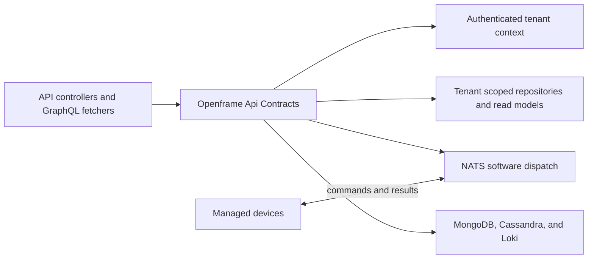
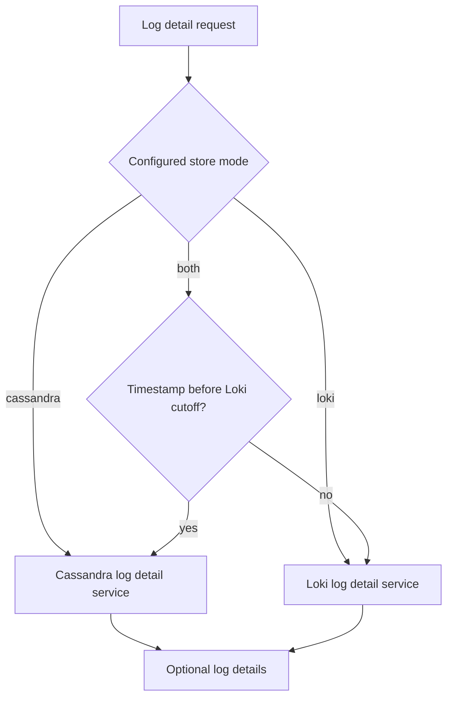
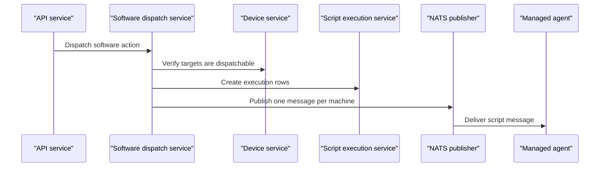
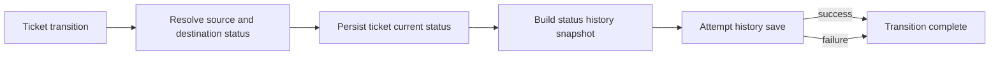

# Openframe Api Contracts

Openframe Api Contracts is the shared Java API library that supplies request and response DTOs plus application services used by the tenant API runtime. In this repository, the library is consumed as `com.openframe.oss:openframe-api-lib` version `7.0.11` and contributes its behavior to the OpenFrame API service rather than starting a service by itself.

The module establishes several important cross-service contracts:

- API-facing value objects for organizations, audit-log filtering, ticket status transitions, and software-bundle mutations.
- Tenant-aware retrieval, validation, and read-model shaping for audit logs, software inventory, and vulnerabilities.
- RMM command and software-dispatch coordination that creates persistent execution records before publishing work to agents.
- Ticket list filtering, lifecycle history, activity tracking, numbering, staleness, and aggregate statistics.
- Small extension points and defaults, including device-status processing and knowledge-base publication timestamps.

The implementation is provided by the **OpenFrame OSS Library**. The source links in this document point to that library because it owns the code executed here.

## Role in the Tenant System

Openframe Api Contracts sits between API transport components and the data, messaging, and security layers. API controllers and GraphQL data fetchers from the API service core invoke these contracts; the contracts then use tenant-scoped repositories, read models, and publishers supplied by the wider platform.

### Architectural Boundaries

| Boundary | Responsibility in Openframe Api Contracts |
| --- | --- |
| Transport | Defines DTOs and reusable application operations without exposing HTTP or GraphQL framework code in the components shown. |
| Authorization and tenancy | Obtains the active tenant through `TenantIdProvider`; ticket filter and statistics operations additionally validate administrator access. |
| Persistence | Uses repositories to query and update tickets, sequence counters, software read models, policy state, vulnerabilities, and log records. |
| Messaging | Creates durable execution state before publishing software work to device-specific NATS subjects. |
| Observability | Retrieves log detail from Cassandra or Loki according to configured storage mode and migration cutoff. |

## Functional Areas

### API Data Contracts

The DTO layer provides stable shapes that transport implementations can bind and validate.

- [OrganizationFilterOption](https://github.com/flamingo-stack/openframe-oss-lib/blob/16e7c1cbd9664e7d10ec5ebca7d53c9bd314decf/openframe-api-lib/src/main/java/com/openframe/api/dto/audit/OrganizationFilterOption.java) is an identifier and display-name pair for audit-log organization selectors.
- [AddressDto](https://github.com/flamingo-stack/openframe-oss-lib/blob/16e7c1cbd9664e7d10ec5ebca7d53c9bd314decf/openframe-api-lib/src/main/java/com/openframe/api/dto/organization/AddressDto.java) and [ContactPersonDto](https://github.com/flamingo-stack/openframe-oss-lib/blob/16e7c1cbd9664e7d10ec5ebca7d53c9bd314decf/openframe-api-lib/src/main/java/com/openframe/api/dto/organization/ContactPersonDto.java) model organization address and contact data as immutable records.
- [CreateSoftwareBundleInput](https://github.com/flamingo-stack/openframe-oss-lib/blob/16e7c1cbd9664e7d10ec5ebca7d53c9bd314decf/openframe-api-lib/src/main/java/com/openframe/api/dto/rmm/software/CreateSoftwareBundleInput.java) requires an action, bundle mode, and a nonempty collection of subject-safe machine identifiers. It also validates nested package data and optionally schedules a start time.
- [UpdateSoftwareBundleInput](https://github.com/flamingo-stack/openframe-oss-lib/blob/16e7c1cbd9664e7d10ec5ebca7d53c9bd314decf/openframe-api-lib/src/main/java/com/openframe/api/dto/rmm/software/UpdateSoftwareBundleInput.java) adds a required bundle identifier while retaining the same target and package validation rules.
- [TicketStatusTransitionRule](https://github.com/flamingo-stack/openframe-oss-lib/blob/16e7c1cbd9664e7d10ec5ebca7d53c9bd314decf/openframe-api-lib/src/main/java/com/openframe/api/dto/ticket/TicketStatusTransitionRule.java) declares one source status and its allowed destination statuses.

These types are contracts, not persistence models. Callers should preserve their validation constraints when adding new transport adapters.

### Audit Log Lookup and Device Log Admission

The log-detail services implement one lookup contract over alternate stores:

- [CassandraLogDetailsService](https://github.com/flamingo-stack/openframe-oss-lib/blob/16e7c1cbd9664e7d10ec5ebca7d53c9bd314decf/openframe-api-lib/src/main/java/com/openframe/api/service/CassandraLogDetailsService.java) builds a Cassandra composite key containing ingest day, tool and event types, event timestamp, tool event identifier, and the current tenant identifier.
- [LokiLogDetailsService](https://github.com/flamingo-stack/openframe-oss-lib/blob/16e7c1cbd9664e7d10ec5ebca7d53c9bd314decf/openframe-api-lib/src/main/java/com/openframe/api/service/LokiLogDetailsService.java) queries Loki with tenant, tool type, timestamp, and tool event identifier.
- [BothStoresLogDetailsService](https://github.com/flamingo-stack/openframe-oss-lib/blob/16e7c1cbd9664e7d10ec5ebca7d53c9bd314decf/openframe-api-lib/src/main/java/com/openframe/api/service/BothStoresLogDetailsService.java) selects Cassandra before `openframe.tool-events.loki-since` and Loki at or after that instant. The selected service is conditional on `openframe.tool-events.store`.

[DeviceLogQueryArguments](https://github.com/flamingo-stack/openframe-oss-lib/blob/16e7c1cbd9664e7d10ec5ebca7d53c9bd314decf/openframe-api-lib/src/main/java/com/openframe/api/service/device/DeviceLogQueryArguments.java) carries machine and organization identifiers, include and exclude terms, a time window, and a cursor. [DeviceLogArgumentContract](https://github.com/flamingo-stack/openframe-oss-lib/blob/16e7c1cbd9664e7d10ec5ebca7d53c9bd314decf/openframe-api-lib/src/main/java/com/openframe/api/service/device/DeviceLogArgumentContract.java) applies the pure argument rules shared by schema and admission consumers:

- At most 50 distinct nonblank machine or organization identifiers may be queried.
- Include and exclude lists allow at most five nonblank terms, each no longer than 256 UTF-16 code units.
- The requested range must be ordered, fit within 30 days, and be representable as epoch nanoseconds.
- Omitted end time defaults to validation time. Omitted start time defaults to seven days for named devices, or one day for a tenant-wide query.
- Cursors must decode to a positive signed-long timestamp when present.

`prepare` validates the request and returns normalized identifiers, effective timestamps, nanosecond bounds, and decoded cursor state. The variant that treats an empty machine list as absent is intentionally distinct from the standard variant, so a consumer must select the intended scope semantics.

### Remote Management Execution and Software Read Models

`CommandExecutionService` creates one tenant-scoped `RUNNING` execution row for each machine in a batch command. Every row shares the supplied execution identifier, records shell, privilege, timeout, initiator, and test-run state, and is persisted before later results are read back.

Script safeguards are explicit:

- `ScriptPrivilegeValidator` permits `ELEVATED_USER` only when the supported-platform list is exactly Windows.
- `ScriptTimeoutValidator` rejects nonpositive values and values above the configured script-execution maximum.

Software operations combine validation, read-model queries, catalog matching, policy state, and message dispatch:

| Component | Responsibility |
| --- | --- |
| `PackageUpdateSettingsMapper` | Allows update settings and auto-update configuration only for UPDATE actions. Defaults normal update settings to WAIT mode, a seven-day deadline, and a five-minute countdown. |
| `SoftwareDispatchService` | Verifies target devices, creates software execution rows, tokenizes arguments, and publishes a device-specific script message with a shared execution identifier. |
| `DeviceSoftwareReadModelQuery` | Produces software rows for one connected device from its installed-software projection and matching tenant software titles. |
| `TenantSoftwareReadModelQuery` | Lists and retrieves tenant software titles, affected devices, and software vulnerabilities with sorting, filtering, and paging. |
| `SoftwareCatalogStatus` | Matches installed programs to package-catalog entries, derives latest-version and version-status fields, and determines whether automatic update is available. |
| `SoftwareAutoUpdateService` | Resolves effective automatic-update state from policies, disables policies on request, and withdraws pending auto-update work after disabling. |
| `DeviceVulnerabilityReadModelQuery` | Derives CVEs for a device from its software edges and maps affected installed software. |
| `TenantCveReadModelQuery` | Paginates tenant CVEs, retrieves CVE detail and affected software, and lists affected machines. |

The sequence ensures that the platform has execution records before an agent can report outcomes. Dispatch is conditional on both cloud-stream enablement and the software RMM feature setting.

### Ticket Query and Lifecycle Services

Ticket services preserve distinct responsibilities rather than concentrating ticket behavior in a single class.

- `TicketQueryService` builds a repository query and performs cursor pagination ordered by creation time descending and then identifier descending. The cursor is the identifier of the last returned ticket.
- `TicketFilterService` validates administrator access, then concurrently resolves status, organization, assignee, and tag options. Tag values remain raw tag identifiers for GraphQL callers to encode as needed.
- `TicketIdsForFilter` translates tag and unread-message criteria into an optional ticket identifier restriction. `null` intentionally means no restriction, whereas an empty list means that no tickets match. Unread notification lookup uses a machine recipient for agent principals and a user recipient otherwise.
- `TicketNumberService` requests the next per-tenant value from the `ticket_number` sequence.
- `TicketActivityService` stamps activity and optionally marks a ticket as awaiting a client after outbound messages. Write failures are logged and do not interrupt the surrounding action.
- `TicketResolverStamp` identifies AI resolution through the synthetic `AI_AGENT` identifier; other resolutions are attributed to a technician and denormalize a display name.
- `TicketStalenessResolver` maps activity filters to per-status stale cutoffs, falling back to `openframe.tickets.staleness.default-minutes`, which defaults to 30 minutes.
- `TicketStatisticsService` produces total and per-status counts, average resolution duration, and optional rating data. It also folds custom lifecycle statuses into legacy status buckets for older clients.
- `TicketStatusHistoryMapper` snapshots status identifiers, kinds, names, actor information, and the transition reason. `TicketStatusHistoryService` saves that audit row but deliberately swallows a history-write failure so the primary transition remains successful.
- `TicketUserNames` standardizes user display and profile name derivation.

### Knowledge Base and Device Extension Points

`KnowledgeBasePublishLifecycleListener` is a Mongo lifecycle listener. On the first conversion of a knowledge-base item whose status is published, it assigns `publishedAt`. It never overwrites the timestamp, preserving the original publication moment through later unpublish, republish, archive, or unarchive cycles.

`DefaultDeviceStatusProcessor` is the fallback implementation of the device-status extension point. It logs machine status changes and is only registered when no application-specific processor exists, allowing tenant deployments to replace post-update behavior without changing this library.

## Configuration and Activation

| Setting | Effect |
| --- | --- |
| `openframe.tool-events.store` | Activates Cassandra, Loki, or both log-detail implementations. |
| `openframe.tool-events.loki-since` | In dual-store mode, determines the timestamp cutoff for Loki reads. |
| `openframe.rmm.software.enabled` | Activates software catalog and auto-update services. |
| `spring.cloud.stream.enabled` | Must be enabled alongside software RMM for software dispatch. |
| `openframe.tickets.staleness.default-minutes` | Sets the fallback stale threshold when a ticket status does not provide one. |
| Script execution maximum timeout setting | Defines the upper bound enforced by `ScriptTimeoutValidator`. |

## Maintenance Notes

1. **Preserve tenant scoping.** Services that accept a tenant identifier must pass it through to repositories, while services using `TenantIdProvider` must not accept caller-controlled tenant context as a substitute.
2. **Treat validation as a compatibility boundary.** Device log rules and software-bundle identifier patterns protect downstream query and messaging paths. Adjust limits and defaults only with corresponding schema and client compatibility review.
3. **Persist before publish.** The software dispatch ordering protects result correlation. Do not publish an execution message before execution rows exist.
4. **Keep dual-store behavior deterministic.** The audit-log cutoff is timestamp-based, not fallback-based: a lookup is routed to one configured store according to the event time.
5. **Maintain ticket-history resilience.** A ticket transition must survive a history persistence failure, but the failure should remain observable through logs.
6. **Avoid changing DTO semantics casually.** These objects are shared API contracts consumed by transport and application layers; additive changes are generally safer than field renames or altered validation.

## Source Ownership

Openframe Api Contracts executes from the OpenFrame OSS Library artifact `com.openframe.oss:openframe-api-lib` at version `7.0.11`. This tenant repository assembles the library into its API service image and publishes the tenant-facing `com.openframe:openframe-api` artifact. No downstream consumer of the published tenant artifacts is recorded in the available ecosystem inventory.
