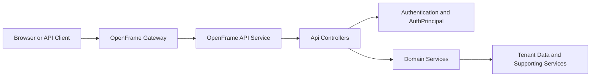
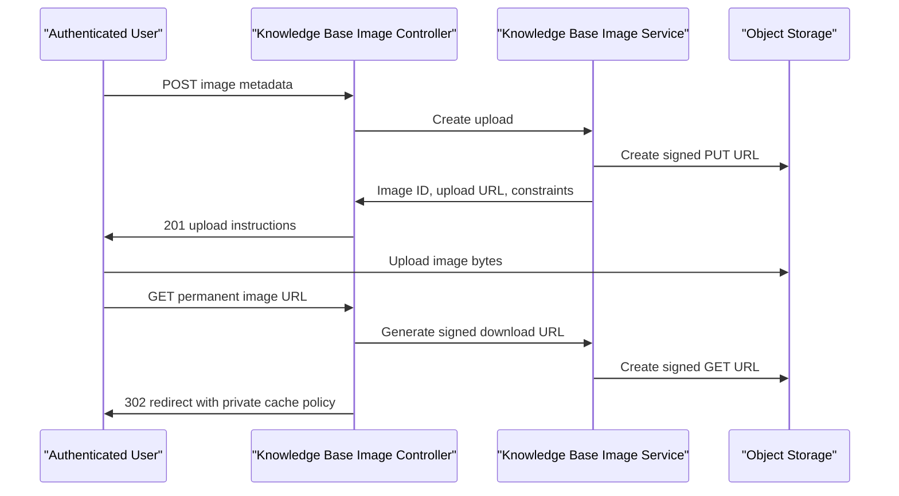
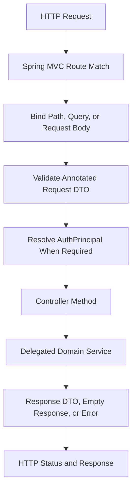

# Api Controllers

## Purpose

Api Controllers is the REST boundary supplied by the `com.openframe.oss:openframe-api-service-core` library and run by the tenant repository's OpenFrame API service. It exposes focused operational endpoints for agent bootstrap data, API-key administration, device and organization mutations, invitations, knowledge-base image delivery, user and SSO administration, release metadata, and basic service health.

The controllers are deliberately thin: they bind HTTP requests, validate request bodies where annotated, obtain the authenticated principal when needed, select HTTP status codes, and delegate domain work to services. GraphQL read functionality and the public external API are separate parts of the API service ecosystem; this module is the REST controller surface represented by the provided source files.

## Runtime Position

The tenant deployment routes requests with the `/api/**` path through OpenFrame Gateway to the OpenFrame API service. The controller mappings below are service-relative, so a deployment routed through that gateway presents them beneath the gateway API path. Authentication and principal resolution are configured outside this module; controllers that accept `AuthPrincipal` use it to scope or attribute work.

## Architectural Characteristics

- **HTTP adaptation:** Spring MVC annotations define route, verb, response status, request-body validation, request parameters, and path parameters.
- **Delegation:** business rules, persistence, authorization ownership checks, token handling, and signed-object URL creation belong to injected services rather than controllers.
- **Tenant-aware identity:** `ApiKeyController`, `MeController`, `KnowledgeBaseImageController`, and user-deletion or ownership-transfer operations obtain the authenticated `AuthPrincipal` where the endpoint needs caller context.
- **Explicit lifecycle semantics:** creation routes commonly return `201 Created`; mutations with no payload return `204 No Content`; the release-version route returns `404 Not Found` when no version exists.
- **Conditional media support:** the Knowledge Base image controller is enabled only when `storage.s3.disabled` is `false`.

## Controller Groups

### Agent and Client Operations

| Controller | Service-relative routes | Responsibility |
|---|---|---|
| [Agent Log Key Controller](https://github.com/flamingo-stack/openframe-oss-lib/blob/16e7c1cbd9664e7d10ec5ebca7d53c9bd314decf/openframe-api-service-core/src/main/java/com/openframe/api/controller/AgentLogKeyController.java) | `GET /agent/log-key` | Retrieves the current agent log key through `AgentLogKeyService`. |
| [Agent Registration Secret Controller](https://github.com/flamingo-stack/openframe-oss-lib/blob/16e7c1cbd9664e7d10ec5ebca7d53c9bd314decf/openframe-api-service-core/src/main/java/com/openframe/api/controller/AgentRegistrationSecretController.java) | `GET /agent/registration-secret/active`, `GET /agent/registration-secret`, `POST /agent/registration-secret/generate` | Returns the active or complete registration-secret set and generates a new secret. Generation returns `201 Created`. |
| [OpenFrame Client Configuration Controller](https://github.com/flamingo-stack/openframe-oss-lib/blob/16e7c1cbd9664e7d10ec5ebca7d53c9bd314decf/openframe-api-service-core/src/main/java/com/openframe/api/controller/OpenFrameClientConfigurationController.java) | `GET /openframe-client/configuration` | Returns the client configuration query result used by OpenFrame Client consumers. |
| [Release Version Controller](https://github.com/flamingo-stack/openframe-oss-lib/blob/16e7c1cbd9664e7d10ec5ebca7d53c9bd314decf/openframe-api-service-core/src/main/java/com/openframe/api/controller/ReleaseVersionController.java) | `GET /release-version` | Maps the current release version to a response DTO, or returns `404 Not Found` when no version is available. |
| [Force Agent Controller](https://github.com/flamingo-stack/openframe-oss-lib/blob/16e7c1cbd9664e7d10ec5ebca7d53c9bd314decf/openframe-api-service-core/src/main/java/com/openframe/api/controller/ForceAgentController.java) | `POST /force/...` | Dispatches targeted or all-device client updates, tool-agent installation, updates, reinstallation, client uninstallation, and feature-flag actions. |

The Force Agent Controller provides these operation families:

- `POST /force/tool-agent/install` and `/all` delegate installation for selected machines or every applicable machine.
- `POST /force/client/update` and `/all` dispatch client updates.
- `POST /force/tool-agent/update` and `/all` dispatch tool-agent updates.
- `POST /force/tool-agent/reinstall` and `/all` translate a reinstallation request into the installation-service reinstallation path.
- `POST /force/client/uninstall` and `/force/client/feature-flags` dispatch their respective commands.

### Identity, Access, and Administration

| Controller | Service-relative routes | Responsibility |
|---|---|---|
| [Api Key Controller](https://github.com/flamingo-stack/openframe-oss-lib/blob/16e7c1cbd9664e7d10ec5ebca7d53c9bd314decf/openframe-api-service-core/src/main/java/com/openframe/api/controller/ApiKeyController.java) | `GET`, `POST /api-keys`; `GET`, `PUT`, `DELETE /api-keys/{keyId}`; `POST /api-keys/{keyId}/regenerate` | Manages the current user's API keys through `ApiKeyService`. Create returns `201 Created`; delete returns `204 No Content`. The authenticated user ID is passed to every operation. |
| [Me Controller](https://github.com/flamingo-stack/openframe-oss-lib/blob/16e7c1cbd9664e7d10ec5ebca7d53c9bd314decf/openframe-api-service-core/src/main/java/com/openframe/api/controller/MeController.java) | `GET /me` | Returns identity, roles, tenant ID, and the resolved super-user flag for the authenticated user. It returns a structured `401` response if no principal is present. |
| [SSO Config Controller](https://github.com/flamingo-stack/openframe-oss-lib/blob/16e7c1cbd9664e7d10ec5ebca7d53c9bd314decf/openframe-api-service-core/src/main/java/com/openframe/api/controller/SSOConfigController.java) | `GET /sso/providers`, `GET /sso/providers/available`, and CRUD-style routes under `/sso/{provider}` | Lists enabled and available SSO providers, reads provider configuration, creates or updates configuration, toggles a provider, and deletes configuration. |
| [User Controller](https://github.com/flamingo-stack/openframe-oss-lib/blob/16e7c1cbd9664e7d10ec5ebca7d53c9bd314decf/openframe-api-service-core/src/main/java/com/openframe/api/controller/UserController.java) | `GET /users`, `GET`, `PUT`, `DELETE /users/{id}`, `POST /users/{id}/transfer-ownership` | Lists and updates users, performs soft deletion attributed to the current user, and transfers ownership. Ownership transfer has the `OWNER` authority requirement. |
| [Invitation Controller](https://github.com/flamingo-stack/openframe-oss-lib/blob/16e7c1cbd9664e7d10ec5ebca7d53c9bd314decf/openframe-api-service-core/src/main/java/com/openframe/api/controller/InvitationController.java) | `POST`, `GET /invitations`; `DELETE /invitations/{id}`; `POST /invitations/{id}/resend` | Creates, pages through, revokes, and renews invitations. Create and resend return `201 Created`; revocation returns `204 No Content`. |

### Organization and Device Lifecycle

| Controller | Service-relative routes | Responsibility |
|---|---|---|
| [Organization Controller](https://github.com/flamingo-stack/openframe-oss-lib/blob/16e7c1cbd9664e7d10ec5ebca7d53c9bd314decf/openframe-api-service-core/src/main/java/com/openframe/api/controller/OrganizationController.java) | `POST /organizations`, `PUT /organizations/{id}`, `GET /organizations/{id}/can-archive`, `PATCH /organizations/{id}/status` | Handles organization command operations and archive eligibility. It verifies that the organization exists before operations requiring an ID, converting an unknown organization into a domain `NotFoundException`. |
| [Device Controller](https://github.com/flamingo-stack/openframe-oss-lib/blob/16e7c1cbd9664e7d10ec5ebca7d53c9bd314decf/openframe-api-service-core/src/main/java/com/openframe/api/controller/DeviceController.java) | `PATCH /devices/{machineId}` | Validates an `UpdateDeviceStatusRequest` and delegates status changes by machine ID. Successful requests return `204 No Content`. |

The organization archive flow is intentionally split. `GET /organizations/{id}/can-archive` exposes a preflight query, while `PATCH /organizations/{id}/status` asks the command service to apply the requested state. The controller documentation states that archiving can result in a conflict when active devices remain linked, preserving the domain rule at mutation time.

### Knowledge Base Images and Health

| Controller | Service-relative routes | Responsibility |
|---|---|---|
| [Knowledge Base Image Controller](https://github.com/flamingo-stack/openframe-oss-lib/blob/16e7c1cbd9664e7d10ec5ebca7d53c9bd314decf/openframe-api-service-core/src/main/java/com/openframe/api/controller/KnowledgeBaseImageController.java) | `POST /knowledge-base/images`, `GET /knowledge-base/images/{id}` | Creates direct-upload instructions for an authenticated user and resolves a stable image URL to a short-lived signed download URL. |
| [Health Controller](https://github.com/flamingo-stack/openframe-oss-lib/blob/16e7c1cbd9664e7d10ec5ebca7d53c9bd314decf/openframe-api-service-core/src/main/java/com/openframe/api/controller/HealthController.java) | `GET /health` | Provides a lightweight liveness-style response with HTTP `200 OK` and the body `OK`. |

The image upload path does not carry file bytes through the controller. The upload request supplies file metadata, `KnowledgeBaseImageService` creates the image record and signed upload target, and the controller returns the permanent application image path, signed upload URL, and content-length-range header requirement. A later image request receives a `302 Found` redirect to a newly generated download URL. The redirect is privately cacheable for one minute less than the signed URL lifetime, with a minimum duration of zero minutes.

## Request Processing Flow

The common controller pattern is consistent across the module. Exact authorization rules and domain validation remain service and security concerns except where the controller explicitly enforces them.

## Maintenance Notes

- Keep controllers focused on protocol concerns. New business decisions should be implemented in the corresponding service layer and exposed through a small controller method.
- Preserve caller scoping when extending API-key and account-affecting operations: the existing design passes the authenticated principal ID to services rather than accepting it from the client.
- Apply `@Valid` to newly introduced request DTOs when they define validation constraints, matching the existing create and update endpoints.
- Treat force routes as command dispatch endpoints. Their returned response types come from the invoked force service and may represent a request accepted for downstream agent processing rather than synchronous device completion.
- The API service has adjacent GraphQL data-fetcher and data-loader modules for read models. Avoid duplicating that query surface in REST controllers without a clear REST integration requirement.
- The controller source is provided by OpenFrame OSS Library version `7.0.11` in the tenant build. Changes to controller behavior therefore belong in that library dependency unless the tenant repository updates the pinned artifact.
