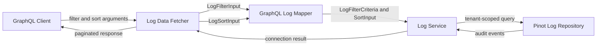
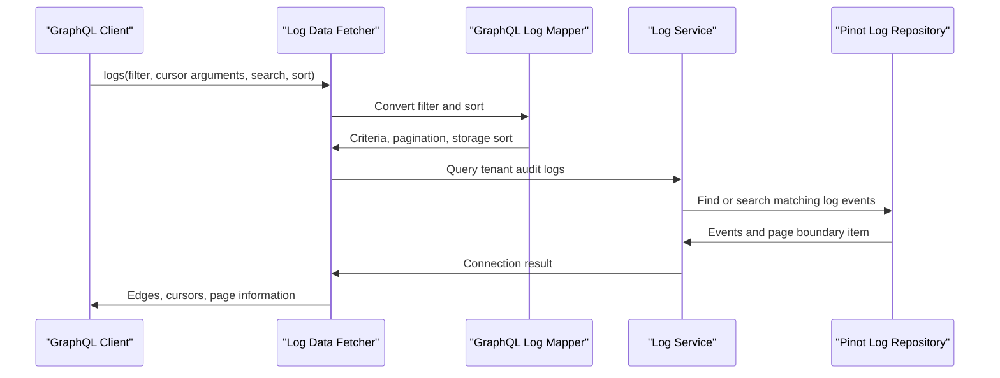

# Api Dto Audit

Api Dto Audit defines the GraphQL input boundary for querying tenant-scoped audit logs in the OpenFrame API service. The module is supplied by the OpenFrame OSS Library artifact `com.openframe.oss:openframe-api-service-core` at version `7.0.11` and is assembled into this repository's `openframe-api` service.

It deliberately contains only request-shaping types. Query execution, tenant isolation, storage access, pagination, and audit-event projection remain outside this module.

## Responsibilities

| Component | Responsibility |
| --- | --- |
| [`LogFilterInput`](https://github.com/flamingo-stack/openframe-oss-lib/blob/16e7c1cbd9664e7d10ec5ebca7d53c9bd314decf/openframe-api-service-core/src/main/java/com/openframe/api/dto/audit/LogFilterInput.java) | Accepts optional date, timestamp, categorical, organization, and device constraints for audit-log queries. |
| [`LogSortField`](https://github.com/flamingo-stack/openframe-oss-lib/blob/16e7c1cbd9664e7d10ec5ebca7d53c9bd314decf/openframe-api-service-core/src/main/java/com/openframe/api/dto/audit/LogSortField.java) | Exposes the API-level sortable field set. Currently, timestamp is the only supported field. |
| [`LogSortInput`](https://github.com/flamingo-stack/openframe-oss-lib/blob/16e7c1cbd9664e7d10ec5ebca7d53c9bd314decf/openframe-api-service-core/src/main/java/com/openframe/api/dto/audit/LogSortInput.java) | Pairs a supported log sort field with the shared ascending or descending direction. |

## Architecture

The data fetcher accepts `filter` and `sort` arguments for the `logs` query, converts them through `GraphQLLogMapper`, and delegates to the audit log service. The mapper preserves every filter field and translates `TIMESTAMP` into the storage-facing `eventTimestamp` sort field. If no sort input or field is supplied, the service uses its default ordering; if a direction is omitted, the service defaults to descending order.

## Filter Contract

`LogFilterInput` is a Lombok data class with a builder and no-argument and all-argument constructors. Every field is optional, allowing clients to progressively narrow a query.

| Field | Type | Query scope |
| --- | --- | --- |
| `startDate` | `LocalDate` | Beginning of a date-based interval. |
| `endDate` | `LocalDate` | End of a date-based interval. |
| `timestampFrom` | `Instant` | Inclusive lower bound for event timestamps. |
| `timestampTo` | `Instant` | Upper bound for event timestamps. |
| `eventTypes` | `List<String>` | Event categories to include. |
| `toolTypes` | `List<String>` | Producing tool categories to include. |
| `severities` | `List<String>` | Severity values to include. |
| `organizationIds` | `List<String>` | Organization identifiers to include. |
| `deviceId` | `String` | A single device identifier to include. |

Date fields and timestamp fields are both forwarded unchanged to the service-layer criteria object. This module does not define precedence, mutual exclusivity, or range validation between those pairs; consumers should therefore provide internally consistent intervals.

The same filter shape is also accepted by the `logFilters` query. That operation returns available tool-type, event-type, severity, and organization options constrained by the supplied filter, enabling clients to build dependent filter controls.

## Sorting Contract

`LogSortInput` carries two values:

- `field` is a `LogSortField`. The current public choice is `TIMESTAMP`.
- `direction` is the shared `SortDirection` enum from the OpenFrame API Library, with `ASC` and `DESC` values.

The API intentionally exposes a typed enum rather than a raw storage column name. `GraphQLLogMapper` maps `TIMESTAMP` to `eventTimestamp`, and the log service validates the resulting storage field before issuing the repository query. Adding a new public sortable field requires corresponding mapper and repository support, not only a new enum constant.

## Query Flow

The `logs` operation also accepts cursor pagination and an optional search term, but those are separate arguments rather than fields of Api Dto Audit. The service requests one item beyond the requested limit to determine whether a next page exists. Event cursors are based on the event timestamp and tool event identifier.

## Integration Boundaries

- **GraphQL entry point:** `LogDataFetcher` conditionally activates when `openframe.tool-events.store` is configured. It exposes `logs`, `logFilters`, and a separate `logDetails` lookup.
- **Mapping boundary:** `GraphQLLogMapper` turns these public DTOs into the library's `LogFilterCriteria` and generic `SortInput` types.
- **Service boundary:** `LogService` obtains the current tenant identifier before querying its Pinot-backed repository. The DTO's `organizationIds` restrict results inside that tenant context; it does not establish tenant identity.
- **Response boundary:** audit events, filter-option responses, log-detail responses, pagination types, and persistence models are owned by adjacent API Library and service components rather than by Api Dto Audit.

## Maintenance Notes

1. Preserve the correspondence between `LogFilterInput` and the service-layer filter criteria when adding or removing a filter field.
2. Treat additions to `LogSortField` as a cross-layer change: extend the GraphQL mapper and ensure the repository recognizes the mapped column as sortable.
3. Keep sort field names internal. Clients should send the typed API enum and direction, never storage-column identifiers.
4. Preserve the optional nature of input fields unless GraphQL validation and service behavior are updated together.
5. Verify changes against the data-fetcher and mapper tests in the OpenFrame OSS Library, because they cover DTO-to-query conversion and sorting behavior.
