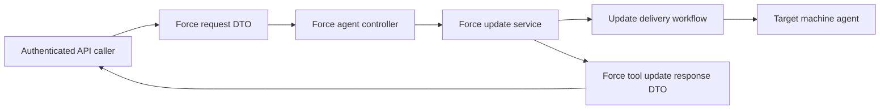
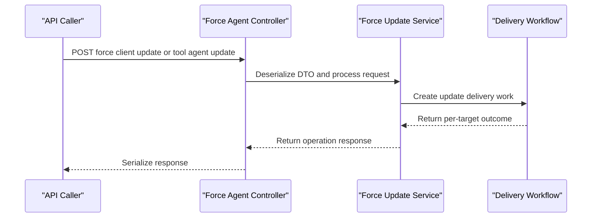

# Api Dto Force

Api Dto Force defines the small request and response contracts used by the OpenFrame API to request immediate client or integrated-tool updates for selected machines. The types are implemented by the `com.openframe.oss:openframe-api-service-core` library at version `7.0.11`, which is consumed by the OpenFrame API service in this repository.

This module is a transport boundary: it carries target identifiers and an integrated-tool identifier where required. It does not validate targets, select update artifacts, schedule delivery, or execute updates. Those responsibilities remain with the force controller and its services in the API runtime.

## Architecture Overview

The library exposes `ForceAgentController` under the `force` request mapping. Its client-update and tool-agent-update operations deserialize the request DTOs in this module, delegate to their respective services, and return an operation-specific response. The controller also supports all-machine variants, reinstall, installation, uninstall, and feature-flag operations; those use related contracts outside Api Dto Force.

## Contracts

| Contract | Direction | Fields defined by the contract | Role |
| --- | --- | --- | --- |
| [Force Client Update Request](https://github.com/flamingo-stack/openframe-oss-lib/blob/16e7c1cbd9664e7d10ec5ebca7d53c9bd314decf/openframe-api-service-core/src/main/java/com/openframe/api/dto/force/request/ForceClientUpdateRequest.java) | Request | `machineIds` | Identifies the machines that should receive a forced OpenFrame client update. |
| [Force Tool Update Request](https://github.com/flamingo-stack/openframe-oss-lib/blob/16e7c1cbd9664e7d10ec5ebca7d53c9bd314decf/openframe-api-service-core/src/main/java/com/openframe/api/dto/force/request/ForceToolUpdateRequest.java) | Request | `machineIds`, `toolAgentId` | Identifies both the target machines and the integrated tool agent to update. |
| [Force Tool Agent Update Response](https://github.com/flamingo-stack/openframe-oss-lib/blob/16e7c1cbd9664e7d10ec5ebca7d53c9bd314decf/openframe-api-service-core/src/main/java/com/openframe/api/dto/force/response/ForceToolAgentUpdateResponse.java) | Response | `items` | Returns a collection of per-item update outcomes. The element type is defined outside this module. |

All three classes use Lombok `@Data`, so the Java runtime and serialization layer receive generated getters, setters, equality methods, hash code, and a string representation.

## API Interaction

The controller maps the DTOs to the following POST operations:

| Operation | Request contract | Delegated capability | Response contract |
| --- | --- | --- | --- |
| `force/client/update` | Force Client Update Request | Force client update for explicitly supplied machine identifiers | A client-update response defined outside this module |
| `force/tool-agent/update` | Force Tool Update Request | Force one integrated tool agent update on explicitly supplied machines | Force Tool Agent Update Response |

The paths above are relative to the API service's controller mapping and do not by themselves establish public gateway routes. Consult the deployed API configuration for externally reachable routes and authorization requirements.

### Request and Response Flow

## Component Responsibilities

### Force Client Update Request

`ForceClientUpdateRequest` contains one field:

- `machineIds`: a list of target machine identifiers.

It intentionally provides no update version, rollout policy, or tool selector. Its meaning is limited to a request to force the OpenFrame client update path for the listed targets. The client-update service determines the update behavior after the controller delegates the request.

### Force Tool Update Request

`ForceToolUpdateRequest` combines two fields:

- `machineIds`: a list of target machine identifiers.
- `toolAgentId`: the identifier of the integrated tool agent to update.

The extra tool identifier is the distinction from the client update contract: a machine may have multiple managed tool agents, so the request must identify the intended tool-agent update workflow as well as its targets.

### Force Tool Agent Update Response

`ForceToolAgentUpdateResponse` contains:

- `items`: a list of `ForceToolAgentUpdateResponseItem` values.

The DTO acts as an envelope for per-target outcomes rather than declaring an aggregate success flag. Consumers should therefore inspect each returned item according to the item type's contract. Api Dto Force does not define that item type or the service logic that produces it.

## Boundaries and Maintenance Notes

- These contracts are Java objects intended for request-body binding and response serialization; they do not contain business methods or validation annotations.
- `machineIds` is modeled as a list of strings. Empty-list handling, unknown-machine behavior, deduplication, authorization, and partial-success semantics are service-level concerns not specified by these DTOs.
- `toolAgentId` is also an unvalidated string at the DTO layer. Changes to its format or meaning require coordinated changes to the downstream force-update service.
- Adding a field changes the wire contract. Preserve backward compatibility deliberately, especially for callers that serialize requests directly.
- Keep per-target result semantics in the response item type rather than inferring outcome details from the response envelope.

## Source Ownership

The code is supplied by the OpenFrame OSS Library dependency rather than being implemented directly in this repository. The OpenFrame API service assembles that library at runtime, while this repository publishes the `com.openframe:openframe-api` service artifact and corresponding container image.
