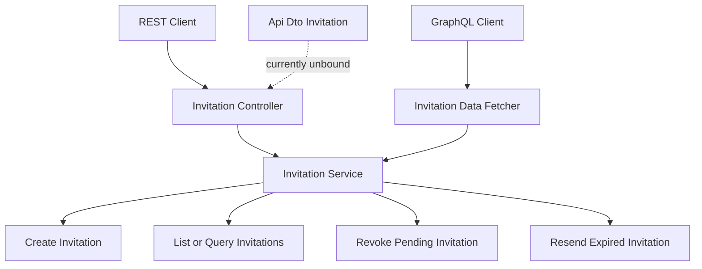
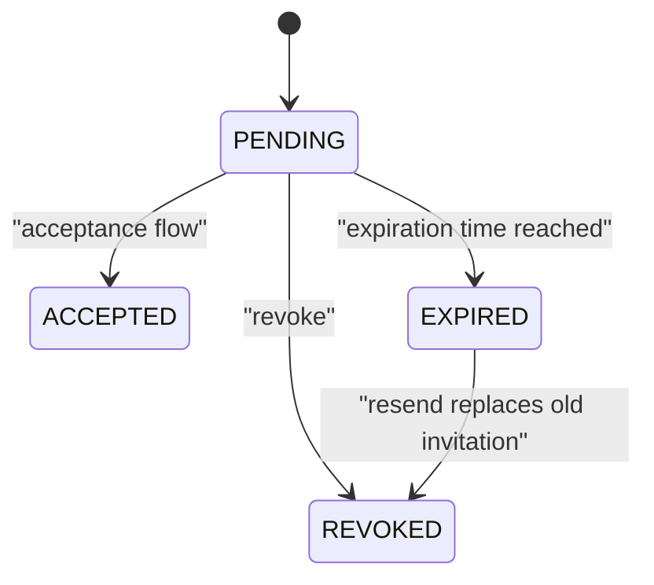
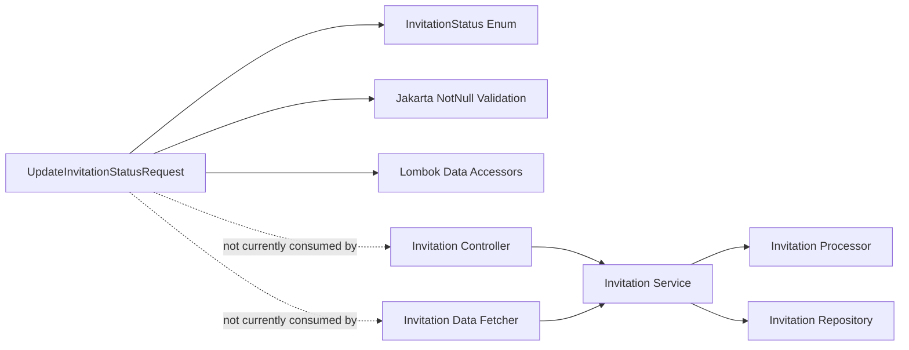

# Api Dto Invitation

Api Dto Invitation defines the request payload for changing an invitation's status in the OpenFrame API service. Its sole type, `UpdateInvitationStatusRequest`, carries a required `InvitationStatus` value. The type is implemented by the `com.openframe.oss:openframe-api-service-core` library at version `7.0.11`; this repository assembles that library into the OpenFrame API service.

> **Current integration status:** the request type has no callers or tests in the indexed organization. The active REST and GraphQL invitation interfaces create, list, revoke, and resend invitations, but do not bind this request type. It is therefore a contract definition available for a future status-update endpoint, not an active public operation.

## Source and Scope

The implementation is a small Java DTO from OpenFrame OSS Library:

- [UpdateInvitationStatusRequest source](https://github.com/flamingo-stack/openframe-oss-lib/blob/16e7c1cbd9664e7d10ec5ebca7d53c9bd314decf/openframe-api-service-core/src/main/java/com/openframe/api/dto/invitation/UpdateInvitationStatusRequest.java)
- Package: `com.openframe.api.dto.invitation`
- Runtime consumer in this repository: `openframe/services/openframe-api`
- Library: `com.openframe.oss:openframe-api-service-core:7.0.11`

The module deliberately contains no service logic, persistence access, authorization policy, or lifecycle transitions. Those responsibilities belong to invitation-facing API components and the invitation domain service.

## Contract

`UpdateInvitationStatusRequest` is a mutable Java bean. Lombok's `@Data` generates accessors and standard value methods, while Jakarta Bean Validation requires the `status` property to be present when the request is validated by a controller or another validation-aware boundary.

| Property | Java type | Required | Meaning |
|---|---|---:|---|
| `status` | `InvitationStatus` | Yes | The requested lifecycle state for an invitation. |

The `InvitationStatus` enumeration defines four wire-level states:

| Value | Interpretation |
|---|---|
| `PENDING` | The invitation is open and has not been accepted or revoked. |
| `ACCEPTED` | The invitation has been accepted. |
| `EXPIRED` | A presentation or query state for an invitation that is no longer valid by time. |
| `REVOKED` | The invitation was withdrawn. |

The DTO does not validate whether a supplied status transition is legal. `@NotNull` rejects only an absent or `null` value. Any endpoint that adopts this type must apply authorization, invitation lookup, tenant scoping, and transition rules in its service layer rather than treating payload validation as lifecycle validation.

## Architecture

The request object is at the API boundary. When integrated, it should be deserialized and validated at an HTTP or GraphQL boundary, then passed to a service that owns invitation state. The persistence implementation and the domain model are intentionally outside the DTO.

```mermaid
flowchart LR
    Client["API Client"] -->|"status payload"| Boundary["Validated API Boundary"]
    Boundary -->|"UpdateInvitationStatusRequest"| Contract["Api Dto Invitation"]
    Contract -->|"requested status"| InvitationService["Invitation Service"]
    InvitationService -->|"load and transition"| Repository["Invitation Repository"]
    Repository -->|"store invitation"| Database["Tenant Data Store"]
```

The Api Dto Invitation module itself is represented by the contract node. The remaining nodes describe the surrounding architecture supplied by OpenFrame API Service Core and its data modules, rather than code contained in this module.

## Existing Invitation Interfaces

The deployed invitation surface currently routes through `InvitationController` for REST and `InvitationDataFetcher` for GraphQL. Both delegate lifecycle operations to `InvitationService`.

REST exposes creation, paged listing, revocation, and resend operations under the invitation resource. The GraphQL data fetcher exposes invitation queries, filter counts, and mutations to invite users, revoke an invitation, and resend an invitation. Neither path currently accepts `UpdateInvitationStatusRequest`.

## Invitation Lifecycle Context

The invitation service provides the lifecycle rules that a future status-update operation would need to respect:

- New invitations are created as open invitations after email-domain policy and existing-user checks pass. An email delivery failure removes the newly saved invitation.
- Only `PENDING` invitations can be revoked. Revocation persists `REVOKED` and invokes the invitation processor hook.
- Resending requires an invitation that remains `PENDING` but whose expiration time has passed. The service creates a replacement invitation, then revokes the previous record.
- Listing excludes `ACCEPTED` and `REVOKED` records. Query-oriented views distinguish pending invitations from time-expired open invitations using the expiration timestamp.

`EXPIRED` needs special care: the service documents expiration as a `PENDING` record whose `expiresAt` has elapsed. It is not necessarily a stored transition. Consumers should preserve this distinction when designing an update operation so that a request payload cannot contradict time-derived state.

## Validation and Error Ownership

A validation-aware endpoint should annotate its request parameter with `@Valid`. With that boundary in place, a missing `status` fails bean validation before domain processing. An unknown enum token normally fails request deserialization before the DTO exists.

The following concerns are not enforced by Api Dto Invitation and must be handled by the API boundary or invitation service:

| Concern | Owning layer |
|---|---|
| Request body presence and enum deserialization | HTTP or GraphQL binding layer |
| Non-null `status` | Bean validation at the boundary |
| Caller permission | Security and authorization layer |
| Invitation existence and tenant isolation | Invitation service and repository configuration |
| Allowed source-to-target transition | Invitation service |
| Persistence and lifecycle hooks | Invitation service and repository |

## Integration Guidance

Before exposing a status-update operation, define the permitted transitions explicitly. In particular, avoid allowing arbitrary writes to `ACCEPTED`, `EXPIRED`, or `REVOKED` merely because those values are valid enum constants. The current service treats revocation and resend as dedicated operations with preconditions and side effects; a generic update path must either reuse those operations or preserve their invariants.

A suitable implementation should:

1. Bind the request with `@Valid`.
2. Resolve the invitation in the caller's tenant.
3. Authorize the caller for the requested operation.
4. Verify the current state and expiration time against an explicit transition policy.
5. Persist through the invitation service, including applicable processor hooks.
6. Return the canonical invitation representation instead of echoing only the requested value.

Because the DTO currently has no consumers, adding an endpoint or mutation is a contract activation change. Add endpoint-level validation and lifecycle tests alongside that change, including missing status, unknown status, nonexistent invitation, cross-tenant access, illegal transitions, and each permitted transition.

## Component Relationships

This separation keeps the payload stable and simple while allowing operational components to enforce the security and business rules required for invitation management.
