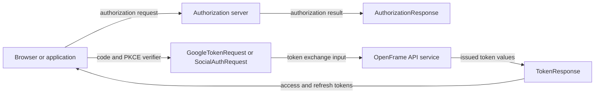
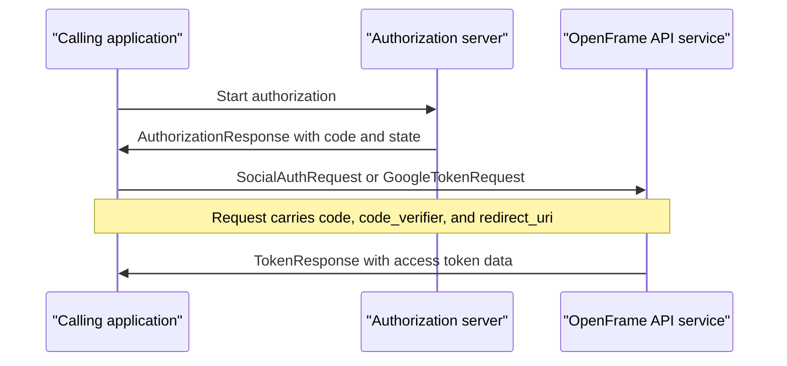

# Api Dto Oauth Oidc

Api Dto Oauth Oidc is the small transport-contract module used by the OpenFrame API service for authorization-code and token-exchange payloads. It is supplied by the `com.openframe.oss:openframe-api-service-core` library at version `7.0.11` and is assembled at run time by this repository's `openframe-api` service.

The module defines four mutable Java DTOs. They deliberately contain no endpoint mappings, authentication decisions, token signing, provider calls, or persistence logic. Those concerns belong to the API and authorization-server layers; this package establishes the JSON-shaped values passed between those layers and their callers.

## Architecture Overview

The diagram depicts the responsibility boundaries implied by the DTO names and fields. It is not an endpoint specification: the four classes do not declare routes or select an OAuth provider.

## Contract Inventory

| Contract | Direction | Purpose | Serialization detail |
|---|---|---|---|
| `AuthorizationResponse` | Authorization result | Carries a code, caller state, and redirect URI. | Uses the Java property names `code`, `state`, and `redirectUri`. |
| `GoogleTokenRequest` | Token-exchange request | Accepts an authorization code, PKCE verifier, and redirect URI for the Google-oriented request shape. | Fields are declared `code`, `code_verifier`, and `redirect_uri`. |
| `SocialAuthRequest` | Token-exchange request | Represents the same authorization-code and PKCE concepts for a general social-login request. | `codeVerifier` and `redirectUri` are explicitly mapped to `code_verifier` and `redirect_uri`. |
| `TokenResponse` | Token-exchange response | Returns access and refresh token values, their type, and lifetime. | The token fields are explicitly serialized as snake case. |

## Component Responsibilities

### Authorization Response

[`AuthorizationResponse`](https://github.com/flamingo-stack/openframe-oss-lib/blob/16e7c1cbd9664e7d10ec5ebca7d53c9bd314decf/openframe-api-service-core/src/main/java/com/openframe/api/dto/oauth/AuthorizationResponse.java) is a builder-backed response object for the result of an authorization step.

| Field | Meaning |
|---|---|
| `code` | Authorization code returned to the caller for a later token exchange. |
| `state` | Caller-correlated state value returned with the authorization result. |
| `redirectUri` | Redirect URI associated with the response. |

Lombok generates accessors and builder support. The contract itself does not validate, generate, or consume the authorization code and does not verify the state value.

### Google Token Request

[`GoogleTokenRequest`](https://github.com/flamingo-stack/openframe-oss-lib/blob/16e7c1cbd9664e7d10ec5ebca7d53c9bd314decf/openframe-api-service-core/src/main/java/com/openframe/api/dto/oauth/GoogleTokenRequest.java) is a data-bound request object with these fields:

| Field | Meaning |
|---|---|
| `code` | Authorization code being exchanged. |
| `code_verifier` | PKCE code verifier associated with the authorization request. |
| `redirect_uri` | Redirect URI supplied as part of the exchange. |

Its underscore-separated Java field names make its wire-oriented naming explicit. As a result, code interacting with this DTO uses `getCode_verifier()` and `getRedirect_uri()` rather than camel-case accessors.

### Social Authentication Request

[`SocialAuthRequest`](https://github.com/flamingo-stack/openframe-oss-lib/blob/16e7c1cbd9664e7d10ec5ebca7d53c9bd314decf/openframe-api-service-core/src/main/java/com/openframe/api/dto/oauth/SocialAuthRequest.java) models an authorization-code exchange with idiomatic Java names while retaining the snake-case JSON protocol.

| Java property | JSON property | Meaning |
|---|---|---|
| `code` | `code` | Authorization code being exchanged. |
| `codeVerifier` | `code_verifier` | PKCE verifier. |
| `redirectUri` | `redirect_uri` | Redirect URI for the exchange. |

The explicit Jackson `JsonProperty` annotations are the compatibility boundary. Refactors must retain these mappings unless every wire consumer is migrated together.

### Token Response

[`TokenResponse`](https://github.com/flamingo-stack/openframe-oss-lib/blob/16e7c1cbd9664e7d10ec5ebca7d53c9bd314decf/openframe-api-service-core/src/main/java/com/openframe/api/dto/oauth/TokenResponse.java) is a builder-backed representation of credentials issued after a successful exchange.

| Java property | JSON property | Meaning |
|---|---|---|
| `accessToken` | `access_token` | Access token returned to the caller. |
| `refreshToken` | `refresh_token` | Refresh token returned to the caller. |
| `tokenType` | `token_type` | Type associated with the access token. |
| `expiresIn` | `expires_in` | Integer lifetime value returned by the issuer. |

`expiresIn` is a primitive `int`, so it cannot represent a missing value. The DTO does not state the unit, calculate expiration, or redact token values in logs; callers must rely on their protocol and security configuration for those concerns.

## Data Flow

`AuthorizationResponse` supports the authorization-result portion of this flow. `GoogleTokenRequest` and `SocialAuthRequest` represent alternative request shapes for a subsequent exchange, while `TokenResponse` represents the returned credential payload. The actual validation, provider communication, and authorization logic are outside this module.

## Integration Boundaries

- **OpenFrame API service core:** This is the source library for all four DTOs. Its API configuration and security components provide the surrounding web application context.
- **OpenFrame authorization service core:** The authorization-server module contains the authorization-server configuration, login controllers, social provider registration strategies, and grant providers that implement authentication behavior. Api Dto Oauth Oidc does not duplicate those mechanisms.
- **OpenFrame security OAuth:** The OAuth BFF controller and redirect-target resolution live in the dedicated security OAuth library. The DTOs remain framework-light contracts rather than BFF behavior.
- **OIDC user information contracts:** The sibling OIDC DTO module contains discovery and user-information contracts. Api Dto Oauth Oidc covers authorization-code and token payloads only.

## Maintenance Guidance

1. Treat JSON property names as public protocol surface. In particular, preserve `code_verifier`, `redirect_uri`, `access_token`, `refresh_token`, `token_type`, and `expires_in`.
2. Keep secrets out of diagnostics. `TokenResponse` contains credential material, and request DTOs can include sensitive authorization artifacts.
3. Add validation and provider-specific semantics in controller or service layers instead of adding behavior to these transport DTOs.
4. Prefer a new, explicitly versioned contract when a wire-format change cannot remain backward compatible.

The available organization-wide code graph records no consumers outside the source library for these symbols. This result is complete for indexed repositories, but it does not change the need to preserve the published Maven contract for external users.
