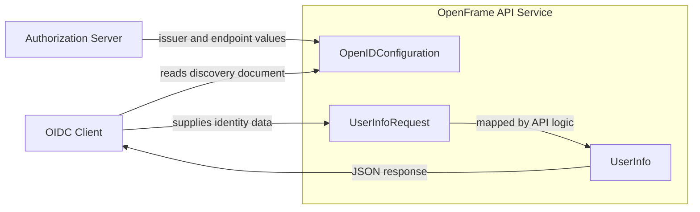
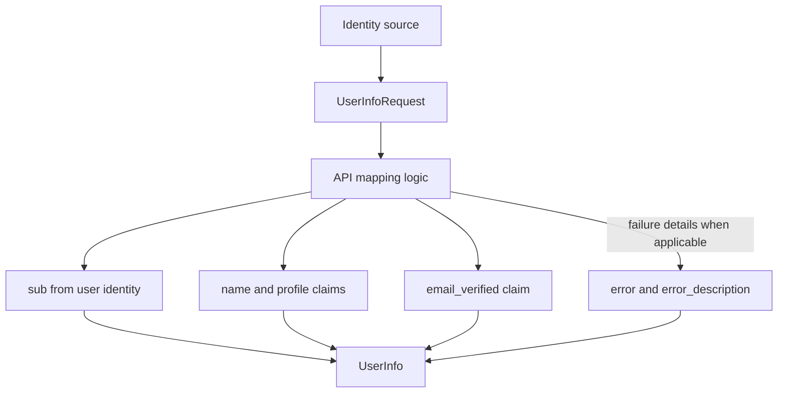

# Api Dto Oidc Userinfo

Api Dto Oidc Userinfo defines the OpenID Connect discovery, user-information input, and user-information output payloads assembled by the OpenFrame API service. It is implemented by the `com.openframe.oss:openframe-api-service-core` library at version `7.0.11`, which this repository runs through its OpenFrame API service.

The module is deliberately transport-focused: its three Lombok data classes describe JSON field names and optionality, but do not authenticate requests, publish routes, load users, or enforce authorization. Those responsibilities belong to the surrounding API and authorization-server layers.

## Architecture

The diagram expresses the DTO contract, not a routing guarantee. The classes do not declare controllers or endpoint mappings. The gateway configuration routes `/sas/**` to the authorization-server service and `/api/**` to the OpenFrame API service; deployment-specific configuration determines the externally reachable addresses.

## Components

| Component | Role | Serialization behavior |
|---|---|---|
| [`OpenIDConfiguration`](https://github.com/flamingo-stack/openframe-oss-lib/blob/16e7c1cbd9664e7d10ec5ebca7d53c9bd314decf/openframe-api-service-core/src/main/java/com/openframe/api/dto/oidc/OpenIDConfiguration.java) | Represents discovery metadata that tells an OIDC client which capabilities and endpoint URLs are available. | Converts Java camel-case properties to standard discovery names such as `authorization_endpoint` and `jwks_uri`. |
| [`UserInfoRequest`](https://github.com/flamingo-stack/openframe-oss-lib/blob/16e7c1cbd9664e7d10ec5ebca7d53c9bd314decf/openframe-api-service-core/src/main/java/com/openframe/api/dto/oidc/UserInfoRequest.java) | Carries the source identity attributes used to construct user-information claims. | Uses the Java property names `userId`, `email`, `firstName`, and `lastName`; it has no Jackson field-name overrides. |
| [`UserInfo`](https://github.com/flamingo-stack/openframe-oss-lib/blob/16e7c1cbd9664e7d10ec5ebca7d53c9bd314decf/openframe-api-service-core/src/main/java/com/openframe/api/dto/oidc/UserInfo.java) | Represents subject and profile claims, or an error payload, returned to an OIDC consumer. | Omits fields whose values are `null`; serializes standard claim and error names such as `given_name`, `email_verified`, and `error_description`. |

All three types use Lombok `@Data` and `@Builder`. Lombok generates accessors, equality methods, and builder APIs during compilation; the source files themselves contain no custom methods or validation logic.

## Discovery Metadata Contract

`OpenIDConfiguration` exposes the following groups of fields:

- **Provider identity:** `issuer` identifies the token issuer.
- **Service locations:** `authorization_endpoint`, `token_endpoint`, `userinfo_endpoint`, and `jwks_uri` identify the configured authorization, token, user-info, and signing-key locations.
- **Advertised capabilities:** `response_types_supported`, `subject_types_supported`, `id_token_signing_alg_values_supported`, `scopes_supported`, `token_endpoint_auth_methods_supported`, and `claims_supported` are lists of values the provider advertises.

The DTO does not derive or validate any of these values. Its caller must provide coherent URLs, algorithms, scopes, claims, and authentication methods that match the actual authorization-server configuration.

## User Information Mapping

`UserInfoRequest` is an internal input shape for identity values. `UserInfo` is the serialized claim and error shape. A typical mapping is shown below; the precise handling of missing values and errors is owned by the code that builds these DTOs.

### Identity Inputs

| `UserInfoRequest` field | Intended information |
|---|---|
| `userId` | Source identifier from which the response subject can be derived. |
| `email` | Email address available to the mapping layer. |
| `firstName` | Given-name source value. |
| `lastName` | Family-name source value. |

### Response Claims and Errors

| `UserInfo` field | JSON name | Notes |
|---|---|---|
| `sub` | `sub` | Subject identifier. |
| `name` | `name` | Display-name claim when supplied. |
| `email` | `email` | Email claim when supplied. |
| `givenName` | `given_name` | Given-name claim. |
| `familyName` | `family_name` | Family-name claim. |
| `emailVerified` | `email_verified` | Boolean verification-status claim. |
| `error` | `error` | Error code or category when an error representation is built. |
| `errorDescription` | `error_description` | Human-readable error detail when an error representation is built. |

Because `UserInfo` is annotated with `JsonInclude.Include.NON_NULL`, clients must treat omitted claims as absent rather than assuming empty strings, `false`, or another default. The class does not enforce mutual exclusion between claims and error fields, so builders should produce a consistent success or failure representation.

## Boundaries and Integration

The DTOs originate in the OpenFrame OSS Library, rather than this repository. The OpenFrame API application in this repository assembles `openframe-api-service-core`; the authorization-server service provides the broader OIDC and authorization context. The DTO package itself has no persistence, HTTP-client, cryptographic, or tenant-resolution dependency.

The current organization-wide code graph records no direct callers or tests for these three DTO class symbols. That observation is limited to graph-recognized direct references: framework serialization, reflection, and configuration-driven uses can exist without appearing as static callers. Maintain field names and null-handling semantics as a compatibility contract for consumers that deserialize or serialize these payloads.

## Maintenance Guidance

- Preserve the explicit `@JsonProperty` names in `OpenIDConfiguration` and `UserInfo`; changing them changes the wire contract.
- Add discovery capabilities only when the corresponding service behavior is actually available.
- Keep `UserInfo` null omission in mind when adding fields or producing errors.
- Treat `UserInfoRequest` as an internal mapping input, not as a substitute for authenticated identity verification.
- Coordinate any contract change with the OpenFrame API and authorization-server deployments, because the DTO definitions are supplied by the shared library.
