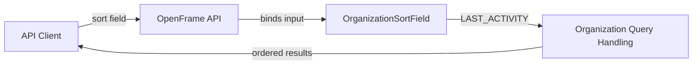
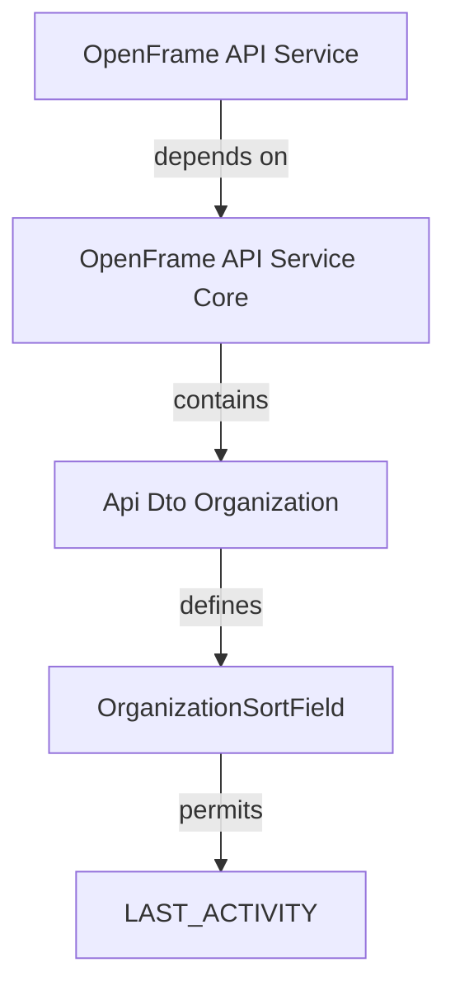
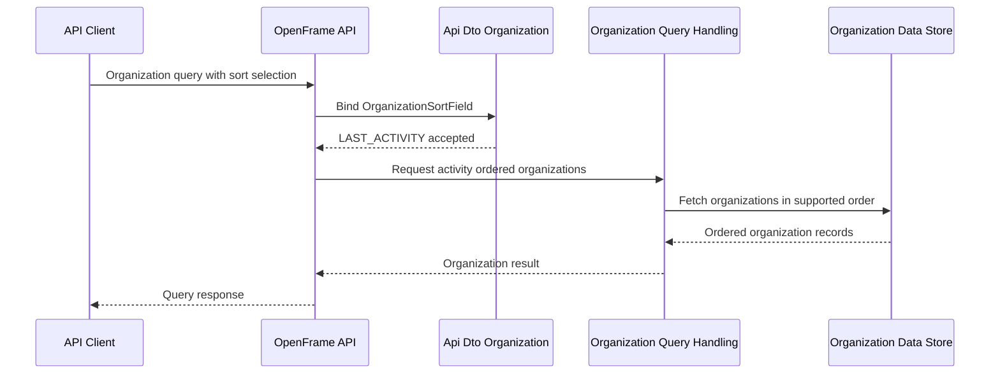
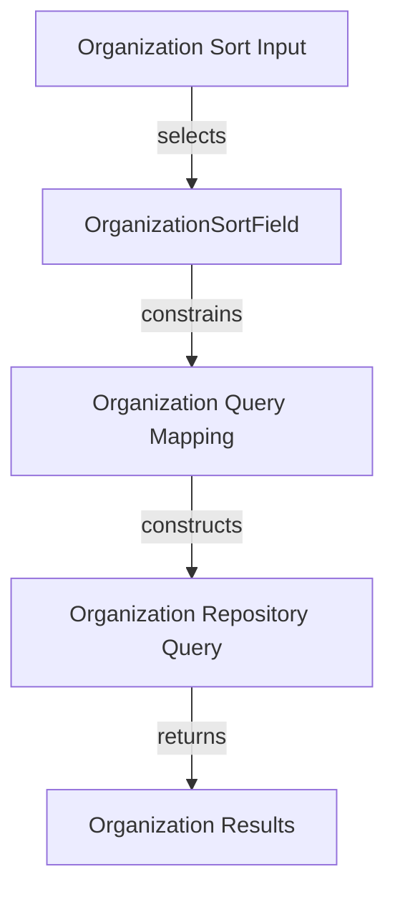
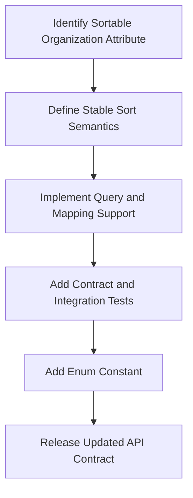

# Api Dto Organization

Api Dto Organization defines the typed sorting vocabulary used when organization data is requested through the OpenFrame API. Its sole component, `OrganizationSortField`, currently exposes `LAST_ACTIVITY`, representing the canonical organization last-activity timestamp. The small enum deliberately constrains clients to supported sort keys while leaving room to add future fields without changing an untyped string contract.

The implementation is supplied by the OpenFrame OSS Library artifact `com.openframe.oss:openframe-api-service-core` at version `7.0.11`. The tenant repository runs that artifact through its OpenFrame API service.

## Responsibilities

- Publish a GraphQL-friendly, compile-time checked organization sort field.
- Define `LAST_ACTIVITY` as the only supported organization sort key.
- Keep sort-field selection separate from sort direction, filtering, paging, organization mapping, and persistence concerns.
- Provide an additive extension point: future sortable fields require enum additions plus the corresponding mapping and query support.

## Component

| Component | Role | Current contract |
|---|---|---|
| [`OrganizationSortField`](https://github.com/flamingo-stack/openframe-oss-lib/blob/16e7c1cbd9664e7d10ec5ebca7d53c9bd314decf/openframe-api-service-core/src/main/java/com/openframe/api/dto/organization/OrganizationSortField.java) | API DTO enum | Exposes only `LAST_ACTIVITY` for organization ordering. |

The enum does not query data, interpret a sort direction, or perform authorization. It is a contract value that higher-level organization query handling can accept and translate into a supported ordering operation.

## Architecture and Placement

Api Dto Organization sits in the OpenFrame API service-core library. It is intentionally a boundary contract rather than a business-service or repository implementation. The running OpenFrame API service assembles this library with the broader API, data access, and tenant infrastructure.

## Request and Data Flow

A consumer supplies an organization sort selection as part of an API query. The API binding layer converts that value to `OrganizationSortField`; query handling uses the permitted field to select the canonical activity-based ordering. The resulting organization collection is returned to the consumer.

## Sort Contract

`LAST_ACTIVITY` is the complete public field set in the current source. Its purpose is to express a stable, canonical activity timestamp rather than expose arbitrary persistence-property names.

| Enum value | Meaning | Compatibility implication |
|---|---|---|
| `LAST_ACTIVITY` | Order organizations using their canonical last-activity timestamp. | Existing clients can rely on this symbol as the supported activity sort key. New keys should be additive and implemented end to end before being exposed. |

The enum alone does not specify ascending or descending behavior. Direction, pagination, filtering, and null handling belong to the associated organization query input and implementation layers, not to Api Dto Organization.

## Component Interaction

The surrounding interaction is a separation-of-concerns boundary:

1. The query input carries field selection and any surrounding query options.
2. Api Dto Organization limits field selection to known enum values.
3. Organization query mapping translates the selected value to query semantics.
4. Repository code applies ordering to organization data and returns the ordered result.

## Extension Process

Adding a sortable organization field is an API contract change. Implement the supporting query behavior before adding the corresponding enum constant so the API never advertises a value that cannot be fulfilled.

When evaluating an addition, confirm that the attribute is available across all relevant organization records, has a documented ordering behavior, works with pagination, and does not leak persistence-specific naming into the public API.

## Validation and Maintenance

The code-graph test references include `GraphQLOrganizationMapperTest` in the OpenFrame OSS Library, indicating that the organization GraphQL mapping is exercised alongside this contract. Because Api Dto Organization has no runtime side effects, maintenance focuses on contract alignment:

- Preserve existing enum names to avoid breaking API clients.
- Update mapping and query logic together with every new enum member.
- Add or update tests that cover binding and translation of each supported field.
- Keep the source documentation accurate: the current source explicitly states that the canonical last-activity timestamp is the only sortable field.

## Source

- [Organization Sort Field source](https://github.com/flamingo-stack/openframe-oss-lib/blob/16e7c1cbd9664e7d10ec5ebca7d53c9bd314decf/openframe-api-service-core/src/main/java/com/openframe/api/dto/organization/OrganizationSortField.java)
