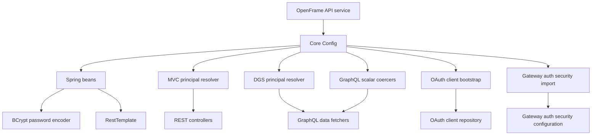
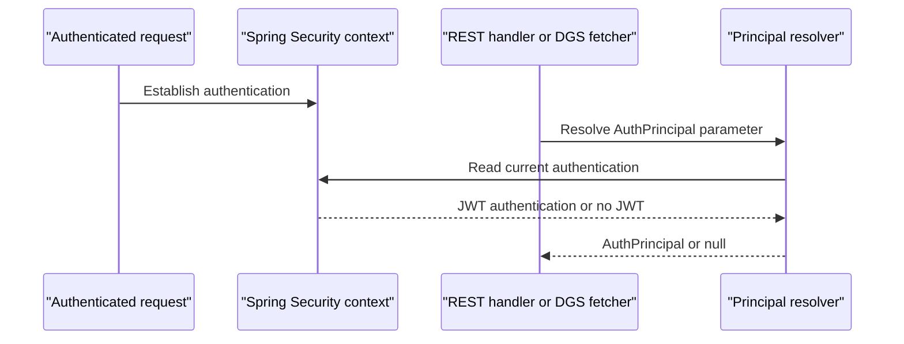
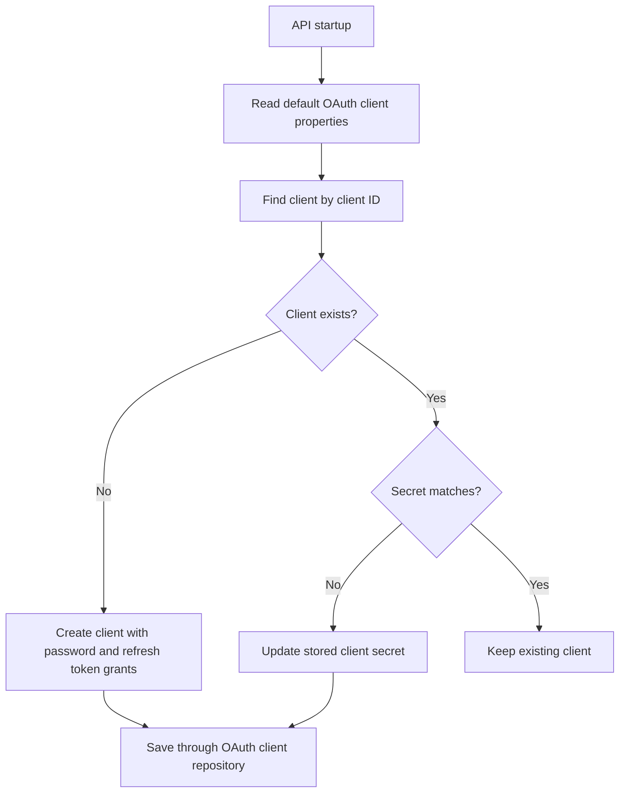

# Core Config

Core Config is the configuration layer supplied by the `com.openframe.oss:openframe-api-service-core` library and assembled at runtime by this repository's OpenFrame API service. It contributes Spring beans, MVC and GraphQL authentication-principal resolution, GraphQL scalar coercion, startup OAuth-client reconciliation, and the API security import.

The implementation belongs to the OpenFrame OSS Library rather than this repository. This repository consumes version `7.0.11` of the library and runs it in `openframe/services/openframe-api`.

## Responsibilities

- Provides a BCrypt `PasswordEncoder` and a basic Spring `RestTemplate` bean.
- Extends Spring MVC argument resolution so REST handlers can accept the platform authentication principal.
- Extends Netflix DGS argument resolution so GraphQL data fetchers have equivalent principal access.
- Registers `Date`, `Instant`, `JSON`, and `Long` GraphQL scalars with explicit input validation and serialization behavior.
- Reconciles one configured OAuth client when the API service starts.
- Imports gateway-auth security configuration into the API application's Spring context.

## Architecture

The API service supplies the application context that discovers these configuration classes. Core Config deliberately does not define HTTP endpoints or GraphQL fetchers; it equips those higher-level components with shared runtime behavior.

## Component Groups

### Application Beans

| Component | Runtime contribution |
| --- | --- |
| [ApiApplicationConfig](https://github.com/flamingo-stack/openframe-oss-lib/blob/16e7c1cbd9664e7d10ec5ebca7d53c9bd314decf/openframe-api-service-core/src/main/java/com/openframe/api/config/ApiApplicationConfig.java) | Registers a `PasswordEncoder` implemented by `BCryptPasswordEncoder`. Consumers should inject the interface rather than construct a competing encoder. |
| [RestTemplateConfig](https://github.com/flamingo-stack/openframe-oss-lib/blob/16e7c1cbd9664e7d10ec5ebca7d53c9bd314decf/openframe-api-service-core/src/main/java/com/openframe/api/config/RestTemplateConfig.java) | Registers an uncustomized `RestTemplate` for outbound synchronous HTTP calls. No timeouts, interceptors, or error handlers are configured here. |
| [SecurityConfig](https://github.com/flamingo-stack/openframe-oss-lib/blob/16e7c1cbd9664e7d10ec5ebca7d53c9bd314decf/openframe-api-service-core/src/main/java/com/openframe/api/config/SecurityConfig.java) | Imports `GatewayAuthSecurityConfig`, making the gateway-auth security setup part of the API context. |

### Principal Resolution

The REST and GraphQL execution paths use different extension mechanisms, so Core Config provides a resolver for each. Both expose an `AuthPrincipal` only when request authentication is available; GraphQL resolution returns `null` for an unauthenticated or non-JWT request.

| Component | Integration point | Behavior |
| --- | --- | --- |
| [AuthenticationConfig](https://github.com/flamingo-stack/openframe-oss-lib/blob/16e7c1cbd9664e7d10ec5ebca7d53c9bd314decf/openframe-api-service-core/src/main/java/com/openframe/api/config/AuthenticationConfig.java) | Spring MVC `WebMvcConfigurer` | Adds `AuthPrincipalArgumentResolver` for REST handler parameters. |
| [DgsAuthPrincipalArgumentResolver](https://github.com/flamingo-stack/openframe-oss-lib/blob/16e7c1cbd9664e7d10ec5ebca7d53c9bd314decf/openframe-api-service-core/src/main/java/com/openframe/api/config/DgsAuthPrincipalArgumentResolver.java) | Netflix DGS `ArgumentResolver` | Recognizes `@AuthenticationPrincipal AuthPrincipal`, reads the Spring Security context, and maps a JWT to `AuthPrincipal`. |

### GraphQL Scalar Contract

The scalar components are DGS-managed Spring components. They handle variables through `parseValue`, inline literal values through `parseLiteral`, and response values through `serialize`.

| Component | GraphQL name | Accepted input and output |
| --- | --- | --- |
| [DateScalarConfig](https://github.com/flamingo-stack/openframe-oss-lib/blob/16e7c1cbd9664e7d10ec5ebca7d53c9bd314decf/openframe-api-service-core/src/main/java/com/openframe/api/config/DateScalarConfig.java) | `Date` | Parses and serializes `LocalDate` values as `yyyy-MM-dd`. Non-string input and invalid dates are rejected. |
| [InstantScalarConfig](https://github.com/flamingo-stack/openframe-oss-lib/blob/16e7c1cbd9664e7d10ec5ebca7d53c9bd314decf/openframe-api-service-core/src/main/java/com/openframe/api/config/InstantScalarConfig.java) | `Instant` | Uses `Instant.parse` for strings and `Instant.toString` for output. Invalid timestamps are rejected. |
| [JsonScalarConfig](https://github.com/flamingo-stack/openframe-oss-lib/blob/16e7c1cbd9664e7d10ec5ebca7d53c9bd314decf/openframe-api-service-core/src/main/java/com/openframe/api/config/JsonScalarConfig.java) | `JSON` | Passes variable input and response values through unchanged. Inline JSON literals are intentionally rejected. |
| [LongScalarConfig](https://github.com/flamingo-stack/openframe-oss-lib/blob/16e7c1cbd9664e7d10ec5ebca7d53c9bd314decf/openframe-api-service-core/src/main/java/com/openframe/api/config/LongScalarConfig.java) | `Long` | Accepts numeric values, numeric strings, and integer literals, converting them to Java `Long`. It supports values beyond GraphQL `Int` range. |

The `JSON` scalar distinction matters to GraphQL callers: arbitrary JSON must be supplied as a variable, not written as an inline literal. The scalar layer throws GraphQL coercion exceptions for unsupported types and malformed values, allowing the GraphQL runtime to report invalid input consistently.

## Startup OAuth Client Reconciliation

[DataInitializer](https://github.com/flamingo-stack/openframe-oss-lib/blob/16e7c1cbd9664e7d10ec5ebca7d53c9bd314decf/openframe-api-service-core/src/main/java/com/openframe/api/config/DataInitializer.java) creates a `CommandLineRunner` that runs during API application startup. It reads `oauth.client.default.id` and `oauth.client.default.secret` from Spring's environment, then uses `OAuthClientRepository` to reconcile the record by client ID.

A newly created client is assigned the `password` and `refresh_token` grant types and the `read` and `write` scopes. Existing records retain their other fields; only the configured client secret is updated when it differs. The initializer logs the client ID and secret length, not the secret value. Deployment configuration must supply the two required properties securely and ensure that the repository is available before startup initialization runs.

## Operational Considerations

- **Authentication parity:** Add equivalent principal-resolution support whenever a new API invocation framework is introduced. MVC configuration does not automatically apply to DGS fetchers.
- **Unauthenticated GraphQL requests:** Fetchers declaring `@AuthenticationPrincipal AuthPrincipal` must treat a `null` value as unauthenticated and apply authorization rules appropriately.
- **Schema compatibility:** Changes to scalar parsing or output formatting are API contract changes. In particular, preserve the `Date` format and ISO-8601 behavior of `Instant` unless clients are migrated.
- **OAuth rotation:** Updating `oauth.client.default.secret` causes the startup runner to replace the stored secret for that configured client at the next API restart.
- **Outbound HTTP policy:** The provided `RestTemplate` is minimal. Consumers that require timeout, proxy, retry, or observability behavior must ensure that their chosen customization is compatible with the application context.

## Relationship to the Platform

Core Config is part of the API service core library, which this tenant repository consumes as `com.openframe.oss:openframe-api-service-core` version `7.0.11`. It depends at runtime on Spring Framework and Spring Security, Netflix DGS and GraphQL Java, the gateway-auth security module, and the OAuth client data repository. Controllers, data fetchers, and persistence implementations are separate concerns supplied by other parts of the OpenFrame API stack.
