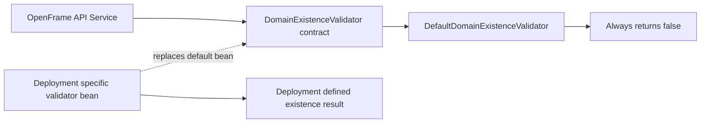
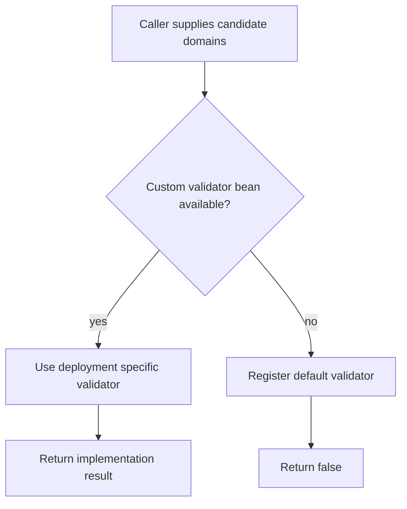

# Domain Existence Validation

Domain Existence Validation is a small extension point in the OpenFrame API service that decides whether any candidate domain is already present. It is supplied by the OpenFrame OSS Library artifact `com.openframe.oss:openframe-api-service-core` version `7.0.11` and runs in this repository's `openframe-api` service.

The module deliberately provides an OSS-safe default: its implementation reports that no supplied domain exists. A deployment that needs authoritative domain checks, such as a SaaS tenant deployment, can contribute its own `DomainExistenceValidator` bean. Spring then retains the custom validator instead of registering the default.

## Source and Scope

The module consists of two library components:

- [`DomainExistenceValidator`](https://github.com/flamingo-stack/openframe-oss-lib/blob/16e7c1cbd9664e7d10ec5ebca7d53c9bd314decf/openframe-api-service-core/src/main/java/com/openframe/api/service/DomainExistenceValidator.java) defines the validation contract: `anyExists(List<String> domains)` returns whether at least one supplied domain is known to exist.
- [`DefaultDomainExistenceValidator`](https://github.com/flamingo-stack/openframe-oss-lib/blob/16e7c1cbd9664e7d10ec5ebca7d53c9bd314decf/openframe-api-service-core/src/main/java/com/openframe/api/service/DefaultDomainExistenceValidator.java) is the conditional Spring component that implements the contract and always returns `false`.

This module does not normalize, persist, fetch, or otherwise inspect domains. Those responsibilities belong to a deployment-specific replacement validator when existence checks are required.

## Architecture

`DefaultDomainExistenceValidator` is annotated as a Spring component and guarded with `ConditionalOnMissingBean`. The condition checks for a `DomainExistenceValidator` bean while explicitly ignoring the default implementation itself. As a result, the default is available when no alternative exists, but a separately supplied implementation takes precedence without modifying library code.

## Runtime Decision Flow

The contract is intentionally boolean and aggregate-oriented. Callers pass a list and receive one answer representing whether **any** member exists. The default does not distinguish an empty list from a populated list: it returns `false` in all cases.

## Component Responsibilities

| Component | Responsibility | Key behavior |
|---|---|---|
| `DomainExistenceValidator` | Defines the API-facing abstraction for a bulk domain-existence decision. | Declares `anyExists(List<String> domains)`. |
| `DefaultDomainExistenceValidator` | Supplies the fallback Spring bean for OSS deployments. | Returns `false`; yields to a custom `DomainExistenceValidator` bean. |

## Extension Guidance

Implement `DomainExistenceValidator` in the consuming application when domain existence must be checked against tenant data, an identity provider, or another authoritative source. Register that implementation as a Spring bean. Because the library fallback is conditional, no exclusion or replacement of the library class is needed.

A replacement should preserve the aggregate contract: return `true` if at least one supplied candidate exists and `false` when none exist. It should also define its own policies for input validation, case handling, normalization, data-source failures, and empty input, because the contract and fallback do not specify them.

## System Placement

The repository publishes an `openframe-api` service that assembles the upstream API service core library. Domain Existence Validation is therefore infrastructure within that service layer rather than an HTTP endpoint or a data repository. It provides a stable seam between API workflows that need an existence decision and deployment-specific domain ownership data.

The module has no independently meaningful child sub-modules: the interface and its single fallback implementation form one inseparable extension point, so this page is the complete module documentation.
