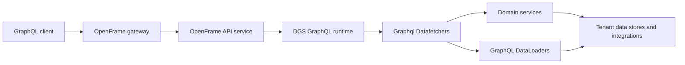
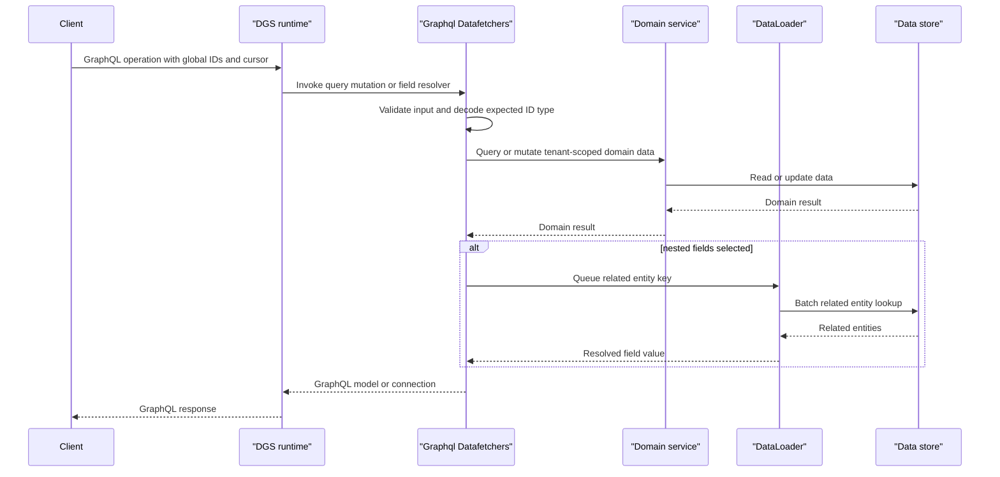

# Graphql Datafetchers

## Purpose

Graphql Datafetchers is the domain-facing GraphQL layer of the OpenFrame API. It is supplied by the `com.openframe.oss:openframe-api-service-core` library at version `7.0.11` and assembled at runtime by this repository’s `openframe-api` service. The module uses Netflix DGS annotations to expose queries, mutations, and object-field resolvers for operational data such as devices, organizations, knowledge-base content, users, assignments, notifications, audit events, packages, tools, and time tracking.

The fetchers deliberately remain thin: they validate and normalize GraphQL inputs, decode Relay global IDs, derive request-specific values from the authenticated principal, delegate domain work to services, and map service results to Relay-style connections. Field resolvers use DataLoaders where resolving a page of objects would otherwise create repeated lookups.

## Runtime Position

The tenant gateway routes the `/api/**` path to the OpenFrame API service. The service loads the library-provided fetchers alongside schema configuration, security, services, mappers, and DataLoaders. Graphql Datafetchers therefore acts as the boundary between a GraphQL operation and the underlying tenant-scoped domain services.

## Common Request Conventions

### Relay IDs and connections

Most externally supplied entity identifiers are Relay global IDs. Fetchers use `RelayIdCodec` to decode an ID only for the expected node type before calling a service. This prevents passing an identifier for one object type where another is expected. Queries that return lists commonly build `ConnectionArgs`, translate them to cursor pagination criteria, and return generic connections containing edges, page information, and, where supported, a filtered count.

### Validation, identity, and authorization

Inputs are validated with Jakarta Validation annotations. Fetchers that act for a person obtain the current JWT-backed principal and require a human user ID. Notification operations additionally enforce `ADMIN` or `AGENT` authority. Domain services remain responsible for their business authorization and state rules.

### Batched field resolution

Object fields that refer to other entities are generally asynchronous DataLoader calls. For example, device fields batch tag, tool-connection, installed-agent, organization, and unread-notification lookups; knowledge-base fields batch parent, tag, attachment, and author lookups; and time-entry fields batch user, ticket, and organization lookups. This is the module’s principal safeguard against GraphQL N-plus-one access patterns.

## Component Map

| Area | Data fetchers | Responsibility |
|---|---|---|
| Assignments | `AssignmentDataFetcher` | Assignment counts, assignment connections, assignment mutations, and assignment target resolution. |
| Device operations | `DeviceDataFetcher`, `DeviceLogDataFetcher` | Device discovery and filtering, device fields, enrollment state, and optional Loki-backed device logs. |
| Knowledge and collaboration | `KnowledgeBaseDataFetcher`, `TagDataFetcher`, `TimeEntryDataFetcher` | Knowledge-base lifecycle and attachments, tags, and time-entry timers and records. |
| Identity and tenant records | `UserDataFetcher`, `InvitationDataFetcher`, `OrganizationDataFetcher`, `NodeDataFetcher`, `PresenceDataFetcher` | User and invitation operations, organization lookup, Relay node lookup, and user-presence updates. |
| Notifications | `NotificationDataFetcher`, `NotificationSettingsDataFetcher` | Per-recipient notification inbox and read state, plus human-user notification preferences. |
| Observability and catalog | `LogDataFetcher`, `PackageSearchDataFetcher`, `ToolsDataFetcher` | Optional audit logs, package catalog lookup, and integrated-tool listing. |

## Data Flow

## Fetcher Responsibilities

### Assignment Data Fetcher

[AssignmentDataFetcher](https://github.com/flamingo-stack/openframe-oss-lib/blob/16e7c1cbd9664e7d10ec5ebca7d53c9bd314decf/openframe-api-service-core/src/main/java/com/openframe/api/datafetcher/AssignmentDataFetcher.java) manages assignments for tickets, knowledge-base items, and insights. It exposes counts and paginated assignment queries, then supports assigning, unassigning one target, or clearing all assignments of a target type.

It decodes item and target IDs using the assignment-specific Relay node mapping. Its `ItemAssignment.target` resolver dispatches by target type to organization, machine, ticket, or knowledge-base-item DataLoaders. It also resolves ticket lifecycle fields: the legacy `status` string is derived from `statusKind`, while `statusDefinition` is loaded only when the ticket has a status ID.

### Device Data Fetcher

[DeviceDataFetcher](https://github.com/flamingo-stack/openframe-oss-lib/blob/16e7c1cbd9664e7d10ec5ebca7d53c9bd314decf/openframe-api-service-core/src/main/java/com/openframe/api/datafetcher/DeviceDataFetcher.java) serves device filtering, cursor-paginated device lists, direct lookup by raw machine ID or global ID, and nickname updates. It uses the GraphQL selection set to request only the device-filter facets selected by the client; absent selection metadata falls back to all facets.

Its machine field resolvers batch tags, tag assignments, tool connections, installed agents, organization, and per-recipient unread-notification counts. It derives enrollment from the machine and its tool connections, hides inactive organizations, exposes connectivity from telemetry, maps package-manager details, reports software-management support, and maps directory fields. Fleet vulnerability freshness is returned only for Fleet MDM tool connections.

### Device Log Data Fetcher

[DeviceLogDataFetcher](https://github.com/flamingo-stack/openframe-oss-lib/blob/16e7c1cbd9664e7d10ec5ebca7d53c9bd314decf/openframe-api-service-core/src/main/java/com/openframe/api/datafetcher/DeviceLogDataFetcher.java) is active only when `openframe.loki.enabled` is `true`. Its `deviceLogs` query accepts a deprecated single machine ID and a multi-machine list, combines them when both are provided, rejects a blank legacy value, and delegates filtering and cursor pagination to `DeviceLogService`. When neither device argument is set, the service receives `null`, indicating a tenant-wide device-log query.

### Invitation Data Fetcher

[InvitationDataFetcher](https://github.com/flamingo-stack/openframe-oss-lib/blob/16e7c1cbd9664e7d10ec5ebca7d53c9bd314decf/openframe-api-service-core/src/main/java/com/openframe/api/datafetcher/InvitationDataFetcher.java) provides invitation lists and filter values, bounded text search, bulk invitation creation, revocation, and renewal. Bulk invitation results preserve both invitation edges and per-address user errors. Revoke and resend decode invitation global IDs; renewal returns the newly created edge and the prior invitation ID encoded as a global ID.

### Knowledge Base Data Fetcher

[KnowledgeBaseDataFetcher](https://github.com/flamingo-stack/openframe-oss-lib/blob/16e7c1cbd9664e7d10ec5ebca7d53c9bd314decf/openframe-api-service-core/src/main/java/com/openframe/api/datafetcher/KnowledgeBaseDataFetcher.java) is the largest content-facing fetcher. It supports filtered item and archived-article connections, individual item lookup, trees for folders and articles, and tag views scoped to assignments, a folder subtree, or archive status.

Its mutations create, rename, move, publish, unpublish, archive, unarchive, and delete content; manage item tags; and manage both temporary and permanent attachments. Content changes requiring attribution derive the current user from the security context. Attachment URL mutations convert expected `IllegalArgumentException` and `IllegalStateException` failures into payload errors rather than allowing those expected validation-state failures to escape. Object resolvers encode parent IDs and batch parent, tag, attachment, and author loads.

### Log Data Fetcher

[LogDataFetcher](https://github.com/flamingo-stack/openframe-oss-lib/blob/16e7c1cbd9664e7d10ec5ebca7d53c9bd314decf/openframe-api-service-core/src/main/java/com/openframe/api/datafetcher/LogDataFetcher.java) is conditional on the `openframe.tool-events.store` property. It exposes audit-log filter options, sorted cursor-paginated event lists, and point lookup of log details using ingest day, tool and event type, timestamp, and tool event ID. It maps GraphQL filters and sorts into service criteria and returns `null` when a detail record cannot be found.

### Node Data Fetcher

[NodeDataFetcher](https://github.com/flamingo-stack/openframe-oss-lib/blob/16e7c1cbd9664e7d10ec5ebca7d53c9bd314decf/openframe-api-service-core/src/main/java/com/openframe/api/datafetcher/NodeDataFetcher.java) implements Relay-style `node` and `nodes` lookup. It passes the authenticated principal and active GraphQL schema to `RelayNodeFinder`, allowing the node layer to resolve a typed global ID correctly. For batched node requests it preloads user IDs in one `UserService` call, then resolves remaining IDs individually. A failure to resolve one ID returns `null` for only that list position.

### Notification Data Fetchers

[NotificationDataFetcher](https://github.com/flamingo-stack/openframe-oss-lib/blob/16e7c1cbd9664e7d10ec5ebca7d53c9bd314decf/openframe-api-service-core/src/main/java/com/openframe/api/datafetcher/NotificationDataFetcher.java) runs inbox operations in the context of the resolved notification recipient. It lists notifications with optional filters, sort, cursor pagination, and selection-aware counting: the service calculates a filtered count only when that field is selected. It also returns unread state and category counts and provides mutations to mark items or entity-related items read, mark all read, delete one, or delete all read items.

[NotificationSettingsDataFetcher](https://github.com/flamingo-stack/openframe-oss-lib/blob/16e7c1cbd9664e7d10ec5ebca7d53c9bd314decf/openframe-api-service-core/src/main/java/com/openframe/api/datafetcher/NotificationSettingsDataFetcher.java) reads and updates notification settings for the authenticated human user. Agent principals cannot be used as a substitute for a human user in these preference operations.

### Organization, Package, Presence, Tag, and Tool Data Fetchers

[OrganizationDataFetcher](https://github.com/flamingo-stack/openframe-oss-lib/blob/16e7c1cbd9664e7d10ec5ebca7d53c9bd314decf/openframe-api-service-core/src/main/java/com/openframe/api/datafetcher/OrganizationDataFetcher.java) lists and looks up organizations and defines `lastActivityAt` as `updatedAt`, falling back to `createdAt`, matching the associated query filter and sort semantics.

[PackageSearchDataFetcher](https://github.com/flamingo-stack/openframe-oss-lib/blob/16e7c1cbd9664e7d10ec5ebca7d53c9bd314decf/openframe-api-service-core/src/main/java/com/openframe/api/datafetcher/PackageSearchDataFetcher.java) exposes cursor-paginated package searches and package details by manager, package ID, and optional Brew package type.

[PresenceDataFetcher](https://github.com/flamingo-stack/openframe-oss-lib/blob/16e7c1cbd9664e7d10ec5ebca7d53c9bd314decf/openframe-api-service-core/src/main/java/com/openframe/api/datafetcher/PresenceDataFetcher.java) has one mutation, `recordPresence`, which records a heartbeat for the authenticated human user.

[TagDataFetcher](https://github.com/flamingo-stack/openframe-oss-lib/blob/16e7c1cbd9664e7d10ec5ebca7d53c9bd314decf/openframe-api-service-core/src/main/java/com/openframe/api/datafetcher/TagDataFetcher.java) exposes tenant-wide tags, key and value suggestions, entity-type-specific tags, script tags, and tag creation, update, and deletion. Updates and deletes decode the Tag Relay ID before service delegation.

[ToolsDataFetcher](https://github.com/flamingo-stack/openframe-oss-lib/blob/16e7c1cbd9664e7d10ec5ebca7d53c9bd314decf/openframe-api-service-core/src/main/java/com/openframe/api/datafetcher/ToolsDataFetcher.java) maps optional filters and sorting into a service query for integrated tools and returns available tool-filter values.

### Time Entry Data Fetcher

[TimeEntryDataFetcher](https://github.com/flamingo-stack/openframe-oss-lib/blob/16e7c1cbd9664e7d10ec5ebca7d53c9bd314decf/openframe-api-service-core/src/main/java/com/openframe/api/datafetcher/TimeEntryDataFetcher.java) manages the active timer, individual entries, personal and employee time-entry connections, employee statistics, and the timer lifecycle. It supports starting, pausing, resuming, stopping, and cancelling a timer, plus creating, updating, unlinking, and deleting entries.

The fetcher converts global IDs in filters and commands to raw IDs before invoking `TimeEntryService`. It preserves compatibility with clients that represent a cleared ticket or organization association as a global ID with an empty raw ID. It derives a GraphQL time-entry state from `endedAt` and `pausedAt`, then batch-resolves related user, ticket, and organization fields.

### User Data Fetcher

[UserDataFetcher](https://github.com/flamingo-stack/openframe-oss-lib/blob/16e7c1cbd9664e7d10ec5ebca7d53c9bd314decf/openframe-api-service-core/src/main/java/com/openframe/api/datafetcher/UserDataFetcher.java) lists users and filter values with bounded search input, decoding exclusion IDs in filters. It also updates user profile information, soft-deletes a user on behalf of the current human user, and transfers ownership from the current owner to a decoded target user.

## Maintaining the Module

When adding or changing a fetcher:

1. Keep it as a DGS boundary adapter. Put durable business rules and persistence work in the corresponding domain service.
2. Validate GraphQL input at the boundary and decode global IDs using the exact expected node type.
3. Use cursor pagination and connection mapping consistently for collection operations.
4. Add a DataLoader-backed field resolver when a nested field may be selected for multiple parent objects.
5. Use the GraphQL selection set only for safe optional-work optimizations; retain a sensible full-result fallback when selection metadata is unavailable.
6. Treat conditional fetchers as unavailable unless their configuration properties enable their backing integration.
7. Preserve compatibility behavior called out in the code, including legacy ticket status, device-log input handling, and clearable time-entry relationships.
