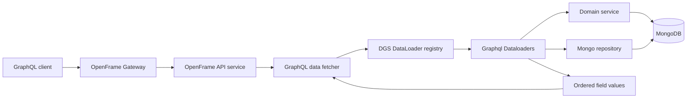
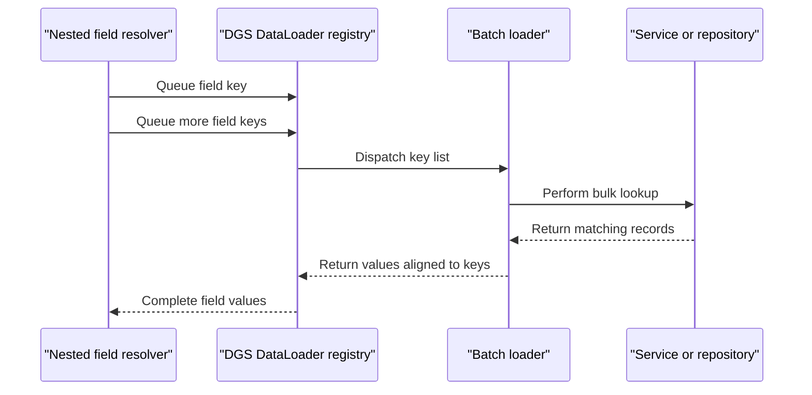

# Graphql Dataloaders

## Purpose

Graphql Dataloaders is the batching layer used by the OpenFrame API's Netflix DGS GraphQL runtime. It prevents nested field resolution from issuing one repository or service call per parent object. Each loader receives the keys accumulated during a GraphQL dispatch cycle, performs one bulk lookup, and returns results in the exact order of the input keys.

The implementation is supplied by the `com.openframe.oss:openframe-api-service-core` library at version `7.0.11` and runs in this repository's OpenFrame API service. The service is exposed through the gateway's `/api/**` route. The loaders do not define GraphQL queries or mutations themselves; GraphQL data fetchers obtain them by their `@DgsDataLoader` names when resolving nested fields.

## Architecture

### Batching contract

All components implement the Java `BatchLoader` contract and are registered with DGS through `@DgsDataLoader`. The contract is positional: the value at each index in the returned list belongs to the key at the same index in the requested list. This is especially important for loaders that return a single nullable entity.

## Loader Families

| Family | DGS loader names | Responsibility |
| --- | --- | --- |
| Machine relationships | `installedAgentDataLoader`, `tagDataLoader`, `toolConnectionDataLoader` | Batch nested information associated with machines. |
| Knowledge base | `knowledgeBaseAttachmentDataLoader`, `knowledgeBaseItemDataLoader`, `knowledgeBaseTagDataLoader`, `userDataLoader` | Resolve article attachments, article targets, tags, and authors. |
| RMM scripts and schedules | `scriptDataLoader`, `scriptScheduleDeviceCountDataLoader`, `scriptTagDataLoader` | Resolve scripts, scheduled-device totals, and script tags. |
| Polymorphic assignment targets | `machineDataLoader`, `knowledgeBaseItemDataLoader`, `ticketDataLoader` | Materialize device, knowledge article, and ticket targets by identifier. |

## Component Reference

### Machine relationship loaders

- [InstalledAgentDataLoader](https://github.com/flamingo-stack/openframe-oss-lib/blob/16e7c1cbd9664e7d10ec5ebca7d53c9bd314decf/openframe-api-service-core/src/main/java/com/openframe/api/dataloader/InstalledAgentDataLoader.java) batches machine identifiers and delegates to `InstalledAgentService.getInstalledAgentsForMachines`.
- [TagDataLoader](https://github.com/flamingo-stack/openframe-oss-lib/blob/16e7c1cbd9664e7d10ec5ebca7d53c9bd314decf/openframe-api-service-core/src/main/java/com/openframe/api/dataloader/TagDataLoader.java) obtains each requested machine's `Tag` list through `TagService.getTagsForMachines`.
- [ToolConnectionDataLoader](https://github.com/flamingo-stack/openframe-oss-lib/blob/16e7c1cbd9664e7d10ec5ebca7d53c9bd314decf/openframe-api-service-core/src/main/java/com/openframe/api/dataloader/ToolConnectionDataLoader.java) resolves grouped `ToolConnection` records through `ToolConnectionService.getToolConnectionsForMachines`.
- [MachineDataLoader](https://github.com/flamingo-stack/openframe-oss-lib/blob/16e7c1cbd9664e7d10ec5ebca7d53c9bd314decf/openframe-api-service-core/src/main/java/com/openframe/api/dataloader/MachineDataLoader.java) resolves a machine by `machineId` for device-target polymorphism. It removes null keys for the lookup, maps results by `Machine.getMachineId`, then restores request ordering and null positions.

### Knowledge base loaders

- [KnowledgeBaseAttachmentDataLoader](https://github.com/flamingo-stack/openframe-oss-lib/blob/16e7c1cbd9664e7d10ec5ebca7d53c9bd314decf/openframe-api-service-core/src/main/java/com/openframe/api/dataloader/KnowledgeBaseAttachmentDataLoader.java) logs the batch size and calls `KnowledgeBaseAttachmentService.getAttachmentsByArticleIds`.
- [KnowledgeBaseTagDataLoader](https://github.com/flamingo-stack/openframe-oss-lib/blob/16e7c1cbd9664e7d10ec5ebca7d53c9bd314decf/openframe-api-service-core/src/main/java/com/openframe/api/dataloader/KnowledgeBaseTagDataLoader.java) delegates item-to-tag expansion to `KnowledgeBaseTagService.getTagsByItemIds`.
- [KnowledgeBaseItemDataLoader](https://github.com/flamingo-stack/openframe-oss-lib/blob/16e7c1cbd9664e7d10ec5ebca7d53c9bd314decf/openframe-api-service-core/src/main/java/com/openframe/api/dataloader/KnowledgeBaseItemDataLoader.java) batch-loads item identifiers with `KnowledgeBaseItemRepository.findByIdIn`. It supports knowledge-article values in polymorphic assignable targets and returns null for missing or null identifiers without changing key order.
- [UserDataLoader](https://github.com/flamingo-stack/openframe-oss-lib/blob/16e7c1cbd9664e7d10ec5ebca7d53c9bd314decf/openframe-api-service-core/src/main/java/com/openframe/api/dataloader/UserDataLoader.java) resolves article authors through `UserService.getUsersByIds`. Using the service, rather than a repository, retains user-processor enrichment such as image data.

### Script and schedule loaders

- [ScriptDataLoader](https://github.com/flamingo-stack/openframe-oss-lib/blob/16e7c1cbd9664e7d10ec5ebca7d53c9bd314decf/openframe-api-service-core/src/main/java/com/openframe/api/dataloader/ScriptDataLoader.java) resolves `ScriptResponse` values through `ScriptService.getScriptsByIds`. This service lookup is tenant-scoped and includes soft-deleted scripts, preserving historical execution display names.
- [ScriptScheduleDeviceCountDataLoader](https://github.com/flamingo-stack/openframe-oss-lib/blob/16e7c1cbd9664e7d10ec5ebca7d53c9bd314decf/openframe-api-service-core/src/main/java/com/openframe/api/dataloader/ScriptScheduleDeviceCountDataLoader.java) retrieves a count map from `ScheduleScriptDeviceService.getMachineCountsByScheduleIds` and emits zero for schedules that have no map entry.
- [ScriptTagDataLoader](https://github.com/flamingo-stack/openframe-oss-lib/blob/16e7c1cbd9664e7d10ec5ebca7d53c9bd314decf/openframe-api-service-core/src/main/java/com/openframe/api/dataloader/ScriptTagDataLoader.java) batches `Script.tags` through `ScriptTagService.getTagsByScriptIds`, following the same grouped-list pattern as the knowledge base tag loader.

### Ticket loader

- [TicketDataLoader](https://github.com/flamingo-stack/openframe-oss-lib/blob/16e7c1cbd9664e7d10ec5ebca7d53c9bd314decf/openframe-api-service-core/src/main/java/com/openframe/api/dataloader/TicketDataLoader.java) loads ticket identifiers with `TicketRepository.findAllById`. It is the ticket branch of assignable-target polymorphic resolution and rebuilds the output list from a map keyed by `Ticket.getId`.

## Result Alignment and Missing Data

The single-entity loaders share a deliberate implementation pattern:

1. Filter null keys and deduplicate non-null keys before the bulk query.
2. Build a lookup map from the fetched entities.
3. Iterate over the original key list and emit the mapped entity, or null if the key was null or not found.

This preserves duplicate keys and positional alignment required by `BatchLoader`. It also makes absent referenced records safe to represent in GraphQL responses. Grouped relationship loaders delegate the equivalent ordering responsibility to their backing services, which return one list for each input identifier.

## Execution Model and Operational Considerations

Most loaders wrap service or repository work in `CompletableFuture.supplyAsync`, allowing GraphQL dispatch to await a completion stage. `ScriptScheduleDeviceCountDataLoader` performs its map lookup synchronously and returns `CompletableFuture.completedFuture` because it already has the complete ordered result.

When adding or modifying a loader:

- Give the `@DgsDataLoader` a stable, unique name that matches the name requested by the consuming field resolver.
- Query all keys in one service or repository operation; do not loop over keys and issue individual reads.
- Return exactly one result position per requested key, including duplicate and null keys.
- Use the relevant domain service when it provides tenant scoping, enrichment, soft-delete behavior, or other domain policy.
- Preserve a known empty collection for relationship fields when the service contract calls for one, rather than returning an unrelated or reordered list.

## System Placement

Graphql Dataloaders belongs to the GraphQL portion of the OpenFrame API service. GraphQL data fetchers select and shape API fields, while these loaders efficiently hydrate nested values. The library depends on the OpenFrame data model and repositories for direct document retrieval and on API domain services where business semantics are required. Platform configuration supplies MongoDB connectivity to the API service.

The OpenFrame API image is built and published by this repository as `ghcr.io/flamingo-stack/openframe-oss-tenant/openframe-api`; the tenant Helm deployment includes that image as the `openframe-saas.api` workload.
