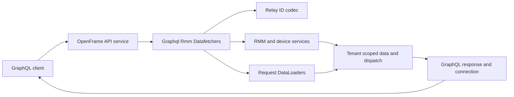
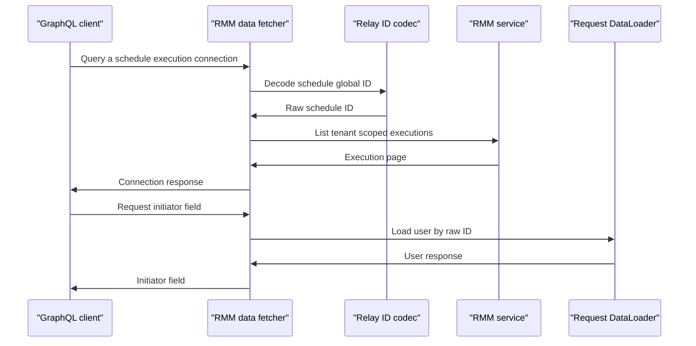
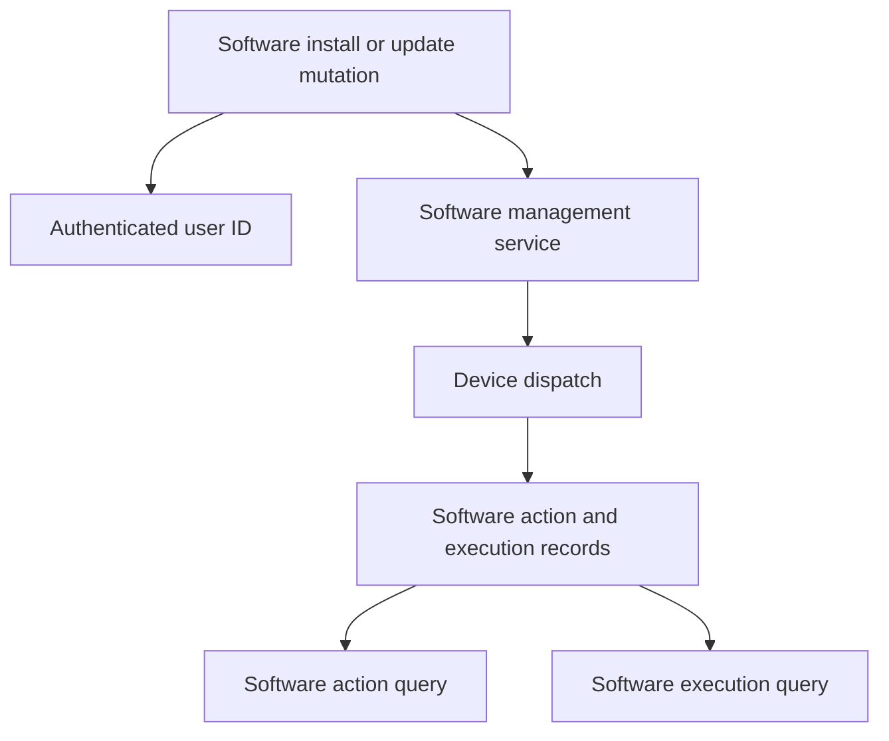

# Graphql Rmm Datafetchers

Graphql Rmm Datafetchers is the Remote Monitoring and Management GraphQL boundary assembled into the tenant's `openframe-api` service from the OpenFrame OSS Library artifact `com.openframe.oss:openframe-api-service-core` version `7.0.11`. Its DGS components expose queries, mutations, and type-field resolvers for ad-hoc commands, scripts, schedules, execution history, software inventory and deployment, and vulnerabilities.

The module is an adapter layer rather than the primary domain layer. It validates GraphQL inputs, translates opaque Relay node identifiers to storage identifiers where applicable, obtains the requesting user from the authenticated JWT for attributable operations, delegates tenant-scoped work to services, and maps paged results back into GraphQL connections. The implementation is supplied by the [OpenFrame OSS Library](https://github.com/flamingo-stack/openframe-oss-lib) and runs in this repository's OpenFrame API service.

## Responsibilities

- Expose RMM command, script, schedule, execution, software, and vulnerability operations through Netflix DGS annotations.
- Preserve Relay ID boundaries for scripts, schedules, executions, machines, users, tags, and software bundles.
- Build cursor connections for script-oriented resources and page-based connections for inventory, action, and vulnerability resources.
- Resolve related users, scripts, tags, machines, and device counts with request-scoped DataLoaders when available.
- Mask script environment-variable values in GraphQL responses.
- Delegate tenant isolation, authorization-sensitive domain behavior, persistence, dispatch, and filtering to injected services.
- Enable software-specific resolvers only when `openframe.rmm.software.enabled` is `true`.

## Architecture

The `openframe-api` deployment is routed through the OpenFrame gateway under the `/api/**` path. The gateway route and the service image are defined by this repository's deployment configuration. The GraphQL implementation itself comes from the library dependency listed above.

## Resolver Families

| Family | Components | Primary role |
|---|---|---|
| Command dispatch | [CommandDataFetcher](https://github.com/flamingo-stack/openframe-oss-lib/blob/16e7c1cbd9664e7d10ec5ebca7d53c9bd314decf/openframe-api-service-core/src/main/java/com/openframe/api/datafetcher/rmm/CommandDataFetcher.java) | Starts, batches, and cancels ad-hoc commands. |
| Scripts and execution history | [ScriptDataFetcher](https://github.com/flamingo-stack/openframe-oss-lib/blob/16e7c1cbd9664e7d10ec5ebca7d53c9bd314decf/openframe-api-service-core/src/main/java/com/openframe/api/datafetcher/rmm/ScriptDataFetcher.java), [ScriptExecutionDataFetcher](https://github.com/flamingo-stack/openframe-oss-lib/blob/16e7c1cbd9664e7d10ec5ebca7d53c9bd314decf/openframe-api-service-core/src/main/java/com/openframe/api/datafetcher/rmm/ScriptExecutionDataFetcher.java) | Manages script definitions, dispatches scripts, and exposes execution views. |
| Script schedules | [ScriptScheduleDataFetcher](https://github.com/flamingo-stack/openframe-oss-lib/blob/16e7c1cbd9664e7d10ec5ebca7d53c9bd314decf/openframe-api-service-core/src/main/java/com/openframe/api/datafetcher/rmm/ScriptScheduleDataFetcher.java), [ScheduleRunDataFetcher](https://github.com/flamingo-stack/openframe-oss-lib/blob/16e7c1cbd9664e7d10ec5ebca7d53c9bd314decf/openframe-api-service-core/src/main/java/com/openframe/api/datafetcher/rmm/ScheduleRunDataFetcher.java) | Manages scheduled scripts, device selection, and per-schedule run history. |
| Software operations | [SoftwareDataFetcher](https://github.com/flamingo-stack/openframe-oss-lib/blob/16e7c1cbd9664e7d10ec5ebca7d53c9bd314decf/openframe-api-service-core/src/main/java/com/openframe/api/datafetcher/rmm/SoftwareDataFetcher.java), [SoftwareBundleDataFetcher](https://github.com/flamingo-stack/openframe-oss-lib/blob/16e7c1cbd9664e7d10ec5ebca7d53c9bd314decf/openframe-api-service-core/src/main/java/com/openframe/api/datafetcher/rmm/SoftwareBundleDataFetcher.java), [SoftwareScheduleDataFetcher](https://github.com/flamingo-stack/openframe-oss-lib/blob/16e7c1cbd9664e7d10ec5ebca7d53c9bd314decf/openframe-api-service-core/src/main/java/com/openframe/api/datafetcher/rmm/SoftwareScheduleDataFetcher.java), [SoftwareActionDataFetcher](https://github.com/flamingo-stack/openframe-oss-lib/blob/16e7c1cbd9664e7d10ec5ebca7d53c9bd314decf/openframe-api-service-core/src/main/java/com/openframe/api/datafetcher/rmm/SoftwareActionDataFetcher.java), [SoftwareInstallUpdatedDataFetcher](https://github.com/flamingo-stack/openframe-oss-lib/blob/16e7c1cbd9664e7d10ec5ebca7d53c9bd314decf/openframe-api-service-core/src/main/java/com/openframe/api/datafetcher/rmm/SoftwareInstallUpdatedDataFetcher.java) | Reads inventory, assigns targets, and dispatches installation and update work. |
| Software presentation and risk | [SoftwareNameDataFetcher](https://github.com/flamingo-stack/openframe-oss-lib/blob/16e7c1cbd9664e7d10ec5ebca7d53c9bd314decf/openframe-api-service-core/src/main/java/com/openframe/api/datafetcher/rmm/SoftwareNameDataFetcher.java), [VulnerabilityDataFetcher](https://github.com/flamingo-stack/openframe-oss-lib/blob/16e7c1cbd9664e7d10ec5ebca7d53c9bd314decf/openframe-api-service-core/src/main/java/com/openframe/api/datafetcher/rmm/VulnerabilityDataFetcher.java) | Produces display names and vulnerability inventory views. |

## Command Dispatch

`CommandDataFetcher` provides the `runCommand`, `batchRunCommand`, and `cancelExecution` mutations. The two dispatch mutations validate their respective input objects and derive the caller ID from the current JWT via `AuthPrincipal`. They pass that user ID to `CommandDispatchService`, making the initiating user available to downstream command handling. Cancellation delegates its validated input directly to the dispatch service.

## Scripts, Schedules, and Executions

### Script lifecycle

`ScriptDataFetcher` provides single-script lookup, paginated listing, filter facets, create, update, deletion, archive, unarchive, single-device dispatch, and batch dispatch. It decodes Script and Tag global IDs before service calls; it encodes author filter options as User IDs before returning them. Script creation and manual execution carry the authenticated user ID and identify their origin as manual.

Its `envVars` field resolver deliberately applies `ScriptEnvVarMapper.mask`, preventing raw environment-variable values from being returned. `tags` and `author` use `scriptTagDataLoader` and `userDataLoader`, respectively, to avoid repeated per-row lookups.

### Schedule lifecycle and targeting

`ScriptScheduleDataFetcher` manages schedule CRUD, archival, script membership, custom parameters, and manual `runScheduleJobNow` dispatch. It supports three device-assignment modes:

1. Replace, add, or remove explicit machine assignments.
2. Add or remove all machines selected by device filters and search criteria.
3. Store live device-selection criteria based on organizations, device types, and operating-system types.

For criteria-based schedules, later-registered matching devices can be selected when the schedule is resolved. The resolver handles schedule-specific assigned and available device connections, their filter facets, device counts, scripts, custom parameters, and authors. Secret custom environment variables are masked before response construction.

`ScheduleRunDataFetcher` provides schedule-run lookup, connection listing, and filter facets for a required schedule. It resolves each run's initiator through `userDataLoader`.

### Execution history

`ScriptExecutionDataFetcher` serves per-script, per-schedule, and software-owned execution views through one `ExecutionOwnerScope` abstraction. It decodes owner and initiator IDs, delegates pagination and filtering to the execution services, and re-encodes returned initiator filter options. Its field resolvers use DataLoaders to resolve the initiator, script name, and machine without storing duplicate display data on an execution record.

## Software and Vulnerability Features

All software-focused fetchers except `SoftwareScheduleDataFetcher` are conditional components; the common enabling property is `openframe.rmm.software.enabled=true`. When disabled, these resolver beans are not registered and their operations are unavailable.

### Inventory and vulnerabilities

`SoftwareDataFetcher` exposes inventory queries across the tenant, a device, or a selected software record; it also exposes device and vulnerability connections plus associated filter facets. Inventory uses `PageCursors` to translate Relay-style arguments into page number and page size. A severity filter determines whether the inventory service receives the vulnerable-only flag. `turnOffSoftwareAutoUpdate` attributes the request to the JWT subject.

`VulnerabilityDataFetcher` provides vulnerability lookup, tenant and device inventory, affected-device lists, and filter facets. It maps GraphQL sort names such as `cveId`, `cvssScore`, `devicesCount`, and `epssProbability` to the backing Fleet order keys before delegating to `VulnerabilityInventoryService`.

`SoftwareNameDataFetcher` is a presentation-only field resolver. It uses `SoftwareNames.displayName` to normalize the `name` field for both `Software` and `AffectedSoftware` records, combining available name and bundle-identifier information.

### Deployment and scheduling

`SoftwareBundleDataFetcher` supports the staged bundle workflow: create a draft, select or remove target machines, submit, inspect assignment-related fields, and delete. Available-device searches include enabled package managers, while assignment reads return normal device connections. The bundle's `deviceCount` is derived from its stored machine IDs.

`SoftwareScheduleDataFetcher` manages persistent software schedule definitions, explicit assignments, criteria-based targeting, archival, and related device fields. It uses `userDataLoader` for the author field and applies enabled package-manager constraints to available-device selections.

`SoftwareInstallUpdatedDataFetcher` offers `installSoftware` and `updateSoftware`. Both validate `SoftwareManagementInput`, attach the caller ID, and pass a distinct execution source to `SoftwareInstallUpdateManagementService`.

`SoftwareActionDataFetcher` provides query access to paginated action history, action filter facets, an individual action, and the per-device execution details for a decoded composite `SoftwareActionId`.

## Cross-cutting Conventions

### Identity and tenancy

Mutations that need attribution obtain the authenticated `Jwt` from Spring Security and convert it to `AuthPrincipal`. Several resolver comments and service boundaries establish that tenant scoping is enforced within the delegated service using a tenant ID provider. Consequently, fetchers should not introduce client-supplied tenant identifiers or attempt to replicate service-layer scope checks.

### Relay identifiers

Fetchers use `RelayIdCodec` at API boundaries. Incoming global IDs are decoded with their expected node type, including Script, Script Schedule, Script Execution, Tag, User, Machine, Software Bundle, and Software Schedule. When filter facet values represent entities, raw IDs returned by services are encoded before reaching the client, so clients can submit them unchanged in later filters.

### Pagination styles

- Script, schedule, schedule-run, and script-execution queries map `first`, `after`, `last`, and `before` into `CursorPaginationCriteria` and return counted generic connections.
- Software inventory, software actions, and vulnerability queries use `PageCursors` to translate connection arguments into page-oriented service requests, then adapt the result to the same connection shape.
- Nested device fields reuse device filtering, sorting, cursor mapping, and connection mapping from `GraphQLDeviceMapper` and `DeviceService`.

### Batched relation loading

Request-level loaders keep list views from issuing a lookup per row. The named loaders used by this module are `userDataLoader`, `scriptDataLoader`, `machineDataLoader`, `scriptTagDataLoader`, and `scriptScheduleDeviceCountDataLoader`. Resolver code explicitly returns `null` or an empty collection when the source relation is absent instead of invoking a loader with a missing key.

## Maintenance Guidance

- Keep GraphQL data fetchers thin: place business rules, tenancy, persistence, and dispatch reliability in services.
- Decode every externally supplied Relay ID with the expected node type before calling a service. Re-encode entity-valued facets returned to the client.
- Apply Jakarta validation to new mutation inputs and constraints to required scalar arguments.
- Preserve secret masking for script and schedule custom environment variables.
- Prefer existing DataLoaders for nested relationships; add synchronous nested device queries only where the existing implementation intentionally avoids chained loader deadlocks.
- Add software resolvers under the same feature-property behavior when they depend on the optional software subsystem.
