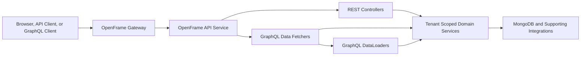
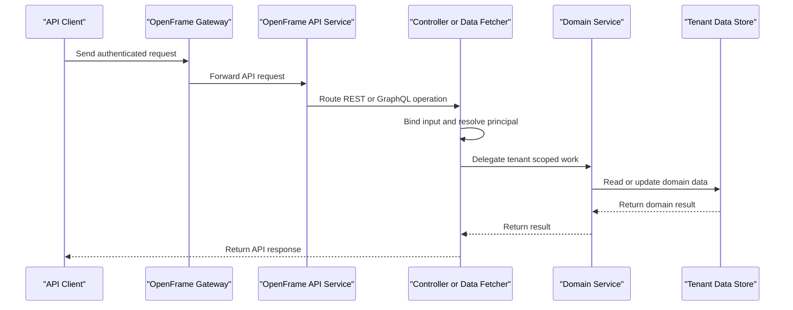

# Openframe Api Service Core

Openframe Api Service Core is the shared Java service layer that supplies the primary API capabilities used by the tenant's `openframe-api` application. Published as `com.openframe.oss:openframe-api-service-core` version `7.0.11`, it provides Spring configuration, REST controllers, GraphQL data fetchers, DataLoaders, API DTOs, Relay support, package-catalog adapters, and tenant-aware integration seams.

The tenant repository assembles this library into the `openframe-api` service and publishes that service as `com.openframe:openframe-api`.

## Purpose

The module forms the API-facing boundary between OpenFrame clients and the platform's domain services. It supports:

- REST operations for agents, devices, organizations, API keys, invitations, users, SSO configuration, health, and release metadata.
- GraphQL queries, mutations, and field resolvers for operational data, RMM workflows, software management, knowledge base content, notifications, and time tracking.
- Efficient nested GraphQL resolution through request-scoped DataLoaders.
- Authentication-principal access and GraphQL scalar configuration.
- Relay node resolution and polymorphic GraphQL type resolution.
- Deployment extension points for domain-existence checks and lifecycle processors.
- Tenant-domain access from the gateway-stamped request context.

## Architecture

The gateway routes `/api/**` traffic to the OpenFrame API service. Within that application, Openframe Api Service Core provides the web and GraphQL adapters, while delegated domain services own business rules, persistence access, tenant isolation, and asynchronous delivery workflows.

## Major Component Areas

| Area | Responsibility |
| --- | --- |
| Core Config | Registers API beans, security integration, authenticated-principal resolution, GraphQL scalars, and startup OAuth client reconciliation. |
| Api Controllers | Provides REST boundaries for agent bootstrap data, force operations, device and organization commands, account administration, invitations, knowledge-base images, and health checks. |
| Graphql Datafetchers | Exposes tenant operational data and mutations for devices, users, organizations, notifications, tags, packages, knowledge base content, assignments, and time entries. |
| Graphql Rmm Datafetchers | Provides RMM command, script, schedule, execution, software, and vulnerability GraphQL operations. |
| Graphql Dataloaders | Batches nested GraphQL lookups to avoid N-plus-one access patterns. |
| API DTOs | Defines API request and response contracts for audit logs, force actions, invitations, OAuth, OIDC user information, and organization sorting. |
| Relay And Type Resolving | Resolves Relay global IDs and concrete GraphQL types for assignment targets. |
| Package Manager Clients | Normalizes Homebrew, Chocolatey, and WinGet package discovery and detail retrieval. |
| Processors | Supplies conditional default lifecycle hooks for user, invitation, SSO, and agent-registration-secret events. |
| Tenant Domain Provider | Reads the trusted tenant-domain header injected by the gateway for the current request. |

## Request Processing Model

GraphQL data fetchers use Relay ID decoding for typed identifiers, validate incoming inputs, and use DataLoaders for related entities. REST controllers similarly adapt HTTP requests to service calls and keep business behavior outside the controller layer.

## Core Component Documentation

Refer to the following component documentation for detailed behavior:

- **Core Config** — API configuration, security imports, principal resolution, GraphQL scalars, and OAuth bootstrap.
- **Api Controllers** — REST controller responsibilities and service-relative endpoint mappings.
- **Graphql Datafetchers** — Operational GraphQL queries, mutations, and field resolvers.
- **Graphql Rmm Datafetchers** — RMM scripts, schedules, commands, software, and vulnerability operations.
- **Graphql Dataloaders** — Batched nested-field resolution and result-ordering requirements.
- **Api Dto Audit** — Audit-log filtering and sorting contracts.
- **Api Dto Force** — Force client and integrated-tool update request contracts.
- **Api Dto Invitation** — Invitation-status update contract and lifecycle context.
- **Api Dto Oauth Oidc** — Authorization-code and token-exchange payloads.
- **Api Dto Oidc Userinfo** — OpenID discovery and user-information contracts.
- **Api Dto Organization** — Organization sort-field contract.
- **Relay And Type Resolving** — Relay node loaders and assignable-target GraphQL type resolution.
- **Domain Existence Validation** — Replaceable domain-existence validation seam.
- **Package Manager Clients** — Brew, Chocolatey, and WinGet catalog integrations.
- **Processors** — Conditional lifecycle processor defaults and replacement model.
- **Tenant Domain Provider** — Gateway-provided tenant-domain retrieval.

## Operational Notes

- Openframe Api Service Core is supplied by the OpenFrame OSS Library dependency; changes to its implementation require updating the pinned upstream library version.
- The API service depends on gateway routing, authentication, tenant resolution, and data-store connectivity supplied by the wider OpenFrame deployment.
- Optional GraphQL capabilities can depend on configuration, including audit-log storage, Loki device logging, and RMM software management.
- Service-layer boundaries should remain the source of truth for authorization, tenancy, persistence, and domain lifecycle rules.