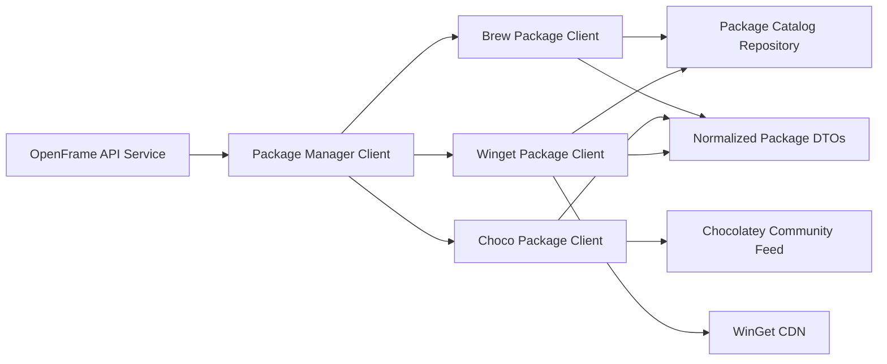
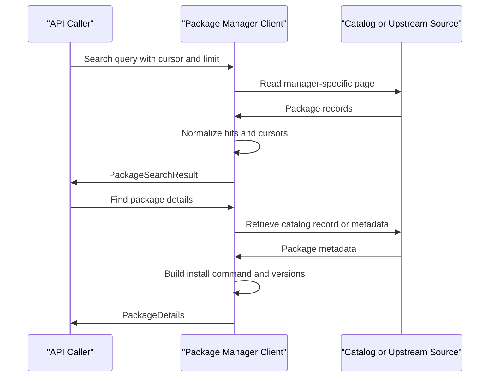
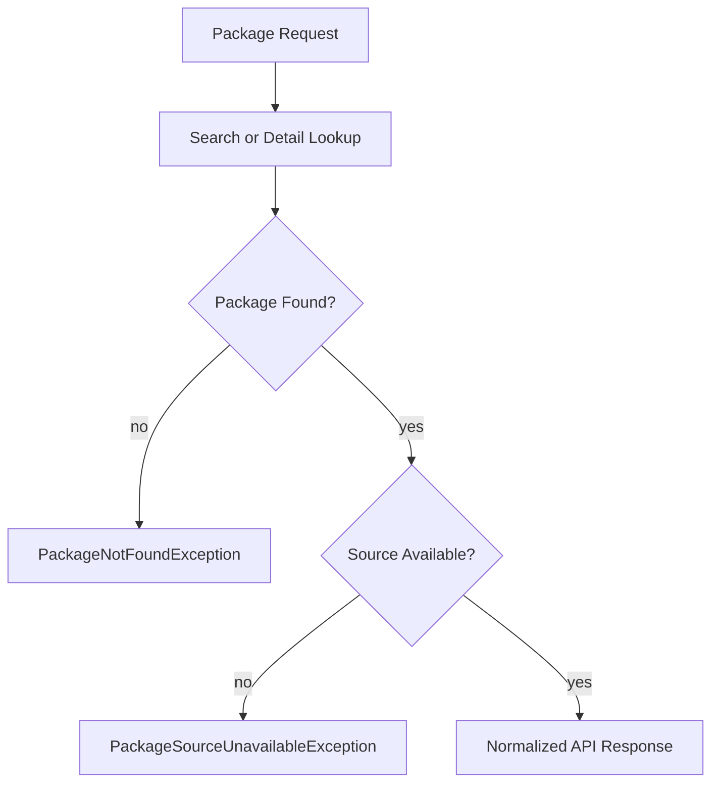

# Package Manager Clients

Package Manager Clients is the package-catalog access layer used by the OpenFrame API service. It presents a single `PackageManagerClient` contract over three package ecosystems:

- Homebrew, through the locally synchronized package catalog.
- Chocolatey, through the Chocolatey community OData feed.
- WinGet, through the locally synchronized catalog plus WinGet CDN manifest data.

The implementation is supplied by the OpenFrame OSS Library artifact `com.openframe.oss:openframe-api-service-core` at version `7.0.11` and runs in this repository's `openframe-api` service. It converts manager-specific data, pagination, and failures into the API package-search DTOs.

## Responsibilities

- Select a client by `PackageManagerType`.
- Search packages with manager-owned cursor semantics.
- Return normalized search hits and package details.
- Produce a ready-to-run install command for each package manager.
- Retrieve version, metadata, and manifest information where the package source provides it.
- Distinguish a missing package from a temporarily unavailable upstream source.

## Architecture

The shared contract is intentionally small: a caller identifies the target manager, performs a paginated search, or loads one package's details. Each concrete client retains ownership of its source-specific cursor format and source-specific enrichment work.

## Components

| Component | Role | Data source | Search ordering |
|---|---|---|---|
| [`PackageManagerClient`](https://github.com/flamingo-stack/openframe-oss-lib/blob/16e7c1cbd9664e7d10ec5ebca7d53c9bd314decf/openframe-api-service-core/src/main/java/com/openframe/api/service/packagesearch/PackageManagerClient.java) | Common contract for manager selection, search, and details lookup. | N/A | Defined by implementation. |
| [`BrewPackageClient`](https://github.com/flamingo-stack/openframe-oss-lib/blob/16e7c1cbd9664e7d10ec5ebca7d53c9bd314decf/openframe-api-service-core/src/main/java/com/openframe/api/service/packagesearch/BrewPackageClient.java) | Serves Homebrew formula and cask data from the catalog. | `PackageCatalogRepository` | Most popular first. |
| [`ChocoPackageClient`](https://github.com/flamingo-stack/openframe-oss-lib/blob/16e7c1cbd9664e7d10ec5ebca7d53c9bd314decf/openframe-api-service-core/src/main/java/com/openframe/api/service/packagesearch/ChocoPackageClient.java) | Queries, ranks, parses, and caches Chocolatey packages. | Chocolatey community feed | Relevance, then downloads, then identifier. |
| [`WingetPackageClient`](https://github.com/flamingo-stack/openframe-oss-lib/blob/16e7c1cbd9664e7d10ec5ebca7d53c9bd314decf/openframe-api-service-core/src/main/java/com/openframe/api/service/packagesearch/WingetPackageClient.java) | Uses the catalog for discovery and the CDN for version and manifest enrichment. | Catalog and WinGet CDN | Alphabetical by name. |

## Shared Contract

`PackageManagerClient` has three operations:

- `getPackageManagerType()` identifies the manager served by an implementation.
- `search(query, afterCursor, limit)` returns a `PackageSearchResult`. The cursor is opaque to callers because each client controls its representation.
- `findPackage(packageId, packageType)` returns `PackageDetails`. The `packageType` argument is meaningful only for Homebrew, where one identifier can refer to both a formula and a cask.

All implementations normalize source data into `PackageSearchItem`, `PackageSearchHit`, `PackageSearchResult`, `PackageDetails`, and `PackageVersion` DTOs. This keeps the API layer independent of upstream feed shapes.

## Search and Detail Flow

## Homebrew Catalog Client

`BrewPackageClient` searches `PackageCatalogRepository` using the `BREW` manager type and `MOST_POPULAR_FIRST` ordering. Repository hits already contain cursors, which are preserved in the API response along with the repository-provided total and `hasMore` state.

For a details lookup, the client performs a case-insensitive manager-and-package-id lookup. If the caller supplies a `BrewPackageType`, it must match exactly. Without a type, the lookup deliberately prefers `FORMULA` before `CASK`. This makes ambiguous identifiers deterministic.

Homebrew metadata is catalog-backed. A single current version is returned when the catalog entry has a version, otherwise the versions list is empty. Installation commands are derived from package type:

| Homebrew type | Install command form |
|---|---|
| Formula | `brew install package-id` |
| Cask | `brew install --cask package-id` |

A package not found in the catalog raises `PackageNotFoundException`.

## Chocolatey Community Feed Client

`ChocoPackageClient` builds a configured `RestClient` through `PackageSearchRestClientFactory`, queries the configured Chocolatey feed, and uses `ChocoFeedParser` to parse its OData XML response.

### Pagination and ranking

Chocolatey's feed uses an offset rather than a cursor. The client exposes a cursor equal to each hit's zero-based source index. On the next page, it parses that cursor and starts at the subsequent index; missing or malformed cursors restart at zero. The request asks for one extra entry so `hasMore` can be determined without a separate count request. The result leaves `total` unspecified because the feed path does not supply a total.

Before mapping a page, the client scores entries using the query, identifier, display name, and description. Ties are resolved by download count and then package identifier. Search items prefer a feed summary; otherwise, long descriptions are truncated to 300 characters.

### Detail lookup and resilience

Details are cached by lower-cased package identifier with a configured time-to-live and a maximum of 2,000 entries. A detail request:

1. Queries the latest package entry using a safely quoted OData string literal.
2. Queries the available versions, ordered by publication time.
3. Maps metadata including description, project URL, icon, tags, download count, and prerelease state.
4. Produces `choco install package-id` as the installation command.

The community feed may expose at most one version page, so the reported list is limited to its newest available entries. If the version query returns no entries, the latest package record supplies a fallback version.

Transport failures, null bodies, and feed-parser failures become `PackageSourceUnavailableException` with a source-safe message. An empty latest-entry response becomes `PackageNotFoundException`.

## WinGet Catalog and Manifest Client

`WingetPackageClient` separates fast discovery from richer detail retrieval:

- Searches read `WINGET` records from `PackageCatalogRepository` with `BY_NAME` ordering. Because WinGet does not publish install counts, unfiltered results are alphabetical.
- Details first locate the catalog entry case-insensitively, then retrieve and parse source artifacts from the configured WinGet CDN.

### Detail enrichment

The client fetches a compressed version-data artifact under the package identifier and hash prefix, decompresses it with `Mszip`, and extracts ordered version-plus-relative-manifest-path pairs. Version data is parsed line-by-line rather than as generic YAML so dotted numeric versions retain their original representation. The first available version path is fetched as YAML and used to enrich the catalog entry.

The resulting details use manifest values when present and catalog values as fallbacks:

| Detail | Preferred source | Fallback |
|---|---|---|
| Name | `PackageName` manifest field | Catalog name |
| Description | `Description` manifest field | `ShortDescription` manifest field |
| Publisher | `Publisher` manifest field | Catalog publisher |
| Homepage | `PackageUrl` manifest field | `PublisherUrl` manifest field |
| Versions | Parsed version-data artifact | Catalog version |

The client also maps the manifest license, tags, and first icon URL. Every result includes `winget install -e --id package-id` as its installation command.

Details are cached by canonical catalog package identifier with the configured time-to-live and a maximum of 5,000 entries. Missing catalog records raise `PackageNotFoundException`. HTTP errors, empty CDN responses, decompression failures, and YAML parsing failures are deliberately reported as `PackageSourceUnavailableException`, preventing source internals from escaping to callers.

## Error Semantics

Not-found errors mean the requested identifier is absent from the selected manager's catalog or feed. Source-unavailable errors mean a remote package source could not be called or parsed. Homebrew operations are catalog-only in this module, whereas Chocolatey and WinGet detail resolution can encounter remote-source failures.

## System Context

The module runs as part of the OpenFrame API service and is used by API-layer package search functionality, including the `PackageSearchDataFetcher` found in the same library artifact. Catalog-backed discovery depends on package catalog repository data, which is populated by the management-side catalog synchronization services for Brew and WinGet. The agent-side package-management components use manager identities and update workflows separately; this module is focused on server-side package discovery and package metadata for API consumers.

## Maintenance Notes

- Treat `afterCursor` as opaque outside the implementation that created it. Catalog clients forward repository cursors, while Chocolatey encodes a source index.
- Preserve Homebrew's formula-before-cask default when no type is supplied; it is a compatibility and ambiguity-resolution rule.
- Keep remote-source exceptions normalized. Do not expose XML, YAML, compression, or HTTP client implementation details in API responses.
- When adding a package manager, implement the common contract, choose source-specific pagination rules, and map its data into the existing package-search DTOs.

## Documentation Scope

This module has no generated child documentation because its four components form one contract and three tightly coupled source adapters. The component source links in this document point to the OpenFrame OSS Library revision that this repository consumes.
