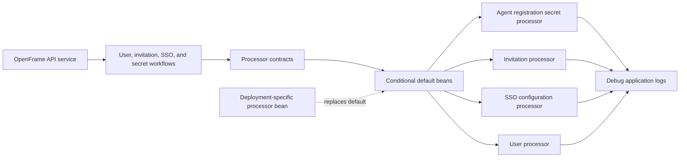
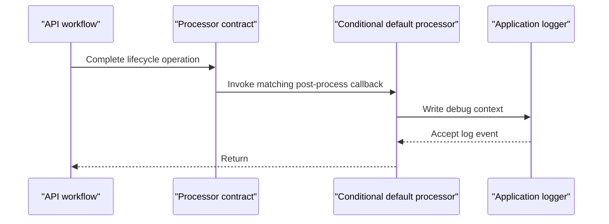

# Processors

The Processors module supplies the default extension points for lifecycle events managed by the OpenFrame API service. It is implemented by the `openframe-api-service-core` library from [OpenFrame OSS Library](https://github.com/flamingo-stack/openframe-oss-lib) and runs in this repository's `openframe-api` service.

Each processor is a Spring `@Component` guarded with `@ConditionalOnMissingBean`. Consequently, the Open Source deployment gets a safe, observable default implementation, while a deployment can contribute another implementation of the corresponding processor contract to replace it. The defaults perform no domain mutation or external integration: they write debug-level audit context after the associated operation has occurred.

## Purpose and Boundaries

The module covers four post-processing concerns:

- Agent-registration secret generation and deactivation.
- User invitation creation and revocation.
- Single sign-on configuration save, deletion, and enablement changes.
- User retrieval, update, and deletion.

The module does not implement the primary persistence, validation, authorization, or HTTP/GraphQL handling for these operations. It runs after those owning workflows invoke their respective processor contracts. Its default behavior is intentionally non-blocking in business terms: it records identifiers, email addresses, providers, counts, and enabled state using the application logger.

## Architecture

### Spring Replacement Model

Every class is registered as a component only when Spring cannot find a bean for its processor interface. The `ignored` attribute excludes the default implementation itself from the missing-bean evaluation, allowing the class to become the fallback. A custom processor implementing the same contract therefore takes precedence at application startup.

This design keeps the API service usable without optional integration code while exposing focused hooks for downstream deployments. Since each provided implementation only logs after its callback is invoked, custom implementations must decide their own error-handling and side-effect policy.

## Component Responsibilities

| Component | Lifecycle callbacks observed in the implementation | Default action |
|---|---|---|
| `DefaultAgentRegistrationSecretProcessor` | Secret generated; secret deactivated | Logs the secret identifier. |
| `DefaultInvitationProcessor` | Invitation created; invitation revoked | Logs the invitation identifier and email address. |
| `DefaultSSOConfigProcessor` | SSO configuration saved, deleted, or toggled | Logs provider identity and, where applicable, enabled state. |
| `DefaultUserProcessor` | User deleted, updated, fetched individually, or fetched as a page | Logs the user identifier or the returned page item count. |

### Agent Registration Secret Processing

[`DefaultAgentRegistrationSecretProcessor`](https://github.com/flamingo-stack/openframe-oss-lib/blob/16e7c1cbd9664e7d10ec5ebca7d53c9bd314decf/openframe-api-service-core/src/main/java/com/openframe/api/service/processor/DefaultAgentRegistrationSecretProcessor.java) is the fallback implementation of `AgentRegistrationSecretProcessor`.

- `postProcessSecretGenerated` receives the persisted secret and a decrypted key argument, but the default implementation logs only the secret ID. It does not expose the decrypted key in the log message.
- `postProcessSecretDeactivated` records the ID of the deactivated secret.

The callback timing and method names establish this processor as a post-operation hook. The default does not generate, encrypt, store, distribute, or deactivate secrets itself.

### Invitation Processing

[`DefaultInvitationProcessor`](https://github.com/flamingo-stack/openframe-oss-lib/blob/16e7c1cbd9664e7d10ec5ebca7d53c9bd314decf/openframe-api-service-core/src/main/java/com/openframe/api/service/processor/DefaultInvitationProcessor.java) is the fallback for `InvitationProcessor`.

- `postProcessInvitationCreated` logs the invitation ID and recipient email.
- `postProcessInvitationRevoked` logs the same identifiers for a revoked invitation.

The processor observes invitation lifecycle transitions. It does not send an email, change invitation state, or manage invitation persistence in its default form.

### SSO Configuration Processing

[`DefaultSSOConfigProcessor`](https://github.com/flamingo-stack/openframe-oss-lib/blob/16e7c1cbd9664e7d10ec5ebca7d53c9bd314decf/openframe-api-service-core/src/main/java/com/openframe/api/service/processor/DefaultSSOConfigProcessor.java) provides the default `SSOConfigProcessor` hook.

- `postProcessConfigSaved` logs the configured provider and whether the configuration is enabled.
- `postProcessConfigDeleted` logs the provider that was removed.
- `postProcessConfigToggled` logs the provider and its new enabled state.

These callbacks support extensions that must react to SSO configuration changes without making the core API workflow depend on a particular identity-provider integration.

### User Processing

[`DefaultUserProcessor`](https://github.com/flamingo-stack/openframe-oss-lib/blob/16e7c1cbd9664e7d10ec5ebca7d53c9bd314decf/openframe-api-service-core/src/main/java/com/openframe/api/service/processor/DefaultUserProcessor.java) is the fallback `UserProcessor` implementation.

- `postProcessUserDeleted` and `postProcessUserUpdated` log the affected persisted user ID.
- The single-user `postProcessUserGet` overload logs the response ID.
- The paged `postProcessUserGet` overload logs the number of returned items rather than individual user data.

The overloads distinguish individual-user and page retrieval results. They provide a single integration seam for read and write lifecycle observations while retaining a no-op functional baseline.

## Event Flow

The processor receives data only after the caller selects and invokes a lifecycle callback. The supplied defaults return after logging; no additional response value, data transformation, or persistence action is visible in these implementations.

## Operational Considerations

- **Logging level:** All default messages use debug level. Production observability therefore depends on the effective logging configuration.
- **Sensitive data:** The registration-secret callback receives a decrypted key, yet the default logging statement does not include it. Replacement implementations should preserve this restraint unless secure secret-handling requirements explicitly justify another approach.
- **Replacement scope:** A replacement is selected per processor contract. Replacing one default does not replace the other three.
- **Side effects:** Because these hooks are post-processing callbacks, a custom implementation should avoid making the completed primary operation ambiguous. In particular, decide whether failures in a custom side effect are logged, retried, or propagated according to the deployment's transaction and reliability requirements.

## Relationship to the Platform

The Processors module is packaged in the OpenFrame OSS Library artifact `com.openframe.oss:openframe-api-service-core` at version `7.0.11`, which this repository consumes. The repository's `openframe-api` service assembles that library alongside API configuration, controllers, data fetchers, and data-access modules. Processors remain deliberately narrow: they provide optional reaction points for lifecycle events rather than acting as API endpoints or repositories.
