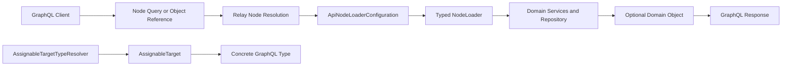
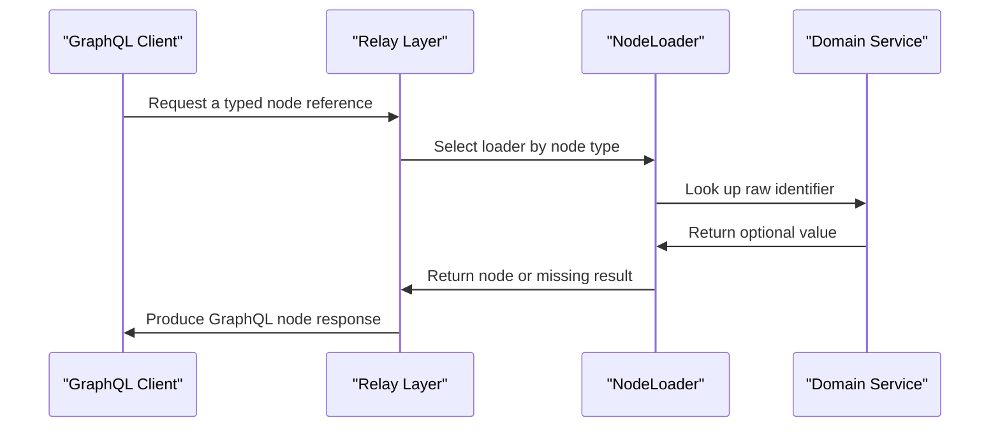
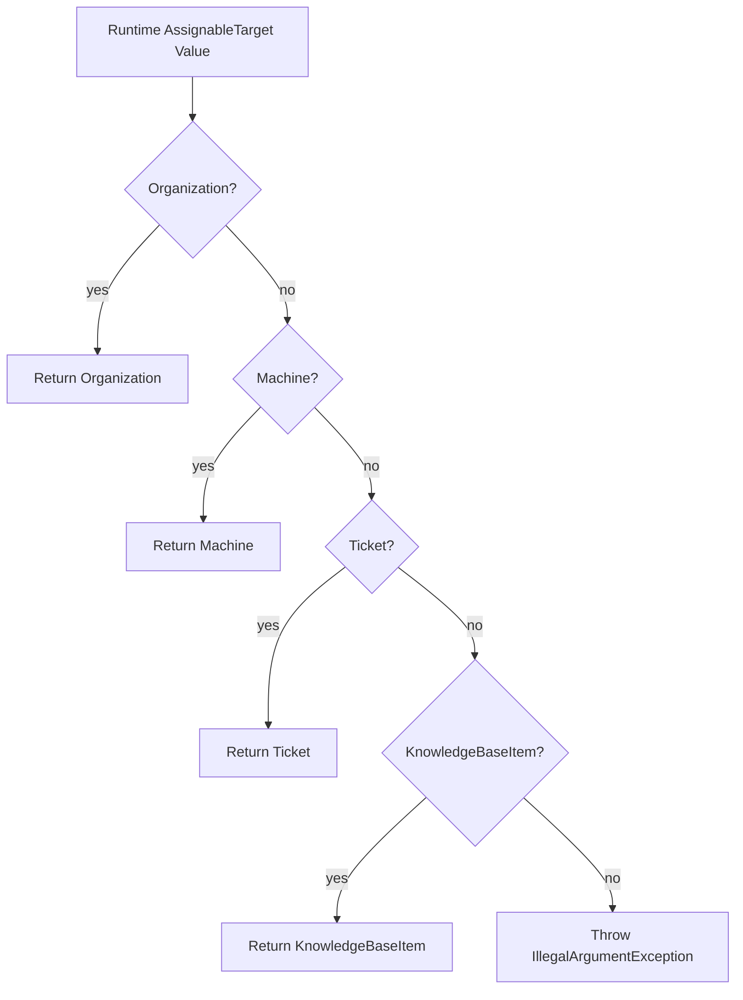

# Relay And Type Resolving

Relay And Type Resolving supplies two GraphQL integration responsibilities for the OpenFrame API service:

- It registers Relay `NodeLoader` beans that resolve globally typed node references into API objects.
- It resolves the concrete GraphQL type for values exposed through the `AssignableTarget` abstract type.

The implementation is supplied by the `com.openframe.oss:openframe-api-service-core` library at version `7.0.11` and is assembled at runtime by this repository's OpenFrame API service. The module is deliberately small: its behavior is concentrated in [ApiNodeLoaderConfiguration](https://github.com/flamingo-stack/openframe-oss-lib/blob/16e7c1cbd9664e7d10ec5ebca7d53c9bd314decf/openframe-api-service-core/src/main/java/com/openframe/api/relay/ApiNodeLoaderConfiguration.java) and [AssignableTargetTypeResolver](https://github.com/flamingo-stack/openframe-oss-lib/blob/16e7c1cbd9664e7d10ec5ebca7d53c9bd314decf/openframe-api-service-core/src/main/java/com/openframe/api/relay/AssignableTargetTypeResolver.java).

## Architecture Overview

The node-loading configuration bridges the GraphQL Relay layer to existing domain services and repositories. A Relay node reference carries a `NodeType` and a raw identifier. `LookupNodeLoader` selects the loader registered for that type, then delegates lookup to the appropriate service. The result is optional, so absent records and unavailable optional capabilities produce a missing node rather than an application startup failure.

`ApiNodeLoaderConfiguration` is a Spring `@Configuration` class. Each bean maps exactly one `NodeType` and Java result class to a lookup function. Most lookups use `LookupNodeLoader.byRawId`; ticket lookup uses `LookupNodeLoader.byPrincipalAndRawId`, preserving the authenticated caller context for authorization-aware retrieval.

`AssignableTargetTypeResolver` is a DGS component. It receives a runtime domain object for the `AssignableTarget` GraphQL abstraction and returns the corresponding schema type name. This separates Java-domain polymorphism from GraphQL's concrete-type selection.

## Relay Node Loading

### Registered Node Types

The configuration provides loaders for the following data families:

| Node type | Resolved Java value | Lookup dependency | Lookup behavior |
|---|---|---|---|
| `MACHINE` | `Machine` | `DeviceService` | Finds a machine by machine identifier. |
| `ORGANIZATION` | `Organization` | `OrganizationService` | Retrieves an organization by organization identifier. |
| `INTEGRATED_TOOL` | `IntegratedTool` | `ToolService` | Finds an integrated tool by identifier. |
| `TAG` | `Tag` | `TagService` | Finds a tag by identifier. |
| `MACHINE_TAG` | `MachineTag` | `TagService` | Queries the tag service with a one-element identifier list and returns the first matching machine tag. |
| `TOOL_CONNECTION` | `ToolConnection` | `ToolConnectionService` | Finds a tool connection by identifier. |
| `INSTALLED_AGENT` | `InstalledAgent` | `InstalledAgentService` | Retrieves an installed agent. |
| `SCRIPT` | `ScriptResponse` | `ScriptService` | Finds a script response by identifier. |
| `SCRIPT_EXECUTION` | `ScriptExecutionResponse` | `ScriptExecutionService` | Finds a script-execution response by identifier. |
| `SCRIPT_SCHEDULE` | `ScriptScheduleResponse` | `ScheduleScriptService` | Finds a script-schedule response by identifier. |
| `SCHEDULE_RUN` | `ScheduleRunResponse` | `ScheduleRunService` | Finds a schedule-run response by identifier. |
| `TENANT` | `Tenant` | `TenantRepository` | Resolves only when the repository capability is present. |
| `SOFTWARE_BUNDLE` | `SoftwareBundleResponse` | `SoftwareBundleService` | Resolves only when the service capability is present. |
| `TICKET` | `Ticket` | `TicketService` | Resolves with both the authenticated principal and raw identifier. |
| `USER` | `UserResponse` | `UserService` | Queries users with a one-element identifier list and returns the first match. |
| `INVITATION` | `InvitationResponse` | `InvitationService` | Resolves open invitations only. |

The configuration uses response types for several API-facing resources, including scripts, schedules, software bundles, and users. This keeps Relay resolution aligned with the objects that the API exposes instead of requiring the GraphQL layer to transform persistence models after loading.

### Resolution Flow

A node loader does not encode a generic repository query. It delegates to the service that owns the resource's retrieval semantics. This is significant for resources such as tickets, where the lookup must remain principal-aware, and invitations, where the resolver intentionally restricts lookup to open invitations.

### Optional Capabilities and Missing Nodes

Tenant, software-bundle, and ticket support can be absent in some deployments. Their loader methods receive an `ObjectProvider` rather than a required dependency. The helper methods retrieve the provider value with `getIfAvailable()` and use `Optional` composition to return no node when the capability is not installed.

This provides two distinct safeguards:

1. The API can create the loader configuration without requiring deployment-specific beans.
2. A lookup for a node type whose backing capability is absent has a missing result rather than a failed dependency injection operation.

Ticket lookup applies the same availability pattern while passing `AuthPrincipal` to `TicketService.getTicket`. The loader therefore preserves ticket-service authorization rules instead of performing an unrestricted identifier lookup.

## Assignable Target Type Resolution

`AssignableTargetTypeResolver` implements DGS resolution for the GraphQL `AssignableTarget` abstraction. It maps runtime domain classes to exact GraphQL schema type names:

| Runtime class | GraphQL type returned |
|---|---|
| `Organization` | `Organization` |
| `Machine` | `Machine` |
| `Ticket` | `Ticket` |
| `KnowledgeBaseItem` | `KnowledgeBaseItem` |

The resolver fails fast for every unknown runtime class by throwing `IllegalArgumentException` with the Java class name. That behavior makes schema and domain-model drift visible: adding a new assignable target implementation requires an explicit resolver branch and a compatible GraphQL type.

## Component Responsibilities

### ApiNodeLoaderConfiguration

`ApiNodeLoaderConfiguration` is the Relay registration boundary. Its responsibilities are to:

- declare one Spring bean per supported Relay node type;
- bind each `NodeType` to its Java class and service-backed lookup operation;
- adapt collection-based APIs for machine-tag and user lookup by selecting the first returned item;
- defer optional deployment capabilities through `ObjectProvider`;
- keep ticket lookup scoped to `AuthPrincipal`; and
- limit invitation lookup to the open-invitation view.

When introducing a new Relay node, maintainers should add a loader that uses the canonical `NodeType`, returns the type exposed by GraphQL, and delegates to the owning service. If the service is optional by deployment design, it should follow the existing provider-and-`Optional` pattern.

### AssignableTargetTypeResolver

`AssignableTargetTypeResolver` is the GraphQL polymorphism boundary for assignment targets. Its responsibilities are to:

- inspect a resolved runtime target;
- map each supported domain class to its precise GraphQL type name; and
- reject unsupported values immediately.

Changes to the `AssignableTarget` schema must be reviewed alongside this resolver. A schema member without a corresponding branch cannot be resolved at runtime, while a branch that returns a type absent from the schema will fail GraphQL type resolution.

## Operational and Maintenance Notes

- **Authorization:** Do not replace the ticket loader with a raw repository lookup. Its principal-aware service call is the mechanism that allows ticket access rules to participate in node resolution.
- **Visibility rules:** The invitation loader deliberately uses `findOpenInvitation`; accepted and revoked invitations are outside the node set exposed by this loader.
- **Optional modules:** Preserve the graceful-missing-node behavior for tenant, software-bundle, and ticket capability dependencies. Required constructor-style injection would make deployment composition more rigid.
- **Collection adapters:** The machine-tag and user helpers treat the first result from a one-item query as the result. Any change to service semantics should preserve the expectation that identifiers uniquely identify the returned record.
- **Type names:** GraphQL type names returned by the DGS resolver are string contracts. Rename a schema type and its resolver return value together.

## System Placement

This module runs inside the OpenFrame API service, which is delivered from this repository as the `openframe-api` image. It depends on the API service-core library for its implementation and on the API's service layer, domain documents, Relay infrastructure, Spring configuration, and Netflix DGS runtime at execution time.

The module does not itself expose REST endpoints, persist data, or run scheduled work. Instead, it provides the framework wiring that lets GraphQL data fetchers and schema execution resolve relay references and polymorphic assignment targets consistently through existing application services.
