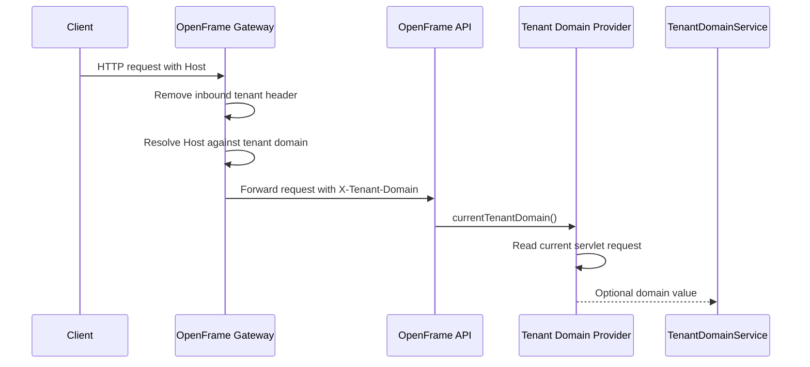
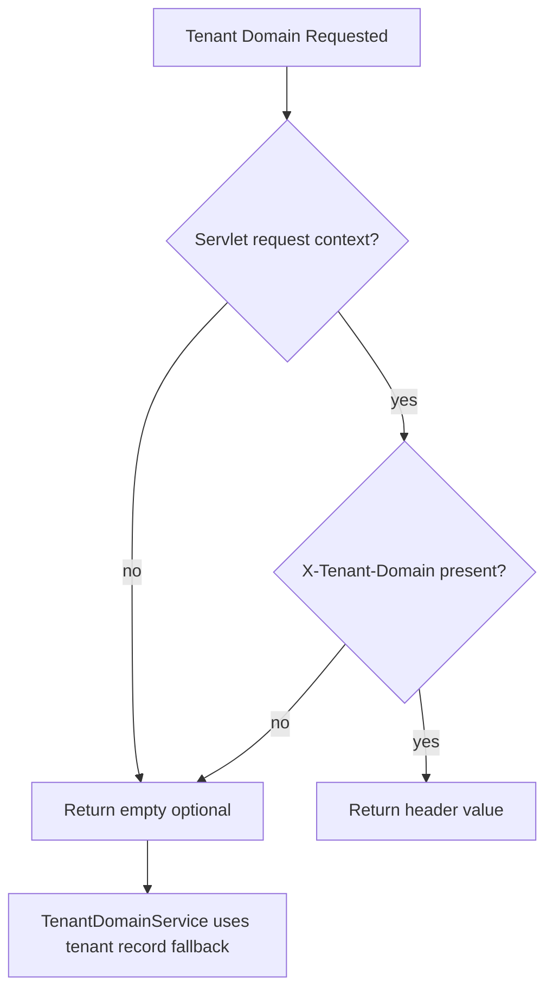
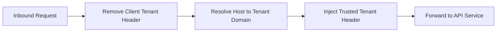

# Tenant Domain Provider

Tenant Domain Provider is the OpenFrame API adapter that exposes the tenant domain resolved by the shared gateway for the current servlet request. It implements `RequestTenantDomainProvider` from the `openframe-api-lib` library and is supplied by the `openframe-api-service-core` library, version `7.0.11`, which the tenant API service assembles at runtime.

The implementation is deliberately narrow: it reads `X-Tenant-Domain` from the request held by Spring's `RequestContextHolder` and returns it as an `Optional<String>`. It does not resolve hosts, query tenant storage, normalize values, or make outbound calls. Gateway behavior is the security boundary: the component documentation states that the gateway removes this header from inbound requests and injects the value it resolved from the request host against `tenants.domain`.

Source: [GatewayTenantDomainProvider in OpenFrame OSS Library](https://github.com/flamingo-stack/openframe-oss-lib/blob/16e7c1cbd9664e7d10ec5ebca7d53c9bd314decf/openframe-api-service-core/src/main/java/com/openframe/api/tenant/GatewayTenantDomainProvider.java).

## Responsibilities and Boundaries

| Responsibility | Behavior |
| --- | --- |
| Request-scoped domain access | Retrieves the gateway-provided domain only from the active servlet request. |
| Contract implementation | Implements the library's `RequestTenantDomainProvider` abstraction so tenant-domain consumers remain independent of servlet APIs. |
| Absence signaling | Returns `Optional.empty()` when there is no servlet request or the header is absent. |
| Trust delegation | Relies on the gateway's header sanitization and host-to-domain resolution; it does not independently validate the header. |
| Fallback compatibility | Allows `TenantDomainService` to fall back to the tenant record in non-request execution contexts, as documented in the component source. |

The provider must not be used as a general tenant lookup mechanism. Scheduled work, NATS consumers, health probes, and local requests can lack both servlet request context and the stamped header.

## Architecture

The provider belongs to the API service layer but connects a gateway concern to a reusable API-library contract. The request originates at the tenant gateway route, which forwards `/api/**` traffic to the OpenFrame API service.

```mermaid
flowchart LR
    Browser["Browser or API Client"] --> Gateway["OpenFrame Gateway"]
    Gateway -->|"sanitizes and stamps header"| ApiService["OpenFrame API Service"]
    ApiService --> Provider["Tenant Domain Provider"]
    Provider --> Contract["RequestTenantDomainProvider"]
    Contract --> DomainService["TenantDomainService"]
    DomainService --> TenantRecord["Tenant Record Fallback"]
```

### Component Relationships

- **OpenFrame Gateway** is responsible for deriving the tenant domain from the incoming host, removing any client-provided tenant-domain header, and injecting the trusted replacement before proxying the request.
- **Tenant Domain Provider** is a Spring `@Component` in `openframe-api-service-core`. Spring discovers it and makes it available as the request-domain contract implementation.
- **RequestTenantDomainProvider** is the abstraction owned by `openframe-api-lib`. It represents the optional request-derived domain without imposing a servlet dependency on its consumers.
- **TenantDomainService** is the documented downstream resolver. When the provider has no request-derived value, it can use tenant-record data instead.

## Request Data Flow

The value is request-local because `RequestContextHolder` binds request attributes to the processing thread. The provider first confirms that the attributes are `ServletRequestAttributes`; only then does it obtain the HTTP header. Consequently, it does not accidentally manufacture a domain in background processing.

## Resolution Behavior

| Execution context | Provider result | Expected resolver behavior |
| --- | --- | --- |
| Request forwarded through the gateway | Header value, when stamped | Use the gateway-resolved tenant domain. |
| Servlet request that bypasses the gateway | Empty when no header is present | Fall back to the tenant record. |
| Actuator probe or local run | Typically empty | Fall back to the tenant record where tenant resolution is needed. |
| Scheduled task or NATS consumer | Empty because no servlet request attributes exist | Fall back to the tenant record. |

## Implementation Notes

`GatewayTenantDomainProvider` defines the header name as a package-visible constant, `TENANT_DOMAIN_HEADER`, with the value `X-Tenant-Domain`. Its single public operation, `currentTenantDomain()`, has two guarded steps:

1. Obtain the current `RequestAttributes` from `RequestContextHolder`.
2. Return an empty optional unless they are servlet request attributes; otherwise, read the tenant-domain header and wrap it with `Optional.ofNullable`.

This preserves a clear distinction between an unavailable request context and an available context with a missing header: callers see both as absent and remain responsible for their fallback policy.

## Security Considerations

The provider treats its header as trusted only under the stated deployment invariant: the gateway strips client-supplied values before adding its own value. Any deployment path that exposes the API service directly, permits an intermediary to preserve a client-supplied `X-Tenant-Domain` header, or bypasses gateway host resolution changes that trust assumption.

When changing routing or ingress behavior, preserve the following sequence:

Do not move domain validation into this provider without also revisiting the `RequestTenantDomainProvider` contract and the fallback behavior in `TenantDomainService`. The current design intentionally centralizes request-origin trust and domain resolution at the gateway.

## Operational Guidance

- Investigate gateway routing and header handling first when API requests resolve to an unexpected tenant domain.
- Treat an empty provider result as normal outside gateway-forwarded servlet traffic, rather than as an application error by itself.
- Test both paths when altering tenant resolution: a gateway-forwarded request should expose the stamped value, while a background execution path should return an empty optional and exercise the tenant-record fallback.
- Maintain the gateway contract when adding proxies or direct service access paths; otherwise, the header's security semantics no longer hold.
