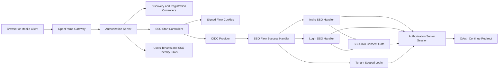
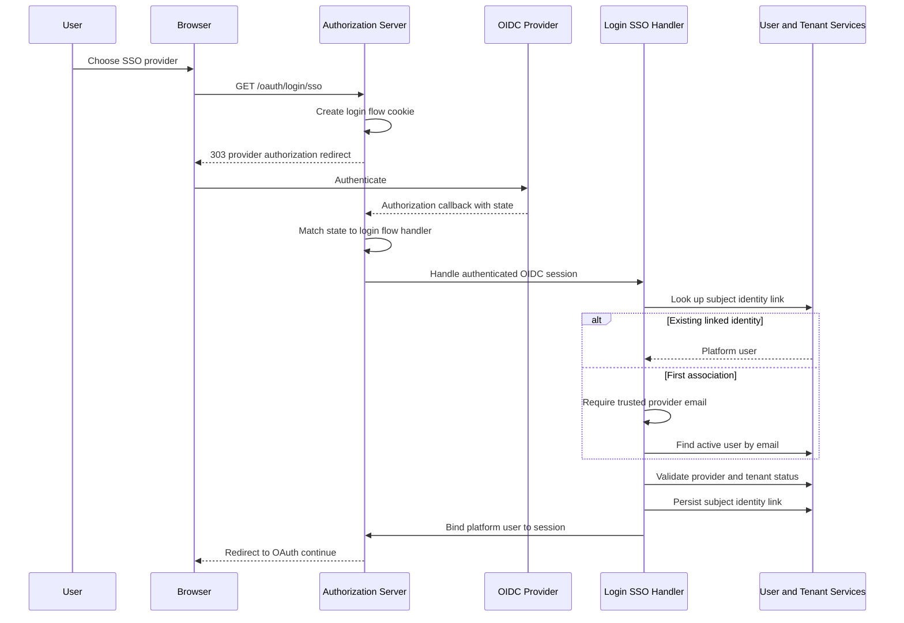
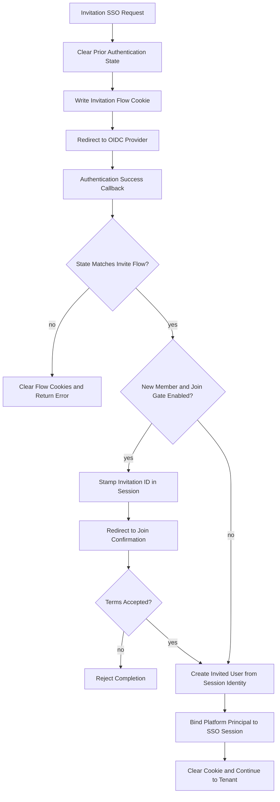

# Authentication And Sso Flows

Authentication And Sso Flows is the browser-facing portion of the OpenFrame authorization server that supports tenant discovery, password registration and recovery, invitation acceptance, and provider-based single sign-on. It is supplied by the `com.openframe.oss:openframe-authorization-service-core` library at version `7.0.11` and runs in this repository through the `openframe-authorization-server` service.

The module separates **flow initiation** from **OIDC callback completion**. Controllers validate requests and establish a short-lived, signed flow cookie. After the identity provider returns, `SsoFlowSuccessHandler` selects the handler whose stored state matches the returned OAuth state. The selected handler either binds an existing account to the authenticated server session, creates an account, or pauses at a consent screen before creation.

## Scope

| Capability | Entry points | Primary components |
|---|---|---|
| Tenant and email discovery | `GET /tenant/discover`, `GET /tenant/email-available`, `GET /tenant/email-domain-allowed` | `TenantDiscoveryController` |
| Password tenant registration | `POST /oauth/register` | `TenantRegistrationController` |
| Invitation registration | `POST /invitations/accept` | `InvitationRegistrationController` |
| Password reset | `POST /password-reset/request`, `POST /password-reset/confirm` | `PasswordResetController` |
| SSO provider discovery | `GET /sso/providers/invite`, `GET /sso/providers/registration` | `SsoDiscoveryController` |
| Email-less provider login and signup | `GET /oauth/login/sso`, `GET` or `POST /oauth/login/sso/complete` | `SsoLoginController`, `LoginSsoHandler` |
| Invitation SSO and consent | `GET /invitations/accept/sso`, `GET /oauth/join/pending`, `GET /oauth/join/complete` | `InvitationRegistrationController`, `InviteSsoHandler`, `SsoJoinController` |
| Callback dispatch and identity hardening | OIDC authentication-success callback | `SsoFlowSuccessHandler`, `MicrosoftLoginEmailGate`, `SsoIdentityCapture` |

The endpoints listed here are implemented by the library code, not independently reimplemented by the tenant repository. OAuth authorization endpoints, token issuance, signing keys, dynamic clients, and tenant-context filters are configured by adjacent authorization-server components and are outside this module’s direct scope.

## Architecture

At deployment, the gateway maps the `/sas/**` route to the authorization server. The module therefore receives its browser-facing requests through the platform gateway, while its library classes use authorization, tenant, user, invitation, SSO configuration, and identity services to read and modify persisted platform state.

## Component Responsibilities

### Discovery, Registration, And Recovery

- [`TenantDiscoveryController`](https://github.com/flamingo-stack/openframe-oss-lib/blob/16e7c1cbd9664e7d10ec5ebca7d53c9bd314decf/openframe-authorization-service-core/src/main/java/com/openframe/authz/controller/TenantDiscoveryController.java) lowercases the supplied email before tenant lookup. Availability first checks for an active account, avoiding an unnecessary external disposable-domain check when the address is already taken. The separate domain-policy endpoint evaluates only email policy, enabling immediate UI feedback.
- [`TenantRegistrationController`](https://github.com/flamingo-stack/openframe-oss-lib/blob/16e7c1cbd9664e7d10ec5ebca7d53c9bd314decf/openframe-authorization-service-core/src/main/java/com/openframe/authz/controller/TenantRegistrationController.java) registers a tenant then signs its owner into the authorization-server session when the active owner can be found. This allows continuation without a second login, while email verification remains a subsequent process.
- [`InvitationRegistrationController`](https://github.com/flamingo-stack/openframe-oss-lib/blob/16e7c1cbd9664e7d10ec5ebca7d53c9bd314decf/openframe-authorization-service-core/src/main/java/com/openframe/authz/controller/InvitationRegistrationController.java) provides both JSON invitation acceptance and an SSO initiation endpoint. Before SSO initiation it clears authentication state and competing SSO flow cookies, writes the invitation flow cookie, and redirects to provider authorization.
- [`PasswordResetController`](https://github.com/flamingo-stack/openframe-oss-lib/blob/16e7c1cbd9664e7d10ec5ebca7d53c9bd314decf/openframe-authorization-service-core/src/main/java/com/openframe/authz/controller/PasswordResetController.java) delegates reset-token creation and password replacement to `PasswordResetService`. A reset request returns `202 Accepted`; confirmation returns `204 No Content`.
- [`SsoDiscoveryController`](https://github.com/flamingo-stack/openframe-oss-lib/blob/16e7c1cbd9664e7d10ec5ebca7d53c9bd314decf/openframe-authorization-service-core/src/main/java/com/openframe/authz/controller/SsoDiscoveryController.java) exposes the effective providers for an acceptable invitation’s tenant, or the system defaults when a person is beginning tenant registration.

### SSO Orchestration

- [`SsoLoginController`](https://github.com/flamingo-stack/openframe-oss-lib/blob/16e7c1cbd9664e7d10ec5ebca7d53c9bd314decf/openframe-authorization-service-core/src/main/java/com/openframe/authz/controller/SsoLoginController.java) starts an email-less SSO login under the onboarding pseudo-tenant. It uses an `of_sso_login` cookie to preserve provider, OAuth state, redirect target, and mobile context across the redirect. Its pending endpoint reads the identity from the authenticated authorization-server session, or an opaque signup ticket for mobile.
- [`SsoFlowSuccessHandler`](https://github.com/flamingo-stack/openframe-oss-lib/blob/16e7c1cbd9664e7d10ec5ebca7d53c9bd314decf/openframe-authorization-service-core/src/main/java/com/openframe/authz/security/SsoFlowSuccessHandler.java) is the callback router. It compares the returned OAuth `state` with each active flow handler’s expected state. If no flow is active, it applies the Microsoft email gate, optionally auto-provisions a plain tenant-scoped login, preserves the normal Spring Security success behavior, captures an Apple web token where applicable, and records a trusted federated identity link. A stale, tampered, or replayed flow clears SSO cookies and uses the standard authorization error responder.
- [`InviteSsoHandler`](https://github.com/flamingo-stack/openframe-oss-lib/blob/16e7c1cbd9664e7d10ec5ebca7d53c9bd314decf/openframe-authorization-service-core/src/main/java/com/openframe/authz/security/flow/InviteSsoHandler.java) completes invitation acceptance using provider-supplied identity data. It can defer new-member creation to the join consent gate, binds the resulting platform user to the active SSO session, and clears the invitation flow cookie only after successful completion.
- [`LoginSsoHandler`](https://github.com/flamingo-stack/openframe-oss-lib/blob/16e7c1cbd9664e7d10ec5ebca7d53c9bd314decf/openframe-authorization-service-core/src/main/java/com/openframe/authz/security/flow/LoginSsoHandler.java) completes email-less provider login. It gives an existing subject link precedence over the provider email claim, requires trusted email routing for first association, refuses the generic provider if a tenant has its own provider application, checks that the tenant is active, and only then persists the identity link and binds the session.
- [`SsoJoinController`](https://github.com/flamingo-stack/openframe-oss-lib/blob/16e7c1cbd9664e7d10ec5ebca7d53c9bd314decf/openframe-authorization-service-core/src/main/java/com/openframe/authz/controller/SsoJoinController.java) exposes a pending view and a consent-required completion endpoint for invitation and shared-domain auto-provisioning. It reads identity only from the authenticated OIDC session and rejects consent completion unless `agreeTerms` is true.

### Trust And Identity Controls

- [`MicrosoftLoginEmailGate`](https://github.com/flamingo-stack/openframe-oss-lib/blob/16e7c1cbd9664e7d10ec5ebca7d53c9bd314decf/openframe-authorization-service-core/src/main/java/com/openframe/authz/security/MicrosoftLoginEmailGate.java) is an optional defense for generic Microsoft tenant-scoped login. A tenant-owned Microsoft application is accepted as authoritative. For a generic application, an existing subject link to the same tenant and email is sufficient; otherwise, the configured email trust policy must verify the routing claim. The gate is intentionally disabled by default pending correct `xms_edov` claim configuration.
- [`SsoIdentityCapture`](https://github.com/flamingo-stack/openframe-oss-lib/blob/16e7c1cbd9664e7d10ec5ebca7d53c9bd314decf/openframe-authorization-service-core/src/main/java/com/openframe/authz/security/SsoIdentityCapture.java) records subject-to-user links only after a successful tenant-scoped login with a positive trust signal: a tenant-specific provider application or a provider claim accepted by the email trust policy. Capture is best effort and cannot change the login result.

## Email-Less SSO Login Flow

The handler’s decision order is security-sensitive:

1. It decodes and validates the `of_sso_login` payload, obtains the provider identity, and requires an email.
2. It attempts a provider-subject identity-link lookup before trusting or routing by email. A bound subject has higher assurance than a mutable email claim.
3. Without a link, it invokes the email trust policy before locating a user by email. This is especially relevant for a generic Microsoft application, where an arbitrary tenant administrator can control some claims.
4. If no active user exists, it may auto-provision a user for a global-domain tenant. When configured, it instead redirects to the consent gate. If no auto-provisioning policy applies, it continues to registration.
5. It rejects generic-provider login when that tenant has an enabled provider-specific configuration, preventing the generic application from becoming a bypass around tenant policy.
6. After tenant-active validation, it links the identity, binds the platform principal into the session, removes the flow cookie, and redirects to OAuth continuation.

### Unknown Identity Registration

For an unrecognized, trusted provider identity, the continuation differs by client type:

- **Web:** when `openframe.sso.login.signup-continue-url` is configured, the handler redirects to that configured continuation page. If it is blank, the flow fails with an account-not-found error.
- **Mobile:** if mobile authentication and a redirect target are set, the handler creates an opaque signup ticket backed by server state and redirects to `/oauth/signup-continue` with the ticket and encoded redirect target. The mobile client can retrieve pending identity information using `GET /oauth/login/sso/pending?ticket=...` and completes tenant creation using `POST /oauth/login/sso/complete`.

The ticket completion endpoint ignores identity fields supplied by the client. It reads email, names, provider, subject, and verification status from the pending ticket; it requires only the ticket plus tenant name and domain from the request. A ticket already bound returns the same tenant identifier, while actual ticket redemption and single-use enforcement occur at token minting.

## Invitation SSO And Consent Flow

The invitation start endpoint clears authentication state and other SSO flow cookies, validates the invitation request through `SsoInvitationService`, stores its signed payload in `of_sso_invite`, and issues a `303 See Other` provider redirect.

For a new member, `InviteSsoHandler` can defer creation when `openframe.sso.join-confirm-url` is set. It records the invitation identifier in the server session before redirecting to the confirmation UI. `SsoJoinController` requires that the invitation cookie identifier matches the session stamp before it displays data or creates the account. This prevents a session from completing a stolen, stale, or unrelated invitation cookie. It also obtains email, names, and picture from the authenticated OIDC session rather than browser input.

Existing invite recipients, or environments without a join confirmation URL, proceed immediately. The handler creates the invited user according to the invitation, including the requested tenant switch behavior, binds that user as the session principal, and redirects through OAuth continuation.

## Plain Tenant-Scoped SSO Callback

A provider callback that has no active invitation, registration, or email-less login flow is treated as an ordinary tenant-scoped SSO login. The success handler applies this sequence:

1. Enforce `MicrosoftLoginEmailGate` when its feature flag and provider conditions apply.
2. Attempt `SsoOidcUserService.autoProvisionForTenantLogin` for eligible tenant-scoped login.
3. Delegate the final redirect behavior to Spring Security’s saved-request success handling.
4. Capture an Apple token when relevant and write a federated identity link only when `SsoIdentityCapture` determines the login had a positive trust signal.

A callback with a flow cookie but no handler matching the returned state is never downgraded to a plain login. The module removes flow cookies and reports an expired-session error instead.

## Data Boundaries And State

| State or data | Authority | How this module uses it |
|---|---|---|
| OAuth state and flow context | Signed SSO flow cookie | Selects the callback owner and carries provider, redirect, and mobile metadata. |
| OIDC subject, email, names, picture, claims | Authenticated authorization-server OIDC session | Creates or identifies users after provider authentication. |
| Invitation identifier | Flow cookie plus server-session stamp for consent flow | Identifies the invitation and binds a consent completion to the initiating session. |
| Signup ticket | Server-side `SignupTicketService` state | Transfers pending mobile signup identity without depending on browser-session cookies. |
| Platform user and tenant | User, invitation, tenant, and registration services | Determines account ownership, tenant membership, status, registration, and session principal. |
| Provider configuration | `SSOConfigService` | Discovers effective providers and distinguishes tenant-owned provider apps from generic apps. |
| Federated identity link | `SsoIdentityService` | Makes provider subject the preferred future lookup key once the association is trusted. |

## HTTP Behavior And Errors

Controllers use bean validation for JSON bodies, model attributes, and email parameters. Controller initiation paths catch broad flow failures where a browser redirect is expected and route them through `AuthErrorResponder`, preserving the error code for the frontend flow. In contrast, JSON/XHR-style pending endpoints report expired session conditions as `409 Conflict`, allowing the client to present an error before returning to login.

Notable response behavior includes:

- `POST /password-reset/request` returns `202 Accepted`.
- `POST /password-reset/confirm` returns `204 No Content`.
- `POST /invitations/accept` and `POST /oauth/register` return `200 OK` with the created domain object.
- Browser flow starts and completions redirect rather than return an application payload.
- `GET /oauth/join/complete` requires a top-level navigation because successful completion redirects to `/oauth/continue`.

## Configuration And Operational Considerations

| Configuration | Effect |
|---|---|
| `openframe.sso.join-confirm-url` | Enables the consent-page redirect for new invitation members and, with the login flag, shared-domain auto-provisioning. |
| `openframe.sso.login.join-confirm-enabled` | Enables the join confirmation diversion for email-less shared-domain first login only when the join confirmation URL is also configured. |
| `openframe.sso.login.signup-continue-url` | Enables web continuation into tenant registration for unknown email-less SSO identities. |
| `openframe.sso.microsoft.require-verified-email` | Enables verified-email enforcement for generic Microsoft tenant-scoped login. It should be activated only after the required provider claim is present in issued tokens. |

Maintain the following invariants when changing this module:

- Do not create a federated identity link before all routing, provider, and tenant-state authorization checks pass.
- Keep subject-link lookup ahead of email routing for email-less SSO.
- Treat flow-cookie state mismatch as a failed flow, not as a normal login fallback.
- Keep new-user identity attributes sourced from the authenticated OIDC session or an opaque server-side ticket, not from mutable browser fields.
- Preserve the invitation-cookie-to-session binding used by the consent completion flow.
- Keep generic-provider rejection for tenants that have their own configured provider application.

## Source Components

The authorization-server application in this repository assembles the library implementation. The source code documented above is maintained in OpenFrame OSS Library:

- [Invitation Registration Controller](https://github.com/flamingo-stack/openframe-oss-lib/blob/16e7c1cbd9664e7d10ec5ebca7d53c9bd314decf/openframe-authorization-service-core/src/main/java/com/openframe/authz/controller/InvitationRegistrationController.java)
- [Password Reset Controller](https://github.com/flamingo-stack/openframe-oss-lib/blob/16e7c1cbd9664e7d10ec5ebca7d53c9bd314decf/openframe-authorization-service-core/src/main/java/com/openframe/authz/controller/PasswordResetController.java)
- [SSO Discovery Controller](https://github.com/flamingo-stack/openframe-oss-lib/blob/16e7c1cbd9664e7d10ec5ebca7d53c9bd314decf/openframe-authorization-service-core/src/main/java/com/openframe/authz/controller/SsoDiscoveryController.java)
- [SSO Join Controller](https://github.com/flamingo-stack/openframe-oss-lib/blob/16e7c1cbd9664e7d10ec5ebca7d53c9bd314decf/openframe-authorization-service-core/src/main/java/com/openframe/authz/controller/SsoJoinController.java)
- [SSO Login Controller](https://github.com/flamingo-stack/openframe-oss-lib/blob/16e7c1cbd9664e7d10ec5ebca7d53c9bd314decf/openframe-authorization-service-core/src/main/java/com/openframe/authz/controller/SsoLoginController.java)
- [Tenant Discovery Controller](https://github.com/flamingo-stack/openframe-oss-lib/blob/16e7c1cbd9664e7d10ec5ebca7d53c9bd314decf/openframe-authorization-service-core/src/main/java/com/openframe/authz/controller/TenantDiscoveryController.java)
- [Tenant Registration Controller](https://github.com/flamingo-stack/openframe-oss-lib/blob/16e7c1cbd9664e7d10ec5ebca7d53c9bd314decf/openframe-authorization-service-core/src/main/java/com/openframe/authz/controller/TenantRegistrationController.java)
- [SSO Flow Success Handler](https://github.com/flamingo-stack/openframe-oss-lib/blob/16e7c1cbd9664e7d10ec5ebca7d53c9bd314decf/openframe-authorization-service-core/src/main/java/com/openframe/authz/security/SsoFlowSuccessHandler.java)
- [Login SSO Handler](https://github.com/flamingo-stack/openframe-oss-lib/blob/16e7c1cbd9664e7d10ec5ebca7d53c9bd314decf/openframe-authorization-service-core/src/main/java/com/openframe/authz/security/flow/LoginSsoHandler.java)
- [Invite SSO Handler](https://github.com/flamingo-stack/openframe-oss-lib/blob/16e7c1cbd9664e7d10ec5ebca7d53c9bd314decf/openframe-authorization-service-core/src/main/java/com/openframe/authz/security/flow/InviteSsoHandler.java)
