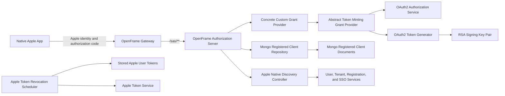
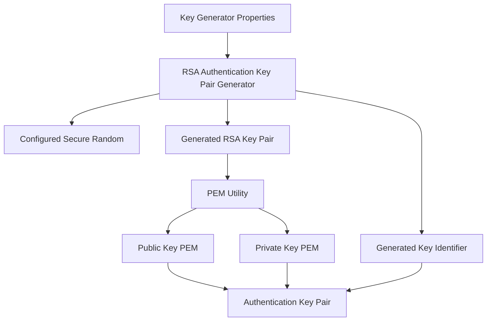
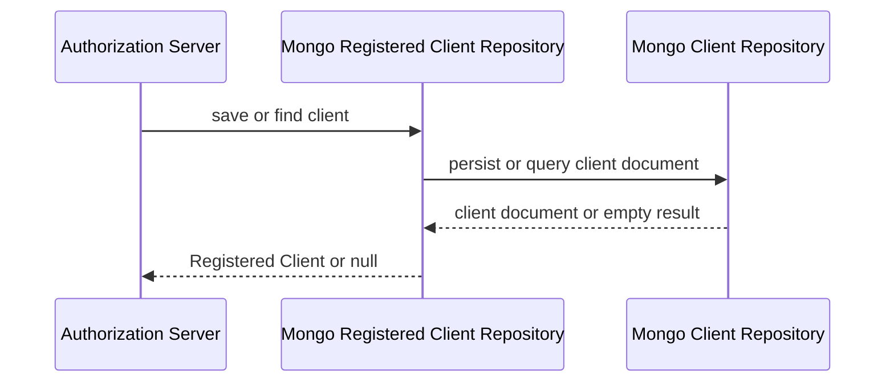
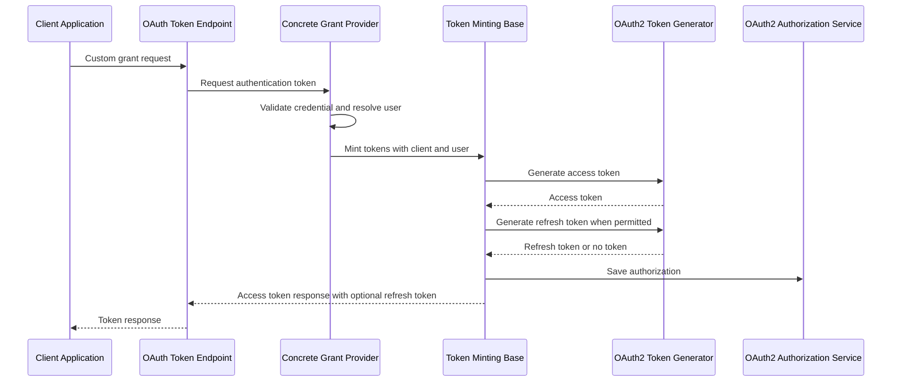
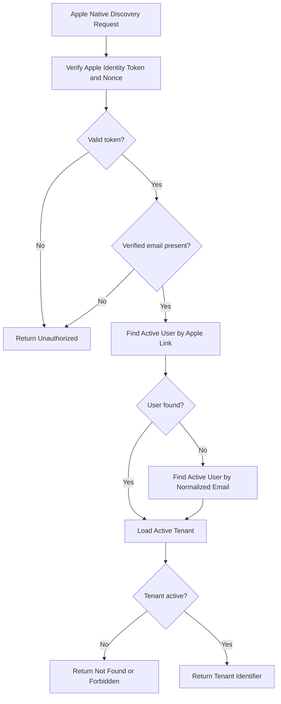
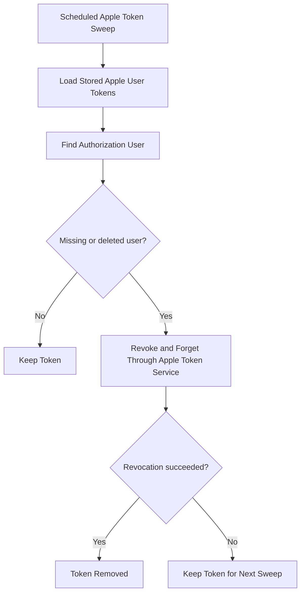

# Oauth Tokens And Client Registration

Oauth Tokens And Client Registration is the authorization-server slice that supplies signing-key material, persists OAuth client definitions, standardizes token issuance for custom grants, and supports native Sign in with Apple onboarding. It is implemented by the `com.openframe.oss:openframe-authorization-service-core` library at version `7.0.11`, which this repository runs through the OpenFrame Authorization Server service.

The module deliberately separates credential validation from token construction. Custom grant implementations validate their own evidence, such as an Apple identity token and authorization code or a signup ticket, then delegate issuance and authorization persistence to one common token-minting base class.

## Responsibilities

| Area | Components | Responsibility |
|---|---|---|
| Signing keys | `AuthenticationKeyPair`, `AuthenticationKeyPairGenerator`, `RsaAuthenticationKeyPairGenerator`, `PemUtil` | Generate RSA keys, represent the key identifier and PEM encodings, and convert between Java RSA keys and PEM text. |
| Key configuration | `KeyGeneratorProperties` | Binds the `openframe.authz.key-generator` settings, defaulting to RSA, a 2048-bit key, and `NativePRNGNonBlocking`. |
| OAuth client registry | `MongoRegisteredClientRepository` | Adapts Mongo client documents to Spring Authorization Server `RegisteredClient` objects and persists their OAuth policy. |
| Custom grants | `AbstractTokenMintingGrantProvider`, `AppleNativeGrantAuthenticationToken`, `SignupTicketGrantAuthenticationToken` | Represents custom endpoint inputs and mints access and optional refresh tokens after a concrete provider validates them. |
| Native Apple discovery | `AppleNativeDiscoveryController` | Resolves the tenant from a verified Apple identity or creates a tenant for a new verified Apple identity. |
| Apple deletion compliance | `AppleTokenRevocationScheduler` | Periodically revokes stored Apple tokens belonging to missing or deleted users. |

## Runtime Architecture

The OpenFrame Authorization Server assembles these library components with the broader authorization-server configuration, tenant context, user services, and Mongo persistence infrastructure. The gateway routes the `/sas/**` prefix to that authorization service; the concrete paths inside that prefix are determined by the authorization-server configuration and controllers.

## Signing-Key Lifecycle

`AuthenticationKeyPair` is an immutable record that carries the RSA public and private keys, their PEM serializations, and a generated key identifier. `RsaAuthenticationKeyPairGenerator` creates this record by obtaining the configured `SecureRandom`, initializing a `KeyPairGenerator` with the configured algorithm and key size, serializing both keys through `PemUtil`, and assigning a `kid-` prefixed UUID.

`PemUtil` expects an X.509-encoded public key under the public-key PEM envelope and a PKCS#8-encoded private key under the private-key PEM envelope. It strips envelope text and whitespace before Base64 decoding on reads. On writes it Base64-encodes the key bytes and wraps encoded output at 64 characters.

### Operational implications

- Invalid secure-random algorithms, unsupported key algorithms, invalid key sizes, or key-generation failures are surfaced as `IllegalStateException`.
- PEM parsing also fails fast with `IllegalStateException`; callers should treat supplied private-key text as sensitive material and avoid writing it to logs.
- The exposed configuration controls only the generator inputs shown above. Key persistence, loading, rotation, and publication are configured outside this module.

## Registered OAuth Clients

`MongoRegisteredClientRepository` implements Spring Authorization Server's `RegisteredClientRepository`. It converts between framework objects and `MongoRegisteredClient` documents so clients survive service restarts and can participate in the normal authorization-server lookup path.

On save, it persists the client identifier and secret; client authentication methods; supported authorization grant types; redirect URIs; scopes; proof-key and consent requirements; access-token and refresh-token lifetimes; and refresh-token reuse policy. When the framework asks for a client by internal identifier or client identifier, the repository reconstructs its `ClientSettings` and `TokenSettings`, converts stored string values back to Spring Security value objects, and returns a `RegisteredClient`.

A missing lookup produces `null`, matching the `RegisteredClientRepository` contract used by the authorization server. A new client without an identifier receives a generated UUID during document creation.

## Custom Token Grants

The module defines two request-token types rather than performing the full credential validation itself:

- `AppleNativeGrantAuthenticationToken` represents the `urn:openframe:params:oauth:grant-type:apple-native` exchange. It carries the authenticated OAuth client principal plus the Apple identity token, single-use authorization code, nonce, and optional first and last names.
- `SignupTicketGrantAuthenticationToken` represents `urn:openframe:params:oauth:grant-type:signup-ticket`. It carries the authenticated OAuth client principal and a ticket bound to a freshly registered mobile SSO user.

A concrete authentication provider is responsible for accepting one of these request types, authenticating the OAuth client, validating the grant-specific credential, and resolving the user principal. It then uses `AbstractTokenMintingGrantProvider` to perform the common tail.

### Shared minting behavior

`AbstractTokenMintingGrantProvider`:

1. Requires an authenticated `OAuth2ClientAuthenticationToken`; otherwise it raises an `invalid_client` OAuth error.
2. Creates an `OAuth2Authorization` associated with the registered client, resolved user principal, grant type, registered-client scopes, and user principal attribute.
3. Requests an access token from the configured token generator. A missing access token is a `server_error`.
4. Preserves JWT claims as authorization-token metadata when the generated access token is a JWT; otherwise it stores a standard access token.
5. Requests a refresh token only if the registered client permits the standard refresh-token grant. A generator result that is not an OAuth refresh token does not produce a refresh token.
6. Saves the completed authorization before returning the bearer-token authentication result.

This makes custom grants inherit the authorization service, token generator, token lifetimes, scopes, refresh-token policy, and JWT claim handling used by the authorization server rather than creating a parallel issuance path.

> The abstract provider must not itself be exposed as a Spring bean. Its source notes that registering an `AuthenticationProvider` bean globally would interfere with password logins; concrete registration belongs in the authorization-server security configuration.

## Native Apple Tenant Discovery and Registration

`AppleNativeDiscoveryController` exposes JSON endpoints under `/oauth/apple/native`:

| Endpoint | Purpose | Validation and outcome |
|---|---|---|
| `POST /discover` | Find the active tenant for an existing Apple-authenticated user. | Requires an identity token, verifies it with the supplied nonce, requires a verified email, prefers an existing Apple identity link, then falls back to an active user found by normalized email. It returns the tenant identifier only when the tenant is active. |
| `POST /register` | Create a tenant for a verified Apple identity that needs registration. | Requires an identity token, tenant name, and tenant domain. It verifies the token and nonce, rejects linked identities and active email collisions, creates a random password server-side, and registers a tenant using the verified identity email. |

Discovery is designed to avoid an email-enumeration interface: tenant resolution occurs only after successful verification of a current Apple identity token. Identity linking is checked before email fallback, allowing the stable Apple subject to continue working across email changes or Hide My Email relay changes.

The registration endpoint intentionally does not spend the Apple authorization code. The subsequent native token exchange is the point that consumes the single-use code and supplies replay protection.

## Apple Token Revocation

`AppleTokenRevocationScheduler` is enabled unless `openframe.sso.apple.revocation.enabled` is explicitly set to `false`. It enables scheduling and runs after the configured initial delay, then at the configured fixed delay. Defaults are a five-minute initial delay and a one-hour sweep interval.

For each stored Apple user token, the scheduler looks up the corresponding authorization user. If the user record is absent or has status `DELETED`, it asks `AppleTokenService` to revoke and remove that token. Failed revocations remain stored so the next scheduled sweep can retry them. The scheduler logs aggregate revoked and failed counts only when either count is nonzero.

## Source Components

The implementation lives in the OpenFrame OSS Library rather than this repository. The OpenFrame Authorization Server service in this repository runs that library.

- [Authentication key record](https://github.com/flamingo-stack/openframe-oss-lib/blob/16e7c1cbd9664e7d10ec5ebca7d53c9bd314decf/openframe-authorization-service-core/src/main/java/com/openframe/authz/keys/AuthenticationKeyPair.java)
- [RSA key-pair generator](https://github.com/flamingo-stack/openframe-oss-lib/blob/16e7c1cbd9664e7d10ec5ebca7d53c9bd314decf/openframe-authorization-service-core/src/main/java/com/openframe/authz/keys/RsaAuthenticationKeyPairGenerator.java)
- [PEM conversion utility](https://github.com/flamingo-stack/openframe-oss-lib/blob/16e7c1cbd9664e7d10ec5ebca7d53c9bd314decf/openframe-authorization-service-core/src/main/java/com/openframe/authz/keys/PemUtil.java)
- [Mongo registered-client repository](https://github.com/flamingo-stack/openframe-oss-lib/blob/16e7c1cbd9664e7d10ec5ebca7d53c9bd314decf/openframe-authorization-service-core/src/main/java/com/openframe/authz/repository/MongoRegisteredClientRepository.java)
- [Shared token-minting provider](https://github.com/flamingo-stack/openframe-oss-lib/blob/16e7c1cbd9664e7d10ec5ebca7d53c9bd314decf/openframe-authorization-service-core/src/main/java/com/openframe/authz/security/grant/AbstractTokenMintingGrantProvider.java)
- [Apple native discovery controller](https://github.com/flamingo-stack/openframe-oss-lib/blob/16e7c1cbd9664e7d10ec5ebca7d53c9bd314decf/openframe-authorization-service-core/src/main/java/com/openframe/authz/controller/AppleNativeDiscoveryController.java)
- [Apple token-revocation scheduler](https://github.com/flamingo-stack/openframe-oss-lib/blob/16e7c1cbd9664e7d10ec5ebca7d53c9bd314decf/openframe-authorization-service-core/src/main/java/com/openframe/authz/service/sso/apple/AppleTokenRevocationScheduler.java)
