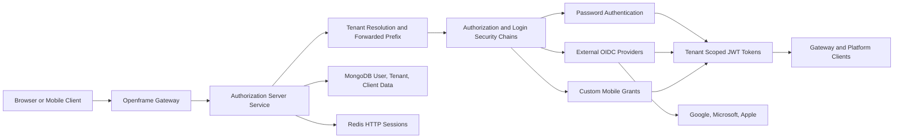
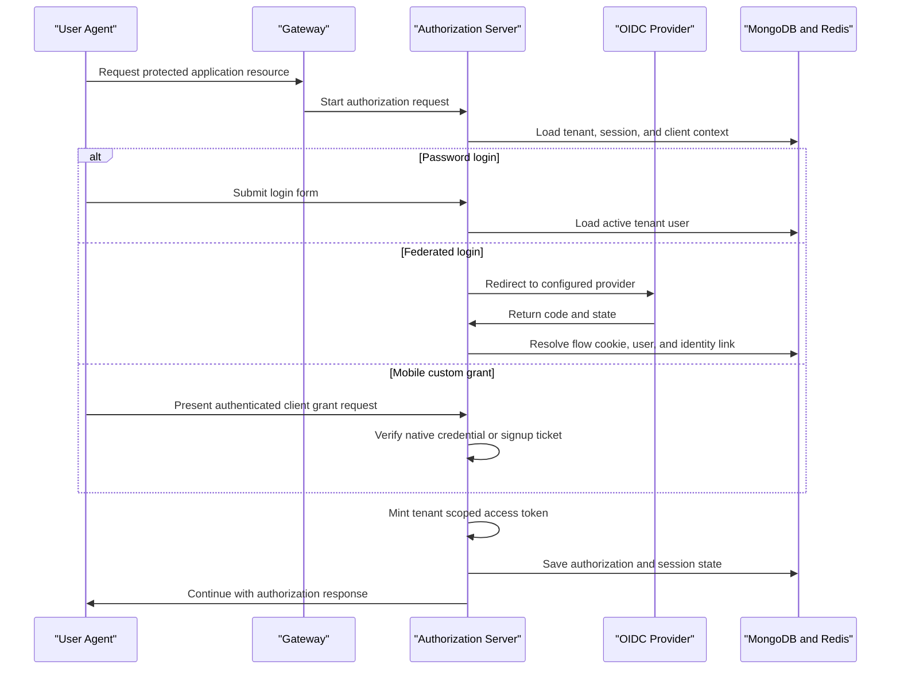

# Openframe Authorization Service Core

Openframe Authorization Service Core is the multi-tenant identity and OAuth 2.0 authorization layer used at runtime by the Openframe Authorization Server service. The tenant repository consumes it as `com.openframe.oss:openframe-authorization-service-core` version `7.0.11`; the service entry point is `OpenFrameAuthorizationServerApplication` in this repository. Its implementation is supplied by the OpenFrame OSS Library.

The module authenticates password and federated users, creates and signs tenant-scoped JWT access tokens, persists OAuth client registrations, maintains resilient browser sessions, and supports tenant onboarding, invitation acceptance, password reset, and mobile-specific Apple flows. It is not the general application API: the gateway routes the `/sas/**` path to the authorization server, while the platform API consumes the resulting authenticated identity.

## Architecture Overview

The authorization server is reached through the gateway route for `/sas/**`. Tenant resolution precedes security processing. For authorization-server endpoints, the forwarded-prefix filter supplies a tenant path prefix when needed, allowing Spring Authorization Server to derive tenant-specific issuer URLs. The module then selects one of two ordered security chains:

1. The authorization-server chain protects OAuth 2.0, OpenID Connect, token, discovery, and JWKS endpoints.
2. The default chain provides the login page, password form login, public onboarding endpoints, and external OIDC login callbacks.

## Runtime Responsibilities

| Area | Responsibility | Primary components |
|---|---|---|
| Authorization server | Configures OAuth 2.0 and OIDC endpoints, token generation, JWT decoding and tenant claims. | `AuthorizationServerConfig` |
| Tenant-aware web security | Resolves a tenant-specific SSO registration and validates provider tokens safely. | `DynamicClientRegistrationRepository`, `SecurityConfig`, provider strategies |
| Session continuity | Stores authentication, OAuth request state, CSRF state, tenant identity, and invitation state in Redis. | `SessionConfig` |
| Account flows | Supports password login, tenant discovery and signup, invitation registration, SSO continuation, and password reset. | Authorization controllers and SSO handlers |
| Mobile authentication | Supports native Apple discovery and exchange, mobile signup tickets, and version-policy discovery. | Apple controllers and custom grants |
| Signing keys and clients | Generates RSA signing material and maps persisted Mongo client registrations into Spring Authorization Server registrations. | Key generators and `MongoRegisteredClientRepository` |

## Submodules

- [Security and Tenant Context](security_and_tenant_context.md) configures ordered security filters, tenant-aware issuer construction, dynamic OIDC registration, and Redis session behavior.
- [Authentication and SSO Flows](authentication_and_sso_flows.md) documents login, invitation, onboarding, SSO callback ownership, consent gates, and identity-link protections.
- [OAuth Tokens and Client Registration](oauth_tokens_and_client_registration.md) covers tenant signing keys, Mongo-backed OAuth client translation, claims, and custom token grants.

## Core Authentication Flow

## Tenant Isolation and Token Semantics

Each access token is built using a tenant-resolved signing key and includes `tenant_id`, `userId`, and the user's effective roles. The JWK source refuses to serve a key if no tenant context was resolved. This makes a missing tenant context an explicit error rather than silently signing for an unintended tenant.

The authorization configuration uses a tenant-aware RSA key supplied by `TenantKeyService`, then uses the same token generator path for built-in and custom grants. Refresh-token requests update the user's last-login timestamp on a best-effort basis. Password authentication refuses inactive tenants before looking up a user and rejects password authentication for SSO-provisioned users that have no usable password hash.

## External Provider Safety

Dynamic SSO registrations are created per tenant rather than using a single static client configuration. The decoder cache key includes registration identifier, client identifier, JWK set URI, and issuer URI, preventing a provider registration resolved for one tenant from being reused for another tenant with different OIDC settings.

Google registrations pin a configured issuer. Apple uses a fixed issuer, an on-demand client-secret JWT, `client_secret_post`, and a form-post authorization response mode. Microsoft permits directory-specific issuers only when they match the Microsoft v2 issuer pattern. Generic Microsoft login can require an explicit verified-email trust signal before email-based account routing; a previously linked provider subject is treated as stronger proof than an untrusted email assertion.

## Persistence and Platform Dependencies

- **MongoDB** stores OAuth registered-client documents and is used by the module's tenant, user, invitation, SSO configuration, and authorization services.
- **Redis** stores Spring Session state under the OpenFrame Redis key namespace. Session attributes that no longer deserialize after a dependency upgrade are discarded, letting the user begin a fresh login rather than failing the request.
- **OpenFrame OSS Library** supplies this module and its supporting contracts. Source files cited in the submodule pages use the library source URLs supplied with the components.
- **Openframe Gateway** exposes the service's `/sas/**` route and validates/forwards authenticated traffic within the platform.

## Extension Points

The module provides no-op fallback processors for tenant registration, invitation registration, auto-provisioning, user deactivation, and email verification. Deployments can provide application-specific implementations of the corresponding processor interfaces; Spring selects the custom bean in place of the fallback.

A default global-domain policy lookup returns no tenant. An environment that allows domain-based automatic membership must provide its own `GlobalDomainPolicyLookup`; this makes auto-provisioning opt-in rather than enabled by a permissive default.

## Source and Delivery

The authorization server container is released as `ghcr.io/flamingo-stack/openframe-oss-tenant/openframe-authorization-server`. The service assembles library code from the OpenFrame OSS Library and repository-specific application bootstrapping. The module source is maintained in the [OpenFrame OSS Library authorization configuration](https://github.com/flamingo-stack/openframe-oss-lib/blob/16e7c1cbd9664e7d10ec5ebca7d53c9bd314decf/openframe-authorization-service-core/src/main/java/com/openframe/authz/config/AuthorizationServerConfig.java).
