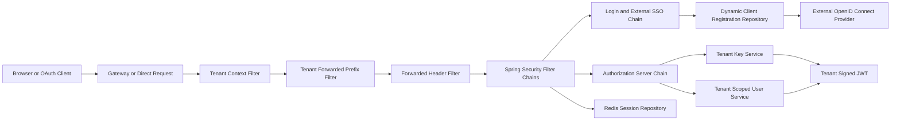
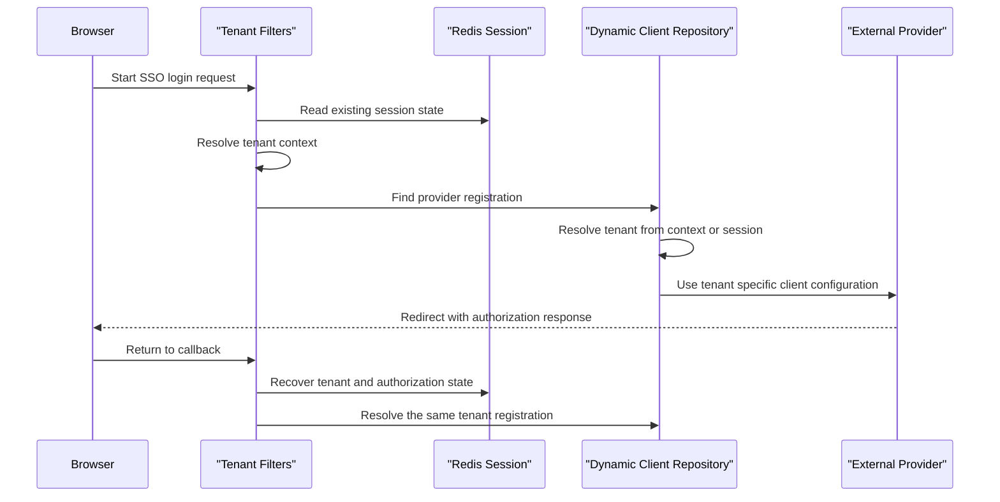
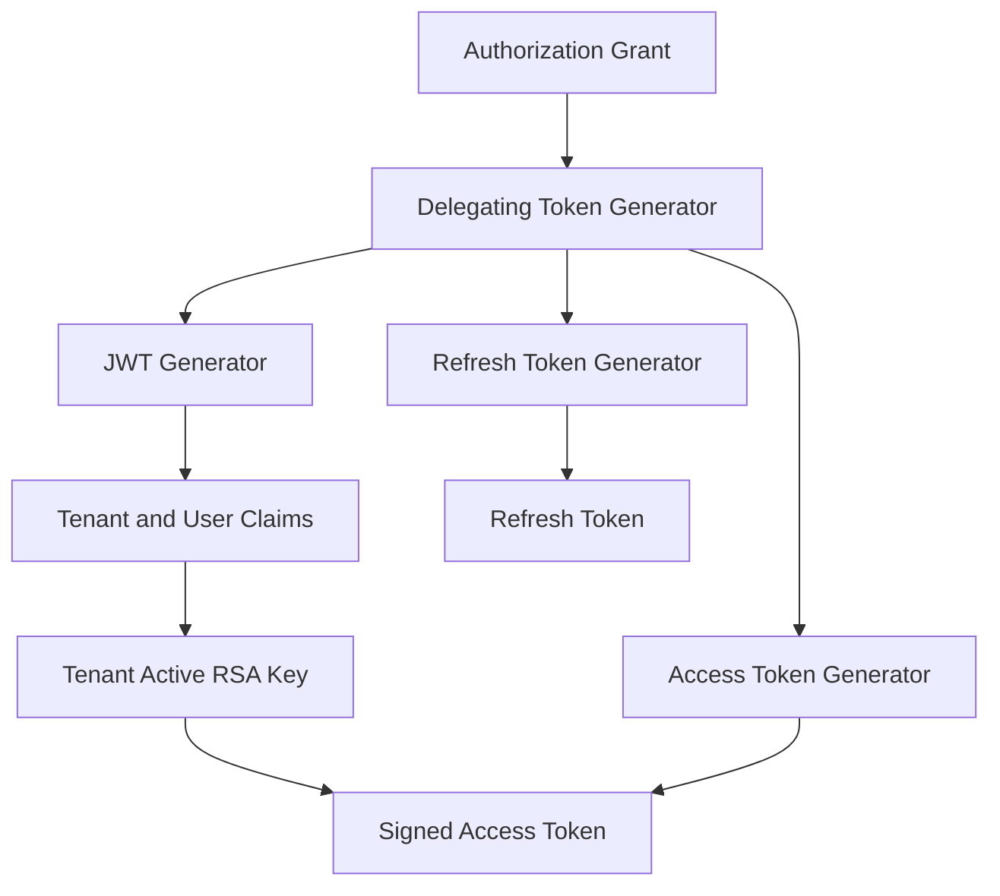
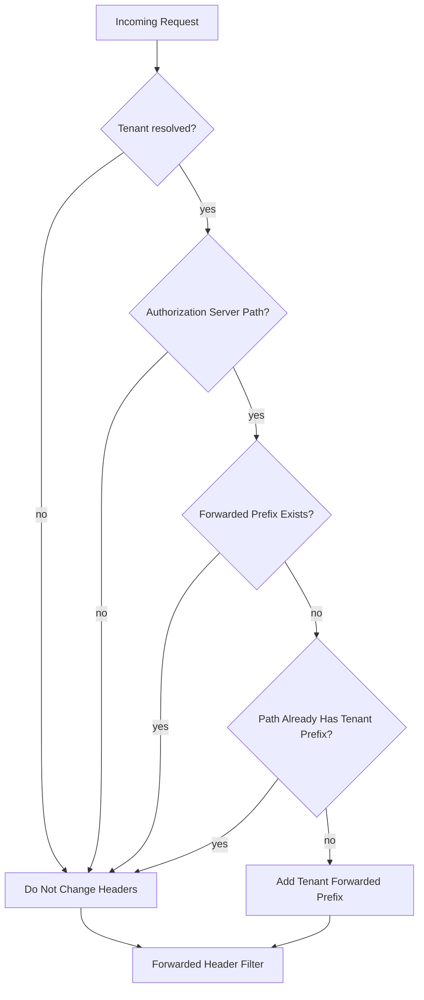

# Security And Tenant Context

Security And Tenant Context is the authorization server's request-bound security foundation. It runs in the OpenFrame Authorization Server service and is supplied by the `com.openframe.oss:openframe-authorization-service-core` library, version `7.0.11`. The module resolves the active tenant before authentication, preserves that identity through clustered login flows, constructs tenant-specific OAuth and OpenID Connect behavior, and prevents tenant configuration from leaking across requests.

The implementation is sourced from the OpenFrame OSS Library. The tenant-context filter itself is referenced by the supplied configuration but its implementation is outside this module's supplied component set; the behaviors below distinguish explicit code from that integration point.

## Responsibilities

- Configure the authorization-server security chain, including OAuth 2.0, OpenID Connect discovery, token handling, resource-server JWT validation, and custom Apple-native and signup-ticket grants.
- Configure the separate default security chain for login pages, password login, and external OpenID Connect providers.
- Resolve SSO client registrations per active tenant, first from request context and then from the HTTP session when a callback resumes a flow.
- Scope signing-key selection, token claims, user lookup, and active-tenant login admission to the tenant resolved for the request.
- Persist session state in Redis so multi-request and multi-replica login journeys retain the security context, tenant identifier, authorization request, CSRF state, and invitation state.
- Rewrite forwarded prefixes for authorization-server endpoints so externally visible tenant-qualified issuer URLs are calculated correctly when traffic does not traverse the gateway.

## Architecture

The filter order declared by `TenantFilterConfig` is significant: Spring Session runs first, followed by the tenant-context filter, then `TenantForwardedPrefixFilter`, and then Spring's `ForwardedHeaderFilter`. The ordering ensures a tenant can be recovered from an existing session before forwarding metadata is consumed and before either security chain makes authorization decisions.

## Component Map

| Component | Role | Security significance |
|---|---|---|
| [`AuthorizationServerConfig`](https://github.com/flamingo-stack/openframe-oss-lib/blob/16e7c1cbd9664e7d10ec5ebca7d53c9bd314decf/openframe-authorization-service-core/src/main/java/com/openframe/authz/config/AuthorizationServerConfig.java) | Defines the order-one authorization-server chain, JWT infrastructure, token generation, password encoding, and programmatic authentication manager. | Binds JWKS, issued claims, user lookup, and token minting to the active tenant. |
| [`SecurityConfig`](https://github.com/flamingo-stack/openframe-oss-lib/blob/16e7c1cbd9664e7d10ec5ebca7d53c9bd314decf/openframe-authorization-service-core/src/main/java/com/openframe/authz/config/SecurityConfig.java) | Defines the order-two chain for form login and external OpenID Connect login. | Applies narrowly scoped CSRF protection, controls public routes, handles failures, and validates tenant-specific identity tokens. |
| [`DynamicClientRegistrationRepository`](https://github.com/flamingo-stack/openframe-oss-lib/blob/16e7c1cbd9664e7d10ec5ebca7d53c9bd314decf/openframe-authorization-service-core/src/main/java/com/openframe/authz/config/DynamicClientRegistrationRepository.java) | Loads an external identity-provider client registration for the current tenant. | Avoids using another tenant's client credentials or provider configuration during an SSO flow. |
| [`SessionConfig`](https://github.com/flamingo-stack/openframe-oss-lib/blob/16e7c1cbd9664e7d10ec5ebca7d53c9bd314decf/openframe-authorization-service-core/src/main/java/com/openframe/authz/config/SessionConfig.java) | Configures Redis-backed sessions, namespaced Redis keys, fixed cookie naming and path, and tolerant session-attribute deserialization. | Allows login state to survive restart and horizontal scaling while avoiding deserialization failures after compatible upgrades. |
| [`TenantFilterConfig`](https://github.com/flamingo-stack/openframe-oss-lib/blob/16e7c1cbd9664e7d10ec5ebca7d53c9bd314decf/openframe-authorization-service-core/src/main/java/com/openframe/authz/config/tenant/TenantFilterConfig.java) | Registers prefix and forwarded-header filters relative to the tenant-context filter. | Establishes the request-processing order on which tenant-aware behavior depends. |
| [`TenantForwardedPrefixFilter`](https://github.com/flamingo-stack/openframe-oss-lib/blob/16e7c1cbd9664e7d10ec5ebca7d53c9bd314decf/openframe-authorization-service-core/src/main/java/com/openframe/authz/config/tenant/TenantForwardedPrefixFilter.java) | Adds a tenant prefix for selected authorization-server paths when no forwarded prefix exists. | Makes issuer calculation reflect the tenant-qualified public URL without overwriting upstream forwarding metadata. |

## Tenant Resolution and Propagation

The active tenant is obtained through `TenantContext`. `AuthorizationServerConfig` requires it for JWKS lookup, custom JWT claims, password-user lookup, and the active-tenant admission check. A missing tenant on a JWKS request is treated as an error rather than selecting a shared or arbitrary signing key.

`DynamicClientRegistrationRepository` has a deliberate fallback strategy:

1. It uses the tenant identifier already present in `TenantContext`.
2. If no request-context tenant is available, it reads the tenant identifier from the existing HTTP session.
3. If neither source supplies a nonblank value, it declines to resolve the provider registration and returns `null`.
4. It asks `DynamicClientRegistrationService` for a registration identified by both provider name and tenant identifier. Invalid registrations are logged and treated as unavailable.

This supports OpenID Connect callback processing, where the callback must recover the same tenant-specific registration established at the beginning of the browser flow.

## Authorization Server Chain

`AuthorizationServerConfig` installs the higher-priority chain for Spring Authorization Server endpoints. It allows multiple issuers, enables OpenID Connect defaults, requires authentication for matched endpoints, ignores CSRF for those endpoints, disables CORS, and configures JWT resource-server support.

### Token Issuance

The JWT encoder and decoder share a `JWKSource`. For each request, the source requires a nonblank tenant identifier and obtains that tenant's active RSA key from `TenantKeyService`. The selected key is returned as a JWK set, so signing and verification use tenant-specific key material.

The token generator composes three generators:

- `JwtGenerator` for JWTs, with the module's claim customizer;
- `OAuth2AccessTokenGenerator` for access-token generation; and
- `OAuth2RefreshTokenGenerator` for refresh-token generation.

The same generator is passed to custom Apple-native and signup-ticket grant providers. Consequently, those grants use the normal persistence, signing, claims, and refresh-token path rather than an independent token implementation.

For access tokens, the customizer loads the authenticated user by lower-cased email and tenant. It then adds `tenant_id`, `userId`, and the user's effective role names. On a refresh-token grant, it attempts to update the user's last-login timestamp; failure to update that timestamp is logged without aborting token issuance.

### Password Login

The user-details service first calls the tenant service to refuse login unless the current tenant is active. It then queries only active users matching both lower-cased email and tenant. Passwordless SSO-provisioned users are rejected for password login when no usable password hash exists; an empty password is never accepted as a fallback.

BCrypt is the configured password encoder. The programmatic authentication manager contains a DAO authentication provider built from that user-details service and encoder. The custom-grant providers are intentionally constructed inside the authorization-server configuration rather than exposed as Spring authentication-provider beans, preserving the DAO provider in the global authentication-manager setup.

## Default Login and External SSO Chain

The lower-priority `SecurityConfig` chain applies to all non-authorization-server requests. It permits the public routes needed for OAuth, invitations, reset and verification workflows, login, tenant discovery and registration, management paths, provider discovery, GraphQL, and static browser assets. All other requests require authentication.

Form-login CSRF protection is limited to the `POST /login` endpoint. CORS is disabled. A password-login failure caused by an `AuthFlowException` is rendered through `AuthErrorResponder`; ordinary authentication failures redirect to the login page with an error marker. OAuth login failures are also sent through `AuthErrorResponder` using the SSO login failure code.

For external OpenID Connect providers, the chain uses `SsoAuthorizationRequestResolver`, the dynamic registration repository, the SSO cookie codec, the tenant-aware OIDC user service, and the success handler. The ID-token decoder factory caches decoders using a key that includes provider registration identifier, client identifier, JWK-set URI, and issuer URI. This avoids Spring's registration-only cache behavior, which would otherwise let the first tenant's configuration be reused for another tenant with the same provider name.

Each generated decoder validates the standard OIDC conditions, including audience validation from `OidcIdTokenValidator`. It also validates a configured issuer when present and appends provider-specific validation supplied by the SSO provider registry.

## Session Storage and Cookie Behavior

Login requests span redirects and may be served by different authorization-server replicas. `SessionConfig` uses Spring Session with Redis instead of process-local servlet sessions. Stored attributes include the security context, CSRF token, tenant identifier, OAuth authorization request, saved authorization request, and join-invite state.

Redis session keys use the OpenFrame Redis key builder under a tenant key namespace. If the Redis tenant setting is absent, the namespace falls back to `shared` so service startup does not fail. The documented hash-tag behavior keeps a session's old and new keys in the same Redis Cluster slot, which supports the rename used by session-fixation protection at login.

The session cookie is named `JSESSIONID` and pinned to the configured servlet context path, or `/` when no context path is configured. Pinning avoids creating a cookie scoped only to a rewritten tenant prefix during OAuth callbacks. The default Redis serializer is JDK serialization with lenient reads: an attribute that cannot be deserialized is discarded and logged, allowing a new login rather than returning a request failure after a dependency serialization change.

## Tenant-Aware Forwarded Prefix

`TenantForwardedPrefixFilter` runs after tenant context has been set and before `ForwardedHeaderFilter` consumes forwarding headers. For authorization-server paths containing `/.well-known/`, or beginning with `/oauth2/` or `/connect/`, and for `/userinfo`, it injects `X-Forwarded-Prefix` as `/{tenant}` only when all of the following are true:

- the active tenant is nonblank;
- the path is not already tenant-prefixed; and
- an upstream forwarded prefix was not already supplied.

This is narrowly scoped to authorization-server URL generation. It prevents direct access to the authorization service from producing an issuer that lacks its tenant segment, while preserving a gateway-provided prefix when one already exists.

## Operational Invariants

Maintainers should preserve these invariants when changing the module:

1. **Resolve tenant before security decisions.** Any change to filter registration must preserve Spring Session before tenant context, followed by prefix processing and forwarded-header processing.
2. **Do not make signing fallback tenant-agnostic.** JWKS resolution must fail when no tenant is available; a default key would undermine tenant separation.
3. **Keep tenant in SSO callback state.** The session fallback in dynamic registration is needed for redirects that do not retain a usable request-context tenant.
4. **Cache SSO decoders by full client configuration.** A cache key limited to provider registration name can incorrectly validate against another tenant's audience or JWK configuration.
5. **Keep active-tenant validation ahead of password user lookup.** This maintains consistent refusal behavior and avoids revealing whether an email exists in an inactive tenant.
6. **Do not permit empty passwords for SSO-provisioned accounts.** Missing password hashes must remain a hard password-login refusal.
7. **Preserve session cookie path behavior.** OAuth callback prefix rewriting must not narrow the browser cookie path away from the authorization server's stable context path.

## Scope Boundaries

Security And Tenant Context supplies the shared security wiring and tenant propagation rules. It does not implement user provisioning, provider-specific registration strategies, invitation registration, password reset, or SSO controller endpoints; those concerns are part of the surrounding authorization-service modules. It also relies on external tenant-context, tenant-key, user, tenant-service, and dynamic-registration services whose interfaces are consumed here.
