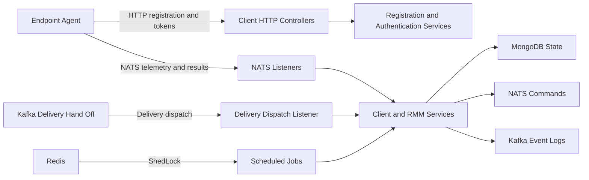
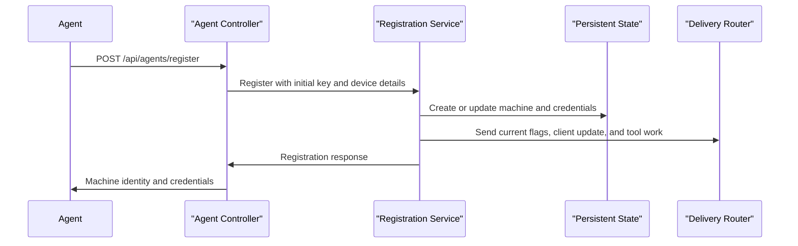
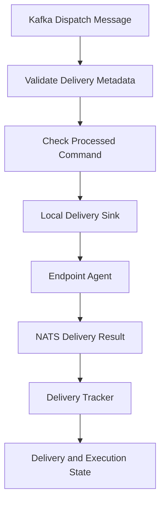

# Openframe Client Core Java

Openframe Client Core Java is the server-side client-management library used at runtime by the tenant repository's `openframe-client` Spring Boot service. The implementation is supplied by the OpenFrame OSS Library artifact `com.openframe.oss:openframe-client-core` at version `7.0.11`. It registers and authenticates endpoint agents, receives their NATS and Kafka messages, persists and aggregates delivery state, and coordinates remote-management work such as scripts, software actions, schedules, and package updates.

The tenant service provides the application entry point; this library supplies the HTTP endpoints, message listeners, schedulers, and orchestration components. The configured gateway routes the `/clients/**` path to the Openframe Client service, while the service configuration connects it to NATS and Kafka.

## Architecture Overview

### Runtime Boundaries

- **Ingress:** `AgentController` exposes registration, reinstallation, and uninstall operations under `/api/agents`; `AgentAuthController` issues tokens from `/oauth/token`; `AgentLogKeyController` returns the logging key from `/agent/log-key`.
- **Event processing:** JetStream listeners consume durable subjects for installed agents, tool connections, hostnames, time zones, delivery outcomes, and package-update status. Plain NATS dispatchers receive heartbeats and script, command, and software results.
- **State and dispatch:** services update machine, execution, delivery, schedule, and software records, then dispatch agent work through the delivery routing layer or NATS publishers.
- **Scheduled recovery:** schedulers sweep due work, online-device sentinels, stalled deliveries, stale executions, and software schedules. Redis-backed ShedLock prevents concurrent replicas from running the same protected sweep.

## Primary Flows

### Agent Registration and Bootstrap

Registration helpers generate a machine identifier and a cryptographically random agent secret, resolve the requested organization with a default fallback, and create device tag assignments. Post-registration work is deliberately separated: current feature flags and the current client release are delivered through the delivery router, while enabled integrated tools are processed asynchronously. Fleet and MeshCentral tool identifiers are normalized by tool-specific transformers; the Fleet transformer can also enrich a machine with host facts.

### Delivery and Result Processing

The Kafka hand-off listener is enabled only when Kafka and a dispatch topic are configured. It requires an audience, an applicable machine identifier, and a complete delivery reference; it records a processed dispatch identifier only after local acceptance. Its custom listener factory retries Mongo connectivity failures indefinitely, but counts and skips unrecoverable records after bounded retries. `DeliveryResultListener` validates agent reports and maps acknowledged, completed, and failed results to the delivery tracker.

## Submodules

The detailed documentation is grouped by the runtime responsibilities below.

- [Registration and Authentication](registration_and_authentication.md) — agent lifecycle endpoints, credential issuance, registration enrichment, and feature-flag reads.
- [Telemetry and Delivery](telemetry_and_delivery.md) — NATS consumers, machine presence, installed-agent and tool-connection state, and delivery dispatch/result handling.
- [Package Update Processing](package_update_processing.md) — status reduction, request roll-up, deadline forcing, failure closure, history recording, and automatic retries.
- [Remote Management Scheduling](remote_management_scheduling.md) — script and software dispatch, device-local timing, online/reconnect behavior, and retry republishing.
- [Scheduled Operations](scheduled_operations.md) — protected recurring jobs, watchdogs, metrics, and Fleet backfill.

## Key Components

| Area | Components | Responsibility |
|---|---|---|
| Security | `PasswordEncoderConfig`, `AccessTokenGenerator`, `RefreshTokenGenerator` | Supplies BCrypt password hashing and creates signed access and refresh JWTs with bounded lifetimes. |
| HTTP and GraphQL | `AgentAuthController`, `AgentController`, `AgentLogKeyController`, `ClientFeatureFlagsDataFetcher` | Exposes agent token, lifecycle, log-key, and feature-flag interfaces. |
| Durable messaging | `InstalledAgentListener`, `ToolConnectionListener`, `MachineHostnameListener`, `MachineTimezoneListener`, `DeliveryResultListener` | Deserialize messages, extract the machine identity from subjects, delegate state changes, and acknowledge only successful or permanently invalid work. |
| RMM results | `AbstractRmmResultListener` and its command, script, bootstrap, and software implementations | Share subscription, parsing, lifecycle cleanup, and safe metadata-only error logging for result streams. |
| Software updates | `PackageUpdateStatusProcessor`, `PackageUpdateDeviceStateReducer`, `PackageAutoUpdateRetry` | Apply ordered state transitions, maintain execution history, aggregate per-device outcomes, and selectively retry transient failures. |
| Schedules | `ScheduleFireDispatcher`, `DeviceLocalScheduleService`, `SoftwareScheduleFireDispatcher` | Build persisted execution rows and fan out commands while respecting platform support, time zones, offline handling, and delivery routing. |

## Configuration and Operational Characteristics

`ShedLockConfig` enables scheduling and installs a Redis `LockProvider` with tenant-scoped job-lock keys. Scheduler locks therefore coordinate replicas without making a single pod responsible for job execution. Individual features are gated by configuration properties: software, package updates, package-manager bootstrap, schedule runners, watchdogs, and Kafka dispatch processing instantiate only when enabled.

`DeviceOnlineDispatchMetrics` exports gauges for pending device-online sentinels and the configured drain batch size. The default event-log publisher publishes command-result events to the configured tenant Kafka topic, unless another `EventLogsPublisher` implementation is provided by the deployment.

## Source Provenance

This module is library code from the OpenFrame OSS Library. The linked sources are pinned to the revision consumed by this repository:

- [Password encoder configuration](https://github.com/flamingo-stack/openframe-oss-lib/blob/16e7c1cbd9664e7d10ec5ebca7d53c9bd314decf/openframe-client-core/src/main/java/com/openframe/client/config/PasswordEncoderConfig.java)
- [Agent HTTP controllers](https://github.com/flamingo-stack/openframe-oss-lib/blob/16e7c1cbd9664e7d10ec5ebca7d53c9bd314decf/openframe-client-core/src/main/java/com/openframe/client/controller/AgentController.java)
- [Delivery dispatch listener](https://github.com/flamingo-stack/openframe-oss-lib/blob/16e7c1cbd9664e7d10ec5ebca7d53c9bd314decf/openframe-client-core/src/main/java/com/openframe/client/listener/delivery/DeliveryDispatchListener.java)
- [Package update status processor](https://github.com/flamingo-stack/openframe-oss-lib/blob/16e7c1cbd9664e7d10ec5ebca7d53c9bd314decf/openframe-client-core/src/main/java/com/openframe/client/listener/packageupdate/PackageUpdateStatusProcessor.java)
- [Schedule fire dispatcher](https://github.com/flamingo-stack/openframe-oss-lib/blob/16e7c1cbd9664e7d10ec5ebca7d53c9bd314decf/openframe-client-core/src/main/java/com/openframe/client/service/rmm/ScheduleFireDispatcher.java)
