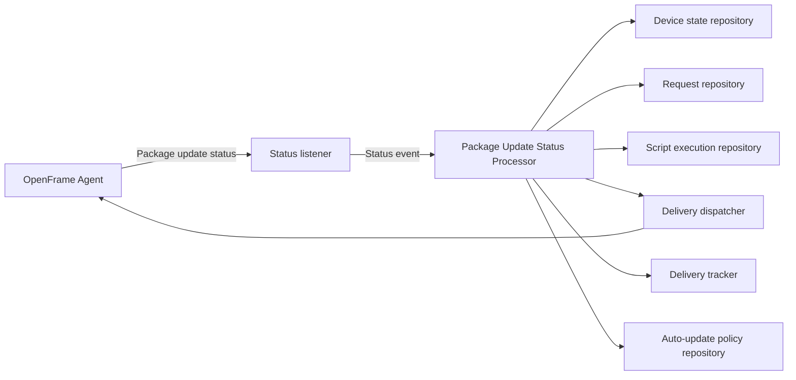
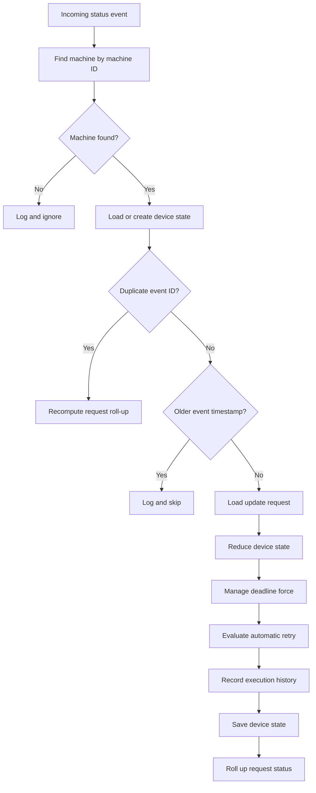
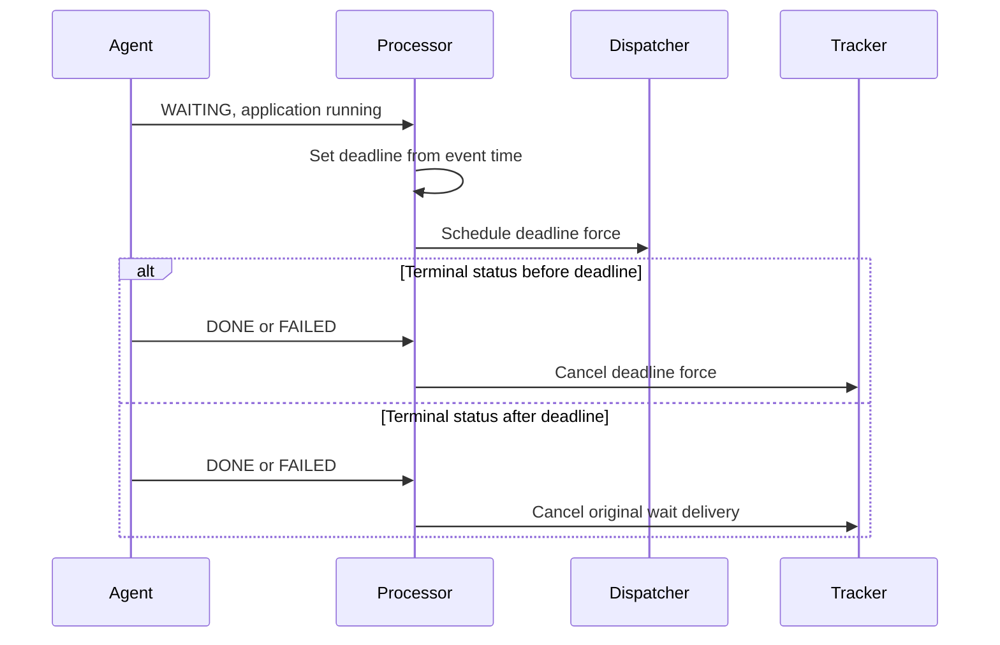
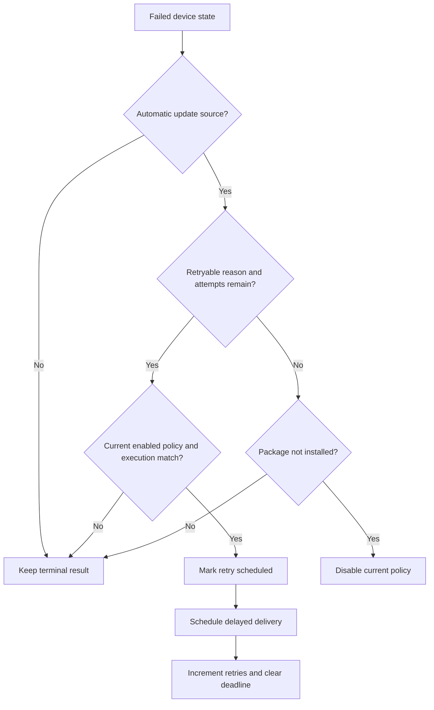

# Package Update Processing

Package Update Processing is the server-side reconciliation path for package-update outcomes reported by managed devices. It is supplied by the OpenFrame OSS Library artifact `com.openframe.oss:openframe-client-core` and runs in this repository's OpenFrame Client service. The module turns device status messages and delivery failures into per-device state, execution history, request-level progress, deadline-driven follow-up deliveries, and bounded automatic retries.

The module is enabled only when both `openframe.rmm.software.enabled` and `openframe.rmm.software.package-update.enabled` are `true`.

## Responsibilities

- Accept a package-update status for a machine and ignore unknown machines.
- Deduplicate by event identifier and reject events older than the last accepted event timestamp.
- Reduce an incoming waiting, completed, or failed report into a durable `PackageUpdateDeviceState`.
- Maintain the package-update execution history row represented by `ScriptExecution`.
- Aggregate all device states into the parent `PackageUpdateRequest` status.
- Schedule a forced follow-up delivery when a wait-mode update reaches its deadline, and cancel it when the update completes in time.
- Retry eligible automatic updates after a configured backoff, while preserving policy and version safety.
- Treat delivery failures as device failures only when the device has not already reported a status.

## System Position

The surrounding OpenFrame Client service receives device-facing delivery and status traffic. Package Update Processing is the status-side coordinator: it does not install packages itself. The OpenFrame agent performs the device-local operation, then reports its progress back through the package-update wire contract. The processor persists the reported outcome and makes it visible to software-action tracking.

The processor's host service is documented at [OpenFrame Client Core Java](openframe-client-core-java.md). The delivery-oriented service context is documented at [Telemetry and Delivery](telemetry_and_delivery.md).

## Core Components

| Component | Role | Key behavior |
|---|---|---|
| [Package Update Status Processor](https://github.com/flamingo-stack/openframe-oss-lib/blob/16e7c1cbd9664e7d10ec5ebca7d53c9bd314decf/openframe-client-core/src/main/java/com/openframe/client/listener/packageupdate/PackageUpdateStatusProcessor.java) | Orchestrator | Loads machine, request, and state; filters duplicate or stale events; coordinates reduction, history, retry, persistence, and roll-up. |
| [Package Update Device State Reducer](https://github.com/flamingo-stack/openframe-oss-lib/blob/16e7c1cbd9664e7d10ec5ebca7d53c9bd314decf/openframe-client-core/src/main/java/com/openframe/client/listener/packageupdate/PackageUpdateDeviceStateReducer.java) | Pure reducer | Maps wire status details into one device state and arms a wait-mode deadline. |
| [Package Update Execution Recorder](https://github.com/flamingo-stack/openframe-oss-lib/blob/16e7c1cbd9664e7d10ec5ebca7d53c9bd314decf/openframe-client-core/src/main/java/com/openframe/client/listener/packageupdate/PackageUpdateExecutionRecorder.java) | History adapter | Updates the corresponding script-execution history row with waiting, success, or failure semantics. |
| [Package Auto Update Retry](https://github.com/flamingo-stack/openframe-oss-lib/blob/16e7c1cbd9664e7d10ec5ebca7d53c9bd314decf/openframe-client-core/src/main/java/com/openframe/client/listener/packageupdate/PackageAutoUpdateRetry.java) | Retry policy coordinator | Verifies the auto-update policy is still current, schedules eligible redelivery, and disables a policy if the package is no longer installed. |

## Status Processing Flow

`PackageUpdateStatusProcessor.process` resolves the tenant from the machine record before looking up state and request data. This makes the machine record the trust boundary for tenant association rather than relying on a tenant identifier from the incoming status event.

### Event Ordering and Idempotency

The module applies two independent protections:

1. **Duplicate protection:** An event whose non-null identifier equals `lastEventId` is not reduced again. The processor still recalculates the parent request roll-up, which helps recover aggregation if an earlier attempt did not persist it.
2. **Stale protection:** An event with a timestamp strictly earlier than `lastEventAt` is ignored. Events lacking a timestamp do not meet this stale predicate.

After an accepted event, the reducer stores the event identifier and, when present, its timestamp. It also records a fresh server-side `updatedAt` timestamp.

## Device-State Reduction

The reducer has no repository or messaging dependencies. Its `apply` operation first copies common event data, clears details that belonged to a previous state, maps the event-specific payload, and then evaluates deadline arming.

| Wire state | Device action status | Stored details |
|---|---|---|
| `WAITING` | `WAITING` | Waiting reason, phase, close time, and optional application/user holders. |
| `DONE` | `COMPLETED` | Result, reboot requirement, and relaunch outcome. |
| `FAILED` | `FAILED` | Failure reason, message, and exit code. |

For all received status events, the reducer stores installed and available versions when supplied. Clearing the previous state's detail fields before the new mapping prevents obsolete waiting, completion, or failure metadata from appearing with the current status.

### Delivery Failures

`applyUndelivered` represents a delivery-engine failure as a terminal device state with:

- state `FAILED`;
- action status `FAILED`;
- failure reason `NOT_DELIVERED`; and
- a failure message derived from the `DeliveryFailure` value.

This path intentionally does not modify the device event clock. A status that arrives late from the agent can therefore still be accepted. `failUndelivered` also refuses to overwrite a state that already has `lastEventId`, because the device is already reporting on that request.

## Wait-Mode Deadline and Forced Delivery

A deadline is armed only once when all of the following are true:

- the request uses `WAIT` mode;
- the request defines `deadlineSeconds`;
- the event is `WAITING` because an application is running;
- the event supplies an occurrence time; and
- the device state does not already have a deadline.

The deadline is calculated from the event occurrence time plus `deadlineSeconds`. On first arming, the processor schedules a deadline-force delivery. If the device reaches a terminal state before the deadline, the processor cancels that force delivery. If completion is observed after the deadline, it withdraws the original wait order because the force delivery owns the agent result.

## Execution History Recording

Package Update Processing associates a device outcome with a `ScriptExecution` row by tenant, execution identifier, machine identifier, and package-update request identifier. If no matching history row exists, the recorder logs a warning and does not create one.

- A waiting report marks the row running and waiting. Repeated waiting reports do not cause another write when the row is already running and waiting.
- A successful report marks the row successful and writes a concise summary: either “Updated” or “Already up to date,” optionally including the installed version and reboot requirement.
- A failed report records failure status, exit code, and a mapped execution failure reason. Timeout becomes agent timeout, manager-missing or unsupported becomes launch failure, and manager, close, missing-package, or not-upgradable failures become system script errors.
- A superseded request is failed with the explicit superseded message but no execution failure reason.
- An undelivered order is recorded as a failed execution with `NO_ACK`.

## Automatic Retry Policy

Automatic retries apply only to requests sourced from auto-update policy and only while the current policy still identifies the same execution. The retry coordinator uses the policy version to prevent an outdated state report from scheduling work after the policy has changed.

A failure is eligible when it is one of the following and the next retry remains below the configured maximum:

- manager error;
- timeout;
- close failure; or
- not delivered.

Before dispatching a retry, the coordinator atomically marks the policy as having a retry scheduled. It then schedules a new package-update delivery for the same request after `openframe.rmm.software.package-update.retry.backoff-seconds`, increments the device retry count, and clears the prior deadline so that the new attempt can establish its own deadline.

A `NOT_INSTALLED` failure from an auto-update request instead disables the current policy. This is guarded by the policy's last version, so a concurrently changed policy is left untouched.

## Request Roll-Up

After an accepted status or eligible delivery failure, the processor reads all device states for the request and updates the request only if its aggregate status changes.

| Condition across device states | Request status |
|---|---|
| Every state is terminal and any state failed | `FAILED` |
| Every state is terminal and none failed | `COMPLETED` |
| Any non-terminal state is waiting | `WAITING` |
| Otherwise, any state is in progress | `IN_PROGRESS` |
| Otherwise | `SCHEDULED` |

No status is selected when the request has no device states. A missing request is tolerated for status and delivery-failure handling: device state can still be recorded, but request roll-up, execution-history lookup, deadline logic requiring request data, and retry policy validation will not proceed fully.

## Persistence and Operational Notes

The module persists three complementary views of the same device operation:

| Store | Purpose |
|---|---|
| Package update device state repository | Latest per-machine state, event cursor, versions, wait details, retry count, and deadline. |
| Package update request repository | Aggregate action progress across all targeted machines. |
| Script execution repository | Operator-facing execution history for the package-update request. |

For troubleshooting, begin with the request identifier and machine identifier. Processor logs distinguish duplicate events, stale events, missing machines, missing execution-history rows, undelivered orders, retry eligibility decisions, policy changes, deadline scheduling, and request-status transitions. The relevant log prefix is `[package-update]`.

## Configuration Surface

| Property | Used by | Purpose |
|---|---|---|
| `openframe.rmm.software.enabled` | All components | Global software-management feature gate. |
| `openframe.rmm.software.package-update.enabled` | All components | Package-update feature gate. |
| `openframe.rmm.software.package-update.retry.max-attempts` | Automatic retry | Limits attempts for retryable automatic-update failures. |
| `openframe.rmm.software.package-update.retry.backoff-seconds` | Automatic retry | Sets the delay before resubmitting the delivery. |
| Request `deadlineSeconds` | Status processor and reducer | Determines when a wait-mode force delivery is scheduled. |

## Maintenance Considerations

- Preserve the reducer's side-effect-free boundary. Repository access, history writes, dispatching, and tracking belong in the processor or retry coordinator.
- Treat `eventId` and event time as distinct ordering controls. Do not change duplicate or stale behavior without considering re-delivery and out-of-order device reports.
- Keep retry mutations version-guarded. The current policy check and `markRetryScheduled` write prevent a superseded policy from being retried or disabled.
- Keep deadline cancellation paired with terminal-state handling. A completed update must not leave an unnecessary forced delivery pending.
- Maintain the mapping between wire failure reasons and execution-history failure reasons so software-action history remains meaningful to operators.
