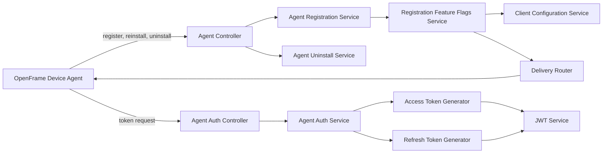
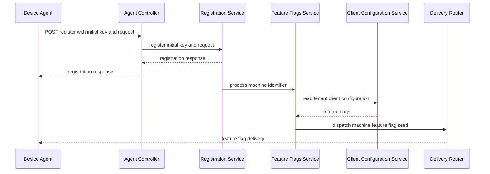
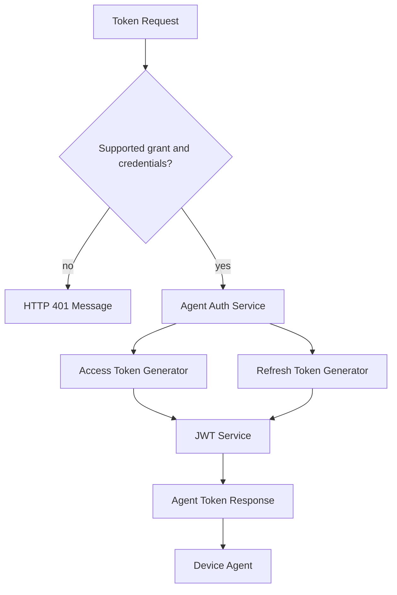
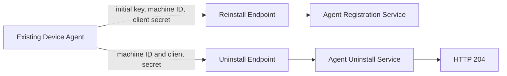

# Registration And Authentication

Registration And Authentication is the device-facing boundary of the OpenFrame Client service. It accepts an initial registration key and device metadata, supports authenticated reinstall and uninstall operations, issues OAuth-style client tokens, and schedules the tenant's current client feature flags for a newly registered machine.

The module is implemented by the `com.openframe.oss:openframe-client-core` library at version `7.0.11` and runs in this repository's OpenFrame Client service. It is a focused part of the verified [OpenFrame Client Core Java](openframe-client-core-java.md) documentation.

## Responsibilities

- Expose agent lifecycle endpoints under `/api/agents` for registration, reinstall, and uninstall.
- Require an initial key for registration-related calls, and machine identifier plus client secret for reinstall and uninstall calls.
- Expose `/oauth/token` for client-secret and refresh-token grant handling.
- Generate signed access tokens with machine, client, grant, and role claims.
- Generate refresh tokens with a bounded refresh-count progression.
- On successful registration processing, attempt to dispatch the tenant's current client feature flags to the new machine without turning a flag-delivery failure into a registration failure.

## System Position

The OpenFrame Client service hosts the HTTP controllers from this module. The device-side OpenFrame client first calls the registration API, then uses the returned client identity and credentials to obtain and renew tokens. After registration, the feature-flag service can seed the device's delivery stream with the current tenant configuration.

## Public HTTP Boundary

### Agent Lifecycle

`AgentController` is mapped to `/api/agents` and defines three POST operations.

| Operation | Required headers | Body | Result | Delegate |
| --- | --- | --- | --- | --- |
| `/register` | `X-Initial-Key` | Validated `AgentRegistrationRequest` | `AgentRegistrationResponse` | `AgentRegistrationService.register` |
| `/reinstall` | `X-Initial-Key`, `X-Machine-Id`, `X-Client-Secret` | Validated `AgentRegistrationRequest` | `AgentRegistrationResponse` | `AgentRegistrationService.reinstall` |
| `/uninstall` | `X-Machine-Id`, `X-Client-Secret` | None | HTTP 204 | `AgentUninstallService.uninstall` |

The controller is deliberately thin: it extracts the identity material from headers, applies Jakarta validation to the registration payload, and passes the request to the respective service. Authentication and registration validation policy therefore belongs to those delegates rather than to the controller.

The agent lifecycle endpoints are defined in [AgentController.java](https://github.com/flamingo-stack/openframe-oss-lib/blob/16e7c1cbd9664e7d10ec5ebca7d53c9bd314decf/openframe-client-core/src/main/java/com/openframe/client/controller/AgentController.java).

### Token Endpoint

`AgentAuthController` is mapped to `/oauth` and provides `POST /oauth/token`, producing JSON. It accepts these request parameters:

| Parameter | Required | Purpose |
| --- | --- | --- |
| `grant_type` | Yes | Selects the token grant handled by the authentication service. |
| `refresh_token` | No | Refresh-token credential for a renewal flow. |
| `client_id` | No | Client identifier for a client-secret flow. |
| `client_secret` | No | Client secret for a client-secret flow. |

The controller logs the requested client identifier at debug level and delegates issuance to `AgentAuthService.issueClientToken`. An `IllegalArgumentException` becomes HTTP 401 with a `message` field. Unexpected errors are logged server-side and become HTTP 400 with `server_error` and a generic description; internal exception details are not returned.

The endpoint is defined in [AgentAuthController.java](https://github.com/flamingo-stack/openframe-oss-lib/blob/16e7c1cbd9664e7d10ec5ebca7d53c9bd314decf/openframe-client-core/src/main/java/com/openframe/client/controller/AgentAuthController.java).

## Registration Flow

Registration starts with an initial key and a validated agent payload. The controller delegates the domain work to `AgentRegistrationService`. The provided module components establish that feature flags are a post-registration concern: `AgentRegistrationClientFeatureFlagsService.process` builds a machine-targeted delivery seed from the tenant configuration and routes it when this delivery type is enabled.

Feature-flag dispatch is best effort. The service exits immediately when `CLIENT_FEATURE_FLAGS` delivery is disabled. If configuration lookup or dispatch throws a runtime exception, it logs the error and preserves the successful registration result. This ensures a machine can register even when delivery infrastructure is temporarily unavailable; a later feature-flag release can reach it.

The implementation is in [AgentRegistrationClientFeatureFlagsService.java](https://github.com/flamingo-stack/openframe-oss-lib/blob/16e7c1cbd9664e7d10ec5ebca7d53c9bd314decf/openframe-client-core/src/main/java/com/openframe/client/service/agentregistration/AgentRegistrationClientFeatureFlagsService.java).

## Authentication And Token Lifecycle

The authentication service receives the requested grant type and the supplied credential type. The controller does not decide which optional parameters are valid together; that decision is delegated to `AgentAuthService`. The resulting token response is returned unchanged on success.

`AccessTokenGenerator` creates a Bearer JWT from an OAuth client record. Its claims include:

- issuer `https://auth.openframe.com`;
- issue time and an expiry calculated from `security.oauth2.token.access.expiration-seconds`;
- subject set to the client identifier;
- `machine_id`, `grant_type`, and `roles` claims.

`RefreshTokenGenerator` produces a separate JWT with the client identifier as its subject, a `refresh_count` claim initialized to zero, and an expiry set by `security.oauth2.token.refresh.expiration-seconds`. Its next-token operation increments the count. The configured `security.oauth2.token.refresh.max-refresh-count` is exposed by the generator for the authentication flow to enforce.

The access and refresh generators are implemented in [AccessTokenGenerator.java](https://github.com/flamingo-stack/openframe-oss-lib/blob/16e7c1cbd9664e7d10ec5ebca7d53c9bd314decf/openframe-client-core/src/main/java/com/openframe/client/service/auth/AccessTokenGenerator.java) and [RefreshTokenGenerator.java](https://github.com/flamingo-stack/openframe-oss-lib/blob/16e7c1cbd9664e7d10ec5ebca7d53c9bd314decf/openframe-client-core/src/main/java/com/openframe/client/service/auth/RefreshTokenGenerator.java).

## Reinstall And Uninstall

A reinstall supplies the initial key plus the existing machine identifier and client secret. This enables the registration service to distinguish the lifecycle operation from first-time registration. Uninstall does not accept a request body: the machine identifier and client secret are enough for `AgentUninstallService` to process the request, after which the controller returns HTTP 204.

## Security And Operational Considerations

- Treat `X-Initial-Key`, `X-Client-Secret`, refresh tokens, and generated JWTs as secrets. Do not include their values in logs or telemetry.
- The endpoint-level debug log records only `client_id`; no token, initial key, or client secret is logged by the provided controller code.
- Access-token expiry and refresh-token expiry are configuration-controlled. Keep the refresh-count limit consistent with the desired reauthentication policy.
- Validate the registration request at the HTTP boundary, but retain service-level validation because controller validation alone does not protect non-HTTP callers.
- Monitor feature-flag seed failures separately from registration failures. A failure is intentionally non-blocking and indicates that subsequent delivery should be checked.

## Component Reference

| Component | Role |
| --- | --- |
| `AgentController` | HTTP API for agent registration, reinstall, and uninstall. |
| `AgentAuthController` | HTTP token endpoint and error mapping for agent authentication. |
| `AgentRegistrationService` | Registration and reinstall delegate invoked by the lifecycle controller. |
| `AgentUninstallService` | Uninstall delegate invoked by the lifecycle controller. |
| `AgentRegistrationClientFeatureFlagsService` | Best-effort seed dispatcher for the tenant's current feature flags after registration. |
| `AccessTokenGenerator` | Builds access-token claims and signs the resulting JWT. |
| `RefreshTokenGenerator` | Builds initial and successor refresh-token claims, including the refresh counter. |

## Source And Runtime Context

This module's source is supplied by the OpenFrame OSS Library dependency and is assembled into the OpenFrame Client service published by this repository. The platform gateway routes `/clients/**` traffic to that service, while the service's runtime configuration supplies the client-service address, token lifetimes, signing support, configuration access, and delivery infrastructure.

For surrounding service startup, event delivery, and other client-service concerns, see [OpenFrame Client Core Java](openframe-client-core-java.md).
