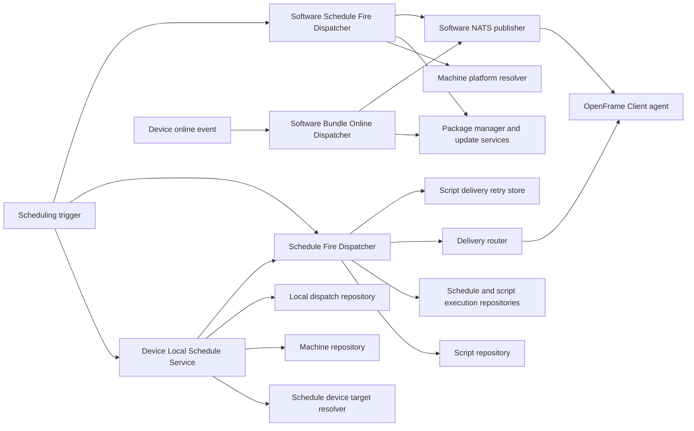
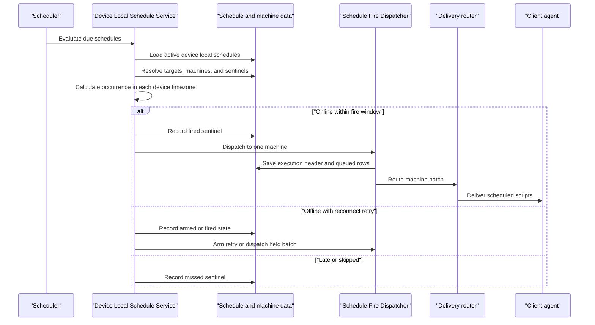
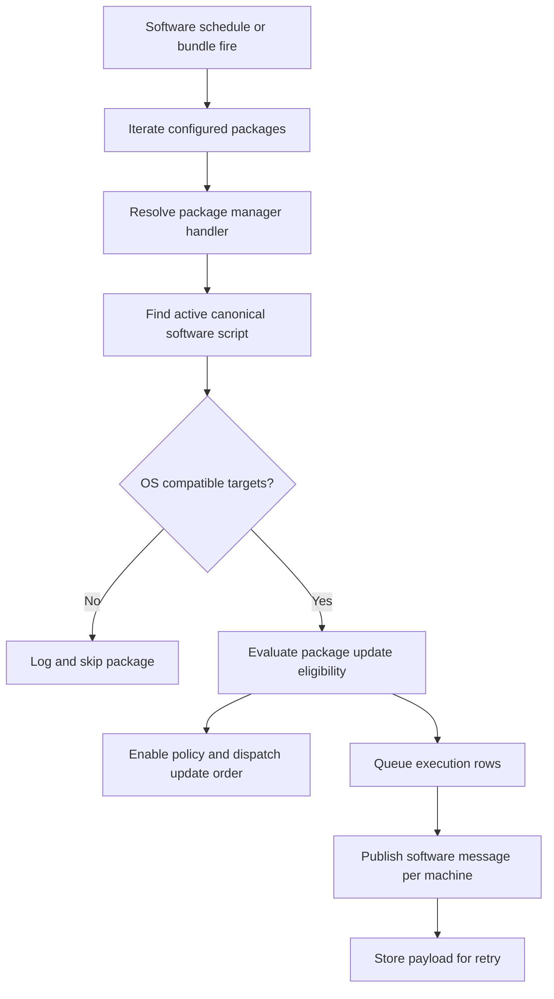

# Remote Management Scheduling

Remote Management Scheduling is the server-side dispatch layer for recurring remote-management work in the OpenFrame Client service. It turns due script and software schedules into per-device deliveries, creates execution-tracking records before publishing work, and applies distinct offline and compatibility rules so that devices do not receive work they cannot execute.

The implementation is supplied by the `com.openframe.oss:openframe-client-core` library at version `7.0.11` and is run by this repository's OpenFrame Client service. This module owns dispatch decisions; schedule evaluation, message routing, execution, and result processing are performed by collaborating components.

## Responsibilities

- Evaluate active script schedules expressed in each target device's local time.
- Resolve the devices currently assigned to a schedule.
- Prevent duplicate handling of the same device-local occurrence with durable dispatch sentinel records.
- Create a schedule execution header and queued script-execution rows before messages are sent.
- Route script schedules according to their offline behavior: skip, wait on a delivery route, or retry on reconnect within a deadline.
- Dispatch software bundle and software schedule packages through an eligible package-update path or as direct software scripts.
- Filter software work by package-manager availability and operating-system compatibility.
- Retain retry payloads for downstream delivery recovery.

## Architecture

The module is instantiated in the OpenFrame Client service. Its most important collaborators are provided by data, NATS delivery, and RMM services from the same OpenFrame OSS Library dependency:

| Collaboration | Purpose in this module |
|---|---|
| Schedule and target repositories/services | Load active schedules, resolve their assigned machines, and persist execution or dispatch state. |
| Machine repository and platform resolver | Supply online state, timezone, and operating-system information used to decide whether and how to dispatch. |
| Delivery router | Delivers scheduled script batches and can retain work for an offline machine when the route supports it. |
| NATS publishers | Send direct software script messages to a specific machine. |
| Package-manager and eligibility services | Select a package-management order or a direct script, based on machine capability and eligibility. |
| Retry store | Saves a delivery payload before dispatch so retry/watchdog facilities can republish it. |

## Core Components

### Device Local Schedule Service

[Device Local Schedule Service](https://github.com/flamingo-stack/openframe-oss-lib/blob/16e7c1cbd9664e7d10ec5ebca7d53c9bd314decf/openframe-client-core/src/main/java/com/openframe/client/service/rmm/DeviceLocalScheduleService.java) evaluates active `DATE_TIME` script schedules whose time reference is `DEVICE_LOCAL`.

A device-local schedule stores its start value as a UTC wall-clock `LocalDateTime`. For each resolved target, the service combines that wall-clock time with the target machine's reported timezone to compute the actual instant at which that machine should run. It processes online and offline devices separately.

Key safeguards and behavior:

- A target with no known timezone is skipped while online because its local occurrence cannot be calculated safely.
- An invalid stored timezone is logged and skipped rather than guessed.
- A non-repeating schedule is ignored after it has been handled for that device.
- A repeating schedule advances only after the current occurrence is recorded as fired, armed for reconnect, or missed.
- A per-schedule, per-machine sentinel records the last occurrence, decision timestamp, and dispatch status. A duplicate-key conflict means another evaluator won the race, so the current evaluator does not dispatch.
- The fire window is the configured device-local catch-up period, except that reconnect behavior with a positive reconnect window uses that window instead.

For an online device, a due occurrence outside its fire window is recorded as `MISSED`; otherwise it is recorded as `FIRED` before the service asks the Schedule Fire Dispatcher to send work to the single device.

For an offline device, `SKIP` behavior records the occurrence as missed. `RETRY_ON_RECONNECT` behavior depends on delivery routing: if the machine's script-schedule route can hold offline work, the service records `FIRED` and sends a batch with a deadline for that route to hold. Otherwise, it creates a reconnect-retry sentinel and records `ARMED_FOR_RECONNECT`. If the deadline has elapsed, it records `MISSED`.

### Schedule Fire Dispatcher

[Schedule Fire Dispatcher](https://github.com/flamingo-stack/openframe-oss-lib/blob/16e7c1cbd9664e7d10ec5ebca7d53c9bd314decf/openframe-client-core/src/main/java/com/openframe/client/service/rmm/ScheduleFireDispatcher.java) is the shared script-schedule dispatch boundary. It can resolve targets itself or accept a caller-provided target list, which is essential for single-device events such as a device-local occurrence or a device-online trigger.

Before publishing, it:

1. Resolves schedule script identifiers once, preserves their configured order, removes duplicates, and excludes missing or inactive scripts.
2. Generates one execution identifier for the entire schedule fire.
3. Persists one running schedule-execution header for the fire.
4. Persists one queued script-execution row for every script and target-machine pair.
5. Builds a shared schedule batch and publishes one routed delivery seed per machine.
6. Stores every per-machine payload in the retry store before routing it.

The dispatcher also enforces non-online target behavior for regular fires. Machines on a route that already holds scheduled work stay eligible for immediate routing; other non-online devices are either skipped or given a `DeviceFirstOnlineDispatch` retry record that expires after the schedule reconnect window.

### Software Bundle Online Dispatcher

[Software Bundle Online Dispatcher](https://github.com/flamingo-stack/openframe-oss-lib/blob/16e7c1cbd9664e7d10ec5ebca7d53c9bd314decf/openframe-client-core/src/main/java/com/openframe/client/service/rmm/SoftwareBundleOnlineDispatcher.java) applies every package in a software bundle to one machine when it is eligible for online dispatch. It is conditional on `openframe.rmm.software.enabled=true`.

For each package, it verifies that the machine reports a usable package manager, finds the canonical seeded software script for the package manager and requested action, and verifies that the script supports the machine operating system. It then derives a deterministic bundle/package execution identifier.

Eligible machines are dispatched through the package-update order path. That path enables the requested automatic-update policy and submits an administrative package update. Other machines receive a queued direct script execution; the dispatcher builds package-manager-specific arguments, publishes the software message to NATS, and saves the message in the retry store.

### Software Schedule Fire Dispatcher

[Software Schedule Fire Dispatcher](https://github.com/flamingo-stack/openframe-oss-lib/blob/16e7c1cbd9664e7d10ec5ebca7d53c9bd314decf/openframe-client-core/src/main/java/com/openframe/client/service/rmm/SoftwareScheduleFireDispatcher.java) dispatches each package in a software schedule to a supplied device set. It is also conditional on `openframe.rmm.software.enabled=true`.

The dispatcher resolves target operating systems in bulk and filters each package to machines compatible with the canonical software script. It partitions compatible machines into package-update-order targets and direct-script targets. Both groups share package metadata and a deterministic schedule/package execution identifier, but their delivery mechanisms differ:

- **Order targets** receive an administrative package update after policy configuration is enabled.
- **Direct-script targets** receive queued execution rows and individual NATS messages containing the script body, shell, privilege level, timeout, and generated package arguments.

## Device Local Script Flow

## Software Dispatch Flow

## State, Idempotency, and Failure Boundaries

The module makes dispatch decisions durable before or alongside external message delivery:

- Device-local sentinels identify the latest handled occurrence for each schedule and machine. They prevent duplicate dispatch from concurrent scheduler instances.
- Script schedule fires persist a parent execution record and queued leaf rows before routed messages are emitted. These records provide a durable execution view even when delivery or agent execution is delayed.
- Reconnect-retry rows carry an expiration time, limiting deferred delivery to the schedule's configured window.
- Direct software paths save queued execution rows and retry payloads before their NATS message is published.
- Per-schedule device-local evaluation catches and logs exceptions independently, allowing later schedules to continue through the same evaluation pass.

A failure after persistence but before delivery can leave work queued for retry/recovery rather than silently treating it as completed. Conversely, the code deliberately does not infer a timezone, package manager, script, or platform compatibility when required data is absent.

## Operational Considerations

- Configure `openframe.rmm.schedule.device-local.catchup-seconds` to define how long a device-local occurrence remains dispatchable when no reconnect-specific window applies.
- Ensure managed devices report accurate IANA-compatible timezone values. A missing timezone prevents an online device-local schedule from firing on that tick.
- Seed and keep required software scripts active for each package manager/action combination; absent or inactive canonical scripts cause that package to be skipped.
- Enable software scheduling only when `openframe.rmm.software.enabled` is true and package manager telemetry is available.
- Monitor logs for missed occurrences, absent timezones, unsupported operating systems, unavailable package managers, inactive scripts, and concurrent-sentinel messages. These messages distinguish policy decisions from delivery failures.
- Treat schedule offline behavior and reconnect windows as delivery guarantees: they control whether an offline target is skipped, held on a route, or retried until a defined deadline.

## Relationship to Adjacent Modules

Remote Management Scheduling is invoked by scheduled-operation components that determine when normal schedule scans or online dispatches occur. It relies on the client-service delivery and telemetry pipeline to route messages and observe machine connectivity. The agent-side client receives scheduled script batches or software script messages, executes permitted work, and returns execution outcomes through the platform's delivery and result-processing pipeline.
