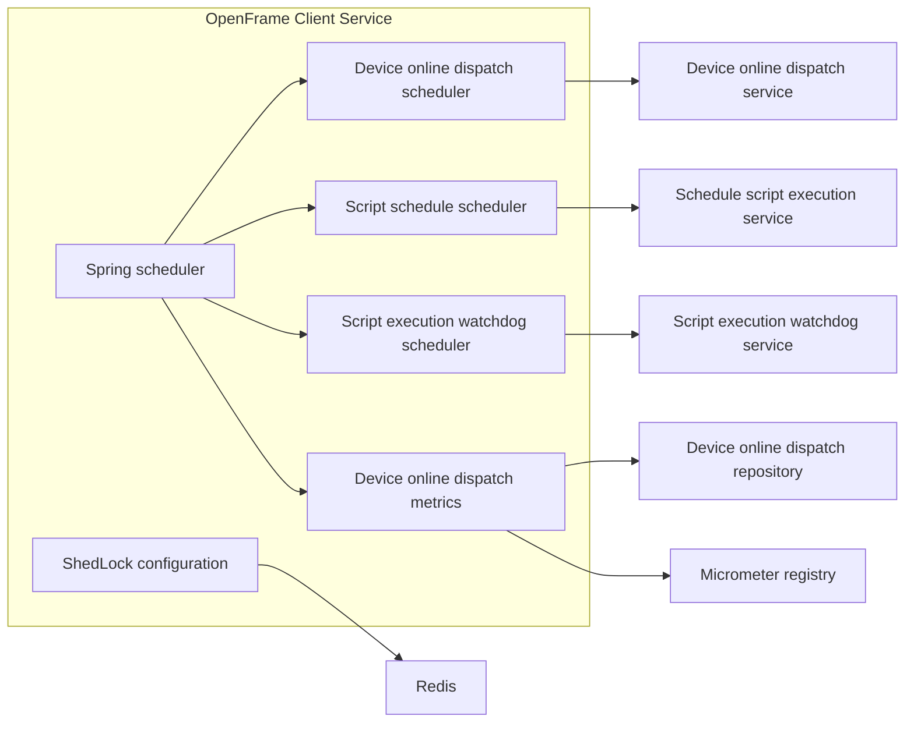
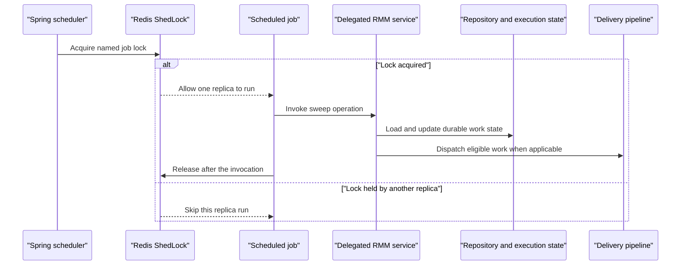

# Scheduled Operations

Scheduled Operations is the timer-driven coordination layer of the OpenFrame Client service. It periodically evaluates work that cannot be completed solely by an inbound event: dispatching work newly eligible because a device came online, firing due script schedules, and reaping script executions that have stopped making progress. The implementation is supplied by the OpenFrame OSS Library artifact `com.openframe.oss:openframe-client-core` at version `7.0.11` and runs in this repository's OpenFrame Client service.

This module deliberately contains scheduling and failure-isolation concerns rather than RMM business rules. Each scheduled method delegates to a dedicated service, logs an exception without terminating the scheduler, and uses a Redis-backed distributed lock so only one service replica performs a particular sweep at a time.

## Responsibilities

- Enable Spring scheduling and configure Redis-backed ShedLock coordination for the client service.
- Periodically drain pending device-online dispatch sentinels.
- Optionally evaluate due script schedules on a UTC cron expression.
- Optionally detect and fail stale script executions.
- Export the pending device-online backlog and configured drain batch size as Micrometer gauges.
- Contain failures at an individual scheduled invocation, preserving future runs.

The adjacent [Remote Management Scheduling](remote_management_scheduling.md) module defines the schedule-evaluation and dispatch behavior that Scheduled Operations invokes. The verified parent overview is [OpenFrame Client Core Java](openframe-client-core-java.md).

## Architecture

The scheduler components and the services they call come from `com.openframe.oss:openframe-client-core`. The Redis integration used by lock configuration comes from the OpenFrame data stack. At runtime, locks coordinate multiple OpenFrame Client replicas through the shared Redis deployment, while services and repositories own actual state transitions and delivery decisions.

## Distributed Scheduling Model

[ShedLock Configuration](https://github.com/flamingo-stack/openframe-oss-lib/blob/16e7c1cbd9664e7d10ec5ebca7d53c9bd314decf/openframe-client-core/src/main/java/com/openframe/client/config/ShedLockConfig.java) enables Spring scheduling and ShedLock with a default maximum lock duration of ten minutes. Its `RedisLockProvider` uses the configured Redis connection factory and an `OpenframeRedisKeyBuilder` tenant key.

The resulting key prefix is tenant scoped and has the `job-lock` category. An `openframe.shedlock.environment` value, defaulting to `default`, namespaces locks further. Therefore, replicas for the same tenant and environment compete for the same job lock, rather than each replica independently executing the scan.

Every scheduled operation declares a stable lock name plus minimum and maximum holding intervals:

| Operation | Lock name | Why it is coordinated |
|---|---|---|
| Device-online dispatch | `deviceOnlineDispatch` | Ensures one replica drains newly-online sentinel records per run. |
| Script schedule sweep | `scriptScheduleRunner` | Prevents duplicated due-schedule evaluation across replicas. |
| Execution watchdog | `scriptExecutionWatchdog` | Ensures only one replica reaps stale executions in a sweep. |

The maximum duration is a safety bound: it limits how long a lock can suppress later work if a process stops unexpectedly. The configured minimum duration avoids immediate re-entry and excessive contention during frequent scans. Correctness also depends on the delegated services' durable state transitions and idempotency; distributed locking controls concurrent scheduler ownership, not all possible delivery failures.

## Scheduled Jobs

### Device Online Dispatch

[Device Online Dispatch Scheduler](https://github.com/flamingo-stack/openframe-oss-lib/blob/16e7c1cbd9664e7d10ec5ebca7d53c9bd314decf/openframe-client-core/src/main/java/com/openframe/client/scheduler/DeviceOnlineDispatchScheduler.java) calls `DeviceOnlineDispatchService.processDevicesBecameOnline()` on a fixed delay. The interval is controlled by `openframe.rmm.device-online.dispatch.interval` and defaults to `60000` milliseconds. Its lock lasts at most two minutes and at least ten seconds unless the matching properties override those defaults.

This scheduler has no feature-property condition, so it is created when the client application includes the module. A failed drain is logged as `DEVICE_ONLINE dispatch sweep failed`; the exception is not rethrown. That choice means the next fixed-delay run remains available to process still-pending work.

The downstream service is covered by a library test at `openframe-client-core/src/test/java/com/openframe/client/service/DeviceOnlineDispatchServiceTest.java`. Its role is to process device-online dispatch work, while the remote-management scheduling layer supplies the dispatch semantics.

### Script Schedule Runner

[Schedule Script Scheduler](https://github.com/flamingo-stack/openframe-oss-lib/blob/16e7c1cbd9664e7d10ec5ebca7d53c9bd314decf/openframe-client-core/src/main/java/com/openframe/client/scheduler/ScheduleScriptScheduler.java) delegates to `ScheduleScriptExecutionService.runDueSchedules()`. It exists only when `openframe.rmm.schedule.runner.enabled=true`.

By default, it runs at minute zero and minute thirty of every hour. The cron expression is supplied by `openframe.rmm.schedule.runner.cron`, and the scheduler explicitly interprets it in UTC. The default lock is held for at most five minutes and at least ten seconds, configurable through the corresponding `lock-at-most-for` and `lock-at-least-for` properties.

The explicit UTC zone keeps scheduler trigger calculation consistent between pods. Device-local behavior, target resolution, execution records, and delivery behavior belong to the delegated RMM services described in [Remote Management Scheduling](remote_management_scheduling.md), not to this adapter.

### Script Execution Watchdog

[Script Execution Watchdog Scheduler](https://github.com/flamingo-stack/openframe-oss-lib/blob/16e7c1cbd9664e7d10ec5ebca7d53c9bd314decf/openframe-client-core/src/main/java/com/openframe/client/scheduler/ScriptExecutionWatchdogScheduler.java) calls `ScriptExecutionWatchdogService.markStuckExecutionsAsFailed()`. It is conditional on `openframe.rmm.execution.watchdog.enabled=true`.

Unlike the cron-driven schedule runner, the watchdog uses a fixed delay set by `openframe.rmm.execution.watchdog.interval`; this property has no in-code default and must be provided when the feature is enabled. Its maximum and minimum lock durations are likewise read from `openframe.rmm.execution.watchdog.lock-at-most-for` and `openframe.rmm.execution.watchdog.lock-at-least-for`.

The watchdog contains failures by logging `Stuck-execution reap sweep failed`. It does not convert an infrastructure error into a success state: stale-execution classification remains the responsibility of the watchdog service and will be reconsidered on a later successful sweep.

## Device Online Backlog Metrics

[Device Online Dispatch Metrics](https://github.com/flamingo-stack/openframe-oss-lib/blob/16e7c1cbd9664e7d10ec5ebca7d53c9bd314decf/openframe-client-core/src/main/java/com/openframe/client/metrics/DeviceOnlineDispatchMetrics.java) exposes two Micrometer gauges:

| Metric | Value | Meaning |
|---|---|---|
| `openframe.rmm.device_online.pending` | Count of `NEW` device-online dispatch records | Backlog awaiting the dispatch drain. |
| `openframe.rmm.device_online.batch_size` | `openframe.rmm.device-online.dispatch.batch-size` | Configured drain capacity and a useful backlog alert threshold. |

The metrics component refreshes the pending count using the same device-online dispatch interval as the dispatch scheduler. A repository read failure produces a warning and leaves the previous value in place, which avoids turning observability refresh errors into scheduler failures. The batch-size gauge is registered once at component construction and reflects configuration rather than a dynamic count.

## Job Interaction and Data Flow

The device-online scheduler begins with already-recorded `NEW` sentinels, so its measurable backlog is repository state rather than an in-memory queue. The script runner evaluates work due at the current UTC trigger time and delegates its per-device delivery decisions. The watchdog completes the complementary lifecycle task by reconciling execution rows that remain stale. Together, the three jobs cover eligibility discovery, scheduled dispatch, and terminal recovery.

## Configuration Reference

| Property | Default in code | Used by |
|---|---|---|
| `openframe.shedlock.environment` | `default` | Redis lock namespace. |
| `openframe.rmm.device-online.dispatch.interval` | `60000` | Device-online drain and pending-gauge refresh cadence. |
| `openframe.rmm.device-online.dispatch.lock-at-most-for` | `2m` | Maximum device-online lock duration. |
| `openframe.rmm.device-online.dispatch.lock-at-least-for` | `10s` | Minimum device-online lock duration. |
| `openframe.rmm.device-online.dispatch.batch-size` | No default in this module | Batch-size metric. |
| `openframe.rmm.schedule.runner.enabled` | Disabled unless set to `true` | Creates the script schedule runner. |
| `openframe.rmm.schedule.runner.cron` | `0 0,30 * * * *` | UTC script schedule cadence. |
| `openframe.rmm.schedule.runner.lock-at-most-for` | `5m` | Maximum script schedule lock duration. |
| `openframe.rmm.schedule.runner.lock-at-least-for` | `10s` | Minimum script schedule lock duration. |
| `openframe.rmm.execution.watchdog.enabled` | Disabled unless set to `true` | Creates the stale-execution watchdog. |
| `openframe.rmm.execution.watchdog.interval` | No default in this module | Watchdog fixed delay. |
| `openframe.rmm.execution.watchdog.lock-at-most-for` | No default in this module | Maximum watchdog lock duration. |
| `openframe.rmm.execution.watchdog.lock-at-least-for` | No default in this module | Minimum watchdog lock duration. |

## Operations and Failure Handling

- Run more than one OpenFrame Client replica only with a shared, reachable Redis instance. Without shared lock state, replicas cannot coordinate scheduled ownership.
- Keep maximum lock durations comfortably above normal service execution time but bounded enough to recover after a stalled replica.
- When enabling the script runner or watchdog, supply every property without an in-code default before deployment.
- Alert when `openframe.rmm.device_online.pending` remains above the configured batch size over multiple intervals. A single sample above the threshold may merely indicate normal batch draining; a sustained increase indicates insufficient drain capacity or a downstream problem.
- Treat scheduler error logs as retryable sweep failures, then inspect delegated service logs and durable execution records for the root cause. The scheduler intentionally continues running after an exception.
- Do not interpret an absent scheduled component as a scheduler failure when its feature flag is disabled; conditional creation is an intentional operational control.

## Boundaries

Scheduled Operations does not expose an HTTP endpoint and does not itself execute agent scripts. It is a server-side component of the OpenFrame Client service that invokes RMM services supplied by the OpenFrame OSS Library. The agent-side client, delivery listeners, execution-result handling, and persistence repositories are separate modules. This separation keeps job timing and distributed coordination small, while allowing the RMM domain services to own target selection, state changes, and delivery guarantees.
