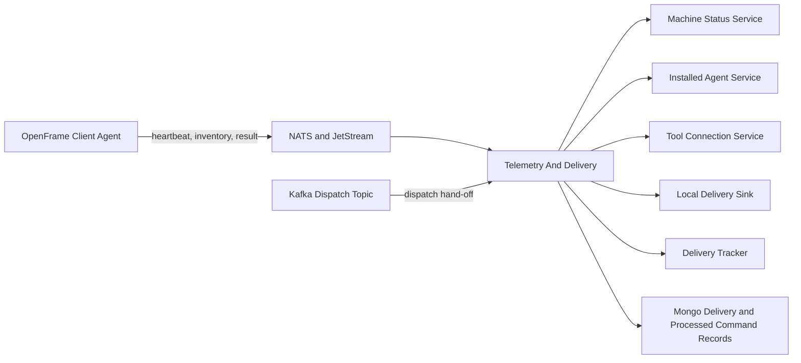
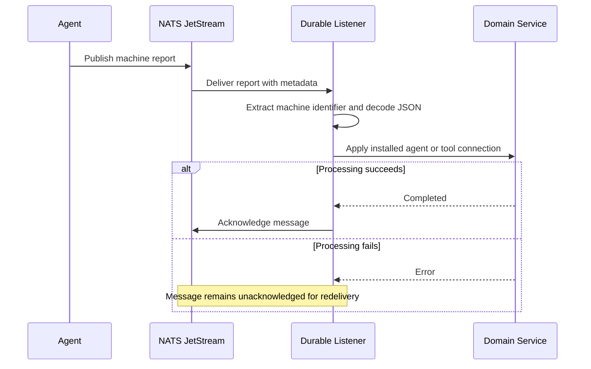
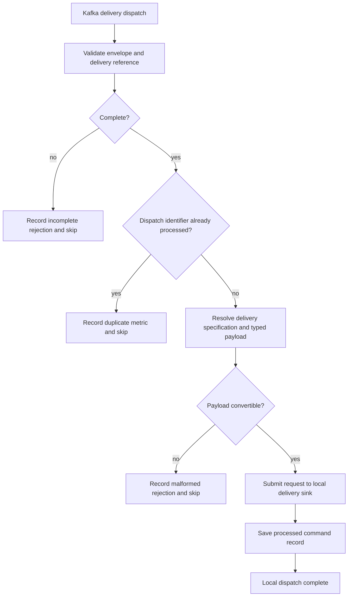
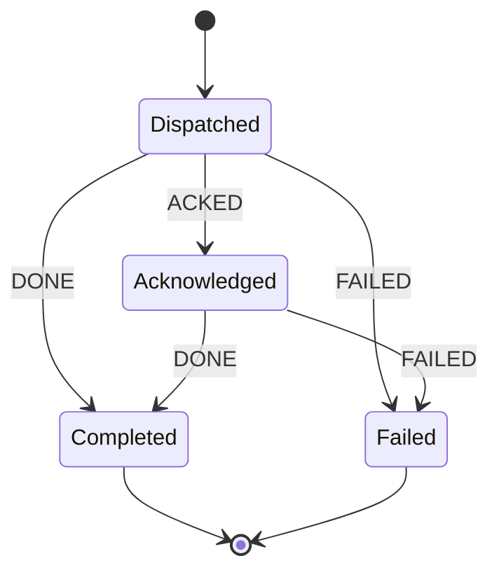

# Telemetry And Delivery

Telemetry And Delivery is the message-ingestion and command hand-off boundary in the OpenFrame Client service. It runs in this repository's `openframe-client` application but is supplied by the `com.openframe.oss:openframe-client-core` library, version `7.0.11`. The module consumes agent-originated machine telemetry from NATS JetStream, records delivery outcomes, and optionally receives centrally prepared delivery work from Kafka for local dispatch.

Its responsibilities are deliberately narrow:

- receive heartbeats and turn them into service-side liveness updates;
- consume durable installed-agent and tool-connection reports;
- route valid delivery hand-offs into the local delivery sink once;
- correlate agent acknowledgements, completions, and failures with delivery tracking; and
- distinguish malformed, terminally invalid input from transient processing failures so that only the latter is retried.

## System Position

The deployed OpenFrame Client service is one of the tenant services built from the OpenFrame OSS Library. The client-side agent publishes telemetry and delivery results to NATS. This module is the server-side consumer for the five message types in scope. Kafka is an additional, feature-gated inbound path for delivery dispatches; it is inactive unless both Kafka support and a dispatch topic are configured.

The service configuration in this repository supplies the client service's Kafka and NATS connectivity. The NATS service is deployed as a datasource, while the client configuration points at its cluster service. The application-specific configuration should also supply the delivery dispatch topic and consumer group when Kafka hand-off is enabled.

## Component Map

| Component | Transport and subscription | Primary action | Delivery behavior |
|---|---|---|---|
| [MachineHeartbeatListener](https://github.com/flamingo-stack/openframe-oss-lib/blob/16e7c1cbd9664e7d10ec5ebca7d53c9bd314decf/openframe-client-core/src/main/java/com/openframe/client/listener/MachineHeartbeatListener.java) | Core NATS dispatcher on `machine.*.heartbeat` | Extracts the machine identifier and passes a server-generated timestamp to `MachineStatusService`. | Errors are logged inside the callback. The dispatcher is drained for up to five seconds during shutdown. |
| [InstalledAgentListener](https://github.com/flamingo-stack/openframe-oss-lib/blob/16e7c1cbd9664e7d10ec5ebca7d53c9bd314decf/openframe-client-core/src/main/java/com/openframe/client/listener/InstalledAgentListener.java) | JetStream stream `INSTALLED_AGENTS`, subject `machine.*.installed-agent` | Deserializes an installed-agent report and calls `InstalledAgentService`. | Acknowledges only after success. An exception leaves the message unacknowledged for redelivery and forwards whether this is the final attempt to the service. |
| [ToolConnectionListener](https://github.com/flamingo-stack/openframe-oss-lib/blob/16e7c1cbd9664e7d10ec5ebca7d53c9bd314decf/openframe-client-core/src/main/java/com/openframe/client/listener/ToolConnectionListener.java) | JetStream stream `TOOL_CONNECTIONS`, subject `machine.*.tool-connection` | Deserializes a tool connection and calls `ToolConnectionService`. | Uses durable consumer `tool-connection-processor-v2`, acknowledges after success, and otherwise permits redelivery. |
| [DeliveryDispatchListener](https://github.com/flamingo-stack/openframe-oss-lib/blob/16e7c1cbd9664e7d10ec5ebca7d53c9bd314decf/openframe-client-core/src/main/java/com/openframe/client/listener/delivery/DeliveryDispatchListener.java) | Kafka topic configured by `openframe.delivery.dispatch-topic` | Validates a dispatch, resolves its delivery specification, and sends a typed request to `LocalDeliverySink`. | Rejects incomplete or malformed commands as terminal input; propagates Mongo failures so the Kafka record is retried. A processed-command record provides idempotency. |
| [DeliveryResultListener](https://github.com/flamingo-stack/openframe-oss-lib/blob/16e7c1cbd9664e7d10ec5ebca7d53c9bd314decf/openframe-client-core/src/main/java/com/openframe/client/listener/delivery/DeliveryResultListener.java) | JetStream stream and subject filter defined by `DeliveryResultMessage` | Validates an agent result and updates `DeliveryTracker`. | Acknowledges valid results and permanently malformed or incomplete results. Unexpected exceptions are not acknowledged, allowing retry. |

## NATS Telemetry Ingestion

### Heartbeats

`MachineHeartbeatListener` is activated after the Spring application is ready. It creates a NATS dispatcher and subscribes to `machine.*.heartbeat`. For each message it:

1. extracts the machine identifier from the NATS subject using `NatsTopicMachineIdExtractor`;
2. creates the event timestamp at the client-service boundary with `Instant.now()` rather than trusting an agent-provided time;
3. invokes `MachineStatusService.processHeartbeat`; and
4. logs errors without allowing a single message to terminate the callback path.

The listener drains its dispatcher in `@PreDestroy`, with a five-second timeout. This makes shutdown cooperative for work already accepted by the NATS dispatcher, but heartbeat processing itself does not use the JetStream acknowledgement mechanism shown by the durable telemetry listeners.

### Durable agent and tool reports

Installed-agent and tool-connection messages both inherit the shared `AbstractJetStreamPushListener` lifecycle. They deserialize UTF-8 JSON after extracting the machine identifier from the subject. The durable-consumer metadata provides the delivery count; `isLastAttempt` derives a flag that downstream services can use when making their persistence or recovery decision.

The installed-agent listener uses consumer `installed-agent-processor-v1`, delivery group `installed-agent`, and delivery subject `machine.installed-agent.delivery`. The tool-connection listener uses consumer `tool-connection-processor-v2`, delivery group `tool-connection`, and delivery subject `machine.tool-connection.delivery`. The versioned tool consumer is intentional: the source notes that the previous consumer could not be altered to add a delivery group in existing environments.

## Kafka Delivery Dispatch

`DeliveryDispatchListener` implements the server-side hand-off from a Kafka delivery dispatch record to the client service's local delivery machinery. It is created only when both conditions are true:

- `spring.oss-tenant.kafka.enabled` resolves to `true`; and
- `openframe.delivery.dispatch-topic` is non-empty.

Its Kafka consumer group comes from `openframe.delivery.dispatch-group`. The source explicitly requires this group to include the tenant identity because the tenant Kafka infrastructure is shared; this prevents a restart in one tenant from unnecessarily rebalancing all client-service consumers.

### Dispatch validation and idempotency

A dispatch must have an audience, a payload containing a `delivery` block, and a machine identifier unless its audience is every machine. The nested delivery reference must include a type, target identifier, and dispatch identifier. Rejections are categorized as `incomplete` or `malformed` and are counted through `DeliveryMetrics`.

For a valid message, the listener checks `ProcessedCommandRepository` by dispatch identifier before doing any local work. A pre-existing entry is treated as a duplicate, counted, logged, and skipped. Otherwise, the listener uses `DeliverySpecRegistry` to select the payload class for the delivery type, converts the JSON payload to that class, constructs a `DeliveryRequest`, and submits it to `LocalDeliverySink`. It persists `ProcessedCommand` only after the sink accepts the request.

This ordering defines the effective at-least-once boundary: Kafka or Mongo errors before the processed-command record is written can retry the record. The repository check suppresses a later repeat after the record exists. The local sink must therefore be considered part of the same logical delivery operation when assessing failure scenarios.

## Delivery Result Processing

Agents report outcome messages through the NATS delivery-result stream. `DeliveryResultListener` reads a `DeliveryResultMessage`, verifies that the delivery reference and result are complete, then maps the result to the tracking operation:

| Agent result | Tracker call | Meaning |
|---|---|---|
| `ACKED` | `DeliveryTracker.acknowledge` | The agent accepted the delivery. |
| `DONE` | `DeliveryTracker.done` | The agent completed the delivery. |
| `FAILED` | `DeliveryTracker.fail` | The agent reports a terminal failure and provides the reported error. |

Invalid agent reports are intentionally acknowledged after the listener records a rejection metric. This avoids poison-message retry loops for contract violations. By contrast, unexpected failures during machine identifier extraction, parsing outside the permanent-failure cases, or tracker updates are logged without acknowledgement so JetStream can redeliver them.

The state diagram describes the outcomes understood by this listener. It does not imply that every delivery must emit an acknowledgement before completion, because the listener accepts both `ACKED` and `DONE` reports independently.

## Failure Handling and Operational Signals

Telemetry And Delivery uses transport-aware failure handling rather than one universal retry policy.

| Input path | Permanent bad input | Transient or unexpected failure | Signal |
|---|---|---|---|
| Heartbeat NATS dispatcher | Logged by the callback. | Logged by the callback. | Listener logs. |
| Installed-agent JetStream | Exception leaves the report unacknowledged. | Leaves the report unacknowledged for redelivery. | Log entries and JetStream delivery count. |
| Tool-connection JetStream | Exception leaves the report unacknowledged. | Leaves the report unacknowledged for redelivery. | Log entries and JetStream delivery count. |
| Kafka dispatch | Incomplete and malformed records are rejected and skipped. | Mongo persistence failures propagate to Kafka for retry. | `DeliveryMetrics` dispatch counters and logs. |
| Delivery-result JetStream | Incomplete or malformed reports are rejected and acknowledged. | Leaves the report unacknowledged for retry. | `DeliveryMetrics` result-rejection counters and logs. |

Operational investigation should begin with the message subject, machine identifier, delivery dispatch identifier, and delivery count emitted by the listeners. Do not infer a machine identifier from JSON alone: these listeners derive it from the NATS topic, establishing the transport subject as the routing identity. For dispatch incidents, distinguish a rejected record from a duplicate: the former did not satisfy the delivery contract, whereas the latter was previously recorded as handled.

## Data and Contract Boundaries

- **Machine identity:** NATS subjects encode the machine identifier and are parsed by `NatsTopicMachineIdExtractor` before a report is applied.
- **Telemetry payloads:** installed-agent reports are decoded as `InstalledAgentMessage`; tool reports are decoded as `ToolConnectionMessage`.
- **Delivery dispatch envelope:** Kafka provides a `DeliveryDispatchMessage` carrying audience, optional machine identifier, due time, and a JSON command payload with a nested delivery reference.
- **Delivery result envelope:** NATS provides `DeliveryResultMessage`, whose delivery reference is paired with an outcome and optional failure detail.
- **Persistence boundary:** `ProcessedCommandRepository` is the deduplication ledger for Kafka hand-off. Domain services and `DeliveryTracker` own the state changes beyond listener validation and routing.

## Maintenance Guidance

1. Preserve subject, stream, durable consumer, delivery group, and delivery subject compatibility when changing NATS listeners. These names determine existing JetStream consumer behavior.
2. Keep acknowledgement placement after successful domain processing for retryable telemetry. Moving an acknowledgement earlier converts recoverable handling failures into silent data loss.
3. Treat malformed input policies separately from infrastructure failures. The dispatch listener deliberately skips terminal bad input, while delivery-result processing acknowledges only contract-invalid messages.
4. Maintain the dispatch identifier check and the post-sink persistence order when evolving Kafka delivery flow. Changes here affect duplicate suppression and retry semantics.
5. When adding delivery types, register an appropriate `DeliverySpec`; the dispatch listener relies on the registry to select the typed payload contract.
6. Keep delivery metric reason values stable where possible because they are the module's explicit observability vocabulary for rejected dispatches and results.

## Source Ownership

The runtime implementation documented here belongs to the OpenFrame OSS Library and is assembled into this repository's OpenFrame Client service through `com.openframe.oss:openframe-client-core` version `7.0.11`. The canonical sources are the five component links in the component map. This tenant repository provides the service application, deployment manifests, and service configuration that run the library code.
