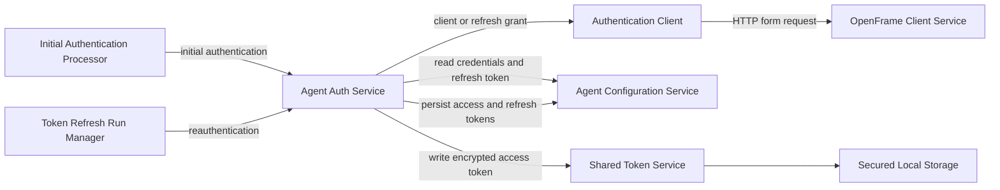
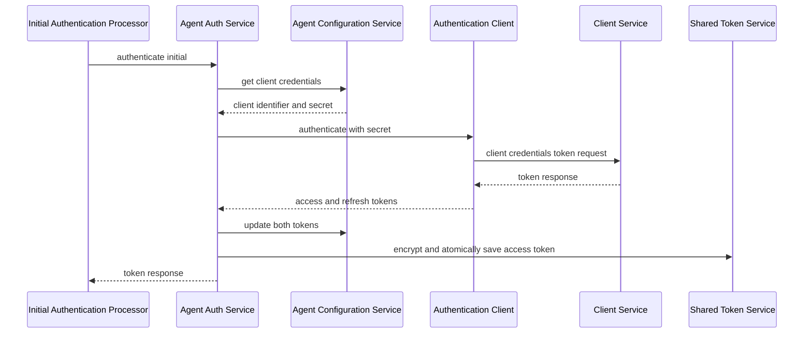
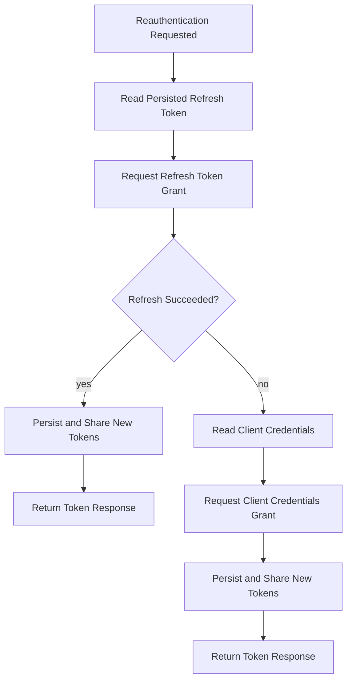
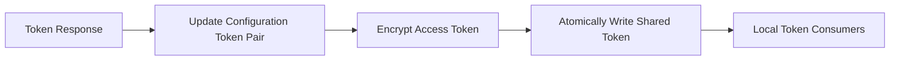

# Agent Auth Service

Agent Auth Service establishes and renews the credentials used by the OpenFrame endpoint client. It is implemented by the `AgentAuthService` type in the OpenFrame OSS Library's Rust client and is assembled by this repository through the `openframe_agent_lib` dependency. The service obtains access and refresh tokens from the client service, persists the latest pair in the local agent configuration, and publishes the access token to the encrypted shared-token store used by local integrations.

The implementation source is maintained in the [OpenFrame OSS Library](https://github.com/flamingo-stack/openframe-oss-lib/blob/16e7c1cbd9664e7d10ec5ebca7d53c9bd314decf/clients/openframe-client/src/services/agent_auth_service.rs).

## Responsibilities

- Perform first-time authentication with persisted client credentials.
- Prefer refresh-token reauthentication while the agent is running.
- Fall back to the client-credentials grant when refresh authentication returns an error.
- Keep durable agent configuration and the encrypted shared access-token artifact synchronized after a successful token response.
- Propagate contextual errors so callers can retry and log the failed authentication stage.

The service does not decide when to authenticate, schedule retries, create registration credentials, or establish the HTTP transport. Those responsibilities belong respectively to the initial-authentication processor and token-refresh run manager, registration components, and the authentication client.

## Architecture

### Collaborators

| Component | Role in the flow |
|---|---|
| `AuthClient` | Posts form-encoded OAuth token requests to the configured client-service base URL. It supports `client_credentials` and `refresh_token` grants. |
| `AgentConfigurationService` | Reads client credentials and the existing refresh token. Its token update is protected by a write lock, reads the current configuration, replaces both token fields, and saves the result. |
| `SharedTokenService` | Encrypts the access token and atomically writes it to the secured agent directory. This makes the current access token available to local consumers without exposing the configuration file directly. |
| `InitialAuthenticationProcessor` | On startup, skips initial authentication when a persisted access token is nonempty; otherwise it repeatedly invokes initial authentication, waiting 60 seconds after failures. |
| `TokenRefreshRunManager` | Runs proactive renewal. It refreshes once on startup, schedules subsequent attempts from token lifetime information, applies a reauthentication timeout, and retries failures on its configured retry interval. |

The token response is represented by `AgentTokenResponse`, which contains `access_token`, `refresh_token`, `token_type`, and an optional `expires_in` lifetime. The Agent Auth Service persists and distributes only the two token values; scheduling logic consumes the lifetime in the refresh manager.

## Initial Authentication

`authenticate_initial` is the bootstrap path. It obtains the saved client identifier and client secret from the Agent Configuration Service, then asks the Authentication Client for a token using the client-credentials grant. On success, it calls the shared persistence routine before returning the response to its caller.

The initial-authentication processor only selects this path when no nonempty persisted access token is present. Its retry loop is outside Agent Auth Service, so this service returns the underlying error instead of sleeping or applying backoff itself.

## Reauthentication and Fallback

`reauthenticate` first calls the refresh-token path. That path reads the locally persisted refresh token and asks the Authentication Client to use the refresh-token grant. A successful response is immediately persisted and written to secure shared storage.

If that operation returns any error, `reauthenticate` invokes the client-credentials flow. The lower-level refresh helper explicitly recognizes HTTP 401 and 403 messages as token rejection and logs that it will use client credentials. Other failures gain the context `Refresh token flow failed`. Nevertheless, both categories are errors to `reauthenticate`, so the current top-level behavior falls back for any refresh failure, not only 401 or 403 responses.

The Authentication Client posts both grants to its client token endpoint using `application/x-www-form-urlencoded`. It reports each response status to the deactivation service before parsing a successful response or returning an error. As a result, authentication traffic also participates in gateway-status handling, including the refresh manager's suspended-tenant probe behavior.

## Token Persistence and Security Boundary

All successful grant paths converge on one internal operation:

1. Update access and refresh tokens in the agent configuration.
2. Encrypt the new access token through the encryption service.
3. Atomically replace the secured shared-token artifact.

The ordering matters. Configuration is updated before the shared token is written. If configuration persistence fails, the shared token is not changed. If encryption or the final shared-token write fails, the configuration already contains the new pair and the call returns an error. Callers therefore treat the operation as failed and can retry, but maintainers should recognize that the persisted configuration and shared access token can temporarily differ after a failure in the final stage.

Tokens and client secrets should never be logged. The implementation logs which authentication strategy succeeded or was selected, not token values. Error context identifies the failed operation, such as token request, configuration update, or shared-token update, while retaining the originating error.

## Runtime Lifecycle

The expected lifecycle is:

1. Registration provisions credentials and writes them through the configuration layer.
2. Startup checks for an existing access token.
3. If no token exists, the initial-authentication processor keeps attempting the client-credentials bootstrap flow.
4. The token-refresh run manager performs reauthentication once at startup because it does not trust stored token lifetime relative to the device clock.
5. Later refreshes use the refresh token when possible and fall back to client credentials on error.
6. Each successful authentication refreshes both persistent token locations before downstream tools use the new access token.

During a deactivation suspension, the refresh manager becomes the single backoff probe. It waits for the deactivation service's next probe delay and invokes reauthentication with a timeout. A successful response reschedules normal refresh timing; an unsuccessful probe leaves the manager in its suspended flow.

## Maintenance Notes

- Keep `authenticate_initial` and the fallback credentials flow aligned: both use the same client-credentials request and common persistence operation.
- Preserve the write order in the common persistence routine unless consumers are redesigned to tolerate a different consistency model.
- The refresh-rejection detection currently inspects error text for `401` or `403`; changing Authentication Client error types to expose status codes would make this classification reliable.
- Do not add retry delays inside Agent Auth Service. The initial-authentication processor and token-refresh run manager already own retry policy, timing, and cancellation boundaries.
- Changes to token response fields or storage semantics must be reviewed with local consumers of the encrypted shared-token store and with the proactive refresh scheduler.
