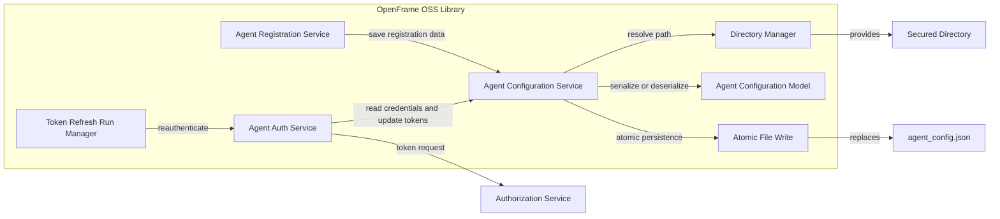
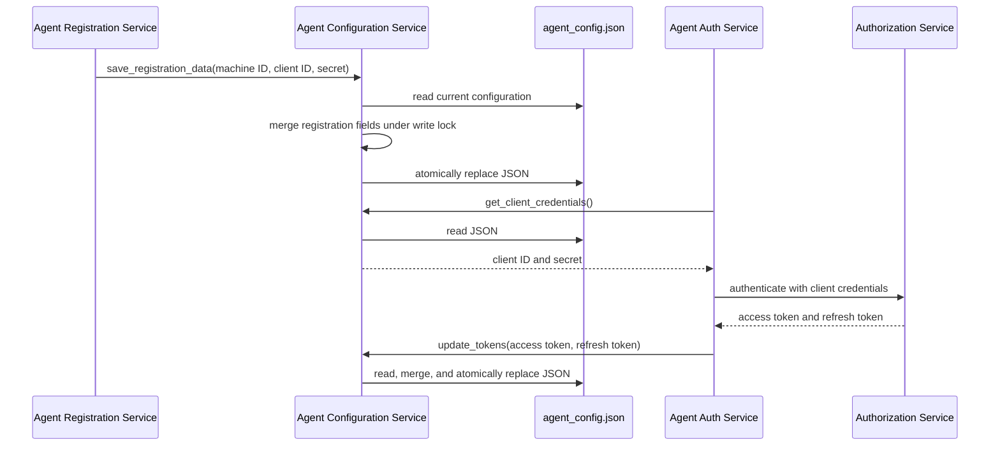
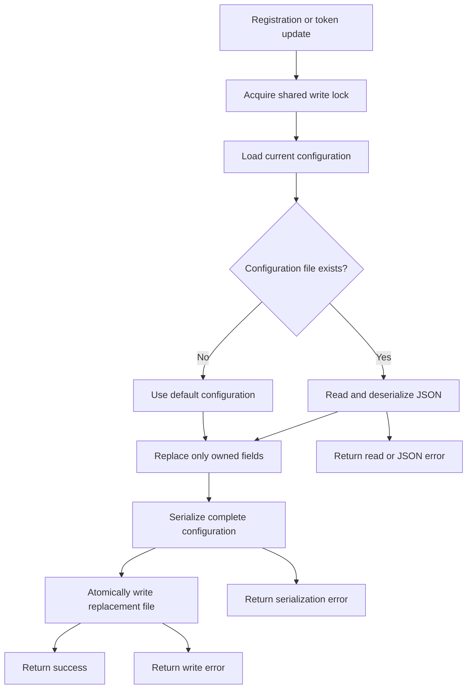

# Agent Configuration Service

The Agent Configuration Service is the OpenFrame client agent's local credential store. It persists the machine identity, OAuth client credentials, and access and refresh tokens in `agent_config.json` so that the client can resume its registered identity after restart.

The implementation is supplied by the OpenFrame OSS Library's `openframe_agent_lib` crate and run by this repository's OpenFrame client deployment. Its source is the [Agent Configuration Service implementation](https://github.com/flamingo-stack/openframe-oss-lib/blob/16e7c1cbd9664e7d10ec5ebca7d53c9bd314decf/clients/openframe-client/src/services/agent_configuration_service.rs).

## Responsibilities

- Resolves `agent_config.json` within the `DirectoryManager` secured directory.
- Ensures the directory structure exists during construction.
- Persists registration data: machine identifier, client identifier, and client secret.
- Persists refreshed access-token and refresh-token pairs.
- Provides individual credential values to registration and authentication workflows.
- Treats a missing configuration file as the default empty configuration for first-run registration.
- Serializes in-process read-modify-write operations so concurrent writers do not discard each other's fields.

It does not contact remote services, validate token contents, encrypt values itself, or decide when to register and refresh. Those responsibilities belong to callers.

## Architecture and Dependencies

Construction through `new(directory_manager)` appends `agent_config.json` to `DirectoryManager::secured_dir()` and calls `ensure_directories`. `DirectoryManager` creates and verifies logs, application-support, and secured directories; its secured directory uses administrator-only directory permissions.

The service retains a resolved file path and an `Arc<tokio::sync::Mutex<()>>`. Clones share this mutex, coordinating writes made by the same agent process.

## Persisted Data

The service uses pretty-printed JSON for the `AgentConfiguration` model.

| Field | Written by | Read by | Purpose |
|---|---|---|---|
| `machine_id` | `save_registration_data` | `get_machine_id`, `get_registration_credentials` | Registered machine identity. |
| `client_id` | `save_registration_data` | `get_client_credentials` | Agent OAuth client identity. |
| `client_secret` | `save_registration_data` | `get_registration_credentials`, `get_client_credentials` | Agent client credential. |
| `access_token` | `update_tokens` | `get_access_token` | Latest persisted access token. |
| `refresh_token` | `update_tokens` | `get_refresh_token` | Token used for reauthentication. |

When the file does not exist, the private read operation returns `AgentConfiguration::default()`. If the file exists but cannot be read or parsed as JSON, the service returns an error with context rather than replacing the state.

## Public Operations

| Operation | Async | Behavior |
|---|---:|---|
| `new` | No | Prepares directories, resolves the secured file path, and creates the shared write lock. |
| `save_registration_data` | Yes | Replaces `machine_id`, `client_id`, and `client_secret`, then saves the complete model. |
| `update_tokens` | Yes | Replaces `access_token` and `refresh_token`, then saves the complete model. |
| `get_machine_id` | No | Returns the machine identifier. |
| `get_registration_credentials` | No | Returns the machine identifier and client secret. |
| `get_client_credentials` | Yes | Returns the client identifier and client secret. |
| `get_access_token` | Yes | Returns the access token. |
| `get_refresh_token` | Yes | Returns the refresh token. |

The two mutation methods hold the shared mutex from loading the current configuration through replacement of the saved JSON. Each method changes only its owned fields, preserving the other credentials. Reads do not take the write lock; they read and deserialize the persisted file directly.

## Registration and Authentication Flow

The Agent Registration Service calls `save_registration_data` after it receives a registration response. The Agent Auth Service retrieves client credentials for initial client-secret authentication and persists the received token pair. For later authentication, it first tries refresh-token authentication and falls back to client credentials when refresh authentication fails. The Token Refresh Run Manager drives proactive reauthentication, returning successful token results to the same persistence path.

## Write Process and Failure Boundaries

The private save operation serializes the complete record and delegates to the client utility `atomic_write`. That utility creates a temporary file in the target directory, writes and flushes it, and atomically replaces the target. It also has Windows handling for a held target file. This prevents a partially written configuration document after an interrupted write.

Errors preserve context: construction errors describe directory preparation; read and write errors include the configuration path; and serialization or deserialization errors identify the configuration operation. Callers receive `anyhow::Result` and apply their own retry, logging, or agent-state policy.

## Concurrency and Security Notes

The shared mutex protects a family of cloned service instances inside one process. It does not provide an inter-process lock or synchronize readers with writers. A deployment that permits multiple processes to update the same configuration path would need extra coordination.

The configuration contains a client secret and bearer tokens. Keep the secured directory available and writable, exclude `agent_config.json` from diagnostics unless redacted, and do not edit it while the client is running. The atomic-write helper sets Unix temporary-file permissions to mode `0644`; effective access also depends on the secured directory restrictions. Any change to storage location or permissions should be reviewed as a credential-handling change.

## Source Components

| Component | Role |
|---|---|
| `AgentConfigurationService` | Stores the path and shared asynchronous write lock. |
| `new` | Initializes persistent configuration storage. |
| `save_registration_data` | Saves machine identity and client credentials. |
| `update_tokens` | Saves the current token pair. |
| `get_machine_id` | Reads the machine identifier. |
| `get_registration_credentials` | Reads the machine identifier and client secret. |
| `get_client_credentials` | Reads OAuth client credentials. |
| `get_access_token` | Reads the persisted access token. |
| `get_refresh_token` | Reads the persisted refresh token. |

For implementation details, consult the [OpenFrame OSS Library source](https://github.com/flamingo-stack/openframe-oss-lib/blob/16e7c1cbd9664e7d10ec5ebca7d53c9bd314decf/clients/openframe-client/src/services/agent_configuration_service.rs).