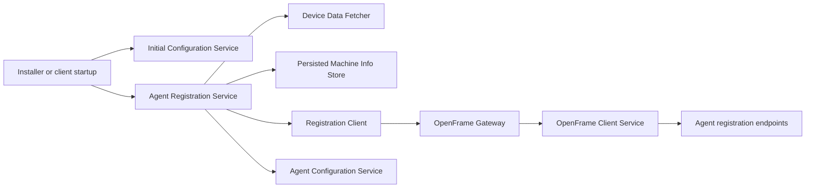
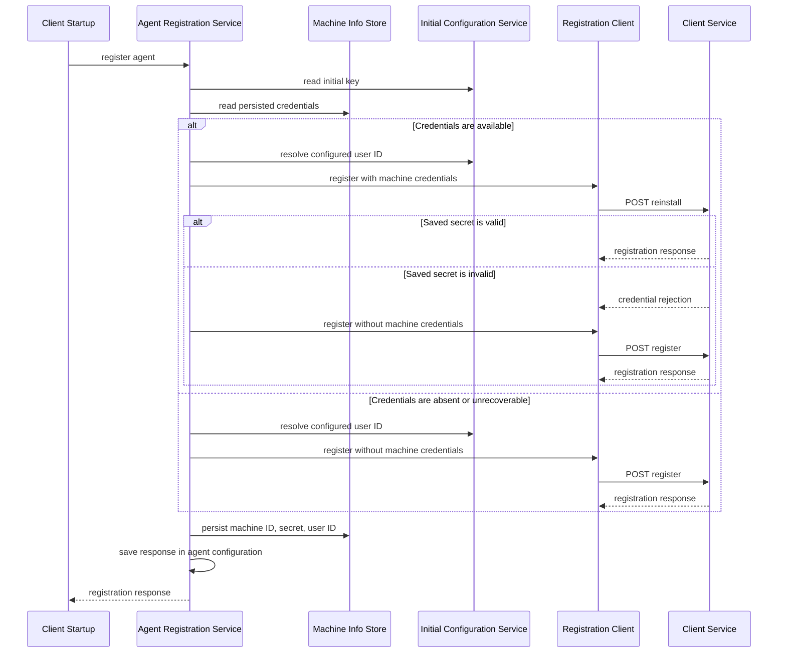
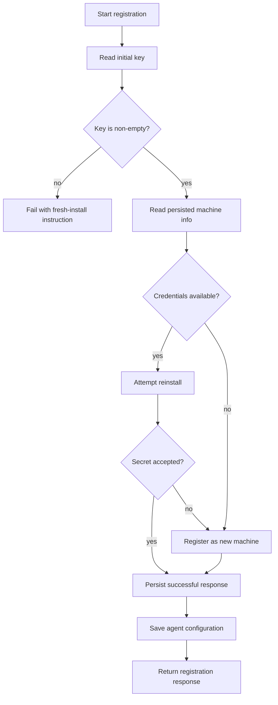
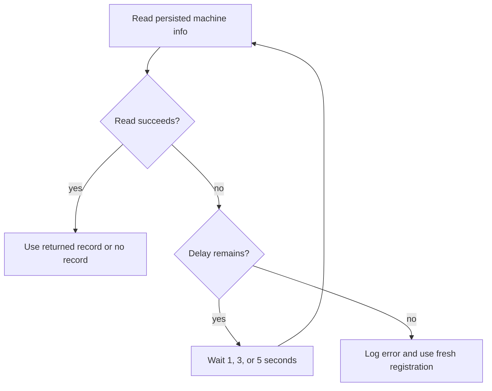

# Agent Registration Service

The Agent Registration Service establishes or restores an OpenFrame client’s server identity during installation. It turns installation configuration and locally collected device facts into a registration request, calls the client service through the gateway, persists reinstall credentials, and saves the returned OAuth client credentials for later authentication.

The implementation is supplied by the `openframe_agent_lib` Cargo dependency from OpenFrame OSS Library version `v0.0.5`. This tenant repository runs that library as part of its OpenFrame client. The authoritative implementation is [agent registration service source](https://github.com/flamingo-stack/openframe-oss-lib/blob/16e7c1cbd9664e7d10ec5ebca7d53c9bd314decf/clients/openframe-client/src/services/agent_registration_service.rs).

## Responsibilities

- Require a non-empty installation key before attempting registration.
- Reuse persisted machine credentials when a client is reinstalled.
- Preserve the original user association when a reinstall does not supply a new user ID.
- Collect hostname, agent version, operating system, organization, and tags for the request.
- Fall back to a new server-side machine registration when saved credentials are rejected.
- Persist the returned machine identity and client credentials for subsequent startup and reinstall flows.

The service is an installation-time coordinator. It does not itself refresh tokens, process commands, or deregister a client; those are separate client-library concerns.

## Position in the System

The gateway routes `/clients/**` to the OpenFrame Client Service in the tenant deployment. The client-side `RegistrationClient` adds the gateway-facing `/clients` prefix before calling the backend’s `/api/agents/register` or `/api/agents/reinstall` endpoints. The server exposes these endpoints through `AgentController`; they require `X-Initial-Key` for both paths and additionally require `X-Machine-Id` and `X-Client-Secret` for reinstall.

## Core Components

| Component | Role |
|---|---|
| `AgentRegistrationService` | Orchestrates fresh and reinstall registration, persistence, and configuration updates. |
| `new` | Constructs the service from a registration client, device-data fetcher, agent configuration service, and initial configuration service. |
| `register_agent` | Main asynchronous workflow. Validates the installation key, selects fresh or reinstall behavior, writes local state, and returns the server response. |
| `read_persisted_credentials` | Reads the reinstall record with timed retries, returning no record after recovery is exhausted. |

### Collaborators

| Collaborator | Input or output used by Agent Registration Service |
|---|---|
| Initial Configuration Service | Reads installation key, user ID, organization ID, and device tags. |
| Device Data Fetcher | Supplies hostname, compiled agent version, and platform type. The platform type is `WINDOWS` on Windows and `MAC_OS` otherwise. |
| Registration Client | Serializes the request as JSON and selects the fresh-registration or reinstall endpoint based on whether persisted credentials are provided. |
| Persisted Machine Info Store | Stores the machine ID, client secret, and optional user ID used for a later reinstall. |
| Agent Configuration Service | Saves the successful response’s machine ID, client ID, and client secret under an asynchronous write lock. |

## Registration Request and Response Boundary

The service builds an `AgentRegistrationRequest` from local inputs:

| Request field | Source | Behavior when unavailable |
|---|---|---|
| Hostname | Device Data Fetcher | Uses an empty value and emits a warning. |
| Agent version | Device Data Fetcher | Uses an empty value if unavailable. |
| Operating system | Device Data Fetcher | Determined from the compiled target platform. |
| Organization ID | Initial Configuration Service | Uses an empty value if the configuration cannot supply one. |
| User ID | Initial configuration or persisted machine info | An explicitly configured install-time value takes precedence. |
| Tags | Initial Configuration Service | Uses an empty collection if unavailable. |

A successful `AgentRegistrationResponse` provides the machine identity and OAuth client material consumed by subsequent client authentication. The service writes the machine ID and client secret to the persisted machine record, and writes the machine ID, client ID, and client secret to agent configuration.

## Fresh Registration and Reinstall Flow

### User ID Resolution

The service deliberately applies this order:

1. Use a non-empty user ID supplied by the current initial configuration.
2. Otherwise, use the optional user ID from persisted machine information.
3. If neither exists, use an empty user ID.

This allows a current install command to override prior association while preserving the original association across uninstall and reinstall cycles when no new user ID is present.

### Endpoint Selection

| Case | Client request | Authentication headers |
|---|---|---|
| Fresh installation | `POST /clients/api/agents/register` | `X-Initial-Key` |
| Reinstall with saved identity | `POST /clients/api/agents/reinstall` | `X-Initial-Key`, `X-Machine-Id`, and `X-Client-Secret` |

Both requests set JSON content type and send the same registration-request body. Endpoint construction occurs in the Registration Client, leaving the service responsible for choosing whether a persisted machine record is passed.

## Credential and Persistence Behavior

The initial key is mandatory. If it is empty, registration stops with an error explaining that the key is cleared after the device holds a log key and that registering again requires a fresh install command. The service does not send a request in this case.

After a successful registration response, writing the persisted machine record is best effort: a write failure is logged but does not prevent the configuration save or successful result from being returned. In contrast, saving registration data through the Agent Configuration Service is awaited and propagated as an error if it fails. This distinction means a registration can complete while reinstall continuity is unavailable, but it cannot report success if its primary agent configuration was not saved.

## Retry and Recovery Semantics

Reading persisted machine information can fail because of local storage or permission problems. The underlying reader first attempts to repair permissions when it sees a permission-denied error, then retries the read. If the read still fails, the service applies three delays: one second, three seconds, and five seconds.

The exhaustion path intentionally returns no saved credentials rather than failing the entire registration. This favors recovering an install with a new server-side machine identity when local reinstall state is unreadable. A separate reinstall failure caused specifically by an invalid client secret takes the same fresh-registration fallback. Other registration-client failures are returned with operation context and do not fall back.

## Operational Considerations

### Sensitive values

The installation key, client secret, and machine ID are sent in request headers or stored locally. The registration logs shown by this service record state transitions and the hostname, but do not intentionally log these credential values. Implementers should retain that property when extending diagnostics.

### Identity changes

A rejected saved client secret causes a clean registration. This may produce a new server-side machine identity rather than restoring the old one. Operators investigating unexpected duplicate devices should check whether the local machine-info record was missing, unreadable, or rejected.

### Hostname quality

The Device Data Fetcher rejects empty or unsuitable kernel hostnames and may use platform-specific fallback sources. Registration still proceeds when no valid hostname is found, with an empty hostname and a warning. The server must therefore not treat hostname alone as the durable device identity.

### Failure surfaces

| Stage | Result |
|---|---|
| Initial configuration cannot provide the initial key | Registration returns an error. |
| Persisted record cannot be read after recovery attempts | Registration proceeds as fresh. |
| Reinstall secret is rejected | Registration retries as fresh. |
| Other registration HTTP or response parsing failures | Registration returns an error. |
| Persisted record cannot be written | Error is logged, registration continues. |
| Agent configuration cannot be saved | Registration returns an error after the server call. |

## Maintenance Guidance

When changing this service, keep the following invariants aligned with the server contract and the Registration Client:

- A reinstall must include the saved machine ID and client secret, while fresh registration must omit them.
- The initial key must be validated locally before any network call.
- User ID precedence must remain current configuration before persisted value.
- A client-secret-specific rejection may fall back to fresh registration; unrelated failures must remain visible to callers.
- Persisted machine information must be complete before it is written, because later reinstall depends on both machine ID and client secret.
- The response must update both the reinstall record and agent configuration, because they serve different consumers and durability expectations.

The receiving service is part of the OpenFrame Client Service library. Its registration controller defines the public server endpoints, and its registration processor extension point performs post-registration processing after the core registration operation.
