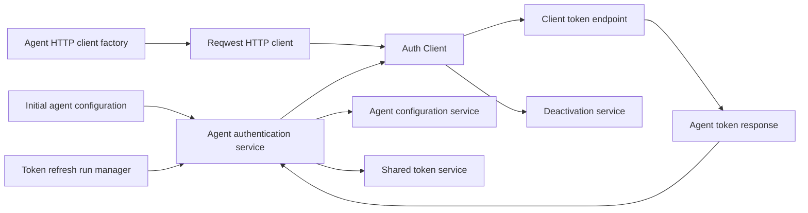
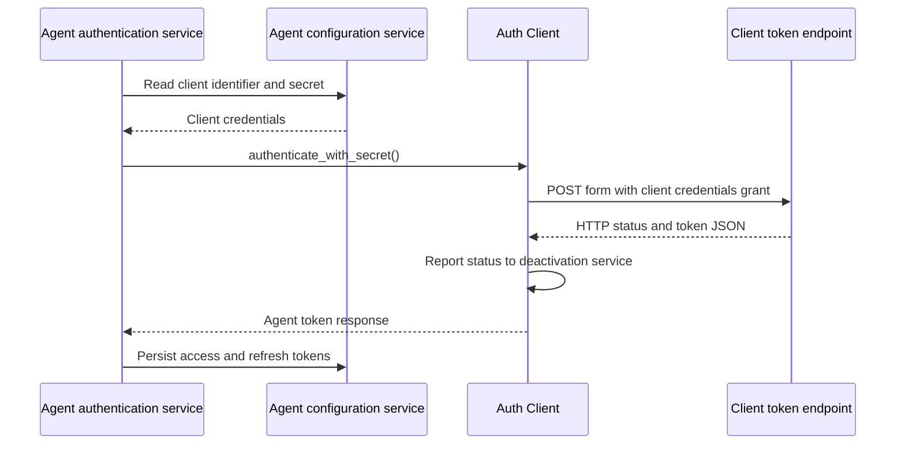
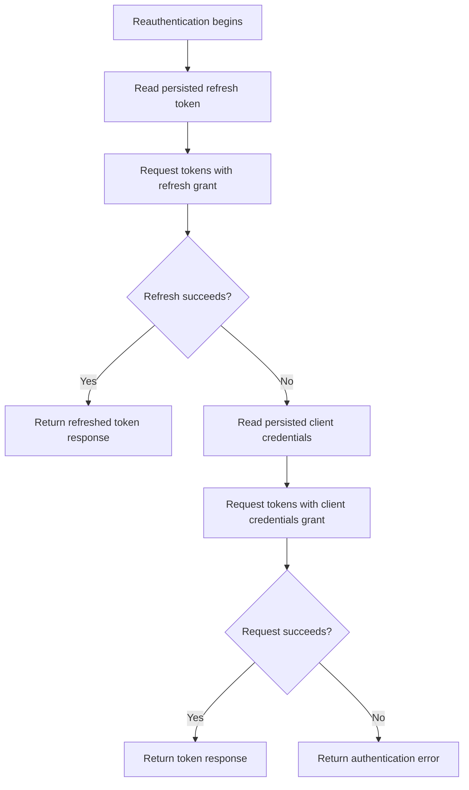
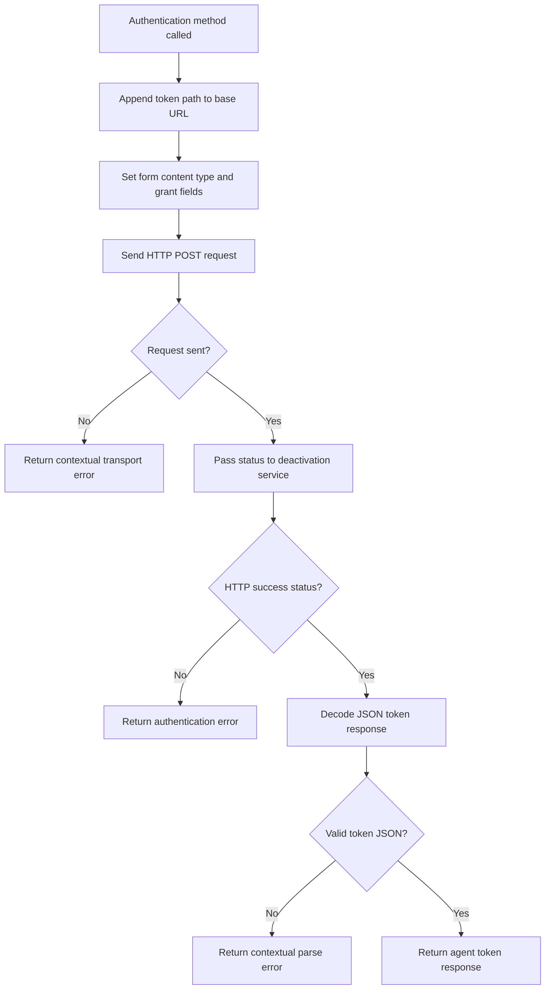
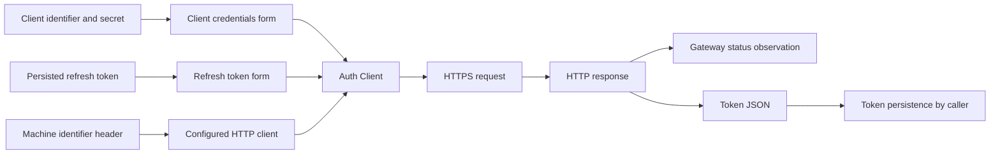

# Auth Client

Auth Client is the Rust agent library component that obtains OAuth-style tokens for an installed OpenFrame client. It is implemented by the [`auth_client.rs` source file](https://github.com/flamingo-stack/openframe-oss-lib/blob/7a766f00e4f58b5d89db007b878ac8d6e0c344f4/clients/openframe-client/src/clients/auth_client.rs) in the OpenFrame OSS Library, supplied to this repository through the `openframe_agent_lib` Cargo dependency. The component exposes two token-grant operations against a configured server base URL and reports gateway responses to the agent deactivation subsystem.

## Responsibilities

- Construct an `AuthClient` from a base URL, a configured `reqwest` HTTP client, and a shared `DeactivationService`.
- Request an access and refresh token using persisted client credentials during initial authentication.
- Request replacement tokens using a refresh token during reauthentication.
- Deserialize successful responses into `AgentTokenResponse`.
- Preserve transport, non-success status, and response-deserialization errors as Rust `anyhow` errors.
- Notify deactivation logic of every received HTTP status, so a successful response records gateway health and an HTTP `410 Gone` can initiate the deactivation path.

Auth Client does not persist tokens, schedule refreshes, generate credentials, or start and stop tools. Those responsibilities remain with the consuming services.

## Position in the Agent

The component is a narrow HTTP boundary within the OpenFrame client agent. Its caller supplies a preconfigured HTTP client and an already-normalized base URL; Auth Client adds only the authentication-specific URL, form fields, and content type.

### Main collaborators

| Collaborator | Responsibility at this boundary |
|---|---|
| `AuthClient` | Holds the HTTP client, server base URL, and deactivation service; performs token requests. |
| `AgentAuthService` | Orchestrates initial authentication and reauthentication. It persists returned tokens and updates the shared token used by the wider agent. |
| `AgentConfigurationService` | Supplies persisted client credentials or a refresh token and serializes token updates to the local configuration. |
| `SharedTokenService` | Stores the current access token in an encrypted file for consumers that use the shared-token mechanism. |
| `DeactivationService` | Observes gateway statuses. The observed `410 Gone` status is its explicit deactivation signal; successful responses record a healthy gateway. |
| Agent HTTP client factory | Creates the supplied `reqwest` client with the machine identifier header, timeout, optional invalid-certificate acceptance, no proxy use, and no idle connection pooling. |

## Public Interface

| API | Inputs | Result | Behavior |
|---|---|---|---|
| `new` | Base URL, `reqwest::Client`, shared `DeactivationService` | `AuthClient` | Retains the supplied dependencies without performing I/O. |
| `authenticate_with_secret` | Client identifier and client secret | `AgentTokenResponse` | Posts a client-credentials form to the token endpoint. |
| `authenticate_with_refresh_token` | Refresh token | `AgentTokenResponse` | Posts a refresh-token form to the same endpoint. |

A successful `AgentTokenResponse` contains `access_token`, `refresh_token`, `token_type`, and an optional `expires_in` value. The module passes that response through unchanged; lifecycle decisions based on expiry are handled elsewhere.

## Endpoint Contract

For both flows, Auth Client derives the request URL by appending `/clients/oauth/token` to its configured base URL. The base URL must therefore be configured without relying on Auth Client to discover an endpoint or rewrite a tenant path.

| Property | Client-credentials flow | Refresh-token flow |
|---|---|---|
| Method | `POST` | `POST` |
| URL suffix | `/clients/oauth/token` | `/clients/oauth/token` |
| Content type | `application/x-www-form-urlencoded` | `application/x-www-form-urlencoded` |
| `grant_type` field | `client_credentials` | `refresh_token` |
| Other form fields | `client_id`, `client_secret` | `refresh_token` |
| Success body | JSON decoded as `AgentTokenResponse` | JSON decoded as `AgentTokenResponse` |

The module sends form data through `reqwest`, which performs the form encoding. It does not log credentials or token values.

## Authentication Flows

### Initial authentication

Initial authentication uses the client credentials saved during registration. `AgentAuthService` retrieves the client identifier and secret from `AgentConfigurationService`, calls `authenticate_with_secret`, then saves the returned access and refresh tokens.

### Reauthentication and fallback

Reauthentication attempts the persisted refresh token first. If that attempt returns an error, `AgentAuthService` falls back to the client-credentials flow. The fallback occurs in the calling service, not inside Auth Client; each Auth Client method executes exactly one request mechanism.

## Request Processing and Failure Semantics

Both methods follow the same processing sequence after preparing their distinct form data.

### Status handling

Status observation precedes the success check in both methods. Consequently, Auth Client reports both successful and failed HTTP responses to `DeactivationService` whenever a response was received.

- A success status is reported as gateway health and processing continues to JSON decoding.
- An HTTP `410 Gone` is passed to the deactivation service as its defined gateway-deactivation signal.
- Other non-success statuses are returned as errors after status observation.
- A connection, timeout, or other request-send failure has no HTTP status to report and returns an error with operation-specific context.

The failure messages differ slightly by flow: the client-credentials operation includes the response body in its non-success error, while the refresh operation reports the HTTP status only. Maintainers should treat response bodies as potentially sensitive when handling propagated errors or logs.

## Dependency and State Boundaries

Auth Client has no direct file or database state. It only owns in-memory references to its three dependencies. Credential retrieval, token encryption, and durable writes occur outside the module, which keeps its responsibilities limited to request construction, response validation, and status propagation.

## Operational Considerations

- **Base URL correctness:** The base URL is concatenated with a fixed path. A trailing slash in the supplied value produces a double slash before `clients`; the module does not normalize it.
- **TLS and proxy policy:** Auth Client inherits the supplied HTTP client's security and network behavior. The standard factory disables proxy use, attaches the machine identifier header, and can be configured to accept invalid certificates. Certificate acceptance should be controlled by trusted deployment configuration.
- **Fresh connection behavior:** The standard factory disables idle per-host pooling to force a fresh DNS lookup on each request. This policy belongs to the HTTP client factory and affects Auth Client requests because the factory-built client is injected.
- **Concurrency:** `AuthClient` derives `Clone`, allowing multiple agent tasks to share the underlying HTTP client and deactivation-service reference. Persistence serialization is handled by `AgentConfigurationService`, not by Auth Client.
- **Token secrecy:** Callers should avoid placing client secrets, refresh tokens, access tokens, or full error bodies into telemetry. Auth Client itself does not deliberately emit those values.

## Maintenance Checklist

When changing this module or the token endpoint contract:

1. Keep both methods aligned on the endpoint suffix and form content type.
2. Preserve status reporting before any success-return path, because deactivation health tracking depends on it.
3. Update the `AgentTokenResponse` deserialization contract together with server-side token responses if fields change.
4. Keep refresh-token fallback policy in `AgentAuthService`; avoid hiding retries or credential fallback inside a single low-level request method.
5. Exercise transport failure, non-success response, malformed JSON, client-credentials success, and refresh-token success paths.
6. Review any change to the injected HTTP-client factory for its effects on headers, TLS verification, timeouts, DNS behavior, and proxy routing.

For broader registration, durable configuration, token-refresh scheduling, and deactivation behavior, refer to the corresponding OpenFrame client agent documentation.