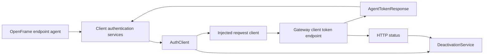
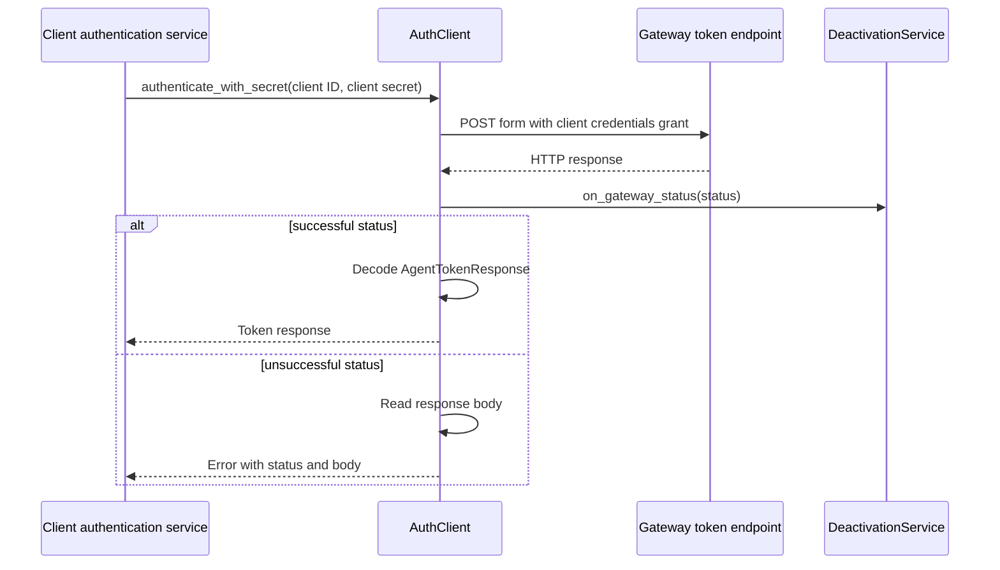
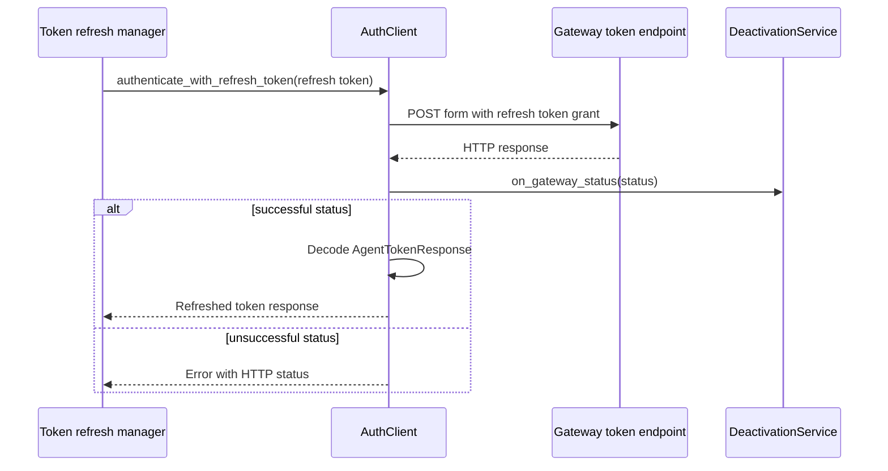
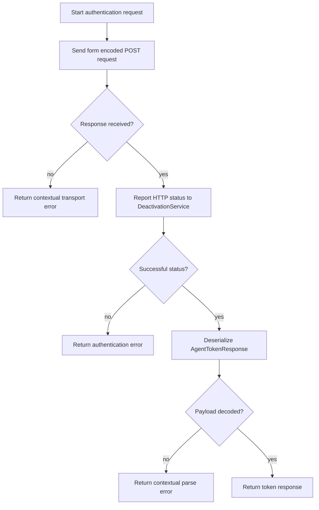

# Auth Clients

Auth Clients is the OpenFrame endpoint agent's HTTP adapter for obtaining OAuth access tokens. It is implemented by the `AuthClient` type in the `openframe_agent_lib` Rust crate from the OpenFrame OSS Library and is assembled at runtime by this repository's OpenFrame client service. The module exposes two grant flows against the same client-token endpoint:

- Initial authentication with an agent client identifier and secret.
- Reauthentication with a previously issued refresh token.

The module deliberately has a narrow responsibility: it builds form-encoded token requests, delegates transport to a supplied `reqwest::Client`, reports every received HTTP status to deactivation handling, and deserializes a successful response as `AgentTokenResponse`. Credential persistence, retry scheduling, and deciding whether an agent remains suspended belong to the surrounding client services.

## Ownership and System Placement

The implementation originates in the OpenFrame OSS Library at [auth_client.rs](https://github.com/flamingo-stack/openframe-oss-lib/blob/16e7c1cbd9664e7d10ec5ebca7d53c9bd314decf/clients/openframe-client/src/clients/auth_client.rs). This repository consumes the library as the `openframe_agent_lib` Cargo artifact and runs it through its OpenFrame client service.

`AuthClient::new` receives all runtime dependencies rather than constructing them internally:

| Dependency | Role in Auth Clients |
| --- | --- |
| `base_url: String` | Prefix used to construct the client token URL. |
| `http_client: reqwest::Client` | Performs the asynchronous HTTPS request and inherits the client-wide transport configuration. |
| `deactivation: Arc<DeactivationService>` | Receives the HTTP response status after each request so lifecycle policy can observe gateway outcomes. |

The constructed request URL is `base_url` followed by `/clients/oauth/token`. The base URL must therefore be configured without assumptions about a trailing slash; the implementation appends its own slash-prefixed path.

## Public Interface

| Operation | Input | Token grant | Result |
| --- | --- | --- | --- |
| `new` | Base URL, HTTP client, deactivation service | Not applicable | Ready-to-use `AuthClient`. |
| `authenticate_with_secret` | Client identifier and client secret | `client_credentials` | Parsed `AgentTokenResponse` or an error. |
| `authenticate_with_refresh_token` | Refresh token | `refresh_token` | Parsed `AgentTokenResponse` or an error. |

Both authentication methods are asynchronous and return `anyhow::Result<AgentTokenResponse>`. The response model is owned by the client library's agent-token model module; callers should treat the returned value as the source of newly issued token material and pass it to the appropriate token and configuration services.

## Request Composition

Auth Clients uses HTTP `POST` and the `application/x-www-form-urlencoded` content type for both grants. The following table describes the complete payload constructed by each operation.

| Operation | Form fields |
| --- | --- |
| Secret authentication | `grant_type=client_credentials`, `client_id`, `client_secret` |
| Refresh authentication | `grant_type=refresh_token`, `refresh_token` |

No authorization header is constructed in this module. Authentication material is sent as form fields, and the caller-provided HTTP client determines connection behavior such as TLS, proxies, and timeouts.

## Secret Authentication Flow

Secret authentication is the initial credential exchange used when the agent has its client credentials. It submits the client-credentials grant to the gateway and returns the decoded token response only after a successful HTTP status.

### Failure Behavior

- A transport failure is wrapped with the context `Failed to send token request`.
- Every received response status is reported to `DeactivationService` before success is evaluated.
- For an unsuccessful response, the method reads the response body and includes both status and body in its error. This is useful for diagnosis but means callers must avoid exposing the resulting error where server-provided response text could be disclosed.
- If a successful response cannot be decoded as `AgentTokenResponse`, the method returns an error with the context `Failed to parse token response`.

## Refresh-Token Authentication Flow

Refresh authentication renews access when the caller already has a refresh token. It targets the same endpoint but submits only the refresh-token grant payload.

### Failure Behavior

- A failure before receiving a response is annotated as `Failed to send refresh token request`.
- As in secret authentication, a received status is passed to deactivation handling before the status check.
- An unsuccessful refresh returns an error containing the HTTP status. Unlike secret authentication, this path does not read or append the response body.
- A malformed successful payload is reported as `Failed to parse refresh token response`.

## Component Interaction and Lifecycle Impact

The status-reporting call is intentionally positioned after receiving a response and before either method returns. Consequently, the lifecycle service can observe both successful and unsuccessful gateway responses, while network errors that prevent a response do not produce a status callback.

The deactivation service is a collaborator, not an error replacement. Auth Clients still returns an error for every non-successful status even after reporting it. Callers remain responsible for retry, recovery, credential replacement, and token persistence.

## Security and Maintenance Notes

- Treat client secrets, refresh tokens, and `AgentTokenResponse` contents as sensitive. Do not log form payloads, token values, or complete errors from the secret-authentication failure path without redaction.
- Preserve the form encoding and `grant_type` values when modifying either method; they are the contract used by the gateway client-token endpoint.
- Keep `on_gateway_status` on every response-returning path. Moving it after the success check would prevent lifecycle handling from observing failed gateway statuses.
- Use the injected HTTP client rather than constructing a new client per request so authentication follows the agent's configured transport, certificate, proxy, and timeout policy.
- A new authentication grant should be added as a separate explicit method with a documented payload and failure policy, rather than overloading the two existing flows.

## Scope Boundaries

Auth Clients does not register or deregister agents, manage remote-access state, fetch tool assets, persist credentials, or schedule refreshes. Those responsibilities are separate client-library modules and services. This separation keeps token exchange reusable while higher-level services choose when to perform initial authentication or reauthentication and how to apply the returned tokens.
