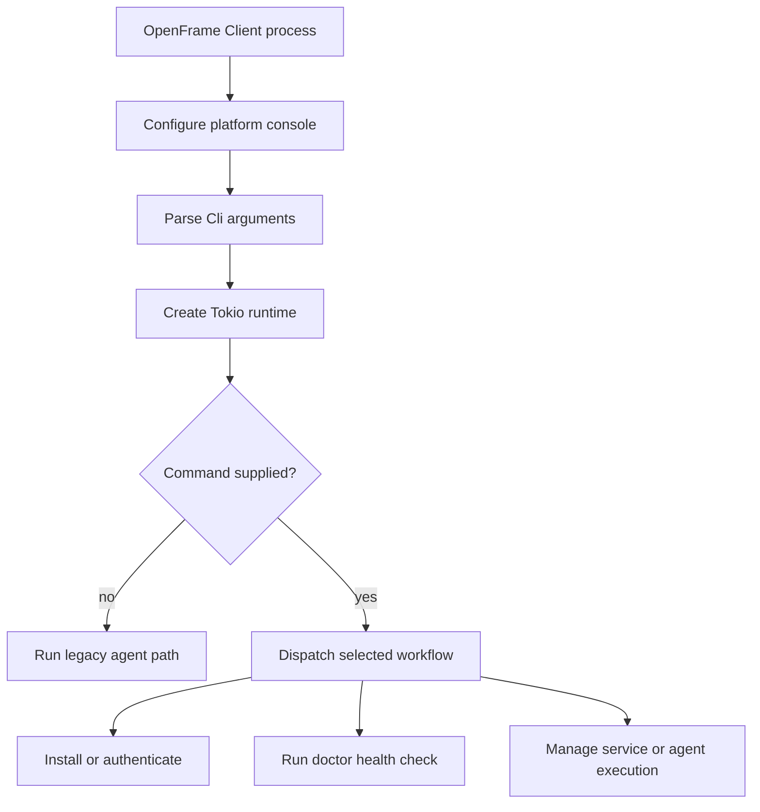
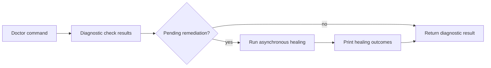
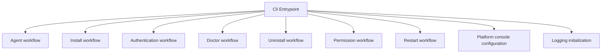

# Cli Entrypoint

Cli Entrypoint is the command-line dispatch boundary for the OpenFrame Client executable. It configures the platform console, parses arguments with Clap, creates one Tokio runtime, and delegates the selected operation to the appropriate client workflow. The implementation is supplied by the `openframe_agent_lib` dependency from the OpenFrame OSS Library and is run by this repository's `clients/openframe-client` artifact.

The module has two source components:

- [`cli::run`](https://github.com/flamingo-stack/openframe-oss-lib/blob/16e7c1cbd9664e7d10ec5ebca7d53c9bd314decf/clients/openframe-client/src/cli.rs) is the executable command router.
- [`banner::print`](https://github.com/flamingo-stack/openframe-oss-lib/blob/16e7c1cbd9664e7d10ec5ebca7d53c9bd314decf/clients/openframe-client/src/banner.rs) writes the colored OpenFrame ASCII banner to standard output.

## Responsibilities

Cli Entrypoint owns command selection rather than the operational implementations. It defines the public installation, authentication, removal, and diagnostic commands; keeps service-manager operations hidden; and hands control to dedicated modules. This separation lets the same executable support interactive administration and managed service startup.

The `run` function performs the following steps:

1. Configures console behavior through the platform layer.
2. Parses the optional subcommand and its arguments.
3. Creates a Tokio runtime used by asynchronous command workflows.
4. Dispatches exactly one command path.
5. Preserves legacy behavior by starting the agent when no subcommand is supplied.

## Command Surface

| Command | Visibility | Entrypoint behavior |
| --- | --- | --- |
| `install` | Public | Converts installation flags into `InstallConfigParams` and invokes the installation workflow. |
| `auth` | Public | Uses the same installation argument shape to authenticate a client installed without initial parameters. |
| `uninstall` | Public | Invokes the asynchronous uninstallation workflow. |
| `doctor` | Public | Runs diagnostics against the installed agent configuration. |
| `run` | Hidden | Starts the agent directly rather than through the system service manager. |
| `run-as-service` | Hidden | Starts the service-specific agent path. |
| `check-permissions` | Hidden | Executes the permission-check workflow. |
| `restart-service` | Hidden | Runs the service restart path, intended for detached use while applying feature flags. |
| no command | Compatibility path | Runs the legacy direct-agent behavior. |

The hidden commands remain parseable because system-service management and internal restart flows invoke the same binary. They are intentionally omitted from normal command help.

## Installation and Authentication Inputs

Both `install` and `auth` accept the internal `InstallArgs` structure, which maps directly to `InstallConfigParams`. The supported flags are:

| Flag | Purpose |
| --- | --- |
| `--serverUrl` | Supplies the server URL. |
| `--initialKey` | Supplies the initial registration key. |
| `--logKey` | Supplies the log-stream key; the code notes that it is fetched after registration when absent. |
| `--localMode` | Enables local mode; it defaults to `false`. |
| `--orgId` | Supplies the organization identifier. |
| `--userId` | Supplies the user identifier. |
| `--tag` | Adds a tag; the option may be repeated because it is collected as a list. |
| `--remote-access-mode` | Sets the remote-access mode to apply after registration. |

The entrypoint passes values through without implementing registration, credential exchange, persistence, or remote-access policy. Those concerns belong to the invoked installation and authentication workflows.

## Diagnostics and Automatic Remediation

The CLI module includes helpers used by diagnostic command paths:

- `init_logging` initializes the general logging configuration and exits the process with status 1 if setup fails.
- `init_file_logging` performs file-only logging setup with the same fail-fast behavior.
- `heal_if_needed` inspects diagnostic `CheckResult` values, skips remediation when none are pending, and otherwise blocks on asynchronous healing through the Tokio runtime.
- `print_heal_outcomes` renders each remediation outcome. The currently represented remediation is WebView2 Runtime installation, reported as fixed or failed.

## Runtime Boundaries and Failure Behavior

Cli Entrypoint creates a single runtime before command dispatch and passes a reference to workflows that need asynchronous work. The service-only path is called without that runtime reference, matching its separate service execution boundary. Parsing errors and runtime construction errors are propagated through `anyhow::Result`. Logging initialization failures are handled differently: they are printed to standard error and terminate the process immediately with exit status 1.

`banner::print` is deliberately independent of the command router. It emits escape sequences for OpenFrame branding and resets terminal formatting before returning; it does not parse arguments, initialize logging, or alter command execution.

## Placement in the Client

Cli Entrypoint is the front door to the Rust client library. It delegates to command-specific modules named `agent`, `auth`, `healthcheck`, `install`, `permissions`, `restart`, and `uninstall`, and it relies on the doctor, logging, platform, installation-configuration, and remote-access model layers. The module does not itself connect to tenant services or execute agent workloads.

## Maintenance Notes

- Add a new operational command by extending the Clap `Commands` enum and adding a corresponding dispatch arm in `run`.
- Keep `InstallArgs::to_params` synchronized with `InstallConfigParams` whenever installation or authentication inputs change.
- Preserve the no-subcommand legacy path unless compatibility with existing invocation patterns is intentionally retired.
- Treat hidden service commands as an internal interface: changes may affect service-manager integration, detached restart flows, and updater behavior.
- Keep the banner output isolated from routing logic so terminal presentation cannot affect lifecycle behavior.
