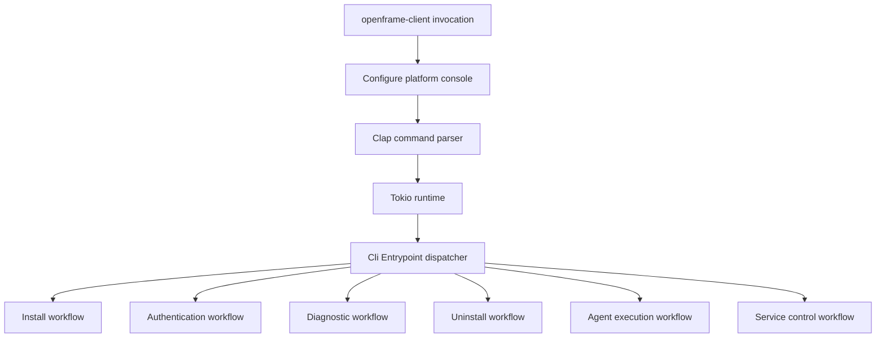
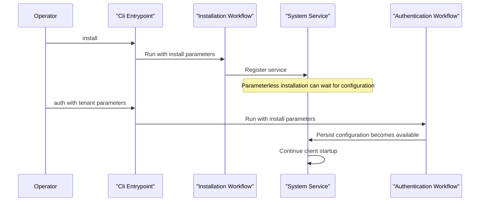
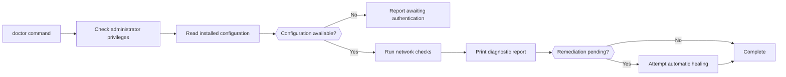

# Cli Entrypoint

The Cli Entrypoint is the process boundary for the OpenFrame client agent. It configures the console, parses command-line arguments, creates the Tokio runtime used by asynchronous commands, and dispatches each requested lifecycle action. The implementation is supplied by the `openframe_agent_lib` Cargo dependency from OpenFrame OSS Library version `v0.0.5` and is run by this repository's OpenFrame client packaging.

## Responsibilities

- Present the branded terminal banner through [`banner.rs`](https://github.com/flamingo-stack/openframe-oss-lib/blob/7a766f00e4f58b5d89db007b878ac8d6e0c344f4/clients/openframe-client/src/banner.rs).
- Configure the platform console before argument parsing.
- Parse the `openframe-client` command and its subcommands with Clap.
- Translate install and authentication options into `InstallConfigParams` without performing persistence itself.
- Create one Tokio runtime and pass it to asynchronous command handlers.
- Route operator-facing commands to installation, authentication, diagnostics, or removal workflows, and route service-manager commands to internal handlers.

## Architecture

The dispatcher is deliberately thin: it selects a workflow and supplies the shared runtime. Installation, service execution, configuration persistence, diagnostics, and remediation remain the responsibility of the corresponding client modules.

## Command Surface

| Command | Visibility | Dispatch target | Behavior |
|---|---|---|---|
| `install` | Public | Installation handler | Installs the OpenFrame client as a system service. It accepts initial connection and registration settings. |
| `auth` | Public | Authentication handler | Completes tenant authentication after a parameterless installation, using the same configuration arguments as `install`. |
| `doctor` | Public | Health-check handler | Runs the installed-agent environment check and reports results. |
| `uninstall` | Public | Uninstall handler | Removes the OpenFrame client service. |
| `run` | Hidden | Direct agent handler | Starts the client directly rather than through a system service. |
| `run-as-service` | Hidden | Service agent handler | Starts the process in the mode expected by the operating system service manager. |
| `check-permissions` | Hidden | Permission handler | Checks whether the process has required permissions. |
| `restart-service` | Hidden | Restart handler | Stops and starts the service; this is used by the client when feature flags require a restart. |
| no command | Compatibility path | Legacy agent handler | Preserves legacy invocation behavior. |

Hidden commands are operational integration points, not a primary public interface. Service definitions and agent-controlled restarts invoke them where needed.

## Installation and Authentication Inputs

`InstallArgs` is converted into `InstallConfigParams`. The available options are:

| Option | Purpose |
|---|---|
| `--serverUrl` | Tenant server URL. |
| `--initialKey` | Initial registration key. |
| `--logKey` | Log-stream key; the agent can fetch it after registration when it is absent. |
| `--localMode` | Enables local mode. Defaults to `false`. |
| `--orgId` | Organization identifier. |
| `--userId` | User identifier. |
| `--tag` | Repeatable device tag. |
| `--remote-access-mode` | Requested remote-access mode to apply after registration. |

A parameterless `install` does not persist initial configuration. The installed service waits in an unauthenticated state until `auth` writes valid configuration, preventing a startup crash loop.

## Diagnostic and Healing Path

The `doctor` command delegates to the health-check workflow. That workflow first checks administrative privileges, then conditionally checks the WebView2 runtime, loads the installed configuration, and performs network checks only when a usable server host is available. A missing initial configuration is reported as an informational awaiting-authentication state rather than a failure.

The Cli Entrypoint also contains support routines used by command handlers for logging initialization and doctor remediation output. When pending remediations exist, it invokes asynchronous healing through the Tokio runtime and prints each outcome. Currently, the remediation label handled here is WebView2 Runtime installation.

## Core Components

### `print`

[`banner::print`](https://github.com/flamingo-stack/openframe-oss-lib/blob/7a766f00e4f58b5d89db007b878ac8d6e0c344f4/clients/openframe-client/src/banner.rs) writes the OpenFrame ASCII banner to standard output. ANSI escape sequences set the color and reset terminal formatting after output. It has no configuration, lifecycle, or network side effects.

### `run`

[`cli::run`](https://github.com/flamingo-stack/openframe-oss-lib/blob/7a766f00e4f58b5d89db007b878ac8d6e0c344f4/clients/openframe-client/src/cli.rs) is the command dispatcher. Its sequence is:

1. Configure console behavior for the current platform.
2. Parse the optional subcommand and its arguments.
3. Create a Tokio runtime.
4. Dispatch to the matching handler, or invoke the legacy agent path if no subcommand was supplied.
5. Return only after dispatch has completed; logging initialization failures in its helper routines terminate the process with a nonzero exit.

## Operational Boundaries

- The entrypoint does not authenticate, register, install, uninstall, or run the agent itself. It delegates those actions.
- Installation and authentication intentionally share the same parameter shape so that a device can be installed first and connected to a tenant later.
- System-service mode is separated from direct agent mode so platform service managers can use their required launch semantics.
- The module depends on the OpenFrame OSS Library source; its code links therefore point to the pinned library revision rather than this repository.
