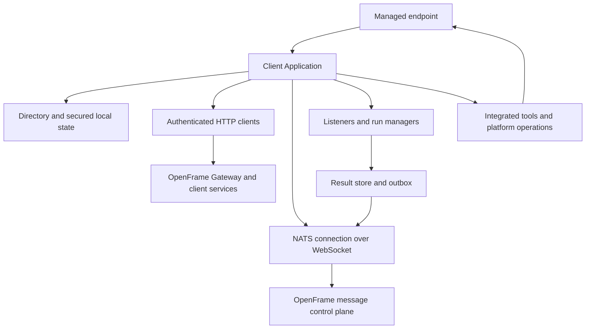
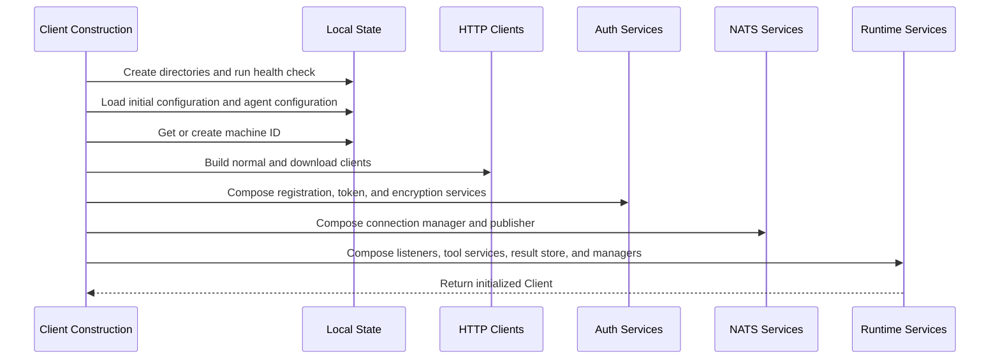
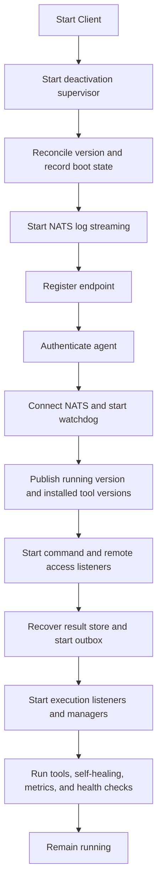
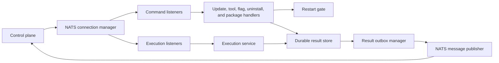
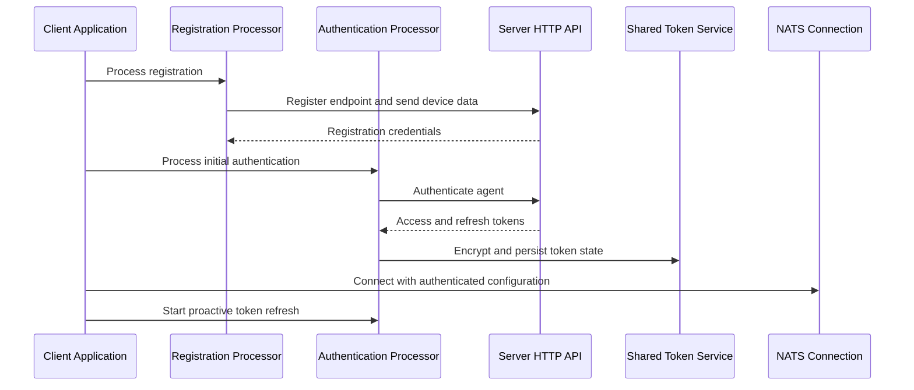

# Client Application

Client Application is the Rust agent composition root that runs on a managed endpoint. It constructs the local services, establishes authenticated control-plane connectivity, subscribes to command and execution subjects, coordinates integrated tools, and keeps device state, telemetry, logs, and delivery results flowing to OpenFrame.

The implementation is supplied by the OpenFrame OSS Library as the `openframe_agent_lib` Cargo artifact (version `v0.0.5` in this repository's dependency graph). This repository assembles and deploys the wider OpenFrame platform around that agent. The orchestrator implementation is [`clients/openframe-client/src/lib.rs`](https://github.com/flamingo-stack/openframe-oss-lib/blob/16e7c1cbd9664e7d10ec5ebca7d53c9bd314decf/clients/openframe-client/src/lib.rs) in the library source.

## Responsibilities

The `Client` type is responsible for the agent lifecycle rather than a single endpoint-facing feature. Its two public lifecycle operations are:

- `Client::new()`: validates local directories, loads persisted setup and agent state, builds HTTP and NATS clients, and composes listeners and background managers.
- `Client::start()`: performs registration and authentication, connects to NATS over WebSocket, starts message consumers and periodic services, then remains active as a long-running service.

`ClientConfiguration` provides a serializable, in-memory configuration model with four groups:

| Group | Fields | Default behavior |
| --- | --- | --- |
| Server | URL, check interval, optional update URL | Targets `https://api.openframe.org`, checks hourly, and has no explicit update URL. |
| Client | ID, log level, update channel | Generates a UUID, uses `info` logging, and selects the stable channel. |
| Metrics | Enabled flag and collection interval | Enables collection at a 60-second interval. |
| Security | TLS verification and certificate path | Verifies TLS and leaves the certificate path empty. |

Runtime connectivity is instead derived from persisted initial configuration and agent configuration services. In particular, the agent builds HTTPS and secure WebSocket URLs from the configured server host, selects local-mode HTTP behavior when configured, and retrieves credentials and tokens from secured local state.

## Architecture

The client is assembled from the following operational layers:

| Layer | Main collaborators | Role |
| --- | --- | --- |
| Local foundation | `DirectoryManager`, initial configuration, agent configuration, machine ID | Validates local storage, chooses development or installed directories, and loads persisted identity and settings. |
| Registration and identity | `RegistrationProcessor`, `InitialAuthenticationProcessor`, `AgentAuthService`, `SharedTokenService` | Registers the machine when needed, authenticates with the server, encrypts shared token material, and refreshes tokens proactively. |
| Transport | HTTP client factory, `NatsConnectionManager`, `NatsMessagePublisher`, local TLS provider | Creates machine-identified HTTP clients, connects via secure WebSocket, publishes messages, and watches for reconnection. |
| Control-plane intake | Command listeners, execution listeners, remote access listener | Receives feature, tool, client, uninstall, package, command, and script messages. |
| Endpoint work | Tool managers, package-update runner, script executor, client updater | Installs, updates, runs, restarts, and removes tools; executes work; and manages agent updates. |
| Reporting and resilience | Result store and outbox, heartbeat and timezone managers, log streaming, deactivation service | Reports state and results, preserves scheduled results through disconnection, streams logs, and responds to tenant deactivation. |

## Construction Sequence

`Client::new()` fails early when prerequisite local state cannot be initialized. It first creates `DirectoryManager` using user directories when `OPENFRAME_DEV_MODE` is set, otherwise standard directories, and immediately runs its health check. It then creates the persistent configuration, identity, and secure storage services before any network operations are started.

Important construction relationships include:

- The normal and download HTTP clients have separate configured timeouts. Both receive the machine ID and local-mode behavior through the HTTP client factory.
- `RegistrationClient`, `AuthClient`, `RemoteAccessClient`, and `ToolApiClient` share the configured server base URL but have focused responsibilities.
- `NatsConnectionManager` receives the configuration services, authentication service, local TLS provider, deactivation service, and machine ID service. This keeps reconnection and credential acquisition aligned with persisted agent state.
- The result store opens a secured local `scheduled_outbox.redb` database. If it cannot open normally, the implementation intentionally degrades rather than preventing the client from starting.
- Feature flags are loaded from secured local state. The package-update listener and runner are composed only when the package auto-update feature is enabled at construction time.

## Startup and Steady State

`Client::start()` orders startup so that safety and durable reporting precede new execution work. The deactivation supervisor starts first. Registration and initial authentication occur before NATS connection because the subsequent log-key service and control-plane connection require agent credentials.

After connection, Client Application starts these concurrent responsibilities:

- **Command delivery:** feature flags; tool installation and tool update; client update; client uninstall; and optionally package update.
- **Execution delivery:** command, script, bootstrap-script, software-script, and scheduled-script listeners. Bootstrap script completion wakes the package-manager reporting manager.
- **Endpoint monitoring:** periodic heartbeat and timezone publishing, plus a one-shot hostname report on each client startup.
- **Tool lifecycle:** initial tool execution, Mesh self-healing, and tool-connection processing.
- **Logging and metrics:** NATS log streaming starts after local setup and before registration. General metrics initialization and another directory health check occur after runtime listeners have started.

The final loop sleeps for one second at a time. Its purpose is to keep the process alive while the asynchronously started listeners and managers perform operational work.

## Command, Execution, and Delivery Flow

Command handlers are wrapped by `CommandListener` and receive a shared `CommandContext`. The context combines the NATS manager, persisted configuration, a restart gate, message publishing, durable result storage, and a flush notification. This means command acceptance and result reporting use the same coordination primitives.

The durable outbox is especially important for scheduled execution. Before execution listeners are allowed to accept new work, the client attempts result-store recovery and starts `ResultOutboxRunManager`. This ordering reduces the chance that a new result stream overtakes unreported work interrupted by an earlier shutdown.

`RestartGate` prevents a restart request from proceeding while sensitive work is active. It observes busy tool operations, running scripts, a pending client update, package upgrades, and an agent-restart latch. When the gate grants a request, the client delegates service restart to a detached process and exits with the configured self-restart exit code so the service manager can restore the client.

## Registration, Authentication, and Transport

The agent registration processor collects device data and persists registration details through the agent configuration service. The initial authentication processor obtains agent tokens, while the shared token service encrypts and stores the shared token material. The token refresh manager renews credentials independently of NATS reconnections.

A local TLS configuration provider participates in NATS setup. Deactivation handling is also threaded into authentication, log-key retrieval, remote access mode management, and connection management. A gateway response that denotes tenant deletion can therefore suspend normal work, stop or restart tools, and lead to a controlled self-uninstall instead of allowing an unmanaged agent to continue operating.

## Updates, Tools, and Remote Access

Client Application coordinates several separate update paths:

| Update path | Trigger | Coordinator | Key safeguards |
| --- | --- | --- | --- |
| Client binary | Client update command | `OpenFrameClientUpdateService` | Update state, cleanup, last-known-good state, tool-run coordination, and restart gating. |
| Integrated tool installation | Tool installation command | `ToolInstallationService` | Download client, asset API, parameter resolvers, installed-tool tracking, and tool-operation coordination. |
| Integrated tool update | Tool update command | `ToolAgentUpdateService` | Downloading, tool shutdown and restart, installed-version publication, and operation locking. |
| Package update | Package update command when enabled | `PackageUpdateRunManager` | Persistent orders, status reporting, restart signals, and an in-progress guard. |

At boot, the update handler reconciles the running version, writes a boot marker, seeds a last-known-good anchor when absent, records the boot attempt, and later handles any pending update after NATS is connected. It then publishes the running version. These steps allow failed or incomplete updates to be detected and cleaned up without blocking all client startup when recovery itself encounters an error.

For remote access, `RemoteAccessMessageListener` listens for traffic that may require a graphical integrated tool to be running. The remote access mode service synchronizes device mode with the server, and the tool run manager can relaunch the relevant application so that remote sessions reach a live endpoint.

## Persistence and Security Boundaries

The client has several local state categories that maintainers should treat differently:

| State | Owner | Purpose |
| --- | --- | --- |
| Initial configuration | Initial configuration service | Server host, organization and user context, tags, local mode, remote-access mode, log key, and setup values. |
| Agent configuration | Agent configuration service | Machine ID, registration credentials, client credentials, access token, and refresh token. |
| Secured operational records | Directory manager and specific services | Feature flags, scheduled-result outbox, package-update orders, update state, and last-known-good markers. |
| Tool and connection records | Installed tools and tool connection services | Inventory of local integrated tools and their saved connection state. |

The construction path uses `EncryptionService` together with `SharedTokenService` for shared-token persistence. Local directory health is checked during construction and again after operational startup. Maintainers changing directory layouts, credential persistence, or update paths must preserve those startup checks and the intended separation of secured and non-secured storage.

## Operational Failure Handling

The composition root favors continuity with bounded degradation where safe:

- Failure to reconcile the reported client version, write boot markers, seed last-known-good state, or record a boot attempt is logged without immediately stopping startup.
- Failure to handle a pending update is logged and does not block normal service initialization.
- Result-store recovery errors are logged before the outbox manager starts; the client can still proceed.
- Failure to start the tool run manager is logged, whereas Mesh self-healing and tool-connection processing are awaited and can fail the startup path.
- Registration, initial authentication, NATS connection, command-listener start, and execution-listener start are fallible gates. Errors from these steps propagate to the caller because the agent cannot safely fulfill its control-plane role without them.

## Maintenance Guidance

When changing Client Application wiring, preserve the dependency and ordering contracts below:

1. Create and health-check local directories before initializing services that persist data.
2. Use persisted initial configuration to derive the server host and whether local mode applies.
3. Authenticate before connecting NATS; token-dependent services must not start ahead of authentication.
4. Start the deactivation supervisor before the authentication loop so tenant-deletion responses can be acted on even if startup blocks.
5. Recover the scheduled-result store and start the outbox before execution listeners accept new messages.
6. Include every new activity that conflicts with restart in `RestartGate` inputs or its associated coordination latches.
7. Keep client, tool, and package update flows coordinated with tool operations and the client-update-pending state.
8. Treat feature-gated subsystems as optional: package-update structures are absent when the package auto-update flag is disabled.

The module tree separates this orchestration layer from its focused components, including CLI entrypoint behavior, authentication and registration clients, command listeners, execution listeners, logging, platform operations, and individual services. Refer to the corresponding module documentation for implementation detail rather than duplicating those contracts here.
