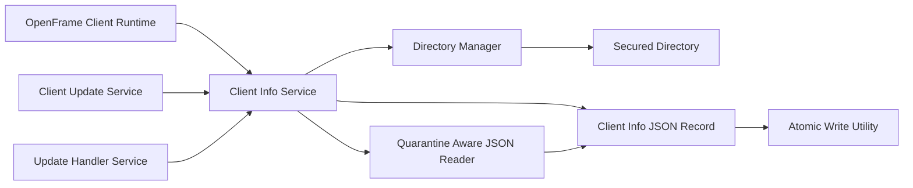
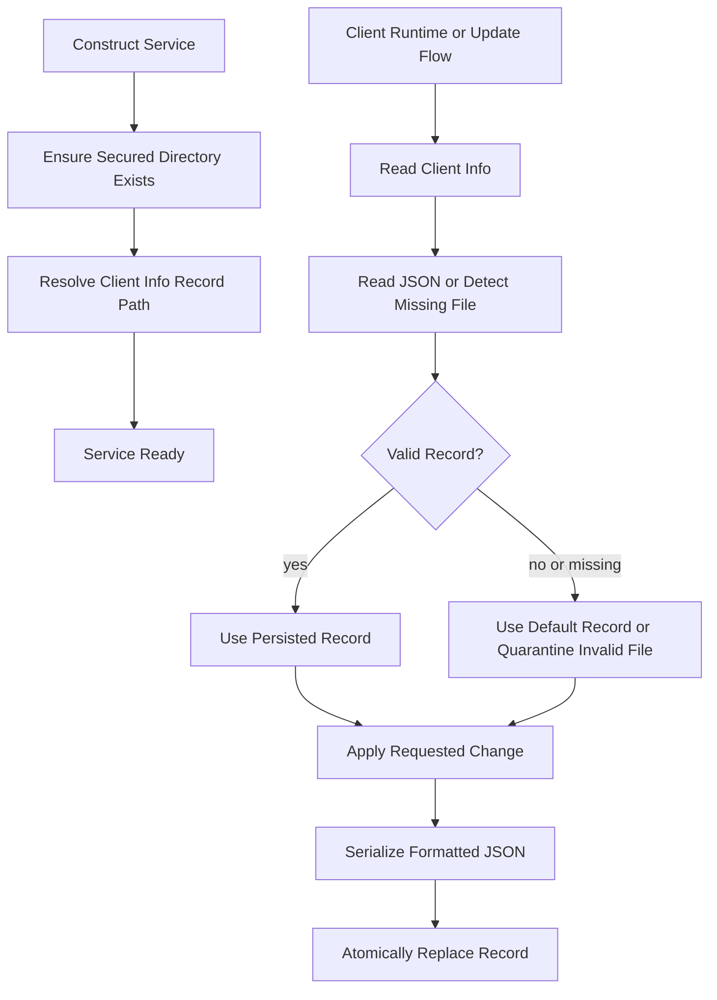
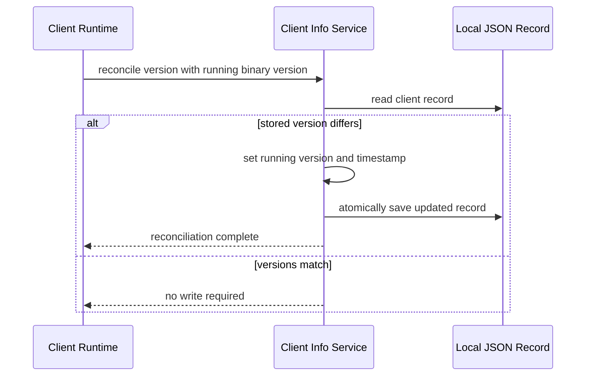
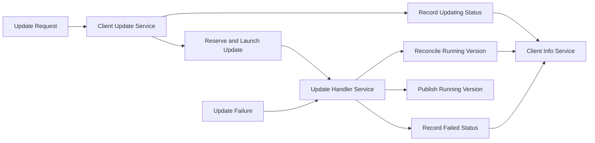

# Client Info Service

Client Info Service is the OpenFrame client agent's local record keeper for its running binary and update state. It is supplied by the `openframe_agent_lib` Rust library from [OpenFrame OSS Library](https://github.com/flamingo-stack/openframe-oss-lib/blob/16e7c1cbd9664e7d10ec5ebca7d53c9bd314decf/clients/openframe-client/src/services/openframe_client_info_service.rs) and runs within this repository's OpenFrame client deployment.

The service owns a single JSON document in the agent's secured directory. It provides a small asynchronous API for reading the record, persisting changes safely, recording the executable location, reconciling the stored version against the binary actually running, and tracking an update lifecycle.

## Responsibilities

- Establish the secured state location during construction.
- Return a default client record when no record has been written yet.
- Serialize the complete record as formatted JSON and replace it atomically.
- Recover safely from malformed persisted JSON through the library's quarantine-aware reader.
- Record the observed binary version and the time it was changed.
- Track an intended target version and one of four update states: current, updating, updated, or failed.
- Persist the path to the running client binary.

## Architecture

`OpenFrameClientInfoService` contains only the resolved file path. It receives a `DirectoryManager` at construction, derives the secured-directory path for the record, and ensures required directories exist before returning a usable service instance. The model persisted at that location contains the current version, optional target version, update status, binary path, last update check, and last modification time.

The service is intentionally local: it does not make network requests, launch an updater, or decide update eligibility. Those responsibilities belong to the wider client runtime and update services. Its role is to make their shared update metadata durable and recoverable.

## Persisted State

The record represents the agent's local view of the installed client:

| Value | Purpose | Updated by |
|---|---|---|
| Current version | Version the agent records as installed or running | Version update and reconciliation operations |
| Target version | Optional version requested for an update | Update-status operation |
| Update status | Current, updating, updated, or failed | Update-status operation |
| Binary path | Location of the client executable | Binary-path operation |
| Last update check | Timestamp of the latest status update | Update-status operation |
| Last updated | Timestamp of the latest version change | Version update and reconciliation operations |

All timestamps are generated in UTC and stored as RFC 3339 strings.

## Component Interaction

The reader reports a missing file without treating it as an error; `get` then supplies the model default. If a file is malformed, the shared filesystem utility parses or quarantines it before Client Info Service consumes the result. Other read failures are returned with path-specific context, so callers can distinguish storage failures from the first-run case.

Writes serialize the full record before persistence. The shared atomic writer creates a temporary file in the destination directory, flushes it, and persists it as the destination file. This prevents a normal write from exposing a partially written JSON document and makes the state file more resilient to interruption.

## Operations

| Operation | Behavior | Persistence effect |
|---|---|---|
| Construct | Resolves the record path from the secured directory and ensures directories exist | None |
| Get | Reads the record using quarantine-aware JSON handling, or supplies defaults when missing | None |
| Save | Serializes the supplied record and atomically replaces the file | Writes the full record |
| Update version | Sets the recorded version and modification timestamp | Writes the full record |
| Reconcile version | Compares stored and running versions, writing only when they differ | Conditionally writes the full record |
| Set update status | Sets the state and optional target version, then records the update-check timestamp | Writes the full record |
| Set binary path | Replaces the stored executable path | Writes the full record |

## Version Reconciliation Flow

Reconciliation protects the local record from becoming stale after an update, rollback, manual binary replacement, or another lifecycle path changes the executable outside the normal version-update operation.

The comparison is exact. A difference causes the running binary version to become authoritative and updates the modification timestamp; an equal version avoids unnecessary file replacement.

## Update Lifecycle Integration

Client Info Service is used as shared state by the update path. The client update service holds it alongside download, update-state, last-known-good, tool coordination, and update-handler dependencies. The update handler also holds it while processing pending updates, failures, cleanup, boot records, installed-agent publication, configuration, and result storage.

This diagram describes the dependency roles exposed by the library types. Client Info Service records status and identity, while the update services retain ownership of downloading, reservation, launch, cleanup, rollback-oriented handling, and publication.

## Failure and Recovery Semantics

- **No existing record:** a default record is returned. This supports first startup without a separate initialization step.
- **Invalid JSON:** the shared read utility quarantines malformed content rather than presenting it as a valid record. The service then uses the parsed result when available, otherwise the default record.
- **Directory setup failure:** construction fails before callers can obtain the service, preventing later operations from targeting an unprepared state location.
- **Serialization or write failure:** the operation returns an error enriched with the affected record path or serialization context. Existing persisted content is not intentionally replaced with partial JSON.
- **No version discrepancy:** reconciliation completes without writing, preserving the record and avoiding needless timestamp changes.

## Maintenance Guidance

Keep the record model and all update lifecycle writers compatible. Because each mutation reads the full record, modifies selected values, and saves the full document, a new persisted field should have a safe model default and be preserved by all operations that only modify other fields.

Treat the secured-directory location as part of the client state contract. Moving or renaming the record requires an explicit migration or compatibility read path; otherwise the agent will treat the new location as a first-run record.

When changing update status behavior, ensure the target version and last-update-check timestamp remain meaningful together. A caller that changes status without a target can intentionally clear the target version because the status operation accepts an optional value.

## Source and Runtime Context

The implementation is supplied by OpenFrame OSS Library artifact `openframe_agent_lib` version `v0.0.5`, which this repository consumes. The concrete source is [openframe client info service](https://github.com/flamingo-stack/openframe-oss-lib/blob/16e7c1cbd9664e7d10ec5ebca7d53c9bd314decf/clients/openframe-client/src/services/openframe_client_info_service.rs). It runs in the Rust OpenFrame client that is part of the OpenFrame OSS Tenant service deployment.
