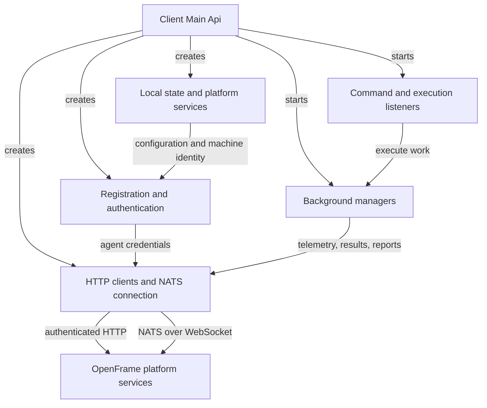
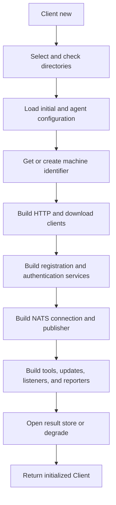
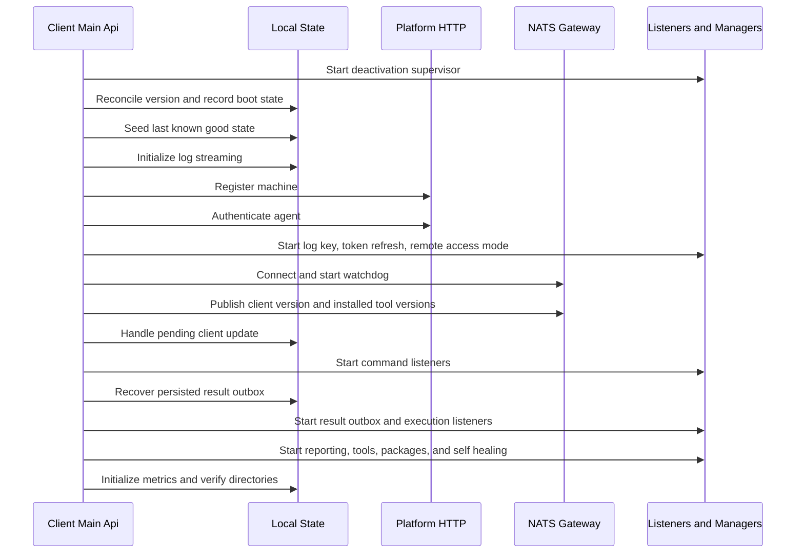
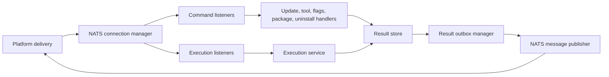
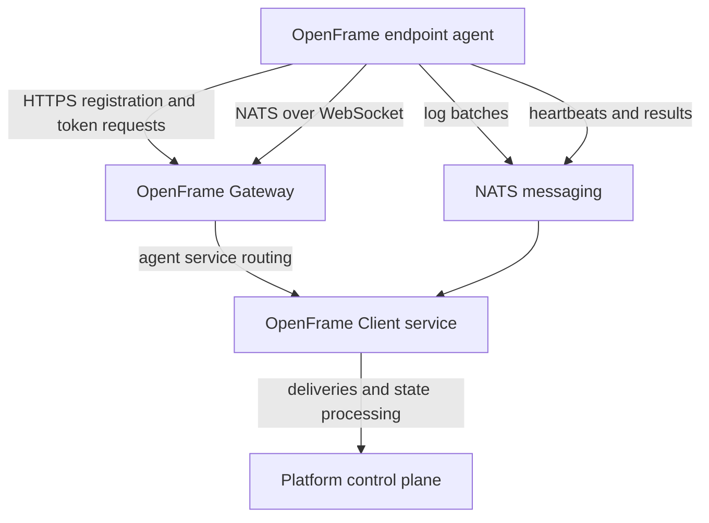

# Client Main Api

Client Main Api is the composition root for the OpenFrame endpoint agent. It creates the agent's local storage, configuration, HTTP and NATS connectivity, authentication, command handlers, execution listeners, update machinery, telemetry publishers, and managed-tool lifecycle services. Its public surface is deliberately small: construct [`Client`](https://github.com/flamingo-stack/openframe-oss-lib/blob/7a766f00e4f58b5d89db007b878ac8d6e0c344f4/clients/openframe-client/src/lib.rs) with `Client::new`, then run it with `Client::start`.

The implementation belongs to the `openframe_agent_lib` Rust library from [OpenFrame OSS Library](https://github.com/flamingo-stack/openframe-oss-lib) and is assembled at runtime by this repository's OpenFrame Client service. The tenant repository consumes `openframe_agent_lib` at version `v0.0.5`; the source reference in this document is the revision supplied with the module.

## Responsibilities

Client Main Api coordinates the endpoint agent without implementing every capability itself. It is responsible for:

- establishing a durable local runtime context, including installation, secured, log, update, and tool directories;
- registering a machine and obtaining or refreshing agent credentials;
- connecting authenticated agent traffic to the platform through HTTP and NATS-over-WebSocket;
- subscribing command, tool, update, remote-access, and execution listeners;
- publishing heartbeats, hostname and timezone information, installed-agent and tool state, package reports, command results, and streamed logs;
- coordinating safe execution, tool updates, package updates, client updates, restarts, tenant deactivation, and recovery after interruption; and
- keeping the process alive after all startup services have been initialized.

It does not expose an inbound HTTP API. The agent is an outbound client: platform services dispatch work over NATS subjects and receive acknowledgements, results, reports, and telemetry through the same messaging plane.

## Public Types and Entry Points

| Component | Purpose |
|---|---|
| [`Client`](https://github.com/flamingo-stack/openframe-oss-lib/blob/7a766f00e4f58b5d89db007b878ac8d6e0c344f4/clients/openframe-client/src/lib.rs) | Owns the fully wired agent runtime and provides construction and asynchronous startup. |
| [`Client::new`](https://github.com/flamingo-stack/openframe-oss-lib/blob/7a766f00e4f58b5d89db007b878ac8d6e0c344f4/clients/openframe-client/src/lib.rs) | Performs local health checks, resolves machine identity and configuration, then builds all clients, services, listeners, managers, stores, and guards. |
| [`Client::start`](https://github.com/flamingo-stack/openframe-oss-lib/blob/7a766f00e4f58b5d89db007b878ac8d6e0c344f4/clients/openframe-client/src/lib.rs) | Executes the ordered startup sequence, starts background managers and listeners, and maintains the agent process. |
| [`ClientConfiguration`](https://github.com/flamingo-stack/openframe-oss-lib/blob/7a766f00e4f58b5d89db007b878ac8d6e0c344f4/clients/openframe-client/src/lib.rs) | Serializable top-level configuration grouping server, client, metrics, and security settings. It is held behind an asynchronous read-write lock. |
| [`ServerConfig`](https://github.com/flamingo-stack/openframe-oss-lib/blob/7a766f00e4f58b5d89db007b878ac8d6e0c344f4/clients/openframe-client/src/lib.rs) | Defines the server URL, check interval, and optional update URL. |
| [`ClientConfig`](https://github.com/flamingo-stack/openframe-oss-lib/blob/7a766f00e4f58b5d89db007b878ac8d6e0c344f4/clients/openframe-client/src/lib.rs) | Contains a client identifier, logging level, and update channel. |
| [`MetricsConfig`](https://github.com/flamingo-stack/openframe-oss-lib/blob/7a766f00e4f58b5d89db007b878ac8d6e0c344f4/clients/openframe-client/src/lib.rs) | Enables metrics and declares a collection interval. |
| [`SecurityConfig`](https://github.com/flamingo-stack/openframe-oss-lib/blob/7a766f00e4f58b5d89db007b878ac8d6e0c344f4/clients/openframe-client/src/lib.rs) | Holds TLS-verification and certificate-path settings. |

The default `ClientConfiguration` uses the OpenFrame API URL, a generated client identifier, stable update channel, enabled metrics, and TLS verification. Runtime initialization also derives the actual gateway HTTP and WebSocket endpoints from the persisted initial configuration, rather than using this in-memory default as the full operational connection configuration.

## Architecture

### Composition Boundaries

The constructor groups its dependencies into the following functional areas:

| Area | Components assembled by Client Main Api | Result |
|---|---|---|
| Local foundation | `DirectoryManager`, initial and agent configuration services, machine identifier, installed-tools and tool-connection stores | Validated writable directories and persistent agent state. `OPENFRAME_DEV_MODE` selects user-scoped development directories. |
| HTTP, registration, and authentication | Agent HTTP clients, `RegistrationClient`, `AgentRegistrationService`, `AuthClient`, `AgentAuthService`, shared encrypted-token storage, token refresh manager | A registered agent with persisted credentials and proactive token refresh. |
| Messaging | TLS configuration provider, `NatsConnectionManager`, `NatsMessagePublisher`, result store, result outbox manager | Authenticated NATS-over-WebSocket communication and recovery-capable result publication. |
| Device reporting | Heartbeat, hostname, timezone, installed-agent, tool-connection, package-report, and log-streaming publishers | Platform-visible device identity, status, inventory, and operational logs. |
| Remote management | Command listeners, execution listeners, execution service, tool lifecycle managers, package-update manager | Delivery and controlled execution of commands, scripts, software work, tool operations, and package updates. |
| Resilience and lifecycle | Deactivation, update state and cleanup, update handler, last-known-good state, restart gate, mesh self-healing | Safe recovery, deferred restarts, client replacement, tenant-removal handling, and stale tool-agent repair. |

## Construction Flow

`Client::new` is synchronous, except for later activities started by `Client::start`. It fails construction when a required local dependency cannot be initialized or the directory health check cannot complete. The constructor performs the following high-level sequence.

Notable construction decisions:

- **Development directories:** when `OPENFRAME_DEV_MODE` is set, `DirectoryManager::for_development` is used; otherwise the normal platform directory manager is created.
- **Machine-bound HTTP:** both normal and download clients are built with the persisted machine identifier. The download client receives its own, longer timeout.
- **Local mode:** the initial configuration determines whether HTTP clients should use local-mode behavior and whether a local CA can be supplied to the NATS TLS configuration provider.
- **Deactivation supervision:** the deactivation service is created before authentication and NATS initialization so gateway responses that indicate a removed tenant can cause controlled backoff, service stopping, and self-uninstallation.
- **Durable results:** scheduled-execution results use a secured `scheduled_outbox.redb` store. If opening the store fails, `open_or_degrade` allows the agent to continue with degraded durability rather than failing all startup.
- **Feature-gated package updates:** the package-update command listener and run manager are created only when the persisted `PackageAutoUpdate` feature is enabled.

## Startup Lifecycle

`Client::start` is asynchronous and intentionally orders startup around credential availability, message durability, and restart safety.

### Ordered Startup Details

1. **Protect lifecycle work first.** The deactivation supervisor starts before the registration and authentication steps. Client-version reconciliation, a boot marker, a last-known-good anchor, and an update boot-attempt record follow. Errors in these bookkeeping operations are logged and do not stop startup.
2. **Initialize log streaming before identity processing.** `LogStreamingRunManager` receives initial configuration, agent configuration, installed tools, directories, and the log-key service. Startup fails if this required initialization fails.
3. **Register and authenticate.** Registration collects device data and persists returned registration state. Initial authentication obtains credentials and supplies the shared token required by later services.
4. **Start token-dependent services.** The log-key service, proactive token refresh manager, and remote-access mode service start only after authentication.
5. **Connect the message plane.** The agent connects to NATS-over-WebSocket and activates its reconnection watchdog. It then publishes its running client version and installed tool versions, and handles a pending update from a preceding run without blocking startup on update-handling failure.
6. **Begin control-plane reception.** Feature-flag, optional package-update, tool installation, tool update, client update, client uninstall, and remote-access listeners subscribe before execution work begins.
7. **Recover results before accepting new executions.** The result store attempts to recover interrupted scheduled execution data, then the outbox flusher starts. Only then are command, script, bootstrap script, software script, and scheduled script listeners started.
8. **Start periodic and long-running work.** Heartbeat and timezone managers, a one-shot hostname report, package reporting and optional updates, tool runtime management, mesh self-healing, tool-connection processing, metrics initialization, and a final directory health check are started.
9. **Remain resident.** The method enters a one-second asynchronous sleep loop. Normal shutdown is therefore controlled externally by the platform service manager or an explicit lifecycle path.

## Command, Execution, and Result Data Flow

Commands are processed through a common command context that combines the NATS connection, agent configuration, restart gate, NATS publisher, durable result store, and flush notification. Execution listeners use the same messaging and durable-result facilities.

The configured command categories are:

- feature flag application;
- tool installation and tool-agent updates;
- client updates and client uninstallation; and
- package update orders when the package auto-update feature is enabled.

The execution side has separate listener instances for commands, scripts, bootstrap scripts, software scripts, and scheduled-script execution messages. Bootstrap-script completion additionally wakes the package-manager reporting run manager. This lets the agent report package-manager capability or changes after bootstrap work while retaining a common execution service.

### Delivery Safety

The result store and outbox decouple local execution from transient transport failure. Results are journaled, recovered during startup, and flushed by a dedicated run manager. Command context and execution listeners can notify the flusher after new work completes. This ordering is important: execution listeners are not started until recovery has already been attempted and the outbox manager is active.

## Lifecycle Coordination and Failure Handling

Several coordination primitives prevent conflicting activities:

| Mechanism | Coordination role |
|---|---|
| `ToolOps` | Tracks busy tools and supplies guards so tool installation, update, restart, and runtime actions do not overlap unsafely. |
| `InProgress` package-upgrade state | Indicates whether package updates are in flight. Client-update logic receives a view of this state. |
| `Latch` for agent restart | Represents a pending agent restart request. |
| `RestartGate` | Waits for tool activity, running scripts, pending client updates, package upgrades, and restart signals to reach a safe restart point. |
| `ResultStore` | Persists execution outcomes independently of immediate network availability. |
| `LastKnownGoodService` | Records boot and known-good anchors that support update rollback or recovery decisions. |

When `RestartGate` is requested, a background task launches the service restart subcommand in a detached process. It waits only for the configured handoff period; regardless of handoff success, timeout, or spawn failure, the current process exits with the dedicated self-restart exit code so the operating-system service manager can recover it.

The update path includes persistent update state, cleanup, version information, last-known-good management, and an update handler. A pending update is handled after NATS connects so status can be published. The handler can record boot attempts and publish the version currently running.

Tenant removal is handled separately by `DeactivationService`. It observes gateway status through the services that use it, begins controlled deactivation behavior, and can request uninstallation while coordinating with the tool run manager.

## Platform Integration

Client Main Api connects endpoint behavior to the tenant deployment as follows:

The tenant configuration defines the gateway as the public route layer and routes client paths to the OpenFrame Client service. The agent's runtime code constructs its HTTP endpoint from its initial configuration and its messaging endpoint as a secure WebSocket URL. It does not directly couple itself to the platform's persistence systems; the client-side platform service consumes the agent's messages and handles downstream state updates.

## Operational Notes

- **Configuration sources:** `ClientConfiguration` is a serializable runtime structure with defaults, but registration, authentication, server URL, local mode, certificate information, agent credentials, and feature flags are supplied through specialized persistent services.
- **Security:** HTTP clients are constructed with the machine identifier and local-mode context. NATS uses a TLS provider backed by initial configuration. Agent tokens are stored through the shared-token service together with encryption support.
- **Logging and observability:** log streaming starts before registration and authentication processing; key retrieval begins after authentication. Metrics initialization occurs near the end of successful startup. Heartbeat, hostname, timezone, package-manager, installed-agent, and tool-version publishing provide additional operational signals.
- **Startup tolerance:** failures in noncritical reconciliation, marker, boot-attempt, version-publication, pending-update, and certain manager startup paths are logged while startup continues. Failures from required construction, initial log-stream setup, registration, authentication, NATS connection, listener subscription, or final health checks propagate from `start`.
- **Managed process model:** Client Main Api expects an external service manager to supervise the executable. Its own restart handoff ends by exiting with a designated code, allowing the service manager to launch a replacement process.

## Maintainer Guidance

When extending Client Main Api, preserve initialization and startup ordering rather than treating `Client::new` as a generic dependency container:

1. Create persistent local state and identity before building clients that need them.
2. Keep services requiring an access token after registration and authentication.
3. Connect NATS before publishing runtime state or accepting platform deliveries.
4. Recover durable results and start the outbox before starting execution listeners.
5. Feed every operation that can conflict with updates or restart through the existing lifecycle guards.
6. Ensure a new background manager has a clear owner in `Client`, a defined start point, and failure handling consistent with whether it is startup-critical.

The source of truth for these orchestration details is the library implementation: [`clients/openframe-client/src/lib.rs`](https://github.com/flamingo-stack/openframe-oss-lib/blob/7a766f00e4f58b5d89db007b878ac8d6e0c344f4/clients/openframe-client/src/lib.rs).