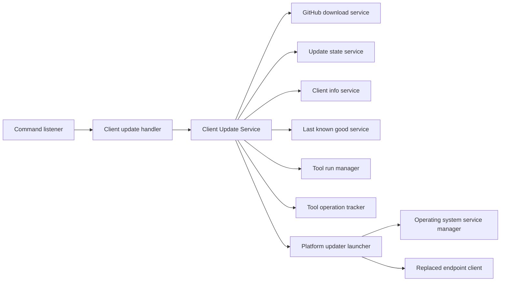
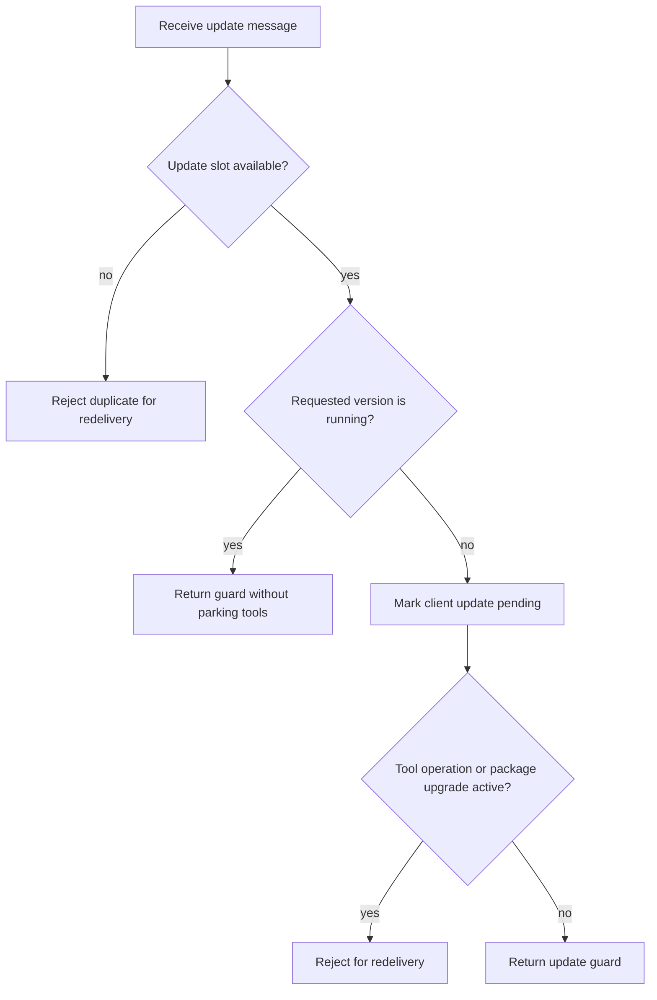
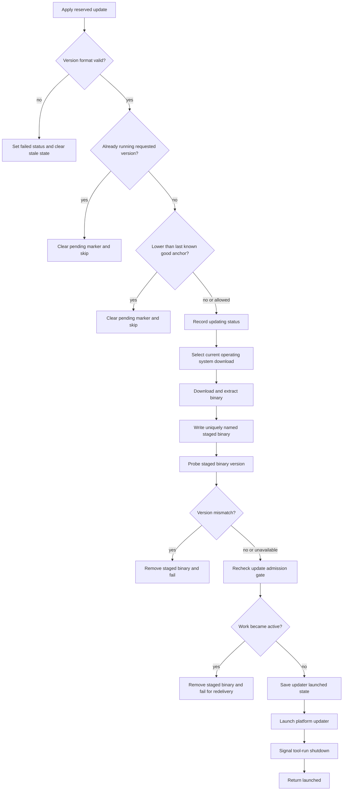
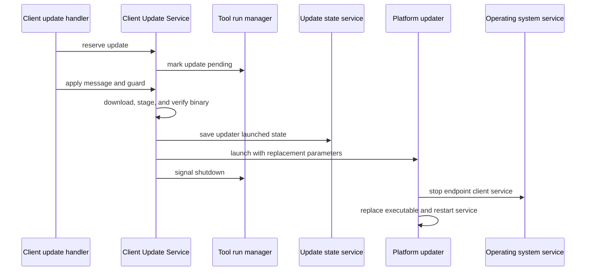

# Client Update Service

The Client Update Service safely replaces the running OpenFrame endpoint client with a requested release. It runs in the Rust `openframe_agent_lib` dependency supplied by [OpenFrame OSS Library](https://github.com/flamingo-stack/openframe-oss-lib/blob/16e7c1cbd9664e7d10ec5ebca7d53c9bd314decf/clients/openframe-client/src/services/openframe_client_update_service.rs), which this repository assembles into the endpoint-client runtime.

Its primary responsibility is to turn an `OpenFrameClientUpdateMessage` into a controlled service handoff: reject unsafe or duplicate work, obtain a platform-compatible binary, stage and validate it, persist recovery state, and delegate the executable replacement to a platform updater. It also coordinates tool supervision so an agent replacement does not race with a tool operation or package upgrade.

## Scope and Responsibilities

The service exposes three important concepts:

| Component | Responsibility |
|---|---|
| `OpenFrameClientUpdateService` | Coordinates reservation, download, staging, validation, state persistence, and updater launch. |
| `UpdateLaunch` | Reports whether an update was launched or intentionally skipped. |
| `UpdateGuard` | Holds an atomic, process-local update slot until the updater completes or an early failure is handled. |

An update message contains the requested version and a set of download configurations. The service chooses the configuration matching the current operating system; it does not choose releases or publish update commands.

## Position in the Endpoint Client

The surrounding endpoint client receives client-update commands through its command-listener layer. The update service owns the local replacement workflow, while companion services own persisted client metadata, recovery state, artifact download, and tool lifecycle control.

### Dependency Roles

- **GitHub download service** selects the operating-system-specific download configuration, downloads the archive with retry behavior, checks minimum archive and extracted-binary sizes, and extracts ZIP or tarball payloads.
- **Client info service** records `Updating` before the handoff and `Failed` when the local workflow cannot proceed. These bookkeeping failures do not prevent a valid update attempt.
- **Update state service** persists an `UpdateState` immediately before launching the updater. The state includes the target version, phase, boot-attempt count, start time, and optional error.
- **Last known good service** supplies the downgrade anchor, a reserve binary location, boot marker path, and per-update transcript path. It promotes confirmed versions outside this service’s launch path.
- **Tool run manager** marks a client update pending, stops tool run loops once the updater is launched, and can restore supervision when the updater aborts before stopping the service.
- **Tool operations and package-upgrade view** form the admission gate. Active tool work or package upgrades defer the update for redelivery rather than competing for the same machine resources.

## Reservation and Concurrency Control

The command handler should reserve the update slot before invoking `apply`. `reserve` acquires an `AtomicBool` through `UpdateGuard`; dropping the guard releases the slot. This prevents a duplicate delivery from overlapping an active update process.

The running-version exception avoids unnecessarily parking tools for an idempotent request. For any other accepted request, the pending marker blocks new tool activity while the update is prepared. The service checks the same busy conditions again after downloading and staging, which closes the race where work starts during artifact retrieval.

## Update Lifecycle

`apply` validates the request and delegates the replacement work to `execute_update` while the caller-owned guard remains live.

### Version Rules

The requested value must be non-empty, begin with a digit or `v`, contain only semver-compatible characters, and parse through the endpoint client version comparator. The parser canonicalizes versions before they are persisted or compared.

A request for the compile-time `OPENFRAME_VERSION` is skipped. Unless `ALLOW_DOWNGRADE` is enabled, a requested version with lower precedence than the persisted last-known-good anchor is also skipped. If the anchor is unavailable or malformed, the service logs the condition and continues instead of making the update path unavailable.

### Artifact Staging and Verification

The service creates the update staging directory and writes the extracted payload under a UUID-based filename. The unique path prevents another process from observing a partially written staged file.

Before the endpoint service is stopped, the staged executable is probed with the configured timeout. A binary that explicitly reports a different version is removed and rejected. A binary whose version cannot be probed is installed as unverified; this preserves compatibility with builds that do not expose a probeable version while making the condition visible in logs.

## Updater Handoff

After staging succeeds, the service passes a platform-specific updater all information needed to complete the replacement:

- staged binary and currently running executable paths;
- full operating-system service name;
- persisted update-state file path and target version;
- boot marker, last-known-good reserve, and updater transcript paths; and
- a flag indicating this is a normal update rather than rollback-only launch.

The `UpdateState` phase becomes `UpdaterLaunched` only after the final busy check and immediately before the launcher is called. If persisting state or launching the updater fails, the staged binary is removed. Any overall failure attempts to set the client status to `Failed` and clears stale state so a prior attempt cannot incorrectly affect boot crash-loop handling.

## Early Updater Failure and Recovery

The launcher may supply an exit watcher. If the updater exits unsuccessfully while the original endpoint client is still alive, the service treats it as a pre-swap failure rather than waiting for a boot that will not occur.

1. It removes the staged binary where possible.
2. It reads update state, tolerating missing or corrupt state with a safe fallback.
3. It marks a non-terminal state as `Failed` and records an error that identifies the updater exit.
4. It invokes the update handler’s failure path, which records failed status, reports the failed delivery, cleans update artifacts, prunes updater transcripts, and clears state.
5. It clears the pending-update marker and resumes tool supervision unless a deactivation workflow has deliberately stopped tools.

On later startup, the update handler evaluates any persisted state. A running binary that matches the target is the success path. A state still in `UpdaterLaunched` or `Verifying` remains pending for later verification; terminal or incompatible phases become failures. Repeated unresolved boots are protected by a crash-loop limit and can trigger a reserve rollback attempt.

## Operational Outcomes

| Condition | Behavior | Result |
|---|---|---|
| Duplicate request during an active update | Reservation fails without overlapping the existing work. | Error, eligible for redelivery. |
| Requested release equals running binary | No download or restart; pending marker is cleared during apply. | `Skipped`. |
| Downgrade below last known good version | Refused when downgrade policy is disabled. | `Skipped`. |
| Active tool operation or package upgrade | Update is deferred before reservation completion or after staging. | Error, eligible for redelivery. |
| Unsupported platform payload, download, extraction, staging, or validation failure | Staged data is cleaned when applicable and failed status is recorded. | Error, eligible for redelivery. |
| Updater launch accepted | Tool supervision is stopped and the updater owns service replacement. | `Launched`. |
| Updater exits before service stop | Failure is finalized locally and eligible tools are supervised again. | Failure recovery. |

## Maintenance Considerations

- Preserve the two admission checks: one before work begins and another after downloading. Removing the second check reintroduces a race with newly started tool work or package upgrades.
- Keep update-state persistence immediately adjacent to updater launch. The updater requires that file, while stale earlier state can mislead boot recovery.
- Treat client-status persistence as observability, not an availability dependency. The current design continues a valid replacement even if metadata writes fail.
- Keep early updater-exit handling asynchronous and retain the update guard in that watcher. Releasing it too early permits duplicate redelivery while the updater outcome is unresolved.
- When changing release packaging, preserve a valid `DownloadConfiguration` for each supported operating system and ensure the archive contains the configured target filename.
- The endpoint client’s command delivery and server-side update publication are outside this module; they must continue to provide idempotent redelivery semantics because this service intentionally defers contention and transient failures.
