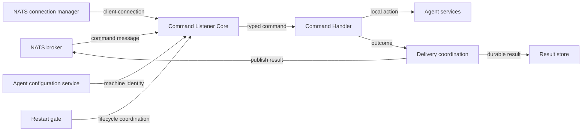
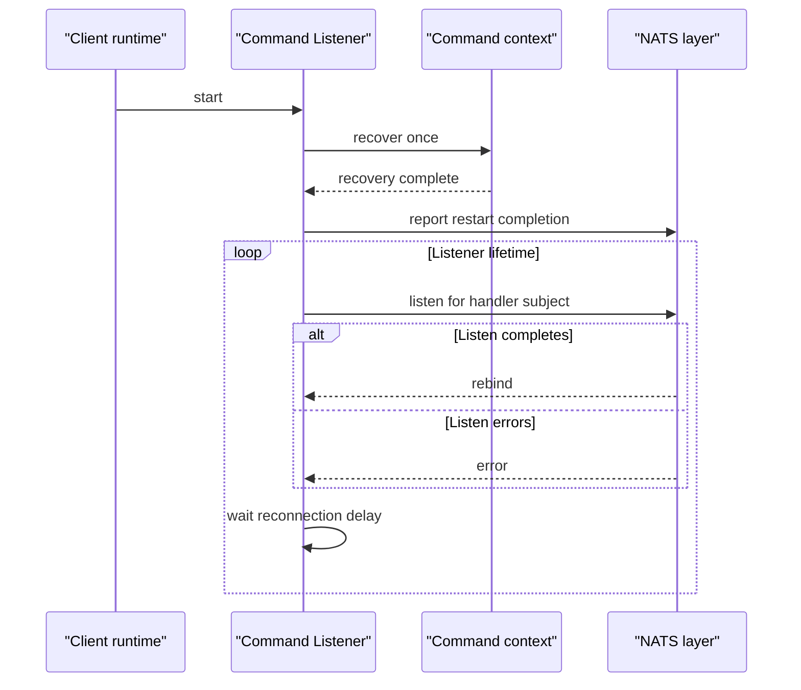
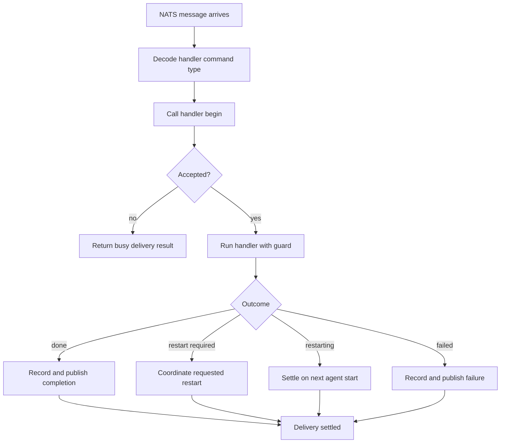

# Command Listener Core

Command Listener Core is the generic, asynchronous command-consumption framework used by the OpenFrame client agent. It belongs to the `openframe_agent_lib` library from [OpenFrame OSS Library](https://github.com/flamingo-stack/openframe-oss-lib/blob/16e7c1cbd9664e7d10ec5ebca7d53c9bd314decf/clients/openframe-client/src/listener/command/mod.rs), which this repository runs as part of its client deployment. The module binds a typed command handler to a machine-specific NATS subject, coordinates durable delivery state, and keeps the listener available through connection failures.

The module is intentionally command-agnostic. A handler supplies the command type, subscription subject, concurrency admission policy, and execution logic; Command Listener Core supplies the common lifecycle around those decisions.

## Responsibilities

- Start an independently running Tokio task for a handler.
- Recover interrupted command deliveries once before listeners begin subscribing.
- Subscribe each handler to the correct subject for the current machine.
- Decode each handler's typed command payload.
- Obtain admission through the handler's `begin` operation, including a busy result when work cannot start.
- Invoke the handler with the machine identifier, delivery reference, command, and guard.
- Coordinate normal completion, failures, restart-sensitive commands, and agent removal.
- Rebind after a listener exit or error using the configured reconnection delay.

## Position in the Client Agent

The listener is a reusable control-plane adapter between NATS and local agent services. It does not embed installation, update, feature-flag, or uninstall business logic. Those responsibilities remain in concrete handlers and their services.

## Core Types

| Type | Role |
| --- | --- |
| `CommandHandler` | Contract implemented by each command family. It defines the wire command type, subject, admission guard, execution operation, and lifecycle characteristics. |
| `CommandContext` | Shared infrastructure for listeners: NATS connection access, agent configuration, restart coordination, delivery coordination, and one-time recovery tracking. |
| `CommandListener` | Generic runtime wrapper around one handler and one shared context. Its `start` operation spawns and supervises the long-running listener task. |
| `Begin` | Admission result. `Accepted` carries the handler-specific guard required by execution; `Busy` carries an explanatory reason without running the command. |
| `Outcome` | Execution result: `Done`, `RestartRequired`, `Restarting`, or `Failed` with a failure description. |

### Command Handler Contract

A handler must be cloneable, thread-safe, and long-lived enough to run in the spawned task. It supplies:

- `KIND`, used by listener logging to identify the command family.
- `subject`, which derives a NATS subscription subject from the machine identifier.
- `begin`, which atomically decides whether work is accepted and returns a guard when it is.
- `run`, which performs the asynchronous command action and returns an `Outcome`.
- Optional sequence support for state-like commands, allowing a command at or below the recorded sequence to be answered as complete without being run again.
- Optional restart and removal hooks for commands whose local effects can terminate the agent process or delete the agent installation.

The guard is deliberately associated with accepted work. This gives each handler control of the lifetime of locks, permits, or other exclusion mechanisms needed while its command runs.

## Listener Startup and Recovery

`CommandListener::start` clones the listener and creates a Tokio task. Before subscribing, the task performs two recovery-oriented actions:

1. `CommandContext` runs delivery recovery exactly once for all listeners that share the context. This handles commands interrupted by the previous stop before any subscription is active.
2. The NATS layer reports the completion of a restart-sensitive delivery, when applicable.

The task then loops forever: it invokes the NATS listening operation, records either a rebind or an error, waits for the configured reconnection delay, and tries again. Consequently, an individual subscription failure does not permanently stop the command family.

## Command Processing Model

The private NATS and delivery submodules implement the transport and settlement details; the public contract establishes the processing boundaries shown below. The listener derives the subscription from the current machine identity, then delegates admission and execution to the selected handler.

## Delivery, Ordering, and Lifecycle Semantics

### Durable delivery

`CommandContext` constructs the internal delivery coordinator with a `NatsMessagePublisher`, shared `ResultStore`, and a flush notification. The result store represents the local durable side of command-result handling, while the publisher sends result messages to NATS. Recovery is intentionally shared with `OnceCell`, preventing concurrent listeners using the same context from recovering the same interrupted work repeatedly.

### Sequenced commands

Handlers can set the sequenced capability when their messages express state rather than independent work. For these handlers, a sequence at or below the last applied sequence is considered complete without rerunning it. The handler may provide an external applied-sequence floor for state that predates the shared result store.

### Restart-sensitive commands

Two distinct outcomes model agent lifecycle changes:

- `RestartRequired` indicates that processing succeeded but a restart must be coordinated.
- `Restarting` indicates that the command itself can stop the agent before its handler returns. Its delivery is settled at the next agent start rather than prematurely marked failed.

`RestartGate` provides shared coordination for shutdown-sensitive work. Its state includes a closing latch, a work lock, restart notification, tool-busy tracking, running-script tracking, client-update status, and package-upgrade progress. Its `requested` operation waits for the restart notification, enabling other runtime components to react to the same lifecycle transition.

### Agent removal

Handlers that remove the agent set the removal capability. The contract requires their completion result to be published before removal begins, then invokes the asynchronous removal hook. This ordering preserves the server-visible result even though the local outbox and installation may disappear immediately afterward.

## Concrete Command Families

Command Listener Core is used with dedicated handlers rather than a single command switch. The module exports the handler types so the client composition root can instantiate listeners for these command families:

| Command family | Handler | Local responsibility |
| --- | --- | --- |
| Client uninstall | `ClientUninstallHandler` | Delegates deactivation and agent removal workflow to `DeactivationService`. |
| Client update | `ClientUpdateHandler` | Uses `OpenFrameClientUpdateService` and `ToolRunManager` to apply a client update safely. |
| Feature flags | `FeatureFlagsHandler` | Applies incoming flag state through `FeatureFlagsService`. |
| Tool installation | `ToolInstallationHandler` | Uses `ToolInstallationService` and tool-operation coordination; it also observes pending client update state. |
| Tool update | `ToolUpdateHandler` | Applies tool-agent updates through `ToolAgentUpdateService` with tool-operation coordination. |
| Package update | `PackageUpdateHandler` | Submits package-update work to its order store and status reporter. |

The handler implementations and restart gate are separate adjacent modules in the same OpenFrame client library. This keeps generic subscription, recovery, and result semantics stable while command-specific dependencies evolve.

## Dependencies and Boundaries

| Dependency | How Command Listener Core uses it |
| --- | --- |
| `NatsConnectionManager` | Provides the managed client connection used to listen, including its connection lifecycle. |
| `AgentConfigurationService` | Supplies agent configuration needed to resolve the local machine context. |
| `NatsMessagePublisher` | Publishes delivery outcomes through the delivery coordinator. |
| `ResultStore` | Maintains local result and recovery state used by delivery coordination. |
| `RestartGate` | Serializes restart-sensitive transitions with ongoing tool, script, package, and update activity. |
| Tokio | Hosts the spawned task, asynchronous recovery, notification primitives, and reconnection delay. |
| Serde | Requires each handler command type to be deserializable from its received payload. |

At the platform level, this client-side control plane complements server-side command dispatch and result processing. The tenant deployment includes NATS as a datasource, and the Java client service contains delivery dispatch and delivery result listeners. Command Listener Core is the endpoint-side consumer and executor; it does not expose an HTTP route.

## Failure Handling and Operational Signals

- Listener errors are logged with the handler kind and do not terminate the supervision loop.
- A clean listener return is logged as a rebind event and is followed by the same delayed reconnect path.
- Handler failures are represented as `Outcome::Failed` with formatted error context; the conversion from a fallible operation ensures errors become reportable outcomes rather than unstructured task failures.
- Admission refusal is explicit through `Begin::Busy`, allowing command-specific contention to be surfaced without executing conflicting work.
- Interrupted work is recovered before subscription, reducing the chance that a new command races with stale in-progress delivery state.

## Maintenance Guidance

When adding a command family:

1. Implement `CommandHandler` with a stable kind and machine-specific subject.
2. Make `begin` the single admission point for handler-local concurrency control, returning a guard that stays alive for the entire `run` operation.
3. Return precise outcomes. Use restart-related outcomes only when the handler's execution and agent lifecycle actually require them.
4. Enable sequencing only for idempotent state application and provide an applied-sequence source if state is maintained outside the shared result store.
5. For removal commands, use the removal capability so result publication precedes local deletion.
6. Construct the listener with the shared `CommandContext` rather than creating isolated delivery recovery state for each command family.

The source implementation is available in [the Command Listener Core module](https://github.com/flamingo-stack/openframe-oss-lib/blob/16e7c1cbd9664e7d10ec5ebca7d53c9bd314decf/clients/openframe-client/src/listener/command/mod.rs).
