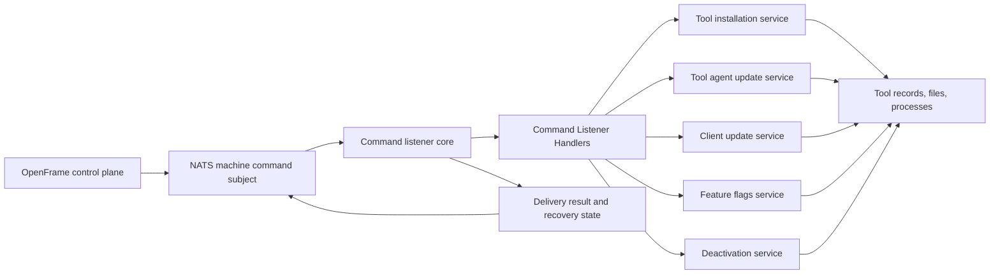
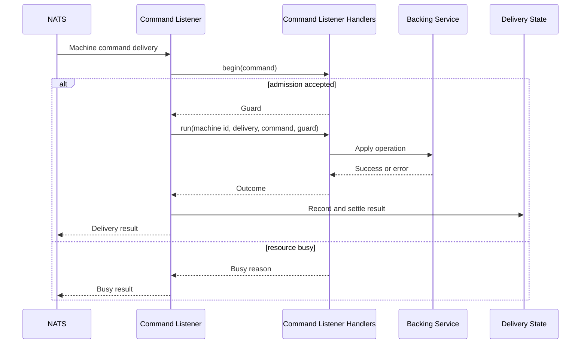
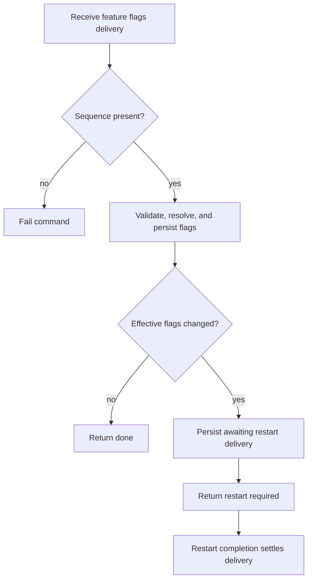
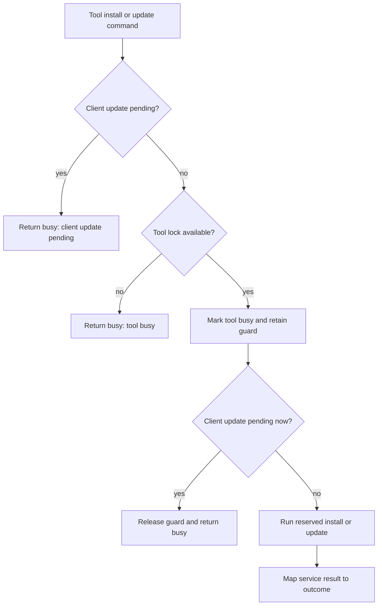
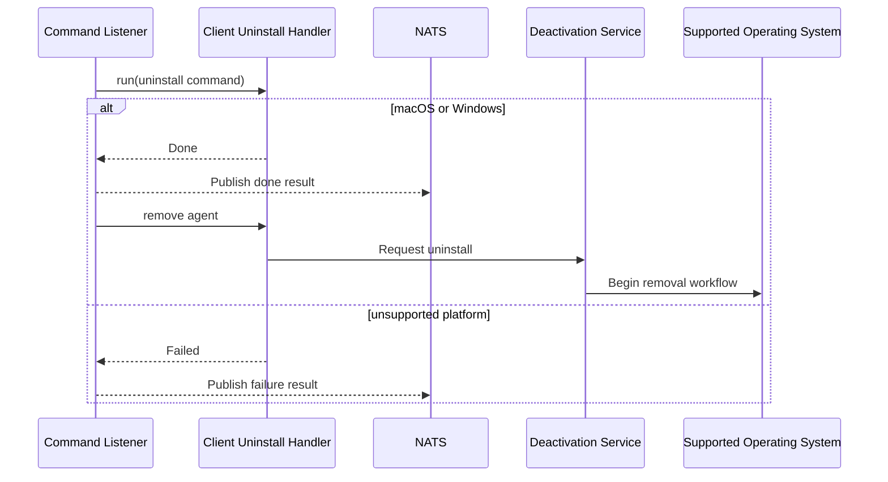

# Command Listener Handlers

Command Listener Handlers is the OpenFrame client module that turns selected machine-scoped commands into guarded local operations. It is implemented in the `openframe_agent_lib` library consumed by this repository at version `v0.0.5`; the client runtime assembles it to apply feature flags, install or update integrated tools, update itself, and remove itself on supported platforms.

The implementation lives in the OpenFrame OSS Library: [handlers.rs](https://github.com/flamingo-stack/openframe-oss-lib/blob/16e7c1cbd9664e7d10ec5ebca7d53c9bd314decf/clients/openframe-client/src/listener/command/handlers.rs).

## Responsibilities

The module supplies five implementations of the command listener's `CommandHandler` contract:

| Handler | Command kind and machine subject | Sequenced | Primary responsibility |
|---|---|---:|---|
| `FeatureFlagsHandler` | `feature-flags` on `machine.{machineId}.feature-flags` | Yes | Persist and resolve the requested feature flags for the running client version; request a restart if the effective set changes. |
| `ToolInstallationHandler` | `tool-installation` on `machine.{machineId}.tool-installation.v2` | No | Reserve a tool-specific operation and delegate installation. |
| `ToolUpdateHandler` | `tool-update` on `machine.{machineId}.tool-update.v2` | Yes | Reserve a tool-specific operation and apply an update or repair. |
| `ClientUpdateHandler` | `client-update` on `machine.{machineId}.client-update.v2` | Yes | Reserve a client update, coordinate with tool activity, and launch or skip the update. |
| `ClientUninstallHandler` | `client-uninstall` on `machine.{machineId}.client-uninstall.v2` | No | Complete the command and then request client removal on macOS or Windows. |

A sequenced handler exposes the last successfully applied sequence. The command listener can consequently acknowledge state-like redeliveries at or below that sequence without running them again. Feature flags persist their own sequence through the feature-flag service, while other sequenced work uses the listener's shared delivery state.

## Position in the Client Architecture

Command Listener Handlers contains command-specific policy, not message transport or the concrete install/update implementations. The generic command listener subscribes, recovers delivery state, enforces sequencing, and translates handler outcomes into delivery results. Each handler receives an already deserialized command and returns an outcome such as done, busy, failed, restarting, or restart required.

### Command Handler Lifecycle

The listener invokes three relevant phases:

1. **Subscription and recovery**: the generic listener recovers saved delivery state and reports any previously completed restart before binding the handler's subject. It reconnects after listener errors.
2. **Admission**: `begin` either accepts the command with a guard or reports it busy. Guards hold the exclusive state needed by the later run phase.
3. **Execution and settlement**: `run` delegates to the backing service and maps its result to an outcome. The listener records and publishes the completion semantics appropriate for a normal completion, a restart, or removal.

## Handler Details

### Feature Flags

`FeatureFlagsHandler` is the only handler in this module whose service state directly controls restart reporting. It requires a delivery sequence; a message without one fails instead of changing client behavior without an ordering anchor.

The handler passes the machine identifier, delivery reference, sequence, and `FeatureFlagsMessage` to `FeatureFlagsService`. That service validates each flag representation, ignores malformed entries, resolves the effective flags for the currently running client version, persists the received state, and records the delivery when the effective flags differ from the running set.

- If the effective flags are unchanged, the handler returns `Done`.
- If they differ, it returns `RestartRequired`.
- If persistence or processing fails, it returns a formatted failure.

The listener can query `awaiting_restart` through the handler after startup. Once restart completion is reported, it calls `restart_reported` so the persisted waiting delivery can be settled.

### Tool Installation and Tool Update

The installation and update handlers share a tool admission gate. Before starting either operation, `reserve_tool` checks whether a client update is pending and then tries to acquire the lock for the command's tool-agent identifier. Once acquired, it marks the tool busy and checks the client-update flag again.

The second check closes the race with client update admission: the client update marks itself pending before inspecting busy tools. Therefore, either the tool command observes an already pending client update, or the client update sees the tool as busy and defers. This prevents a tool install or update from overlapping client replacement.

| Situation | Admission outcome |
|---|---|
| Client update is pending before or after tool lock acquisition | Busy with `client update pending` |
| Tool lock cannot be acquired | Busy with `tool busy with another operation` |
| Both checks pass | Accepted with a `ToolOpGuard` |

The guard owns the tool lock and busy marking for the full asynchronous operation. It is passed, rather than reacquired, to the underlying service.

- **Installation** delegates to `ToolInstallationService.install_reserved`. That service performs the installation workflow using its download, metadata, configuration, process, persistence, and publication dependencies.
- **Update** delegates to `ToolAgentUpdateService.process_update_locked`. The service can treat a missing artifact or an interrupted installation as a repair, avoids disallowed downgrades, updates changed assets, persists repair completion, publishes installed versions, and can relaunch qualifying GUI applications after success.

### Client Update

`ClientUpdateHandler` has a distinct update guard supplied by `OpenFrameClientUpdateService.reserve`. Admission prevents duplicate live updates, marks the client update pending for non-current versions, and checks whether tool or package work is active. A conflicting operation makes the command busy so it can be retried rather than run concurrently.

When the guard is accepted, `apply` validates and normalizes the requested version, skips an already-running version, rejects a downgrade when the last-known-good anchor is newer, records update status, stages the update, and launches the updater. The handler translates the service result as follows:

| Service result | Handler outcome | Operational meaning |
|---|---|---|
| Updater launched | `Restarting` | The client can terminate before ordinary result handling finishes; restart recovery settles the delivery. |
| Update skipped | `Done` | The requested version was already running or was not eligible to apply. |
| Error | `Failed` | The handler clears the client-update-pending flag so tool operations are not blocked by a command that will not be resent automatically. |

The handler declares that it restarts the agent. This tells the command infrastructure to preserve the delivery across process replacement instead of treating a disappearing process as an immediate command failure.

### Client Uninstall

The uninstall command has no payload requirements, so it deserializes into an ignored value and admits immediately. Its run phase succeeds only on macOS and Windows; it returns a failure on other operating systems because self-uninstall is unsupported there.

It also declares that it removes the agent. The listener publishes the done result before invoking `remove_agent`. The handler then calls `DeactivationService.request_uninstall`, which is idempotent: only the first request sets the uninstall trigger and sends the deactivation command. Ordering completion before removal preserves the remote acknowledgement even when local files and the outbox disappear during removal.

## State, Ordering, and Concurrency Guarantees

- **Machine scoping**: each subject incorporates the machine identifier, isolating command streams by client.
- **Versioned tool subjects**: tool installation, tool update, client update, and client uninstall use `v2` subject suffixes. Feature flags retain their dedicated unversioned subject.
- **Sequenced state changes**: feature flags, tool updates, and client updates declare themselves sequenced. Duplicate or older state messages can be completed from recorded sequence state.
- **Exclusive tool operations**: a `ToolOpGuard` serializes operations per tool-agent identifier; it does not impose a global lock across unrelated tools.
- **Client-update barrier**: a pending client update blocks new tool operations. A client update, in turn, backs off when existing tool or package work is busy.
- **Removal acknowledgement**: agent removal is deliberately deferred until the successful result has been published.

## Failure Handling

The module distinguishes retryable contention from terminal execution failures:

- Admission conflicts return `Busy` with a user-visible reason, preserving the command for later delivery.
- Service errors become `Failed` outcomes with formatted error context.
- Feature flags without a sequence fail because they cannot safely participate in ordered state application.
- Unsupported client uninstall fails explicitly rather than attempting a partial removal.
- Client update failure clears the tool-operation barrier. This is essential because failed client-update commands are not independently resent, and leaving the barrier set would indefinitely block tool work.

## Extension Guidance

A new command handler should remain narrowly responsible for subject naming, admission, service invocation, and outcome translation. It should not duplicate listener recovery or delivery publishing behavior.

1. Define a stable `KIND` and machine-scoped subject.
2. Choose `SEQUENCED` only when the command represents ordered state and provide a durable applied-sequence source if required.
3. Acquire exclusivity in `begin` and carry the guard into `run`; do not reacquire a lock after admission.
4. Return `Busy` for recoverable contention and `Failed` for execution errors that should be reported as failures.
5. Set restart or removal metadata only when the process lifecycle actually requires the listener's specialized settlement behavior.
6. Ensure a failed operation releases or clears any cross-operation barrier it established.

The generic command listener, feature flag persistence, tool lifecycle services, client update service, and deactivation workflow remain separate modules; this module composes them into command-specific control flow.