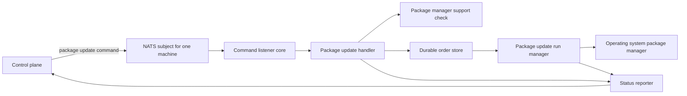
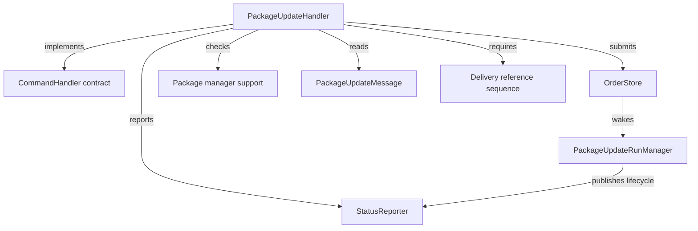
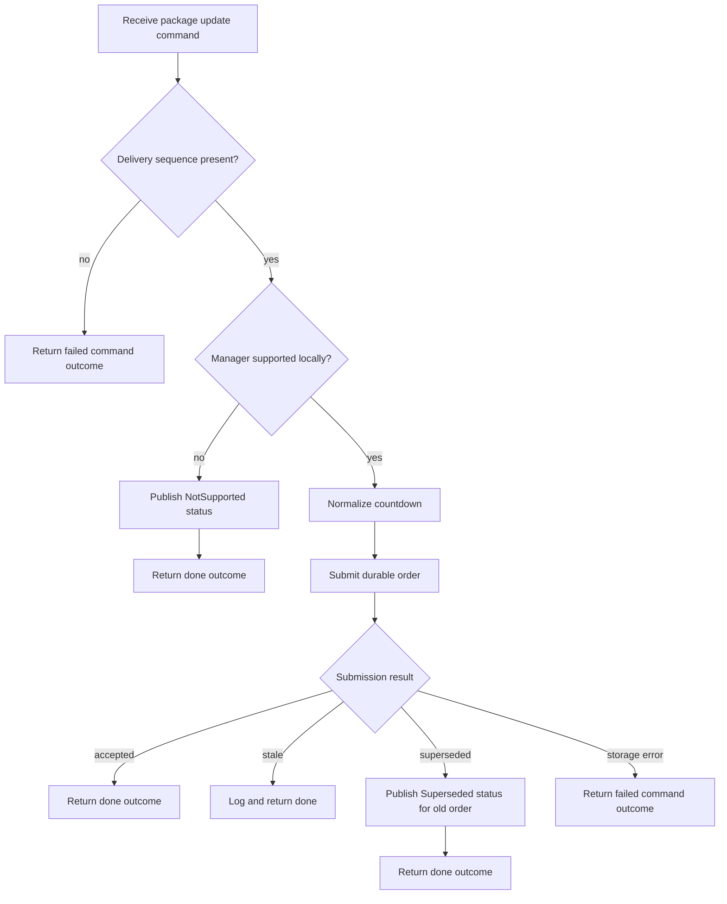
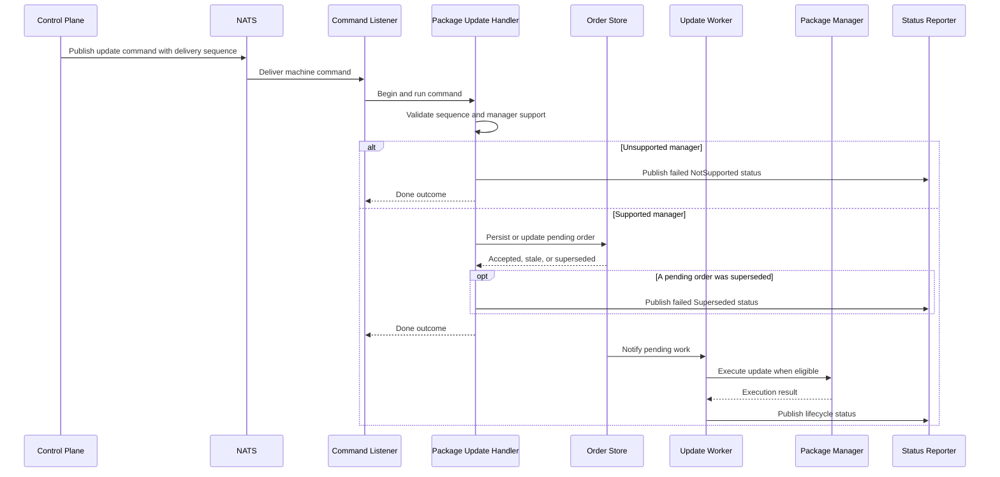

# Command Listener Package Update

Command Listener Package Update is the OpenFrame Client command handler that accepts package-update requests for one managed machine and places accepted work into the durable package-update order queue. It is implemented in the `openframe_agent_lib` dependency, supplied by the OpenFrame OSS Library at version `v0.0.5`; the tenant repository runs that client as part of its deployed platform.

The handler deliberately does **not** run a package manager itself. Its responsibility ends when an order is durably submitted, rejected as unsupported, or fails to be persisted. The package-update worker subsequently consumes queued orders and publishes lifecycle status independently.

**Implementation source:** [package update handler](https://github.com/flamingo-stack/openframe-oss-lib/blob/16e7c1cbd9664e7d10ec5ebca7d53c9bd314decf/clients/openframe-client/src/listener/command/package_update.rs)

## Responsibilities

`PackageUpdateHandler` implements the generic command-handler contract for the package-update command kind. It:

- derives the machine-specific subscription subject as `machine.{machine ID}.{package update kind}`;
- requires a delivery sequence before accepting work, because the sequence supports durable ordering and duplicate handling;
- maps the requested package to a package-manager identity and rejects managers unavailable on the current device;
- normalizes the countdown associated with a forced update;
- submits the request to `OrderStore` with the receive time; and
- reports unsupported and superseded requests on the package-update status stream.

A successful command-listener outcome means the request was dealt with at the admission boundary. It does not mean the operating-system package manager has completed an update.

## Architecture

The listener core owns subscription, reconnection, and command dispatch. The handler owns command-specific admission. `OrderStore` persists pending and recently finished requests, while `PackageUpdateRunManager` is a separately started worker that executes queued work. This separation keeps message handling short and allows pending work to survive a listener restart.

## Command Model and Admission

A package-update message supplies:

| Field | Use at admission |
|---|---|
| `request_id` | Identifies a logical update request and determines duplicate, revision, and replacement behavior in the order store. |
| `source` | Is retained with the order and determines whether a zero countdown is permitted. |
| `package` | Selects the package-manager identity and is compared when a newer request replaces a pending request. |
| `mode` | Selects waiting behavior or a forced update countdown. |
| `countdown_seconds` | Is normalized before persistence for forced updates. |

The delivery reference must contain a sequence. A request without one returns a failed command outcome with the message `package update without a sequence`; it is not entered into the order store.

The package-manager identifier is determined from the package reference. The currently modeled identifiers are Brew, Choco, and Winget. Support is evaluated for the local operating system. If the chosen manager is unsupported, the handler sends a terminal failed status with `NotSupported` and a detail that names the unsupported manager, then returns a done outcome to the listener.

## Component Relationships

`PackageUpdateHandler` is cloneable and holds shared access to `OrderStore` through an atomic reference-counted pointer. The status reporter is held by value and used only for terminal admission outcomes that require an immediate external status.

## Countdown Policy

The countdown policy is applied before an order is saved:

| Request condition | Persisted countdown |
|---|---|
| Wait mode | `0` seconds |
| Force mode with no value | `300` seconds |
| Force mode with a user-originated value of `0` | `0` seconds |
| Force mode with another requested value | Requested value clamped to `60` through `1800` seconds |

When a non-user forced request lies outside the permitted range, the handler logs a warning containing the request identifier, requested value, and clamped value. A zero countdown is therefore reserved for a user's own request; it is not generally available to other forced-update sources.

## Order Submission Semantics

The order store records the machine identifier, delivery sequence, receive time, update message, and normalized countdown. Its submission behavior determines the handler outcome:

### Duplicate and Replacement Rules

- A request with a known request identifier and a sequence no greater than its recorded sequence is **stale**. It is not requeued, and the handler returns done.
- A new delivery for a known pending request identifier updates that pending order in place: its sequence, source, package, mode, countdown, and revision are refreshed.
- A new request identifier can replace a pending request for a matching package. The currently installing request is excluded from replacement, so it is allowed to finish and the new order follows it.
- When a pending order is replaced, the former request receives a failed status with the `Superseded` reason and the detail `replaced by a newer request for the same package`.
- A machine-identifier change clears prior pending and finished order history for the previous machine, while preserving the store's installing marker behavior.

Once an execution completes, the worker calls the order store's finish operation. This removes the request from pending work, clears the installing marker when applicable, and retains a bounded memory of finished request identifiers and sequences for stale-delivery detection.

## Status and Completion Boundaries

The handler emits immediate terminal statuses only for requests that cannot continue through the queue:

| Situation | Command outcome | Package-update status |
|---|---|---|
| Missing delivery sequence | Failed | None from this handler |
| Unsupported local manager | Done | Failed with `NotSupported` |
| Durable order accepted | Done | Deferred to the worker lifecycle |
| Stale delivery | Done | No new status |
| Pending order superseded | Done | Failed with `Superseded` for the replaced order |
| Order-store failure | Failed | None guaranteed by this handler |

The status payload associates an event and request with the machine, source, package, timestamp, optional installed and available versions, plus waiting, done, or failed detail. Execution failures can use reasons such as manager error, missing manager, close failure, timeout, not installed, or not upgradable; those are produced in the later execution lifecycle rather than by normal admission.

## End-to-End Data Flow

## Operational Considerations

- **Durability precedes acknowledgement:** accepted work is persisted before the handler returns its done outcome. A persistence error is surfaced as a failed command outcome so that command-delivery recovery can apply.
- **Local capability is checked early:** unsupported manager requests do not enter the queue and receive an explicit status instead of failing later in the worker.
- **No execution work in the listener:** package-manager invocation, application close handling, and completion reporting belong to the worker path. This avoids keeping a NATS command callback active for an update's full duration.
- **Request ordering is scoped to a machine:** the sequence comes from the delivery reference and the store isolates history by machine identifier.
- **Worker startup is idempotent:** the package-update run manager starts its background task once and warns instead of starting a second worker.

## Maintenance Notes

When changing the handler, preserve the distinction between listener acknowledgement and update completion. In particular, do not return a successful listener outcome before an accepted order is persisted, and retain the explicit status reporting for rejected and superseded work. Changes to supported package managers, package matching, order persistence, worker execution, or status schema should be reviewed together because each participates in the same update lifecycle.
