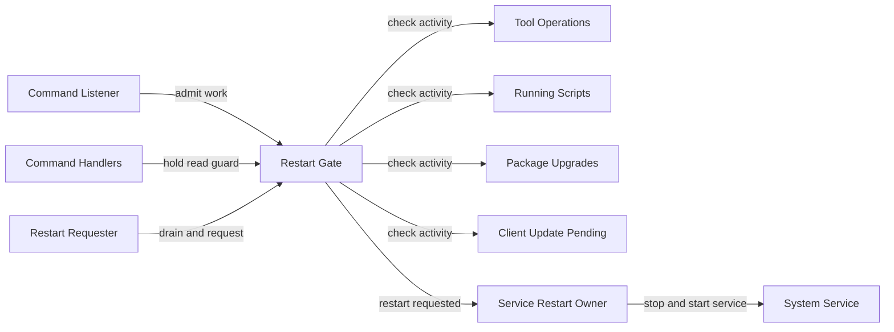
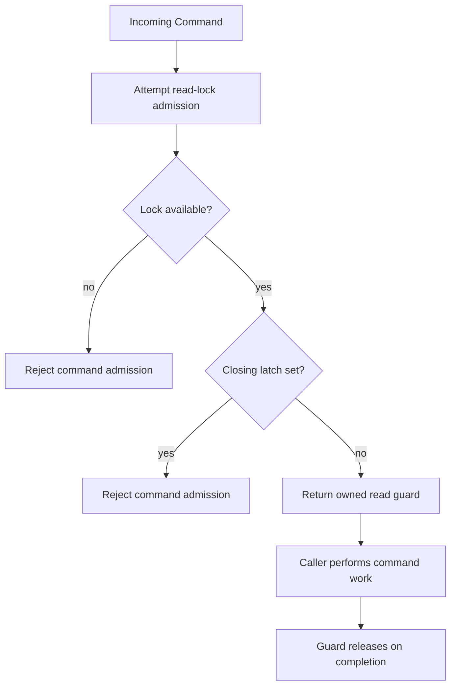
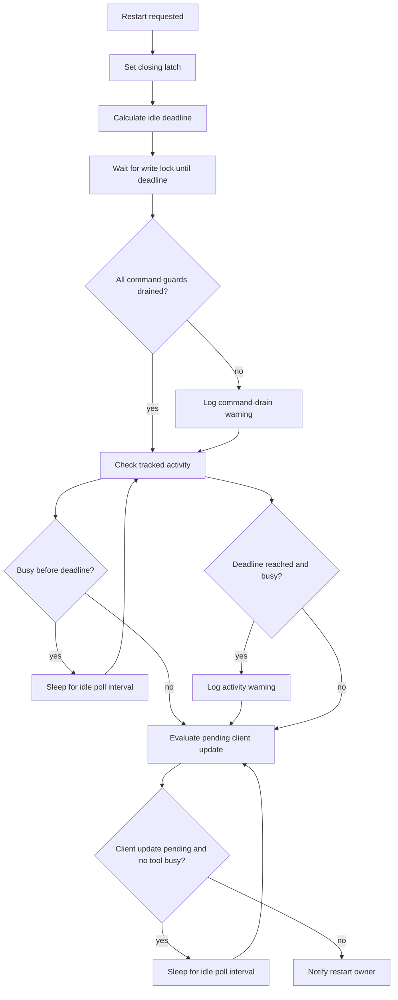
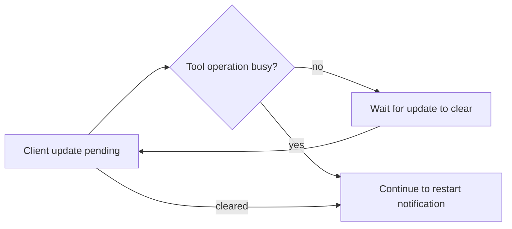

# Command Listener Restart

Command Listener Restart is the graceful-restart coordination primitive used by the OpenFrame client command subsystem. It prevents new commands from entering work, gives already admitted command work and device operations time to finish, and then signals that the client service may restart. The implementation is supplied by the `openframe_agent_lib` dependency from OpenFrame OSS Library and is executed by this repository's OpenFrame client deployment.

The implementation is defined in [restart.rs](https://github.com/flamingo-stack/openframe-oss-lib/blob/16e7c1cbd9664e7d10ec5ebca7d53c9bd314decf/clients/openframe-client/src/listener/command/restart.rs). This repository consumes `openframe_agent_lib` at version `v0.0.5`.

## Purpose and Scope

A restart is disruptive if the client is executing a command, running a script, updating a managed tool, applying package upgrades, or replacing its own binary. Command Listener Restart separates the request for a restart from the point at which the surrounding service actually performs it:

1. Close admission for new command work.
2. Drain command handlers that already hold an admission guard.
3. Wait within the configured idle window for tracked activity to become idle.
4. Avoid stopping the service while a self-update can safely complete its own restart.
5. Notify the owner of the restart request.

The module does not subscribe to messages, run commands, stop the operating-system service, or persist restart state. Those responsibilities remain with the command listener, command handlers, activity-owning services, and service-management layer.

## Architecture

`RestartGate` combines a closure latch, a reader-writer lock used as an admission barrier, a one-waiter notification primitive, and four activity views. It is cloneable: clones share the same lock and notification state through reference-counted ownership.

### RestartGate State

| Element | Role |
|---|---|
| `closing` | A shared latch marking the gate as closed to new command admission. |
| `work` | An asynchronous reader-writer lock. Each admitted command owns a read guard; restart draining waits for a write lock, which requires all readers to leave. |
| `requested` | A `Notify` instance that wakes the task awaiting the completed restart request. |
| `busy_tools` | View of active managed-tool operations. |
| `running_scripts` | View of currently executing scripts. |
| `client_update` | View showing whether an OpenFrame client update is pending. |
| `package_upgrades` | In-progress view for package upgrade activity. |

## Admission and Drain Semantics

### Command Admission

The command listener uses the internal `admit` operation before beginning command work. Admission is non-blocking: it attempts to acquire an owned read guard with `try_read_owned`. If a restart is draining, the write-lock attempt prevents a new reader from being acquired. If the lock is available but the closing latch is already set, admission is rejected.

A successfully admitted command retains its read guard for the duration of work covered by the caller. This creates the central safety boundary: a restart cannot pass the command-drain stage until those guards are released.

The closure check follows lock acquisition. Consequently, a command admitted just before the latch is set is allowed to finish and is included in the drain; commands observed after closure are not accepted.

### Restart Request Lifecycle

`drain_and_request` is the restart-side operation. It is asynchronous and has no result value: timeouts are warnings, not failures that cancel the restart.

The write-lock wait is bounded by `SELF_RESTART_IDLE_WAIT_SECS`. If command guards still exist at the deadline, the module logs a warning and continues. The normal activity polling loop, which uses `SELF_RESTART_IDLE_POLL_SECS`, is bounded by the same deadline and considers any of the following busy:

- a tool operation is active;
- a script is running;
- a package upgrade is in progress; or
- a client update is pending.

If activity remains at the deadline, the gate logs a warning and proceeds toward notification rather than blocking the restart indefinitely.

## Client Update Exception

The client-update path has additional protection. A pending client update can restart the client itself; stopping the service while that update performs a binary replacement could interrupt the swap. After the deadline-based wait, the gate therefore continues polling while a client update is pending **and** no tool operation is busy.

When a tool operation is busy, the client update may be deferred and repeatedly mark itself pending on redelivery. In that case, Command Listener Restart does not wait indefinitely for the update flag; it sends the restart notification. The final client-update wait is deliberately not governed by the earlier idle deadline.

## Interaction With the Client Runtime

Command Listener Restart belongs to the Rust OpenFrame client library rather than a Java service module. In the complete client runtime, command processing owns admission guards and restart orchestration waits for `requested`. The service-management layer is responsible for service lifecycle operations such as stopping and starting an installed service. Its `nudge_restart` operation, for example, only starts the service after a successful stop, preventing an unnecessary second start when the stop failed.

The gate also coordinates with shared activity signals exposed by the broader client runtime:

- Tool operations report whether managed tools are busy.
- Execution services report whether scripts remain active.
- Package-update processing exposes an in-progress view.
- The tool run manager exposes the client-update-pending view; package-update restart signals carry that same view alongside an agent-restart latch.

This is coordination by observation, not ownership. The gate never cancels these activities and does not decide whether an individual command is valid. It only selects a safer restart point and reports when restart may proceed.

## Public API

| API | Visibility | Behavior |
|---|---|---|
| `RestartGate::new` | Public | Builds a gate from shared activity views and the closing latch. |
| `RestartGate::requested` | Public async | Waits until the drain path signals a restart request. |
| `RestartGate::drain_and_request` | Crate async | Closes admission, drains work, waits according to the restart policy, and signals the request. |
| `RestartGate::admit` | Parent-module internal | Returns an owned read guard only while admission remains open. |

## Operational Characteristics

- **No forced cancellation:** Commands and work are given an opportunity to finish, but the deadline permits restart despite unfinished command work or tracked activity.
- **Observable degraded path:** Expired command drain and remaining activity both emit warnings identifying why the restart proceeds under contention.
- **Single coordination signal:** `requested` waits on an in-memory notification. Restart completion and operating-system service lifecycle are outside this module.
- **In-process scope:** The lock, latch, and notification are process-local. A process crash or external service restart bypasses this graceful-drain mechanism.
- **Correct guard lifetime is critical:** Callers must retain the admission guard for the command work that must block restart; releasing it early permits the drain phase to advance early.

## Maintenance Guidance

When changing Command Listener Restart, preserve these invariants:

1. Set the closing latch before waiting, so no new work is intentionally admitted during shutdown.
2. Retain reader guards across the entire command section that must drain before restart.
3. Keep client binary-swap safety separate from the bounded general-idle wait.
4. Treat activity views as shared state: they must accurately clear when their owning operation finishes.
5. Ensure the task calling `requested` is responsible for the actual service restart and does not assume that this notification proves every activity completed.

The source file includes a dedicated test module, `restart_tests.rs`, compiled only for tests. Changes to admission ordering, deadlines, busy conditions, or notification timing should be validated against those restart-specific tests and with concurrent command activity.