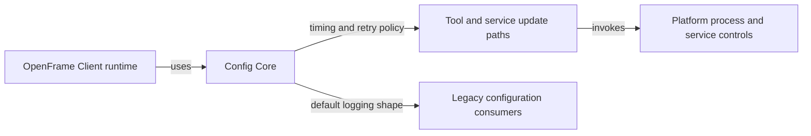
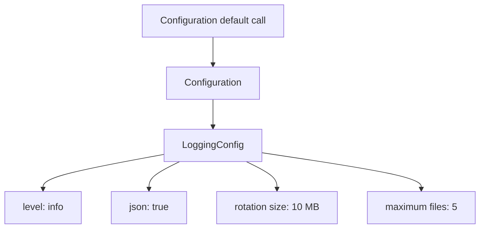
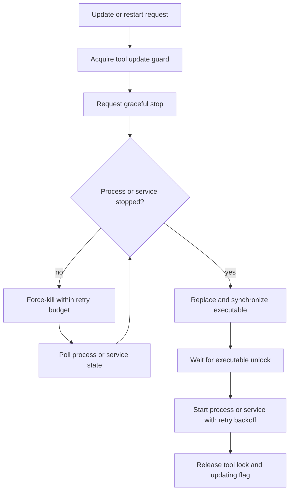
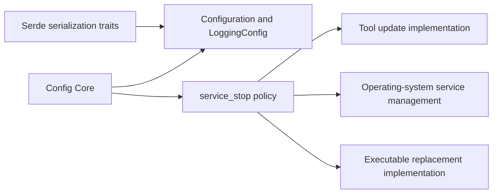

# Config Core

Config Core is the OpenFrame Client configuration module supplied by the `openframe_agent_lib` Rust library. In this deployment, the library is consumed by the OpenFrame Client runtime. The module provides two distinct concerns:

- a legacy, serializable logging configuration shape with a safe `Default` implementation; and
- a shared timing and retry budget for safely stopping, replacing, and restarting managed tools and operating-system services.

The implementation lives in the OpenFrame OSS Library at [clients/openframe-client/src/config/mod.rs](https://github.com/flamingo-stack/openframe-oss-lib/blob/16e7c1cbd9664e7d10ec5ebca7d53c9bd314decf/clients/openframe-client/src/config/mod.rs). It also exposes an `update_config` submodule; that submodule is declared here but is outside the supplied Config Core implementation.

## Position in the system

Config Core belongs to the Rust OpenFrame Client agent rather than the Spring-based Config service. It is compiled into the client library and supplies process-control policy to platform-specific update and service-management paths. The configuration service in this repository deploys the `openframe-config` image, but that service is a separate component from this agent-local module.

The library artifact is pinned by this repository as `openframe_agent_lib` version `v0.0.5`. Although the module is platform-neutral at its boundary, several constants specifically constrain Windows Service Control Manager operations. The source suppresses dead-code warnings because those constants are only referenced on Windows builds.

## Public surface

| Item | Kind | Responsibility |
| --- | --- | --- |
| `service_stop` | Public module | Defines bounded waits, polling intervals, retries, and concurrency limits for shutdown and restart operations. |
| `Configuration` | Serializable struct | Legacy top-level configuration envelope containing logging settings. |
| `LoggingConfig` | Serializable struct | Legacy logging policy: level, JSON mode, rotation size, and retained file count. |
| `Configuration::default()` | Default implementation | Produces the built-in logging defaults described below. |
| `update_config` | Public submodule declaration | Makes update configuration available through the configuration namespace; its implementation is not included in the supplied source. |

`Configuration` and `LoggingConfig` derive `Debug`, `Clone`, `Serialize`, and `Deserialize`. They are annotated as unused legacy structures in the source, so new runtime behavior should not be assumed to read them without confirming the caller path.

## Legacy logging configuration

`Configuration` has one field, `logging`, which contains `LoggingConfig`.

| Field | Type | Default | Meaning |
| --- | --- | --- | --- |
| `logging.level` | `String` | `info` | Logging verbosity name. |
| `logging.json` | `bool` | `true` | Enables JSON-formatted log output in the default value. |
| `logging.rotation_size_mb` | `u64` | `10` | Per-file log rotation threshold in megabytes. |
| `logging.max_files` | `u32` | `5` | Maximum number of retained log files. |

The default construction is deterministic and in-memory only: this module does not load files, read environment variables, initialize logging, or write persistent configuration. Serialization support allows an external caller to perform those activities if it still uses the legacy shape.

## Service stop policy

The `service_stop` constants are a common safety envelope for operations that need to stop a process or operating-system service before replacing an executable or starting it again. They separate short polls from bounded blocking calls, and they include escalation limits so an unresponsive process or Service Control Manager cannot hold an operation indefinitely.

### Process and executable handling

| Constant | Value | Purpose |
| --- | ---: | --- |
| `PROCESS_CHECK_INTERVAL_MS` | 500 ms | Process or service state polling interval. |
| `GRACEFUL_SHUTDOWN_TIMEOUT_SECS` | 5 s | Grace period before escalating a process shutdown to force-kill. |
| `FORCE_KILL_TIMEOUT_SECS` | 3 s | Wait after a force-kill request. |
| `MAX_KILL_RETRIES` | 3 | Maximum force-kill attempts per process. |
| `BINARY_SYNC_TIMEOUT_SECS` | 30 s | Bound for synchronizing a newly written binary; slower storage produces a warning. |
| `EXEC_UNLOCK_WAIT_SECS` | 30 s | Maximum wait for exclusive access to a newly written executable. |
| `EXEC_UNLOCK_POLL_INTERVAL_MS` | 250 ms | Interval for probing whether the executable is unlocked. |
| `TOOL_RESTART_TIMEOUT_SECS` | 600 s | Overall upper bound for a guarded tool restart, ensuring the updating flag and tool lock are released. |

### Windows service controls

| Constant | Value | Purpose |
| --- | ---: | --- |
| `SERVICE_STOP_MAX_ATTEMPTS` | 20 | Maximum state-change polls while stopping a Windows service. |
| `SERVICE_FORCE_KILL_MAX_ATTEMPTS` | 6 | Force-kill rounds allowed for a stuck Windows service. |
| `SERVICE_STOP_CALL_TIMEOUT_SECS` | 10 s | Bound for a blocking Service Control Manager stop call. |
| `SERVICE_START_RETRY_DELAYS_SECS` | 1, 2, 4, 8, 15 s | Backoff schedule between start attempts. |
| `SCM_QUERY_TIMEOUT_SECS` | 10 s | Bound for blocking Service Control Manager queries, including status, configuration, and deletion. |
| `SERVICE_START_CALL_TIMEOUT_SECS` | 30 s | Bound for a blocking Service Control Manager start call. |
| `SCM_QUERY_MAX_CONSECUTIVE_FAILURES` | 2 | Query failures tolerated consecutively before a wait loop stops polling and escalates. |
| `SCM_MAX_IN_FLIGHT` | 4 | Maximum concurrent blocking Service Control Manager calls. |

The source commentary notes that the normal stop polling budget is approximately 10 seconds, but non-consecutive Service Control Manager query timeouts can extend it. The bounded calls, retry ceilings, and in-flight limit are therefore part of the failure-containment design, not merely tuning values.

## Controlled update and restart flow

The module does not execute this flow itself. Instead, platform-specific update and service-management code uses its constants as the operational limits.

The decision and escalation behavior shown here is constrained by the constants, while the exact process execution, service queries, binary replacement, and lock management are implemented elsewhere in the OpenFrame Client library.

## Dependency relationships

Config Core is intentionally small. It depends only on Serde traits for the legacy structs. Its principal relationship is outward: client update and platform service code can import the constants to apply one consistent policy.

The OpenFrame Client module tree includes dedicated areas for tool updating, binary writing, system-service control, and service management. They are the natural consumers of this policy, but their documentation files were not supplied or generated in this run, so they are not linked here.

## Maintenance guidance

- Treat every timeout, retry count, and permit limit as part of a coordinated failure budget. Changing one value can alter how long an update holds a lock or waits before escalation.
- Preserve explicit bounds around blocking service-control operations. The comments identify potentially wedged Service Control Manager calls as a key failure mode.
- Keep the executable-unlock wait distinct from binary synchronization: the first protects startup from file locks held by a writer or antivirus process, while the second bounds persistence of the new binary.
- Do not add new consumers of the legacy `Configuration` structures without confirming that the intended runtime configuration path still uses them.
- When extending serialization fields, supply compatible defaults or migration behavior in the consuming layer; this module only defines data structures and their default value.

## Source and ownership

The Config Core code is provided by the OpenFrame OSS Library dependency, not implemented directly in this repository. The consuming repository publishes the OpenFrame Client service and packages the Rust client library as part of the tenant platform. For source-level changes to the module itself, use the linked library source file above; for deployment configuration, use the platform documentation for the relevant service.
