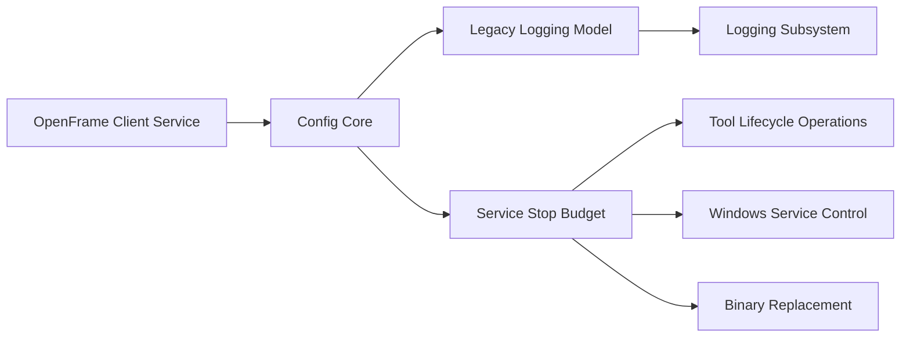
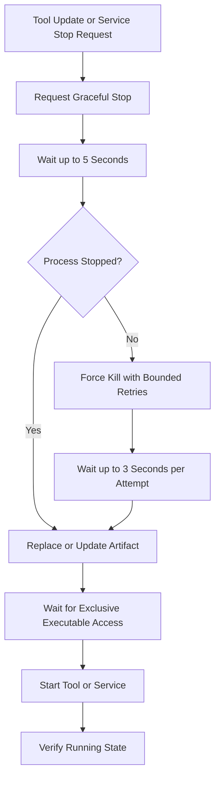
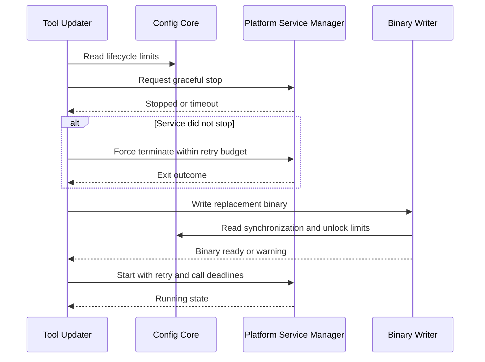

# Config Core

Config Core is the shared configuration boundary for the OpenFrame client agent. Its implementation is supplied by the `openframe_agent_lib` dependency from [OpenFrame OSS Library](https://github.com/flamingo-stack/openframe-oss-lib/blob/7a766f00e4f58b5d89db007b878ac8d6e0c344f4/clients/openframe-client/src/config/mod.rs) and runs as part of this repository’s OpenFrame Client service.

It has two focused responsibilities:

- Preserve a serializable, legacy logging configuration model with safe defaults.
- Centralize timing, retry, and concurrency budgets used when the agent stops, replaces, and restarts managed tools or operating-system services.

The source marks the logging structures as currently unused candidates for removal. They should therefore be treated as a compatibility-oriented model, not as evidence of the active logging initialization contract. The service lifecycle limits, however, are operational controls consumed by platform lifecycle and update paths, particularly the Windows service-control path.

## Architecture and responsibilities

### Components

| Component | Role | Status |
|---|---|---|
| Configuration | Top-level serializable container for logging settings. | Legacy and currently unused. |
| Logging Configuration | Holds the log level, JSON output flag, rotation size, and retained-file count. | Legacy and currently unused. |
| Service Stop Constants | Timing, retry, and concurrency limits for controlled process and service shutdown, replacement, and restart. | Operational. |
| Update Configuration Module | A separately exposed configuration submodule. Its implementation is outside the supplied source and is not described here. | Exposed dependency. |

## Configuration model

`Configuration` contains one `Logging Configuration` value. Its default produces informational JSON logs, rotates at 10 MB, and retains five files.

| Setting | Default | Meaning |
|---|---:|---|
| Log level | `info` | Minimum severity represented by the legacy logging model. |
| JSON enabled | `true` | Requests structured JSON log output. |
| Rotation size | 10 MB | Size threshold recorded for log rotation. |
| Maximum files | 5 | Number of rotated log files recorded for retention. |

The types derive serialization and deserialization traits, so they can be represented in configuration storage or transport formats supported by the Rust serialization stack. No parsing, validation, persistence, or runtime application logic appears in the supplied module; consumers that still use this model own those responsibilities.

## Service lifecycle budget

The Service Stop Constants establish a bounded escalation policy. A lifecycle operation first gives a process or service an opportunity to stop cleanly, then force-terminates it when necessary, while putting deadlines around Windows Service Control Manager calls and file-system operations that could otherwise block.

### Process, binary, and tool limits

| Concern | Limit | Operational effect |
|---|---:|---|
| Process state polling | 500 ms | Bounds the frequency of process or service state checks. |
| Graceful shutdown | 5 s | Time allowed before escalation to force termination. |
| Force-kill wait | 3 s | Time allowed for an affected process to exit after a force kill. |
| Force-kill retries | 3 | Maximum force-kill attempts per process. |
| Binary synchronization | 30 s | Limits a blocking synchronization of a written binary; a slower disk is logged as a warning. |
| Exclusive executable wait | 30 s | Time allowed for a new executable to become exclusively openable before starting its service. |
| Exclusive-open polling | 250 ms | Probe interval while waiting for a writer or antivirus scanner to release the executable. |
| Guarded tool restart | 600 s | Overall cap that guarantees release of the updating flag and tool lock. |

### Windows Service Control Manager limits

| Concern | Limit | Operational effect |
|---|---:|---|
| Stop-state polls | 20 | Limits service state-change polling. The source notes approximately 10 seconds normally, with a longer path when queries intermittently time out. |
| Force-kill rounds | 6 | Provides margin beyond the platform’s automatic restart behavior for a stuck service. |
| Stop call deadline | 10 s | Prevents a blocking stop call from hanging the task. |
| Start call deadline | 30 s | Prevents a blocking start call from stalling behind a busy service. |
| Service-control query deadline | 10 s | Bounds status, configuration, and delete queries. |
| Consecutive query failures | 2 | Stops a polling loop and escalates after repeated query failures. |
| In-flight calls | 4 | Limits threads that a wedged service-control manager can park. |
| Start retry delays | 1, 2, 4, 8, and 15 s | Produces retry backoff before subsequent start attempts. |

## Interaction flow

The constants do not perform lifecycle work themselves. They provide shared policy to callers such as service management, tool update, binary writing, and restart orchestration. Those callers select the appropriate budget, execute platform-specific operations, and use the deadline or retry result to decide whether to continue, escalate, or report a failure.

## Operational considerations

- **Bounded blocking:** Service-control operations and binary synchronization have explicit caps, reducing the chance that an unresponsive service manager, disk, or file lock stalls the agent indefinitely.
- **Controlled escalation:** Graceful shutdown precedes force termination, and force termination itself is retry-bounded.
- **Resource protection:** The in-flight service-control limit constrains threads consumed by blocking native calls.
- **Cleanup guarantee:** The 600-second tool restart cap is specifically intended to ensure that both the update indicator and tool lock are released even when a restart path misbehaves.
- **Platform scope:** Several constants are used only on Windows; the module intentionally permits platform-conditional dead code so one source set can serve multiple operating systems.

## Maintenance guidance

When changing a lifecycle value, evaluate the entire escalation chain rather than one timeout in isolation. For example, increasing a service stop deadline also affects the maximum duration before binary replacement and restart can begin. Preserve the relationship between polling intervals, per-call deadlines, retry counts, and the overall restart cap so that callers remain bounded.

Do not extend the legacy logging model without confirming an active consumer. The supplied source labels it unused, so a new logging setting should be added to the active logging configuration path rather than relying on these structures by default.

For runtime wiring, deployment configuration, and the Config Server application, see the platform documentation; this module documents only the OpenFrame client library source supplied above.