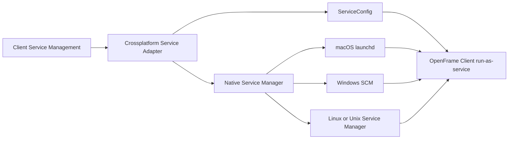
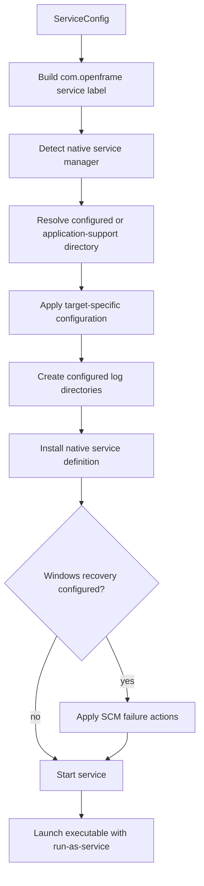
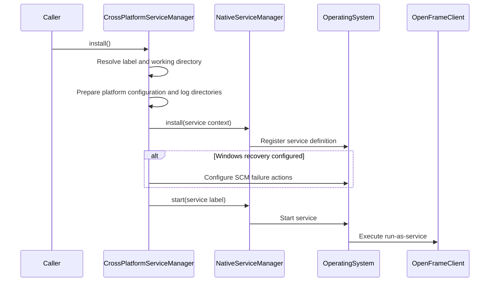

# Crossplatform Service Adapter

The Crossplatform Service Adapter installs and controls the OpenFrame client as an operating-system service. It provides one Rust-facing configuration model and translates the supported portions of that model into the native service-manager representation for macOS, Windows, or Linux/Unix. The implementation belongs to the `openframe_agent_lib` crate supplied by OpenFrame OSS Library and is assembled into this repository's client runtime.

**Source:** [service_adapter.rs in OpenFrame OSS Library](https://github.com/flamingo-stack/openframe-oss-lib/blob/16e7c1cbd9664e7d10ec5ebca7d53c9bd314decf/clients/openframe-client/src/service_adapter.rs)

## Responsibilities

- Build a stable service identity using `com.openframe.` followed by the lowercased configured name.
- Register the client executable with the platform-native service manager and invoke it with the `run-as-service` argument.
- Start, stop, and uninstall the service through the same native abstraction.
- Configure service startup, restart behavior, execution identity, working directory, environment, log destinations, and selected resource controls where the target platform supports them.
- Create parent directories for configured standard-output and standard-error files before installation.
- Apply explicit Windows Service Control Manager recovery actions after installation when recovery is configured.

The adapter does not run the agent loop itself. It gives the operating system a command that starts the client in service mode; the client application's service-management and runtime layers own the process behavior after launch.

## Architecture and Placement

`CrossPlatformServiceManager` is the façade. It owns a `ServiceConfig`, derives the service label, obtains `service_manager::ServiceManager::native()`, and delegates registration and lifecycle calls to that native manager. A caller may construct it with `new`, which applies the module defaults, or with `with_config`, which accepts a complete configuration.

## Configuration Model

### `ServiceConfig`

`ServiceConfig` is the portable input model. Its default values favor an automatically started, continuously running agent:

| Area | Fields | Default or behavior |
|---|---|---|
| Identity | `name`, `display_name`, `description`, `exec_path` | The constructor sets all four required identity fields. The generated label uses the lowercased `name`. |
| Startup and restart | `run_at_load`, `keep_alive`, `restart_on_crash`, `restart_throttle_seconds` | Startup and crash restart are enabled; the restart throttle is 10 seconds. `keep_alive` is retained in the model, while platform-specific configuration determines the concrete behavior. |
| Runtime environment | `working_directory`, `environment_vars` | The working directory defaults at installation time to the client application-support directory when none is supplied. |
| Logging | `stdout_path`, `stderr_path` | Optional file destinations. Their parent directories are created before service registration. |
| Execution identity | `user_name`, `group_name` | An explicit user overrides the adapter's platform default. The default user is `root` on macOS and Unix-like targets, and `LocalSystem` on Windows. |
| Resource and shutdown controls | `file_limit`, `exit_timeout_seconds`, `is_interactive` | Optional file limit and exit timeout; interactive mode defaults to enabled and affects macOS configuration. |
| Windows recovery | `recovery` | Optional `RecoveryConfig`, applied only on Windows after native installation succeeds. |

`RecoveryConfig` defines three restart delays for the first, second, and later failures, a reset period in days, and whether Windows should treat non-crash failures as recovery-triggering failures.

### Builder-Style Mutators

The manager exposes mutating methods that return `&mut Self`, allowing a caller to set log paths, working directory, user, group, restart throttle, file limit, and exit timeout before calling a lifecycle operation. These methods update only the in-memory configuration; installation is the operation that persists a service definition to the operating system.

## Service Installation Flow

During installation, the adapter sets the executable as the program and supplies `run-as-service` as its only service argument. It also passes the configured environment, resolved working directory, selected service username, autostart setting, and restart policy to the `service-manager` abstraction.

On Windows, the generic restart policy is deliberately set to `Never`; Windows recovery is configured separately through SCM failure actions. On non-Windows targets, `restart_on_crash` maps to an on-failure restart policy, or to no restart when disabled. After successful registration, `install` immediately calls `start`.

## Platform Translation

### macOS

For macOS, the adapter serializes a launchd plist into the installation context. It includes the label and program arguments, `RunAtLoad`, crash-oriented `KeepAlive`, and optional standard-output and standard-error paths. When configured, it also emits the open-file soft resource limit, interactive process type, restart throttle, exit timeout, user, group, and working directory.

The plist always uses a 10-second exit timeout when `exit_timeout_seconds` is not set. Its `KeepAlive` dictionary restarts after crashes but does not keep the service alive after a successful exit.

### Linux and Other Unix Targets

On Unix targets other than macOS, the adapter constructs an advanced-options map and serializes it as JSON in the service-installation context. The map can request file-based standard output and error destinations, an open-file limit, and an on-failure restart policy with a restart delay. The target-native implementation of the `service-manager` dependency consumes the installation context.

### Windows

Windows-specific advanced settings are not placed in the generic installation context. If `RecoveryConfig` is present, the adapter opens the installed service through the Windows Service Control Manager and configures three restart actions. The reset period is calculated from the configured number of days. When enabled, recovery is also activated for non-crash failures.

During uninstall, the adapter attempts to stop the service, then waits for up to 60 seconds for the service process to stop. It treats SCM error 1072, already marked for deletion, and error 1060, service absent, as successful uninstall outcomes. This makes cleanup resilient to asynchronous Windows service deletion.

## Lifecycle Operations

| Operation | Behavior |
|---|---|
| `install` | Creates the native definition, applies platform-specific configuration, optionally configures Windows recovery, and starts the service. |
| `start` | Resolves the service label, detects the native manager, and issues a start request. |
| `stop` | Resolves the service label, detects the native manager, and issues a stop request. |
| `uninstall` | Attempts a stop, performs Windows-specific termination waiting where applicable, removes the native definition, and tolerates defined Windows idempotency cases. |

All lifecycle paths attach contextual errors when label parsing, native manager detection, service registration, or a lifecycle call fails. Stop failure during uninstall is logged as a warning so that an already stopped service does not prevent removal.

## Component Interaction

## Operational Considerations

- **Use a stable name.** The configured name determines the installed label. Renaming it changes the operating-system service identity and may leave an older service definition behind unless it is explicitly removed.
- **Treat identity fields as privileged configuration.** The fallback account is privileged on all supported platform families. Specify a different user only when that account can read the executable and required configuration, write needed state, and access configured log paths.
- **Configure log destinations before install.** The adapter creates parent directories but does not otherwise validate writability or rotate files.
- **Understand restart semantics by platform.** macOS receives a generated plist and Windows receives SCM failure actions only when recovery is supplied. Unix behavior is conveyed through the native manager's installation context.
- **Expect installation to start the process.** Callers that need a service registered but not started must account for `install` invoking `start`.

## Maintenance Boundaries

Changes to this module should preserve the `com.openframe.` label convention, the `run-as-service` invocation contract, and the platform-specific conditional compilation boundaries. When adding a portable field to `ServiceConfig`, decide explicitly which platforms can honor it, how each native representation receives it, and whether defaults remain consistent. Windows recovery configuration is intentionally separate from generic restart-policy configuration because the generic Windows manager path cannot encode those SCM actions.
