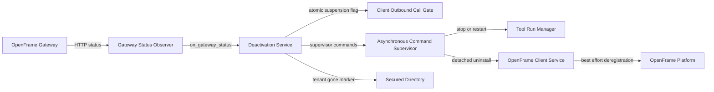
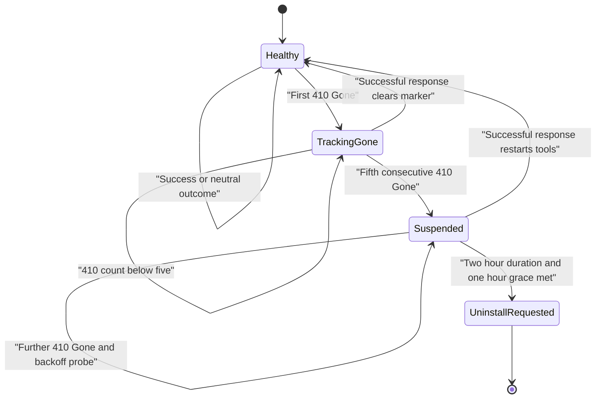
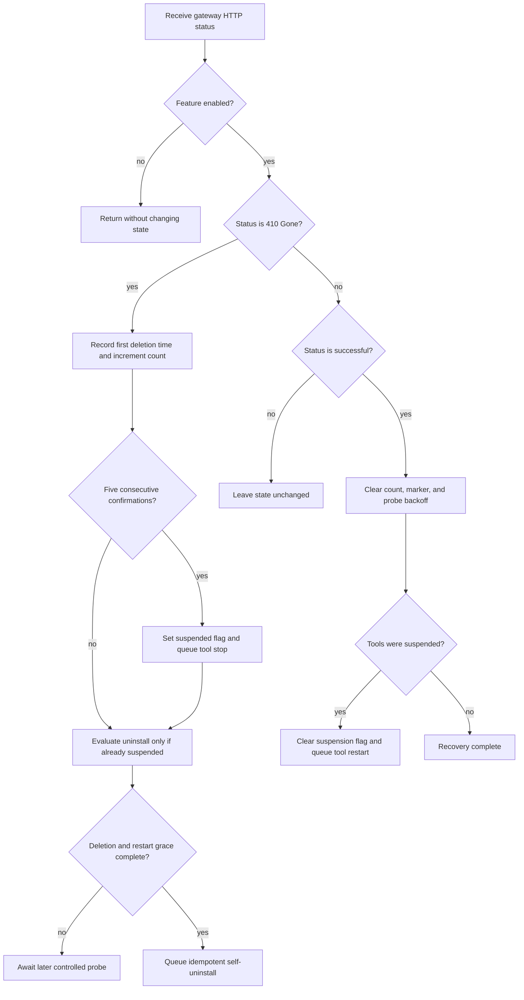
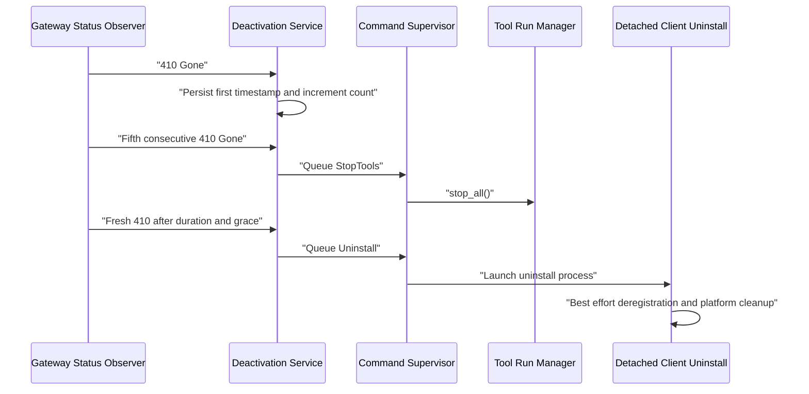

# Deactivation Service

The Deactivation Service protects a managed macOS or Windows endpoint after its OpenFrame tenant has been removed. It observes gateway HTTP outcomes, distinguishes a confirmed tenant deletion from ordinary connectivity failures, suspends managed tools only after repeated confirmation, and eventually requests a detached client uninstall if the deletion remains confirmed long enough.

The implementation is supplied by the OpenFrame OSS Library as the Rust `openframe_agent_lib` dependency. This repository runs it through the OpenFrame Client; the authoritative implementation is [`deactivation_service.rs`](https://github.com/flamingo-stack/openframe-oss-lib/blob/16e7c1cbd9664e7d10ec5ebca7d53c9bd314decf/clients/openframe-client/src/services/deactivation_service.rs).

## Scope and Platform Behavior

The feature is compiled as enabled only for macOS and Windows. On other targets, construction is harmless, `is_suspended` remains false, and received gateway statuses do not change deactivation state.

A `410 Gone` response is treated as a tenant-deletion signal. Successful responses are recovery signals. All other outcomes, including server errors, authentication failures, and timeouts, are intentionally neutral: they neither suspend outbound activity nor reset an existing deletion episode. This prevents a temporary network or service failure from being treated as tenant removal.

The service does not itself perform gateway requests. A caller feeds each observed status to `on_gateway_status`. When the service is suspended, the surrounding client should use `is_suspended` to allow only its controlled backoff probes instead of normal outbound work.

## Architecture

### Runtime collaborators

| Collaborator | Role in the deactivation path |
|---|---|
| Gateway-status observer | Supplies HTTP statuses. The service only reacts to `410 Gone` and successful statuses. |
| `DirectoryManager` | Supplies the secured directory used to persist the first deletion timestamp. |
| `ToolRunManager` | Receives serialized stop and restart actions from the supervisor. Stopping sets its deactivation stop flag, signals shutdown, and attempts to stop every installed tool. Restarting clears shutdown state, starts installed service tools, then resumes its normal run loop. |
| Client service uninstall flow | Invoked by a detached `openframe-client uninstall` process. The uninstall flow checks administrative privileges and, when not reinstalling, initializes deregistration and performs platform-specific macOS or Windows cleanup. |
| Deregistration Service | Performs best-effort platform deregistration from persisted machine credentials during uninstall, with a final retry before exit when reporting has not succeeded. |

The command channel is deliberately separated from status detection. The short status-handling path updates state and enqueues a command, while the asynchronous supervisor carries out potentially slow tool control and uninstall work. Calling `start` transfers the receiver into that supervisor and is idempotent: later calls do nothing.

## State, Persistence, and Timing

The service owns a mutex-protected state machine plus an atomic suspension flag for fast checks by outbound-call code.

| State element | Meaning |
|---|---|
| Phase | `Healthy` initially, then `Suspended` after the configured threshold of consecutive deletion confirmations. |
| Consecutive deletion count | Counts `410 Gone` responses in the current episode and resets on a successful response. |
| First deletion timestamp | The first `410 Gone` timestamp for the current episode. It is written as RFC 3339 text to `tenant_gone_since` in the secured directory. |
| Probe backoff | Starts at 60 seconds and doubles per requested delay until capped at 30 minutes. Recovery resets it to 60 seconds. |
| Process start instant | Enforces a one-hour post-restart grace period before self-uninstall. |
| Uninstall trigger flag | Makes `request_uninstall` idempotent. |

The persisted marker allows the deletion duration to survive client restarts. Loading a marker alone cannot uninstall the client: a fresh `410 Gone` is still required. A malformed marker is logged and ignored, effectively beginning a new deletion window when the next confirmation arrives. A successful gateway response clears both the in-memory timestamp and the marker file.

The effective safeguards are:

1. Five consecutive `410 Gone` statuses are required before suspension and tool shutdown.
2. The tenant must remain gone for at least two hours from the first observed `410 Gone`.
3. The current process must have been running for at least one hour, even when the persisted timestamp is already beyond the two-hour deadline.
4. The deadline is evaluated only while processing a fresh `410 Gone` after suspension.

The wall-clock timestamp maintains the deletion interval across restarts. The monotonic process-start interval prevents a clock change or reboot near the deadline from allowing a single confirmation to remove the client prematurely. On platforms where a monotonic clock pauses during system sleep, this can delay uninstall but cannot shorten the grace period.

## Deactivation Lifecycle

### Status-processing flow

## Component Interaction

### Initial construction

`new` creates an unbounded internal command channel, captures the secured-directory path, initializes healthy state, and records the monotonic process-start time. When enabled, it also tries to load the persisted deletion marker. A loaded marker is informational only until a new `410 Gone` reconfirms the condition.

### Suspension

On the first `410 Gone`, the service writes the current UTC timestamp if no timestamp exists. Each `410 Gone` increments a saturating counter. When the count reaches five from the healthy phase, it transitions to suspended, resets probe backoff to 60 seconds, atomically enables the outbound-call gate, and queues `StopTools`.

The supervisor calls `ToolRunManager.stop_all`. That operation serializes with tool execution, marks tools as stopped, signals a shutdown, clears its running-tool set, enumerates installed tools, and attempts to stop each one. Individual tool-stop failures are logged without cancelling the remainder of the shutdown sequence.

### Controlled probing

While suspended, the host client asks `next_probe_delay` before issuing its next gateway probe. The method returns the current delay and doubles the retained delay up to the 30-minute maximum. The service does not schedule probes itself, so the caller must both honor the delay and continue reporting probe statuses.

### Recovery

Any successful gateway status resets the deletion counter, clears the timestamp and marker, and restores the initial probe delay. If suspension had occurred, it atomically reopens the outbound-call gate and queues `RestartTools`. The supervisor then calls `ToolRunManager.restart_all`, which clears the deactivation shutdown state, restarts installed service tools where possible, and resumes managed-tool execution. A successful response before the fifth deletion confirmation merely clears tracking; tools were never stopped.

### Terminal uninstall

Once the elapsed-deletion and post-restart-grace conditions are both met on a fresh `410 Gone`, `request_uninstall` sets the one-way trigger and queues `Uninstall`. The supervisor resolves the client install location and launches a detached uninstall process. Because removal is terminal, launch failures are retried up to three times with a 30-second delay. Failure to launch after all attempts is logged; the service does not automatically clear the terminal trigger or resume tools.

## Failure Semantics and Operational Considerations

- **Transient gateway failures do not suspend the device.** Only `410 Gone` advances deletion handling, and only a successful response proves recovery.
- **Tool management is best effort.** The supervisor logs failures from stopping or restarting tools. Its command loop continues so that later recovery or uninstall actions can still execute.
- **Marker persistence is best effort.** Inability to write the marker is logged. The in-memory timer still governs the current process, but a restart cannot recover an unwritten timestamp.
- **A marker is not authorization to uninstall.** A client must observe a fresh deletion response, reach suspension, meet both time floors, and invoke the idempotent request path.
- **Uninstall requires platform support and privileges.** The detached process calls the normal client uninstall workflow, which requires administrator or root privileges. The deactivation detector is disabled on Linux because Linux client self-uninstall is unsupported.
- **Normal uninstall reporting remains best effort.** Deregistration is skipped when credentials are absent and is also skipped for a reinstall flow. Failure to report deregistration does not prevent platform-specific local uninstall cleanup.

## Maintenance Guidance

When changing this service, preserve the separation between status observation and side effects. State decisions occur under the asynchronous mutex, but tool lifecycle work and detached-process creation must remain on the supervisor path after the state lock is released. This keeps inbound status processing responsive and avoids holding state while platform operations run.

Changes to confirmation thresholds, duration limits, marker format, or platform support affect removal safety. Test at minimum: repeated deletion confirmations, a successful recovery before and after suspension, marker loading across restart, the post-restart grace floor, duplicate uninstall requests, supervisor startup idempotency, and failed detached-uninstall launches.
