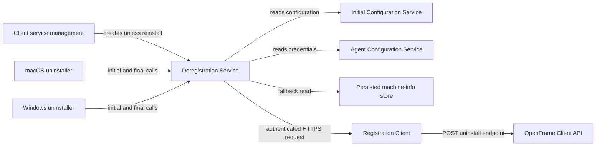
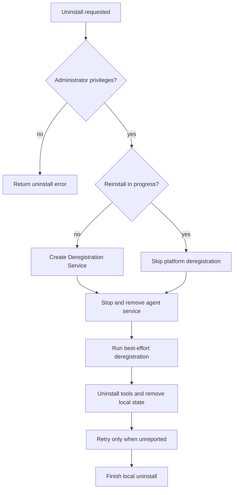
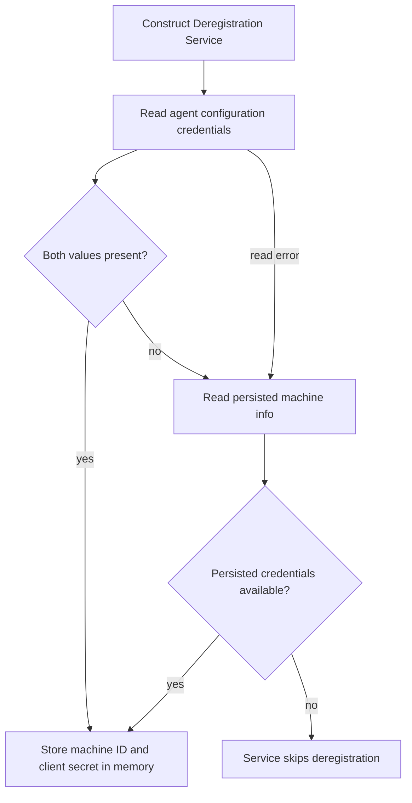
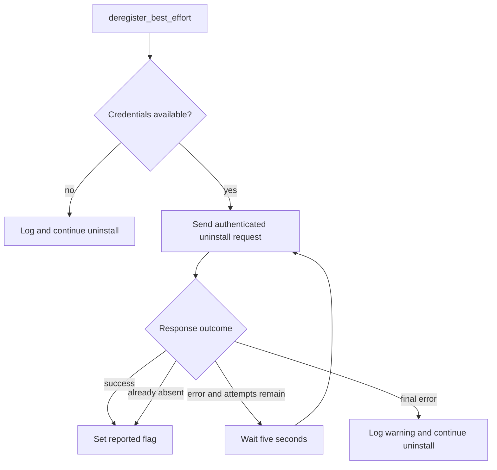
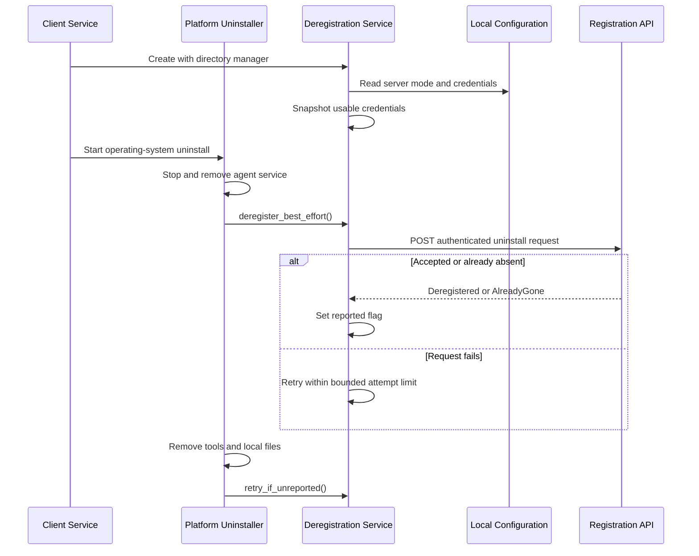

# Deregistration Service

The Deregistration Service is the OpenFrame Client agent's uninstall-reporting boundary. Before local uninstall removes the agent's files, it makes a bounded, best-effort authenticated request to tell the platform that the machine has been removed. A reporting failure never prevents the local uninstall from completing.

The implementation is supplied by the `openframe_agent_lib` artifact from the OpenFrame OSS Library and runs with this repository's OpenFrame Client deployment. Its source is [`deregistration_service.rs`](https://github.com/flamingo-stack/openframe-oss-lib/blob/16e7c1cbd9664e7d10ec5ebca7d53c9bd314decf/clients/openframe-client/src/services/deregistration_service.rs).

## Responsibilities

- Construct an isolated HTTP client and registration API client from locally stored configuration.
- Load machine credentials before cleanup so a final retry still has the machine identity after local files are removed.
- Report removal through the registration API using the machine identifier and client secret.
- Retry transient failures within a strict time budget, then continue uninstalling regardless of the result.
- Treat an accepted deletion and a platform response indicating the machine is already absent as successfully reported.
- Avoid platform deregistration during a reinstall, preventing an in-place replacement from deleting the machine record.

The service does **not** delete files, stop the operating-system service, or uninstall integrated tools. Those operations belong to the platform uninstaller and are deliberately sequenced around deregistration.

## Position in the Uninstall Architecture

The service is created by the client service-management path after administrative privileges have been checked. The platform-specific macOS and Windows uninstall flows stop and remove the agent service first, call the Deregistration Service, remove tools and local state, then make a final report attempt when needed.



### Uninstall Sequencing

Stopping the service precedes deregistration. This prevents the stopped agent from emitting a heartbeat that could make a just-deleted machine appear active again. Both operating-system flows preserve this ordering.



A construction failure is logged and causes the caller to proceed without a Deregistration Service. Likewise, missing credentials cause the service to skip reporting rather than interrupt the uninstall.

## Construction and Dependency Boundaries

`DeregistrationService::new` takes a `DirectoryManager` and derives every runtime dependency from it:

| Dependency | Purpose in deregistration |
|---|---|
| Initial Configuration Service | Reads the configured server host and whether the client runs in local mode. |
| Agent Configuration Service | Retrieves the registered machine identifier and client secret from agent configuration. |
| Persisted machine-info store | Fallback credential source that can survive a partial local wipe. |
| HTTP client | Applies a 15-second request timeout, disables proxy use, disables idle connection pooling, and accepts invalid certificates only in local mode. |
| Registration Client | Owns the API-specific request construction and response classification. |

The service formats the configured server host as an HTTPS base URL. The HTTP client uses `no_proxy`, so deregistration is attempted directly rather than through environment-configured proxies. Disabling per-host idle pooling avoids relying on a reusable connection during a process that is shutting down.

### Credential Snapshot

Credential loading happens during construction, not at the moment of the last request. The primary source is the agent configuration's `(machine_id, client_secret)` pair. Both values must be non-empty after trimming. If that source is unavailable, empty, or unreadable, the service reads `PersistedMachineInfo` from the machine-info store. Read errors from either source are logged and result in no report when no usable fallback exists.



The in-memory snapshot is intentionally retained after cleanup begins. It provides the credentials required by `retry_if_unreported` even if the corresponding on-disk records have been deleted.

## Platform Request Contract

The Registration Client sends an HTTPS `POST` request to the following path relative to the configured server:

```text
/clients/api/agents/uninstall
```

The request supplies these authentication headers:

| Header | Value source |
|---|---|
| `X-Machine-Id` | Persisted machine identifier |
| `X-Client-Secret` | Persisted client secret |

It also includes a JSON body with a `deletedAt` timestamp in UTC, formatted with microsecond precision. The body is included because the client implementation documents that an upstream load balancer rejects body-less POST requests; the backend uninstall contract itself does not require this data.

The client-side Registration Client classifies outcomes into `Deregistered` for successful HTTP statuses and `AlreadyGone` for status codes that mean the platform no longer knows the machine or does not expose the uninstall endpoint. Both outcomes mark the report as complete. Other non-success responses include the response body in an error, while transport errors are surfaced to the retry loop.

## Attempt and Retry Behavior

`deregister_best_effort` is the normal entry point. It returns without an error to its caller in all outcomes: no credentials, success, an already-absent platform record, transient failure, and exhausted retries. Errors are retained in logs for operational diagnosis.

Each invocation uses up to three attempts. Between failed non-final attempts it waits five seconds. Each HTTP request is limited to 15 seconds, so reporting is bounded and cannot indefinitely block removal of the local agent.



The service maintains an atomic `reported` flag. A successful or already-gone response sets the flag with release ordering. `retry_if_unreported` reads it with acquire ordering:

- If a prior call reported successfully, the final retry returns immediately.
- If credentials are absent, the final retry returns immediately.
- Otherwise, it runs the same bounded three-attempt routine once more.

This means the final retry is a recovery opportunity rather than an unconditional duplicate request. It is invoked after most cleanup on macOS and before Windows schedules its process-exit cleanup script.

## Component Interaction



## Operational Considerations

- **Best effort by design:** The client prioritizes local removal over server reachability. An unreachable server, invalid response, or exhausted attempts produces warnings but does not roll back cleanup.
- **Idempotent completion:** A platform response that the machine is already gone is considered a completed report. This handles repeated removals and backend state that was removed before the client request.
- **Reinstall protection:** The service-management entry point bypasses service creation when the reinstall environment marker is set. A reinstall must preserve the platform machine record.
- **Credential handling:** Machine credentials are carried only as long as the Deregistration Service exists in memory and are used solely to authenticate the uninstall request. Avoid logging their values.
- **Local development:** Invalid TLS certificates are accepted only when initial configuration marks the client as local mode. Production-mode certificate validation remains enabled.
- **Diagnostics:** Inspect agent uninstall logs for initialization failures, absent credentials, per-attempt request failures, and the terminal report outcome. The relevant messages distinguish skipped reporting, retries, success, already-absent acceptance, and exhausted attempts.

## Maintainer Checklist

When changing this module, preserve these behavioral invariants:

1. Do not make platform deregistration a prerequisite for local uninstall completion.
2. Keep credential acquisition before destructive cleanup, including the persisted-store fallback.
3. Keep service shutdown ahead of the first deregistration attempt.
4. Preserve the reinstall bypass.
5. Ensure every request remains bounded by a timeout and every retry strategy has a finite limit.
6. Treat a server-confirmed absence as completion, not a retry condition.
7. Keep the final retry conditional on the atomic reported state so a successful report is not repeated.
