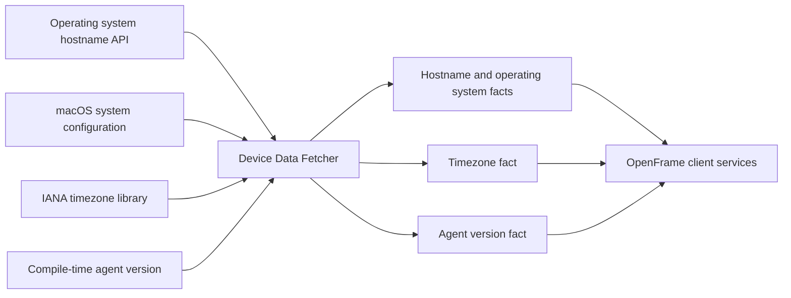
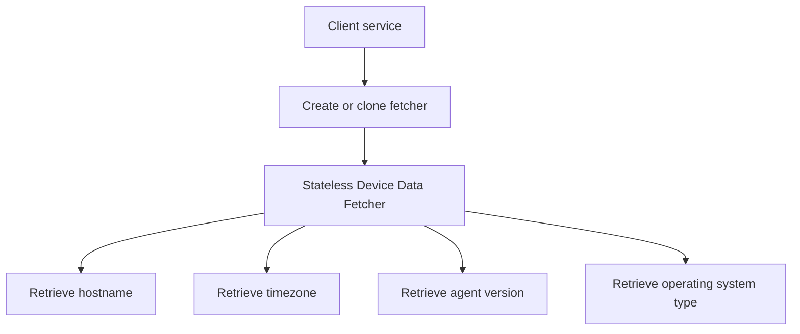
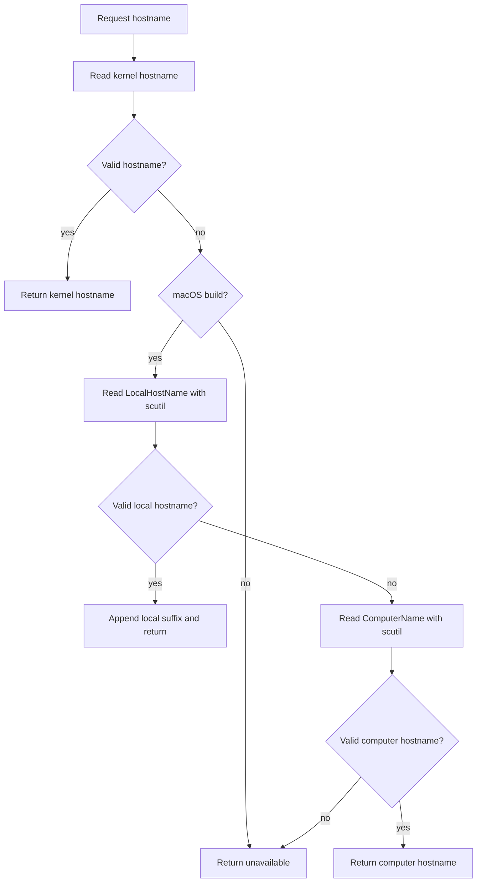
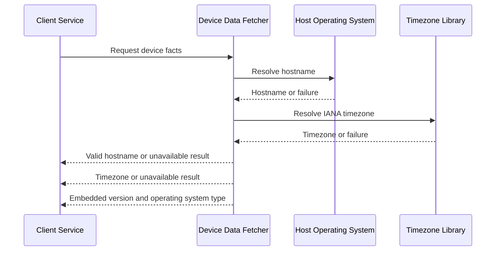

# Device Data Fetcher

Device Data Fetcher is a small, stateless service in the Rust OpenFrame client agent. It reads four pieces of local machine identity and environment data: hostname, IANA timezone, agent build version, and an operating-system classification. The module is implemented by the `openframe_agent_lib` artifact supplied by the OpenFrame OSS Library and runs as part of this repository's OpenFrame client deployment.

The implementation source is maintained in the OpenFrame OSS Library: [device data fetcher source](https://github.com/flamingo-stack/openframe-oss-lib/blob/16e7c1cbd9664e7d10ec5ebca7d53c9bd314decf/clients/openframe-client/src/services/device_data_fetcher.rs).

## Responsibilities

- Construct a cloneable, zero-state fetcher.
- Resolve a useful hostname while rejecting empty values, IP addresses, and loopback-style hostnames.
- Obtain the local IANA timezone when the platform can provide it.
- Expose the compile-time `OPENFRAME_VERSION` value as the agent version.
- Report the operating-system category expected by the current implementation.

The module does not persist data, call the network, publish messages, or decide when reporting occurs. Its callers own those responsibilities.

## Position in the Client Agent

The fetcher is a local information boundary: platform APIs and compile-time metadata enter on one side, while higher-level client services receive normalized string values or an unavailable result on the other. The surrounding client contains dedicated hostname, timezone, heartbeat, registration, and messaging services that can use such device facts when assembling their own messages.

## Public Operations

| Operation | Result | Behavior |
|---|---|---|
| Constructor | Fetcher instance | Creates an empty `DeviceDataFetcher`. The default implementation delegates to this constructor. |
| Hostname retrieval | Optional string | Uses the kernel hostname first, validates it, and on macOS tries additional system configuration values if needed. |
| Timezone retrieval | Optional string | Reads the system timezone through the IANA timezone library. |
| Agent-version retrieval | Optional string | Returns the `OPENFRAME_VERSION` value embedded at compile time. |
| Operating-system retrieval | String | Returns `WINDOWS` for Windows builds and `MAC_OS` for every other build target. |

All data-access operations take an immutable reference. Because the type has no fields and derives `Clone`, callers can safely hold independent fetcher values without synchronization or shared mutable state.

## Component Design

### Construction and Lifetime

The fetcher has no configuration, caches, or external clients. Construction therefore cannot fail and does not perform I/O. The default trait implementation calls the normal constructor, keeping explicit and default construction semantically identical.

### Hostname Resolution

Hostname retrieval is defensive because a hostname becomes device identity data. The primary source is the hostname exposed by the operating system. The returned value is converted lossily to text and trimmed before validation.

A hostname is accepted only when it is non-empty, is not parseable as an IP address, and is not `localhost` or `localhost.localdomain`, case-insensitively. This prevents placeholder and address-like values from being represented as a meaningful device name.

On macOS only, primary resolution failure or rejection activates ordered fallback lookups through `/usr/sbin/scutil`:

1. Query `LocalHostName`, append `.local`, then validate the resulting name.
2. Query `ComputerName`, then validate it.
3. Return no hostname if both candidates are unavailable or invalid.

On non-macOS builds, there are no fallback commands. An unsuccessful or invalid kernel lookup returns no hostname.

Failures of the operating-system lookup or macOS command are logged as warnings. Successful source selection is logged at information level, including the selected hostname.

### Timezone, Version, and Operating System

Timezone collection delegates to the IANA timezone library. A successful lookup returns its value and produces a debug log. Failure produces a warning and returns no value, allowing higher-level reporting code to choose how to handle missing timezone data.

Version retrieval is deterministic at runtime: the build process supplies `OPENFRAME_VERSION`, and the fetcher returns that embedded value while logging it at information level. This function currently wraps the value in an optional result even though the embedded compile-time value is always present for a successful build.

Operating-system retrieval is compile-target based rather than a runtime probe. Its present two-way rule is significant for maintainers:

- Windows targets return `WINDOWS`.
- Every target other than Windows returns `MAC_OS`.

Consequently, support for an additional target requires revisiting this classification before relying on the result as authoritative platform inventory.

## Data Flow

The fetcher normalizes each source independently. It never combines the values into a report, and unavailable hostname or timezone data does not prevent retrieval of version or operating-system data.

## Error Handling and Observability

The module makes absence explicit for operations that can fail due to local environment state:

| Data item | Failure behavior | Log level |
|---|---|---|
| Hostname | Tries applicable fallback sources, then returns no value. | Warning for failure or invalid candidate; information for a selected candidate. |
| Timezone | Returns no value. | Warning for failure; debug for a successful value. |
| Agent version | Returns the embedded version. | Information. |
| Operating system type | Returns a compile-target category. | No log emitted by this operation. |

Logging does not alter the return path. Consumers should treat absent hostname and timezone values as expected recoverable conditions, rather than assuming that local environment discovery always succeeds.

## Maintainer Notes

- Preserve hostname validation whenever adding new sources so fallback sources cannot reintroduce loopback, blank, or IP-address values.
- Keep macOS fallback ordering intentional: the local hostname is converted to a `.local` name before validation, while the computer name is returned unchanged.
- The macOS command location is fixed to `/usr/sbin/scutil`; command launch failure, non-success status, empty output, and invalid text all advance the fallback path.
- Treat the operating-system result as a protocol value. If Linux or other targets are introduced, add an explicit category and coordinate any consumers that interpret the existing values.
- Ensure build configuration provides `OPENFRAME_VERSION`; the Rust compile-time environment macro requires it during compilation.

## Dependencies and Boundaries

| Dependency or boundary | Purpose in Device Data Fetcher |
|---|---|
| `hostname` crate | Provides the primary operating-system hostname lookup. |
| IANA timezone crate | Supplies the current system timezone. |
| Rust compile-time environment | Supplies the agent version. |
| macOS `scutil` utility | Supplies macOS-only hostname fallback values. |
| Tracing | Emits debug, information, and warning diagnostics. |

The implementation itself belongs to the OpenFrame OSS Library rather than this repository. This repository consumes the library as `openframe_agent_lib` version `v0.0.5` and deploys the client runtime that executes it.
